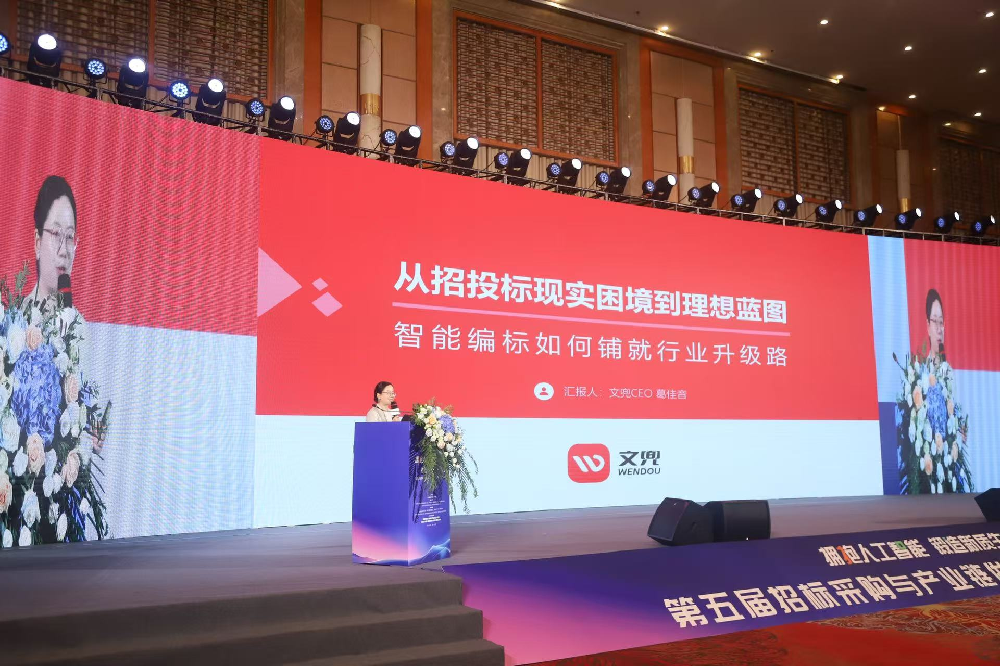
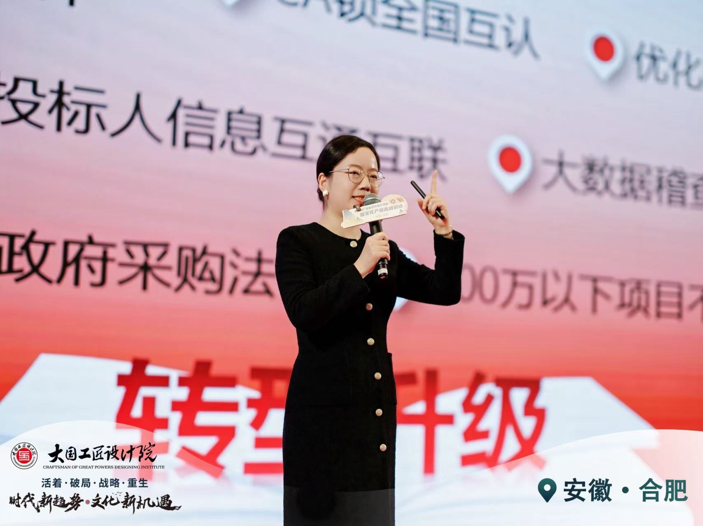

## T变革场景：终局预判

### 快速认识

“变革”这个词是不是听着有点陌生？我们英文找了一个比较准确的单词：**Transform (Transformation)**。翻译成中文是：**使彻底改观；使大变样。**

如果前面的R是给老车换个好轮胎；T是直接造一架新飞机。

不只是简单的降本增效，提升收入和利润，而是用AI不断提升上限，实现很多之前没有的东西，大幅提升AI在业务里的价值。

这个就是不是简单的“AI解放人工”这么简单，而是实现很多之前人根本做不到的水平和量级，甚至用了AI原生的能力，做了很多全新的产品和体验。

前面AI是实习生，合伙人，员工，那最后这个一个区间，AI是什么价值和角色呢？hh，大家有什么感受，大家可以猜猜看。

### 看案例提见识

这是一个通过AI转型的案例，主角是一家专注于**投标服务的公司，叫“文兜”**。 年营收几千万，生意做得很稳，但CEO葛佳音（一堂MBA 学员），决定用AI“革自己的命”。

招投标这行，水深、事苦。动辄几百页的标书，格式要求极严，一个错别字就可能废标。 

葛同学决定，要用**AI来“写标书”**。 她要打造行业里第一个“AI写标书工具”。当时主营业务还在增长，大家不理解为什么启动 AI 业务，内部阻力很大。 

为什么她还是要改变？

因为她观察到**个性化满足标书需求的人力成本会越来越高，传统标书业务未来会被 AI 颠覆的强烈危机感。**

在标书行业，当前是大模型大规模商业应用的黎明。做真正符合用户需求的AI 驱动的标书服务，是他们的机会。

她把原来写标书模板的内容团队，拉去测试 AI 工具。 导致一些老业务，业绩都出现了下滑。 最夸张的时候，**一天之内离职了6个员工。** 大家都觉得，AI要来替代我们了。

但葛同学顶住了压力，她知道AI的价值。 她也很清楚，通用大模型直接拿去写标书，肯定不够。 所以，他们做了大量“软件工程”来弥补。

围绕着标书行业最重要的三个场景，他们打造了三项核心功能： 

- 首先，“文兜智写”，一键解析招标文件，图文并茂生成标书；
- 其次，“标书扩写”，根据参考文库、原始材料，辅助标书扩写技术标/商务标；
- 最后，“标书检查”，专门抓错别字、错误格式。

另外，过去 10年的积累，他们有了一个行业最大的专业文库“采购文件网”，10万+投标方案，100万+行业资料。 这是她们的行业Know-How，AI没有的。 

大家再理解一下，这不只是一个AI工具， 这是一个“AI+行业知识库+工程能力”的组合拳。

这个新产品，给公司带来了第二增长曲线。

> 针对个人（ToC），按字数 1万字 6元 ，弹性收费；

> 针对中小企业（ToB），包年服务，年费 4999元；

> 针对大企业（ToB），私有化部署，项目制，10万元起；

这个AI新业务，**一年就做到了千万级营收**。 更重要的是，它重塑了各个部门，很多岗位发生了很大变化。

- **客服团队**：70%的工作被解放了。 比如开发票，以前动辄沟通半小时，现在表单+AI搞定。他们没被裁，反而工资涨了，因为他们开始做“教客户用AI”的高价值工作。 
- **文案团队**：部分人擅长提示词，设计 Agent来输出标书，赋能整个团队；部分人擅长创新，引导往 AI 产品经理转型，能独立出 Demo。
- **技术团队**：转型成了“AI工程师”，开始用 AI 写代码，大幅提高了编程速度，努力追求AI 代码比例。

他们还跨部门成立“**智能体创新小组**”、“**AI 研究院**”；在公司内**组织AI创新大赛**，鼓励公司每一个人提出 AI 想法、用 AI 拿到结果，现场发现金，没有压力地用 AI，做成了公司团建活动。

这个案例，是“AI场景落地”的绝佳范本，让每一个员工不再担心技术会不会取代我，都能进行赋能式创新，用 AI 更好服务客户，带来更好的口碑和品牌，他们的使命是：帮助投标参与者有更好的生命状态。

它不是一个“小工具”的胜利。 它是一家企业，用AI重塑了核心竞争力，拥有了活得足够好的未来。

回到我和一堂，这一年在T这个象限的探索：

我们一直在思考一个问题：当AI成为所有人的基础设施，模型足够强，足够便宜，大家成熟度足够高，那么创业服务和教育市场会变成什么样呢？

我们推出了**YAI**，一个基于科学体系的AI产品，可以以TCPR的方式给大家提供专业辅导，提供教学专家、教练专家、实践专家和建模专家，帮大家训练科学做事能力。

这大概率不是最终的产品，但是我们积累“理论AI化”最重要的训练和演习场，我们可以不断建模、不断封装partner、不断理解AI for Business的最佳实践。

我们内部还在探索AI更加原生的笔记产品（WriteLess），AI元工作台（Workspace-Creator），AI决策本体树（OneLifeTree），这些都会成为探索“**下一个一堂**”的一部分。

这种案例非常多，比如徐剑大哥，在不断探索“企业经营数据”，不断从数据系统、到标签系统，再到本体系统，一直在攒牌，在构建未来的那个可信任的企业数据经营系统。

比如贺雷，一直在构建AIx医疗的原生AI组织，从研发、营销到管理，再到BossAI，一直在攒牌，试着构建国内领先的一套AI原生组织。

### 背后的专业度

到这一层，就不是简单的某一两个场景、环节使用AI，而是从底层的公司基础设施、HR制度、团队分工，完全AI化融入，打造一个人和AI高效协同的新公司。

不只是简单一两个点，而是全面部署AI；

不只是已有能力提效，而是建设新能力。

AI这个阶段，核心的角色是：

一共还是有四个关键词：
1. **大牌：**这不简单的几个实习生，一个员工，而是一个综合能力。
2. **宏大商业目标**：这是组织视角，如果你长期想做一个足够牛足够大的生意才需要。
3. **竞争**：这是相对的，你能和同行能不能拉开身位领先。
4. **胜负手**：这是决定成败、战略级别的选项。

我们再看一下这张图：

这是面向未来的，用AI提升一个公司的上限，这个象限往往都是**一号位工程**，一号位如果不能形成笃定，是很难推动和落地的。

具体的思考原则是什么呢？给大家一句心法：

试着努力目标放长远，不管是前端价值侧，还是后端成本侧，哪些环节可能存在10倍级别的质变的可能性？AI能不能把某个环节的能力放大10倍、甚至100倍？

比如，有游戏公司在探索游戏AI化，里面的**NPC甚至情节设计，可以做到千人千面**，根据不同玩家的个性化需求来实时生成，整个游戏的体验会有一个量级上的上升。

比如，有一堂同学在探索“**实时语音互动教学**”，如果部署到教育公司，有机会把课程变成“个性化讲课、实时互动版本”，对于学习体验的提升可能是十倍量级的。

把原来的成本指数级下降，把原来难以人工提供的专业服务，十倍速上升，大幅提升用户用户体验，断代式地提升产品转化率和留存率。

以基本的商业常识判断，随着逐步降低人工、增加数据规模效应，未来各个新的细分赛道会越来越集中，有机会诞生更多细分赛道的领先公司。

这个区间的场景，非常考验战略眼光的长度，以及对于AI底层原理的理解，如果在前面的A、S、R三个区间都做的还不错，最后可以来到T这个区间，进入决赛圈争取最后的一个更大规模的胜利。

期待未来3-5年后，在一堂体系里，跑出来越来越多AI变革的优秀公司出来吧：）

