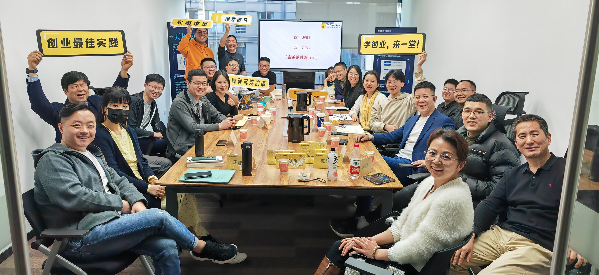
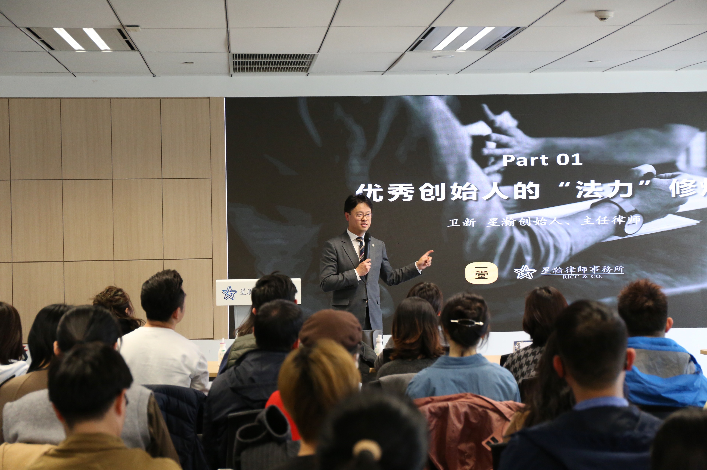
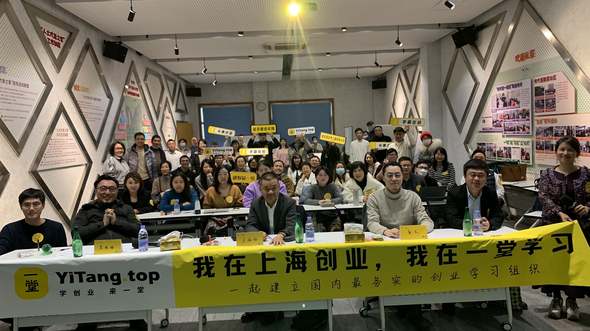

## **一堂活动信息💡**

### 城市活动招生

**【🙋🏻‍♀️互动】**已经来到直播间的同学，扣一下你所在的城市吧~

**【🙋🏻‍♀️提问】**还有同学还没进城市群吗？

来来来，新同学别迷路，先自己找一下组织。以后所有的城市活动都会在城市群内和大家同步。

**【🙋🏻‍♀️互动】**还有没进城市群的同学，**评论区扣口令，班班下周拉你进群。**

大家扣口令，陆续班班会拉大家进群。

### 💃🏻城市活动

📹 8_1681191996.mp4

### 读书俱乐部

2021年8月，我们发起了一堂首个兴趣俱乐部「读书俱乐部」，聚焦商业类书籍的专业深度拆解，**致力于将读书融入创业。** 目前群内聚集了一批喜欢读书、坚持输出、爱交流的书友们，除了日常好书/读书笔记分享之外，**每周二晚8-10点，**会定期举办拆书会。

主理人是一堂品牌顾问、一堂优秀学员水水，她来牵头带大家每周拆解一本商业相关的好书。

截至目前，读书俱乐部已经解读了**224本商业/创业相关书籍**（有文稿/无回放），会员同学可以免费学！

你是不是也困惑：读了很多书，却总觉得用不上？其实问题往往不在读得少，而在读的方法。

本期拆书，薛伟老师拆解了《如何精读一本书》，分享了刘澜的精读方法：在书的前后文之间、书与书之间、书与自己之间建立三个联系，带我们把一本书真正读透：先读懂作者，再读出自己！

这不仅是一场关于“怎么读书”的方法分享，更是一次帮你把读过的书，变成自己判断力的训练！

**回放&文稿&作业入口，**都在「读书俱乐部」群公告里啦！

**【🙋🏻报名】**还没进「读书俱乐部」的同学，可以直接私聊玖月班班口令：**加入读书俱乐部**

AI 俱乐部

**2023年4月的会员日，我们发起了一次招募，应对ChatGPT带来的冲击。**

> **原定招募目标**：**俱乐部成员x1000、观察员x100、研究员x10。**

> **最后实际报名：**

> 1500+个**俱乐部成员**，大家进来学习、吸收信息、听分享。

> 500+个『**观察员**』，持续学习、持续思考，通过定期作业的形式，每个月提交自己的新认知、新观察、新案例发现。

> 100+个『**研究员**』，大量阅读和吸收信息，定期整理、归纳、汇总，变成工具集和武器库，甚至我带着大家尝试萃取了一些模型和方法论，指导我们的AI预判工作。

**我们筛选出了很多背景非常不错的同学加入研究员行列。**

> 乔同学，清华大学工学学士(自动控制)、清华大学理学博士(生物信息学)，在算法研究等多学科都有产研经验

> 韩同学，华为云数据中心解决方案架构师，有自己的团队，已经落地实际应用

> 王同学，在纽约高盛做投行，专注前沿领域初创公司融资，研究量子计算、自动驾驶等领域

> 林同学，国家级机构元宇宙顾问团队，有自己的研究落地

> 徐同学，中科院工科博士，在持续研究AI领域，近期关注AIGC和ChatGPT

> David，美国加州大学统计硕士，研究NLP，machinelearning，AI相关

> 周同学，美国统计博士，在美国工作曾参与推荐系统AI研究

> ……

到现在已经有**5000+**的同学加入，共同探索人工智能的实践落地。

**【报名🙋‍】**欢迎大家正式报名，直播间评论区扣口令：**加入AI俱乐部**

> 明后天陆续拉群；错过可以在会员群or私发玖月班班口令加入；

为了和大家一起加速学习和使用AI，我们决定**把一堂使用AI的真实场景，给大家分享出来**。给大家看看我们是怎么用的，给一个参考借鉴的例子，所以就有了**一堂AI落地Live。**有几个特点：

- **真实性**：颗粒度有大有小，但都是真实场景，真实落地；
- **易用性**：从入门、到进阶和高阶，都尽量体现，覆盖各个层面的同学；
- **开放性**：你有什么想学的能力，抛出来，我们一起学；我们讲的不好的，你来纠正。

两年时间分享了49次，**每周三晚进行**，俱乐部的同学一定要关注群消息。

整个分享受到同学们很多的正反馈，确实给了大家一些落地AI的思路。

每周三晚上8点，AI落地Live分享，大家可以关注一下。

再重复一下，还没加入AI俱乐部的同学。

**【报名🙋‍】**欢迎大家正式报名，直播间评论区扣口令：**加入AI俱乐部**

### 私董会俱乐部

一堂私董会，起源于**一堂的同学相互梳理问题、学以致用**。

一堂同学往往：**有信任度，共同话语体系，务实开放，乐于分享。**

∴ 要围绕一堂展开：选课/学分/作业案例。

一堂是问题驱动的：**学习核心认知和方法论 - 解决问题 - 少走弯路。**

∴  不能太泛化：围绕创业/商业/团队问题展开。

进入私董会俱乐部的同学，都追求实事求是、知行合一，而且真诚互助。

**淋过雨，愿意为彼此撑伞；**

**踩过坑，愿意找自己盲区。**

至今我们共建了不少场，**面向大会员**的**“全国开放旁听”的**私董会直播：

> 全国C级直播累积**75**场，**210位**优秀幕僚同学参与现场讨论

> **2.3W+**人次同学旁听，提交互助建议作业**1w+**份。

只要是**大会员学籍以上同学，联系班班，就可以加入私董会俱乐部群，**

每场私董会的介绍信息、旁听链接和快闪活动，**仅限进群的同学才能看到。**

**【🙋🏻口令】**还没进「私董会俱乐部」的大会员同学，可以私聊**玖月**班班入群，或直接扣口令：**加入私董会**

**🙋🏻如果你有创业难题，只要是大会员同学、学分90以上、产品有数据，可免费报名案主；**

**👇官方帮忙梳理和匹配幕僚，上百名同学会给你支持！**

