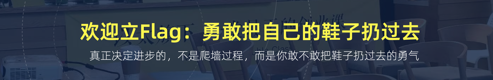

## 开始上课

Hello，大家好啊，

我是Truman，许久未见~~

欢迎大家回来继续（来到）上课，进入**本周末的成长加速时间**。

这是我的介绍，如果直播间有新人的话，自己读一下吧：
> 1. **以太一堂CEO：**2016年加入以太创服，现为合伙人，兼一堂CEO。
> 2. **前美团产品专家：**擅长从0到1业务探索、产品快速起盘、商业分析。
> 3. **一堂课程总设计师：**研发100节创业实操课，收到50万份创业训练作业。
> 4. **曾创办“易项直通车”**：资本对接平台，帮助100+项目融资成功。

**【热场🙋‍♂️】**来来来，我们热个身吧哈哈，这次课题比较特殊，我们一起努力畅想、许个愿吧，如果未来（某月某年）能把一堂的某个方法论/工具/模型转化成一个一堂Agent，直接辅助我们工作，甚至替我们解决问题，你希望是哪个工具？

————

过去两年，我在线上线下各个场合，收到了不下100条各种“呼声”：一堂的AI课呢？同行的各种课都卖疯了，一堂怎么这么稳得住？Truman你咋还不下场？再不做课，我就买同行的课了啊哈哈哈。

大家知道，一堂还是想做长期正确、科学体系的事情，不太喜欢追热点和凑热闹，我们更喜欢在足够大量的案例和事实里，寻找背后的模型和规律，然后推动上万同学集体进步和成长。

过去两年，我们一直在探索和各种收集案例，在于陆和宜骄的带领下，我们用“AI俱乐部”的方式，累计招募了120+专家，做了70+场分享，收集了300+各种案例，收了3500+份AI相关作业。

让子弹飞了两年，终于到了2025年中，随着国内基础工具成熟、随着各个公司实践案例稳定涌现，我们判断拐点到了，是时候到一堂出手了，坐稳扶好，下面我正式宣布：

**一堂AI教研正式全面启动，我来作为主理人，以最佳实践级别的必修课为追求，开始启动系列课计划。**

从入门认知课（重新理解）到系列实操课（10-20节），从千人广场专家组到AI能力基本功化，从最佳实践开源库到一堂千人大航海计划，甚至我们打算带领500+同学一起探索一堂课程Agent化。

哈哈大家是不是开始期待起来了？别急，Dream Big，Start Small，再大的愿景也得从一个基础的、入门的框架开始，这节课就是一堂正式的《AI第一课》。

过去两年，宜骄和于陆分别代表“AI俱乐部”试讲过两轮，今天终于交到我的手上，正式升级成一堂的必修课，这节课叫做**《重新理解“人工智能”》**。

### 为什么要学

作为一堂正式的AI第一课，我们主讲什么呢？

“人工智能”是一个巨大的、工业革命级别的变革，这个已经变成大家普遍的共识了。但我们发现市场上关于AI的两极分化非常严重，各种声音和观点满天飞，各个领域、各个角度，从技术专家到日常使用，从复杂技术原理到大公司All in AI，我们发现三类普遍的问题：

**第一类：还没有真正入门。**很多人看到了市场上大量“十倍速提升”和“AI赚钱”的案例，担心自己会落后，也会偶尔和DeepSeek对话和聊天，但一直没有找到自己的“超高价值AI”环节。

**第二类：拿到结果但认知很碎。**有些同学开始用Coze实现了复杂的智能体，大幅提升了效率，但脑子里对于整个AI一直是碎片理解，缺少一个系统的认识和理解。

**第三类：无法平等对话。**AI太新了，很多概念、产品、工具层出不穷，新事物太多，共识太少，这就导致了在公司里，俱乐部里大家讨论的AI很难同频，根本不在一个频道上。

这一节必修课，我会基于数千份作业、数百个AI落地案例，试着提出一堂我们的模型，一来帮助大家建立全局认识，二来形成初步共识，就像一堂五步法的价值一样，未来大家可以一起深度探讨、协作、甚至组队创业。

说明：这不是一节定位“具体实操”的课，在座的AI专家请把侧重点放在一堂的集体审美和集体建模上，给大家一个完整的思考框架。

### 预热思考题

来来，照例，给大家两个预热思考题吧：

**第一个题目：极限见识题。**

AI在公域（短视频/文章）中出现的大量所谓“AI牛掰案例”往往只是实验产品or大玩具，真正有效、值得长期使用的不到10%，甚至1%，真正有效的落地案例极其稀缺。

你过去在身边、在俱乐部，见识过多少个真正有效的AI落地案例？小到一个高价值的提示词，中到一个优秀的智能体，大到一个AI独立的创业项目，能想到多少个？5个？10个？30个？100个？

**第二个题目：人类稀缺性题。**

最近很多人都在宣扬一种声音：AI爆炸，未来人类的工作会陆陆续续被AI替代，人类的工作没有价值了。这种声音导致越来越多人开始焦虑和恐慌，甚至开始怀疑自己专业存在的价值了。

但你有没有想过一个问题，有了AI，人的专业性真的就不重要了么？假设两个人的提示词、智能体的水平差不多，为什么不同人调试的Agent水平差异极大？

未来5-20年，随着AI的快速普及，对于我们商业管理、创业者来说，最稀缺的能力是什么？在人工智能时代，我们拼的到底是什么？

这两个问题非常重要，尤其第二个很本质，你可以试试说说你的答案，等到今天课程结束，希望你能有一个全面的、系统的认识，可以让自己的做事更笃定。

### 提前划重点

提前划一下重点，大家不要迷路，今天我会讲4个话题：

**第一部分：建立体感。**很多同学过去两年没有机会看到大量的AI实际落地案例，我先给大家快速扫描30-50个真实的落地案例，大家先找找体感、见识下同学们的阶段性最佳实践。

**第二部分：全局理解。**AI太大了，它不只是一个行业，而是像“互联网”是一代系统变革，我试着给大家一个AI全局思考的地图，这张地图有十年稳定性，可以帮大家和各路专家、选手平等对话和协作。

**第三部分：依次拆解。**沿着这张地图的层级，我会依次给你讲讲每一层是什么、重点是什么，以及未来的3个月-3年，我建议你该如何加速学习和进步。

最后：重新理解“人工智能”，我给大家讲讲我对人工智能的底层理解。

为了避免大而无当，为了避免无异议的分歧和争论，我先说一下这节课**研究的边界**：
1. 我们这节课基于大语言模型/生成式AI为基础的人工智能，垂直类AI/NLP具体应用不在讨论范围之内。
2. 这节课立志于做一堂“万人可学”的AI，不会展开具体的技术算法、策略（后续课程展开）
3. 市场上很多概念各家都不太一致（尤其是Agent），我们默认采用更加兼容的“广义的版本”，避免无意义争论。

如果你是AI专家 or 深度实践者 or 海外同学，你可以把重心放在理解一堂、兼容一堂，未来可以使用共同的话语体系，和大量一堂同学深度讨论和组队实践。

特别感谢下，这节课是集体成果。教研组在线上访谈了多位专家同学，大家给我们贡献了很多的**实践经验和技巧**。

而且我们收到了同学们将近十万字的共建作业，里面的很多故事和图片，也融入了这节课里。

**【毛遂自荐🙋】欢迎大家主动报名“学习委员”，谁愿意？**在评论区扣一个：**我愿意**

> 请大家积极报名学习委员，提升上课质量、班级群氛围、督促选课和互帮互助。

**"翻过一个墙，最好的方式，就是先把自己的鞋子，勇敢扔过去"**

来来来，希望大家一起立一个Flag（承诺），认真听课吸收，最后完成这次训练作业。

扣四个字吧：**一定作业**

> 我们正在持续升级作业陪伴&督促服务，口令代表有更高配的周末学习服务：）

**【划重点💡】**欢迎大家勇敢一点承诺，这四个字代表：
1. **给自己的一个预期：**把这个收录进你的10年进步练习清单。
2. **倒逼自己一定进步**：提高优先级，帮你排除杂念进行学习。
3. **享受更高配的服务：**更完备、更好的班班周末督促服务：）

哈哈哈，欢迎大家**一定作业**，未来在这个课题上，持续享受持续进步的滋养和复利。

讲案例前，我们先来热个身吧：

最近一年，你用AI做过最有价值、最深、最想晒的一个案例是什么？最难、最高价值的案例晒一个吧~

**【划重点💡】**欢迎大家来造个句：**我用AI________________**

举几个例子：
1. 我用AI给每个课程做了主题曲
2. 我用AI做了工业化服装选品。
3. 我用AI做了一个年会视频。
4. 我用AI做了一个个人网站。
5. 我用AI用实习生替代了初级程序员。
6. 我用AI做了一个“智能工牌”项目
7. .....

哈哈哈，大家勇敢写，教研同学努力收集线索啊，多多进货：）

OK，进入第一个话题。