# 一堂少年版课程共创方法论 · 课程文档（01-17）

> 本文档由 17 张网页课程长截图（01~17，含 3 张独立素材图：逐字稿1、逐字稿2、表达力火箭模型）转录整理而成。**正文文字逐字转录**，截图中的横幅、课题卡、思维导图、表格图等视觉元素已从正文中分离，单独存放于 `images/` 文件夹，并在原位置以相对路径引用嵌入。整个文件夹拷贝到 Obsidian / Typora 等 Markdown 工具即可正常显示。
>
> 整理原则：
> - 讲课正文逐字转录，保留原本的口语表达（含 hhhh 等原样语气词）
> - 原文强调与标签尽量保留（如 **加粗** 语义、✗/✓ 对例、【互动🤦‍♀️】标签）
> - 截图中的图片只保留图像本身，alt 文本为简短提示，不复述图内文字
> - 页面水印（周磊 / Captured by Longshot / 以太旗下 uble Class）与平台 AI 推荐尾巴（17 页底部）不转写
> - 个别章节标题为整理者概括（03 节「商业素质方向·15个课题的魂儿」系承接 02 页原文两处短语「商业素质方向」「把15个课题的原始魂儿讲准」而成，原文该页以「课题1：一堂五步法」开头）；其余章节标题均为原文真实出现文字

## 目录

- [01 提前划重点](#01-提前划重点)
- [02 第一类难题：选定课题](#02-第一类难题选定课题)
- [03 商业素质方向·15个课题的魂儿](#03-商业素质方向15个课题的魂儿)
- [04 看见未来方向](#04-看见未来方向)
- [05 学习提速方向](#05-学习提速方向)
- [06 第二类难题：进行转译](#06-第二类难题进行转译)
- [07 技巧1：宽而不泛](#07-技巧1宽而不泛)
- [08 技巧2：研究before/after](#08-技巧2研究before/after)
- [09 技巧3：干货点清单](#09-技巧3干货点清单)
- [10 技巧4：巧用AI工具](#10-技巧4巧用AI工具)
- [11 第三类难题：线上交付](#11-第三类难题线上交付)
- [12 技巧1：ABACC](#12-技巧1ABACC)
- [13 技巧2：十指讲香](#13-技巧2十指讲香)
- [14 技巧3：十层解读](#14-技巧3十层解读)
- [15 技巧4：逐字稿](#15-技巧4逐字稿)
- [16 写在最后](#16-写在最后)
- [17 本次作业](#17-本次作业)

---

## 01 提前划重点

讲师招募开始之后，我们收到了400+份报名作业。在作业里面，我们也向大家收集了这一次做课大家可能遇到的卡点，以及需要获得的支持。

> 【活动】哈哈哈，距离讲一门满意的课，大家最需要我给的支持是什么？

通过把大家的作业聚类，我们发现大家普遍的难点和卡点集中在3个部分：

- 第一类难题，是选定课题：这么多课题，我到底怎么理解它的魂儿，怎么避免讲歪。
- 第二类难题，是进行转译：我怎么把成人课程翻译成孩子的真实问题、动作和变化。
- 第三类难题，是线上交付：孩子不在我面前，我怎么让他愿意听、听得懂、听完有收获。

所以今天我们的分享就从这3类难题入手。

针对第一个难题，我会给大家快速串讲一下3大方向，15个课题，每一节课具体的魂儿，大家普遍可能存在的理解误区。针对这个课题，大家可以这么讲，但是不要怎么讲。

针对后面两个难题，我会分别给大家对应到一个重点工作的动作上，同时给大家配几个一堂教研目前在用的教学技巧来帮大家解题。

分享的最后，我也会给大家再重申一下我们这次讲师课题共创的基本原则和红线，避免大家后续可能出现的各种各样的问题。

哈哈哈，那我们就快速进入解题模式。

---

## 02 第一类难题：选定课题

**重点工作：笃定魂儿**

我们内部看大家前面的报名作业，其实一个很强的感受是，大家不是没有热情，也不是没有经验。很多同学非常认真，写了很多孩子的场景，写了很多课程设想，写了很多自己能够贡献的案例。

但是很多同学的第一个卡点是：不确定课程边界和验收标准，哪些必须讲，哪些可以删减，怎样才算符合一堂课程要求。

- 我这样理解一堂的方法论，到底对不对？
- 我这样讲出去，会不会讲歪？
- 我会不会把一堂的方法论讲成我自己的经验分享？
- 我会不会讲得很热闹，但其实已经不是一堂了？

所以今天的第一步是：**把15个课题的原始魂儿讲准。**

后面大家当然要转译，要化简，要换案例，要把它翻译成孩子听得懂的语言。但你翻译之前，得先知道原文是什么意思。如果原文理解错了，翻译得再生动，也只是更生动地跑偏。

> 【预告💡】每个课题，我尽量讲清楚五件事：

1. 第一，它到底解决什么根本问题。
2. 第二，它最核心的中心思想是什么。
3. 第三，它和常见误解的区别是什么。
4. 第四，它最重要的审美和判断标准是什么。
5. 第五，讲师最不能讲歪的地方是什么。

大家听的时候，不要急着想“我怎么给孩子举例”。先听魂，听完以后你再想：这个魂如果翻译给孩子，我应该怎么讲。

### 商业素质方向

我们先讲第一个方向：商业素质。

这个方向有五门课：一堂五步法、需求洞察、产品内核、情报调研、MVP验证。

商业素质方向真正想训练的是一种非常稀缺的能力：面对真实世界的复杂事情，不靠热情、不靠拍脑袋、不靠故事感，而是用科学方法去拆解、判断、验证和迭代。

很多成年人创业失败，不是因为不努力。恰恰相反，很多创业者非常努力，非常有激情，非常愿意投入。但问题是，他脑子里是一大坨：

> 我有一个想法。
> 我觉得市场很大。
> 我觉得用户会喜欢。
> 我觉得这个产品很有价值。
> 我觉得只要做出来就会有人买。

**“我觉得”，就是商业世界里非常危险的东西。** 一堂商业素质方向的几门课，就是把“我觉得”拆开。

- 一堂五步法，是把一整个创业和做事过程拆开。
- 需求洞察，是把“我想做什么”拆回“用户到底有什么真实问题”。
- 产品内核，是把一堆功能和愿景拆回“用户为什么真的会选择你”。
- 情报调研，是把浅层信息和感觉拆回“支撑判断的关键情报”。
- MVP验证，是把完美方案和大投入拆回“先验证最危险的关键假设”。

所以这个方向的总魂儿是：**从商业直觉，走向科学验证。**

商业素质是：你面对真实世界的时候，有没有能力把一个想法拆成可判断、可验证、可迭代的系统。

好，我们逐个课题来讲。

---

## 03 商业素质方向·15个课题的魂儿

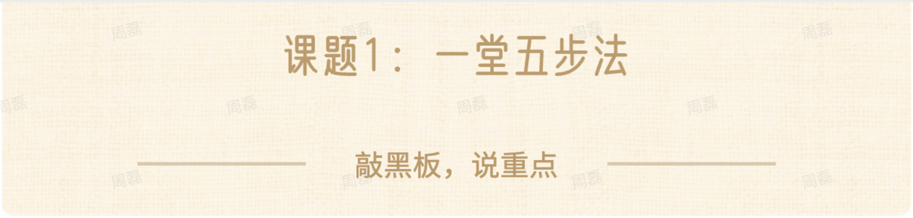

一堂五步法，是商业素质方向里的总纲之一。它的中心思想非常清楚：**创业不是赌运气，而是可以被拆解、被推演、被验证的科学过程。**

大量创业者在早期看项目，是混沌的，会说：我想做一个APP，我想做一个电商网站，我想做一个智能硬件，我想做一个新消费品牌……

但这些表达，其实都只是“方案形态”。它没有回答更底层的问题：这个业务为什么成立？

- 谁真的需要？
- 你的解决方案凭什么比替代方案好？
- 商业模式能不能跑通？
- 增长从哪里来？
- 壁垒到底是什么？

一堂五步法，就是把创业从“一大坨想法”拆成五个关键里程碑：需求、解决方案、商业模式、增长、壁垒。

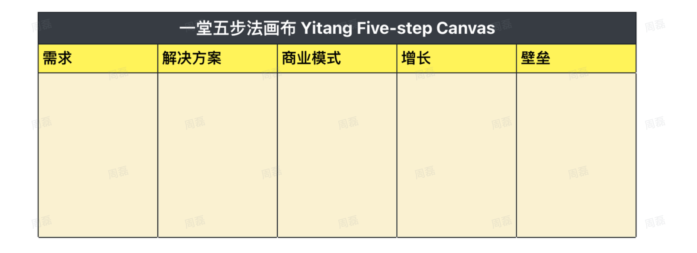

一堂五步法真正追求的是：**把模糊的商业直觉，变成可逐级验证的科学决策体系。** 它要求你从“我觉得”变成“我怎么证明”，从“我想做”变成“哪一步还没有成立”，从“这个项目很有前景”变成“这个项目的关键假设是什么，下一步验证哪一个”。

> 【误区提醒💡】五步法不是把格子填满，而是用五个里程碑逼迫自己面对真实问题。

所以如果你后面把一堂五步法翻译给孩子，当然可以换成社团、活动、项目、义卖、短视频。

但魂儿不能变：做一件事，不要只靠热情，要拆成关键环节，一步一步验证它为什么成立。

> 提醒❤️：重点可以放在前三步，后面有些太难了。

这门课的中心思想是：**先研究市场上客观存在的问题，再讨论我们想提供什么解决方案。**

这句话非常朴素，但非常反人性。因为人一旦有了想法，就会本能地爱上自己的解决方案。然后会带着这个解决方案去问别人：你喜不喜欢？你会不会用？你愿不愿意买？

这时候，很多调研已经失真了。因为你不是在研究需求，你是在为你的方案找支持。

需求洞察真正要做的第一步，是把解决方案先剥离出去。先不要说我要做什么，先问：

- 哪类用户？在什么具体场景？遇到了什么真实问题？
- 这个问题是不是高频？是不是足够痛？
- 是不是已有方案没有解决好？是不是值得被解决？

这就是需求分析的第一性事实：**需求不是创始人的情怀，不是团队的灵感，不是用户碍于面子说的话，也不是一时新鲜感。需求是某类用户在某个场景下真实遭遇的问题。**

这门课最重要的审美是什么？四个字：**实事求是。**

如果讲给孩子，无论用什么例子，都要守住一句话：先从解决方案里退出来，回到客观问题。不要先证明我想做的东西很好，先确认别人真实遇到的问题是什么。

产品内核这门课，特别容易被误解。很多人听到产品内核，会以为它是在讲产品定位，讲卖点，讲功能优先级，讲用户价值。

都有关系，但都不够。产品内核的中心思想是：**产品内核不是功能清单，而是用户愿意选择你的最小解决方案。**

产品内核要回答的问题是：用户为什么真的选择你？

在真实商业世界里，一个产品可以做出100个功能、特性和模块。但真正决定它能不能立在市场上的，可能只有3到5个核心要素。

很多失败，不是因为团队做得太少，恰恰是做得太多。他们不断加功能，不断优化细节，不断丰富愿景，不断完善体验，但始终没有回答那个最关键的问题：用户为什么愿意选择你，而不是别人？

所以产品内核是一门“减法课”。它不是鼓励你做更多，而是逼你判断：

- 哪些是决定性要素？
- 哪些只是优化性要素？
- 哪3到5个东西拿掉以后，用户就不买单了？
- 哪些东西加上以后，看起来更完整，但其实对用户选择没有决定性帮助？

> 【误区提醒💡】后面大家如果把它翻译给孩子，别忘了，这门课不是让孩子把东西做得更花，而是让他判断：这件作品、产品、活动真正成立的关键价值是什么。

这门课的中心思想非常明确：**重要决策不能靠感觉、模板和浅层信息，而要用系统式调研拿到关键情报，再回到业务判断。**

很多人做调研，其实是在堆资料。搜了很多文章，看了很多报告，问了几个朋友，找了一些数据，最后整理成一份看起来很完整的文档。但你问他：这些信息到底支撑什么判断？他答不上来。

这不是情报调研，这只是资料收集。

情报调研真正要解决的问题是：我现在要做一个重要判断，我缺哪些关键信息？这些信息从哪里来？如何交叉验证？最后是否足以支持决策？

所以调研黑客的OSCAR五步，本质上是一套从目标到归因判断的系统：

- Objective，锁死目标。
- Scope，缩小范围。
- Checklist，罗列调研清单。
- Acquisition，获取关键情报。
- Reasoning，回到目标完成归因判断。

> 【误区提醒💡】如果未来讲给孩子，可以讲升学信息、网络传言、研究性学习。

但无论讲什么，都要回到：这个信息能不能支撑你的判断？

- 不是材料多，而是信息能支撑判断；
- 不是报告完整，而是关键假设被验证；
- 不是看起来聪明，而是每一步扎实、可复盘、能降低试错成本。

这门课一定要记住一句话：**调研是为了降低关键判断的不确定性。**

这门课的中心思想是：**用少量时间和试错成本，围绕关键假设持续实验，大幅降低系统性风险。**

MVP 在创业领域经常被提，但也经常被误用。很多人把 MVP 理解成：先做一个简陋版、先做一个丐版产品、先随便上线试试。

MVP 的关键不在于“简陋”，关键在于它验证了什么。你要先问：

- 这个项目最危险的关键假设是什么？
- 如果这个假设不成立，整个项目会不会倒？
- 我能不能用最低成本、最快速度，拿到真实反馈？

> 【误区提醒💡】所以 MVP 的魂儿不是快，也不是省钱，而是：在大投入之前，用小实验验证关键假设。

宁愿粗糙但真实，不要精致但虚假。

宁愿早期暴露问题，不要晚期系统性崩盘。

宁愿围绕关键假设反复实验，不要围绕表面方案持续优化。

真正好的低成本验证，通常是“糙、快、猛、准、可复盘”。

- 糙，不是粗制滥造，而是不把成本花在还没验证的地方。
- 快，不是鲁莽，而是尽早接触真实用户。
- 猛，不是乱冲，而是敢于让关键假设接受真实反馈。
- 准，不是什么都测，而是测最危险的那个判断。
- 可复盘，是每次实验都留下认知收益。

MVP 的真正表达应该是：先识别风险，再剥离关键假设，再用最低成本获得真实反馈。

后面如果翻译给孩子，魂儿必须保留：**先验证最危险的那个判断。**

---

## 04 看见未来方向

这个方向有五门课：泛产品设计、科学决策、人生红点、领导力、AI双三角。

未来、AI、人生、领导力、决策、作品。一不小心就变成宏大叙事。

但一堂做这些课，不是为了制造宏大感，恰恰相反，它是要给大家一些可以握在手里的底层工具：

- 泛产品设计，让你把任何交付物当成作品打磨。
- 科学决策，让你面对选择时不只靠感觉。
- 人生红点，让你敢于寻找长期牵引。
- 领导力，让你在难题面前带动一群人。
- AI双三角，让你在AI面前不丢掉人的判断。

下面我们还是逐个课题来说。

这门课的中心思想是：产品能力不限于某个垂直领域，而是一套可迁移的通用底层能力。

泛产品设计里的“产品”，是一个广义概念。

任何你交付给别人、希望别人使用、理解、接受、喜欢、传播的东西，本质上都可以被当成产品：一门课是产品，一篇文章是产品，一次演讲是产品，一个PPT是产品，一个社群活动是产品，一个AI Agent是产品，一个教学设计也是产品。

这门课最重要的底层价值观是什么？以用户为中心。

泛产品设计真正坚持的是：1）理解用户 2）追求最佳实践 3）持续打磨。

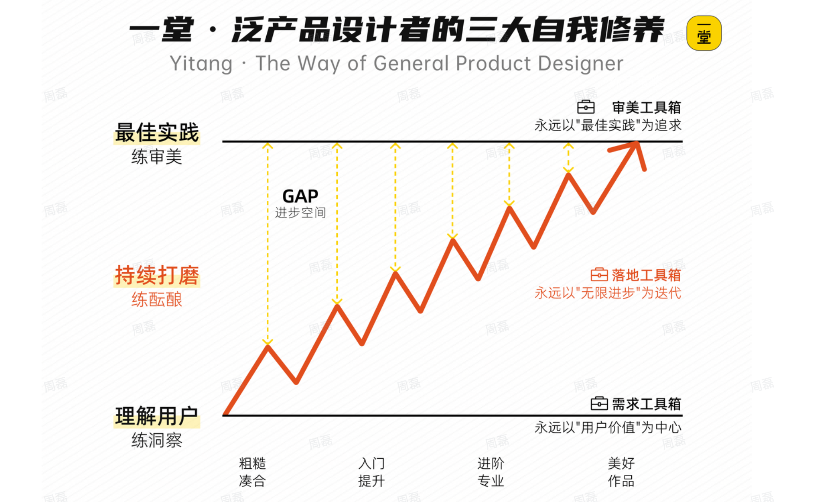

它不满足于“我做完了”。它会问：

- 用户是谁？
- 他在什么场景里用？
- 他真正要解决什么问题？
- 这个领域最好的作品长什么样？
- 我现在和最佳实践差在哪里？
- 我能不能迭代5轮、10轮，甚至20轮？

> 【误区提醒💡】后面翻译给孩子时，可以讲海报、PPT、视频、AI作品，但一定别停在“好看”。它的魂儿是：所有交付都要回到用户价值、最佳实践和持续打磨。

科学决策这门课，中心思想非常一堂：**决策不靠直觉靠科学，能无限进步。**

人每天都在做决策，但绝大多数人的决策方式，其实很粗糙：拍脑袋、凭经验、听别人建议、看短期感觉、被情绪带走、被路径依赖绑住……

最后导致什么？资源错配、机会错失、陷入系统性风险。

科学决策ROI模型要做的，是把模糊的直觉决策，转化为可计算、可验证、可复盘的科学决策。

这里面有三个维度：1）宽度，要素完整 2）深度，定量精准 3）高度，全局视角。

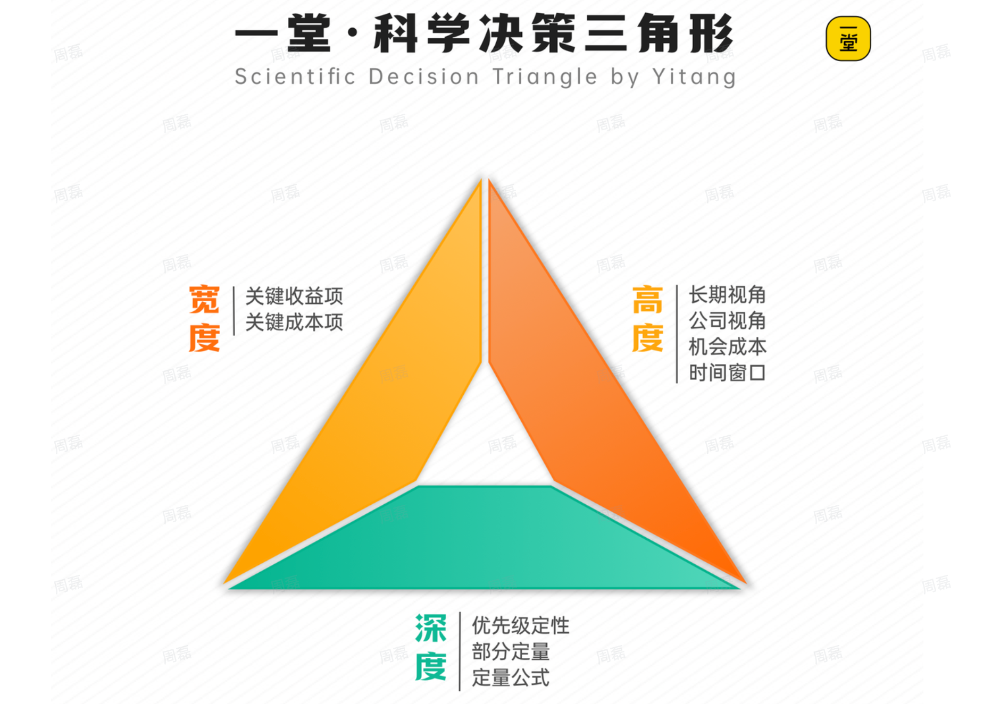

很多人决策错，不是因为他不聪明，而是因为他只看了一个维度。

- 只看收益，不看成本。
- 只看显性成本，不看机会成本。
- 只看眼前收益，不看长期风险。
- 只看个人感受，不看全局约束。

科学决策的价值，就是把这些要素尽量拉到桌面上。不是让人变成计算机器，而是让人在不确定里少一点自欺，少一点冲动，少一点被单一变量绑架。

> 【误区提醒💡】科学决策不能保证决策一定对。

很多事情算不清楚，但你可以提高判断质量，设置检查点，允许动态调整。

后面翻译给孩子，一定要强调：用更完整、更定量、更全局的方式，把选择从直觉和情绪里拆出来。

人生红点这门课，听起来很浪漫，但它其实非常一堂。

它的中心思想是：**人生的底牌，早点拿到。**

人生红点模型，想帮助长期有追求的人，找到一种内心终局确定性。这个确定性不是一天形成的，也不是拍脑袋想出来的。它一开始可能只是一个模模糊糊的感召，是一个你长期放不下的问题，是一个你愿意反复投入的方向，是一个你一想到就觉得“这件事值得”的东西。

人生红点没有高低贵贱，也没有标准答案。关键是：你追求时是否笃定，妥协时是否心甘。

> 【误区提醒1💡】常见的理解误区：

- 第一，把人生红点讲成职业规划，太窄，职业只是表达方式之一，红点更接近人生终局和长期牵引。
- 第二，把人生红点讲成兴趣。兴趣只是Want的一部分，如果没有Need和Can，没有路径和复利，兴趣很容易飘。
- 第三，把人生红点讲成玄学使命。一堂的人生红点，一定要落到路径、能力、资源、里程碑和复盘。

> 【误区提醒2💡】翻译给孩子时当然要降压，不要逼孩子立刻找到使命。但原始课魂不能丢：红点不是兴趣贴纸，红点是人生底牌和长期复利。用长期主义和管理方法，把内心终局的模糊感召，慢慢校准成可执行的人生路径。

领导力这门课，中心思想非常直接：**领导力，就是领导别人心甘情愿解决难题的能力。**

衡量一个人的领导力，不是看他站在台上多有气场，而是看：当一个团队面对困难、长期、开放、充满不确定性的挑战时，别人愿不愿意跟他一起冲、一起扛、一起解决问题。

这门课很重要的一个区分，是管理、权力和领导力：

- 管理，负责确定性工作的流程、工具和架构，保证下限。
- 权力，来自职位、身份和稀缺资源，在紧急或强制场景中可以快速调动。
- 领导力，来自影响力和信任，负责追求上限。

越是新挑战，越是变革，越是创新，越是突破性难题，越不能只靠制度和职权，越需要领导力。

领导力后面翻译给孩子，可以讲班级活动、小组作业、社团项目。但别忘了，领导力是在真实难题面前，通过安全感、结果、共识、成长和希望，让别人心甘情愿一起解决问题。

AI双三角这门课的中心思想是：**AI时代的竞争力，不是单纯会用AI，而是人类三角和AI三角的双向增强飞轮。**

这门课要回答两个灵魂拷问：

- 同样会用AI，为什么业务结果相差巨大？
- 同样都是业务高手，为什么AI结果相差巨大？

背后其实是双三角模型：

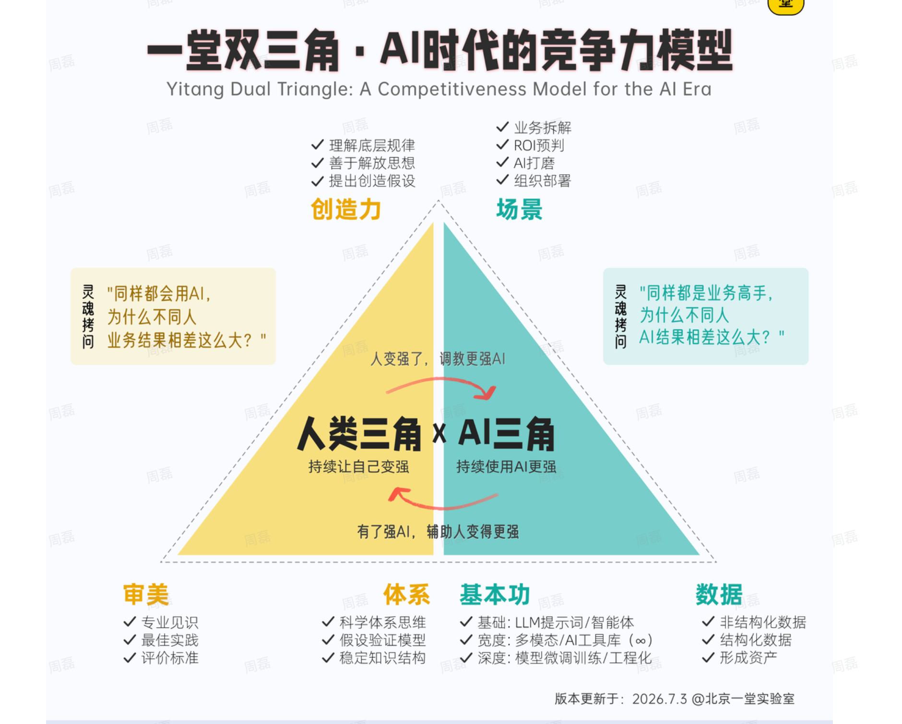

AI双三角的核心，不是“人vs AI”，也不是“AI替代人”。

它讲的是：人越强，越能用好AI；AI越强，越倒逼人提升审美、体系和创造力。

后面翻译给孩子时，可以从AI写作、AI做图、AI查资料切入，但一定要把孩子从“AI消费者”拉向“AI协作者”。人在AI时代如何通过审美、体系、创造力，叠加AI基本功、数据和场景，形成更强的结果。

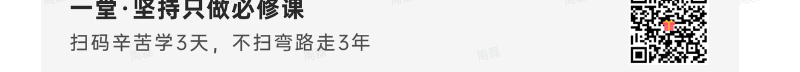

### 学习提速方向

这个方向有五门课：时间管理、IPO科学学习、刻意练习、个人知识管理、清单体笔记。

这五门课放在一起，解决的是一个非常普遍、非常痛的事情：

---

## 05 学习提速方向

这个方向有五门课：时间管理、IPO科学学习、刻意练习、个人知识管理、清单体笔记。

这五门课放在一起，解决的是一个非常普遍、非常痛的事情：

- 为什么有些人很努力，但进步很慢？
- 为什么有些人学了很多，但用不出来？
- 为什么有些人练了很久，但没有变强？
- 为什么有些人资料很多，但知识没有变成能力？
- 为什么有些人笔记很多，但思考没有变清楚？

传统学习叙事里，大家特别容易用两个词解释一切：天赋和努力。

你学不好，是不是不够努力？你进步慢，是不是没天赋？

一堂的学习提速方向，恰恰要把这种粗糙叙事拆掉。

学习不是黑箱，成长不是玄学。能力不是只能靠天赋，努力也不是越多越好。

学习和成长，应该是一套可以被诊断、被训练、被复盘、被迭代的科学系统。

所以这个方向的总魂儿是：**从努力和天赋叙事，走向科学学习系统。**

一堂的时间管理，它的中心思想是：**时间管理本质上是一个“建模、匹配、迭代”的科学过程，而不是找到一个万能工具。**

时间管理有三个变量：1) 时间本身可以建模 2) 事情可以建模 3) 二者之间的匹配关系也可以建模。

很多人的时间管理失败，不是因为工具不好。而是他不知道自己的时间和精力结构。

- 什么时候精神最好？
- 什么时候容易分心？
- 哪些时间适合深度任务？
- 哪些时间适合机械任务？
- 哪些任务需要完整大块时间？
- 哪些任务可以拆成5分钟的小颗粒？

如果这些不清楚，你换再多工具也没用。

时间管理不是玄学，不是意志力比拼，不是“优秀的人都早起”，而是你能不能用一套底层有效的方法，持续提升时间ROI。

> 【误区提醒💡】后面翻译给孩子，可以从作业、手机、长期任务讲。但不要把时间管理讲成“把日程填满”，原始课魂是理解时间、理解任务、理解匹配关系，然后持续实验和优化。一定是科学建模，不是自律鸡血。

IPO科学学习这门课，中心思想是：**学习能力不是天赋，而是一套可以被拆解、训练、迭代和长期优化的科学系统。学习是结果，IPO才是根本。**

很多人学不好，会说：我不聪明，我基础差，我没天赋，我不适合学这个。

但IPO模型会先不接受这种粗糙归因，它会问：

- 你的目标清楚吗？
- 你的输入质量高吗？
- 你的处理深度够吗？
- 你有没有输出？
- 你有没有把学习沉淀成模型？
- 你有没有反馈？
- 你的下一轮循环有没有升级？

这就是IPO科学学习的价值：它把“学得好不好”从一个模糊结果，拆成一个可以诊断的系统。

这门课里的五环节非常重要：1）Goal，目标 2）Input，输入 3）Process，处理 4）Output，输出 5）Feedback，反馈。

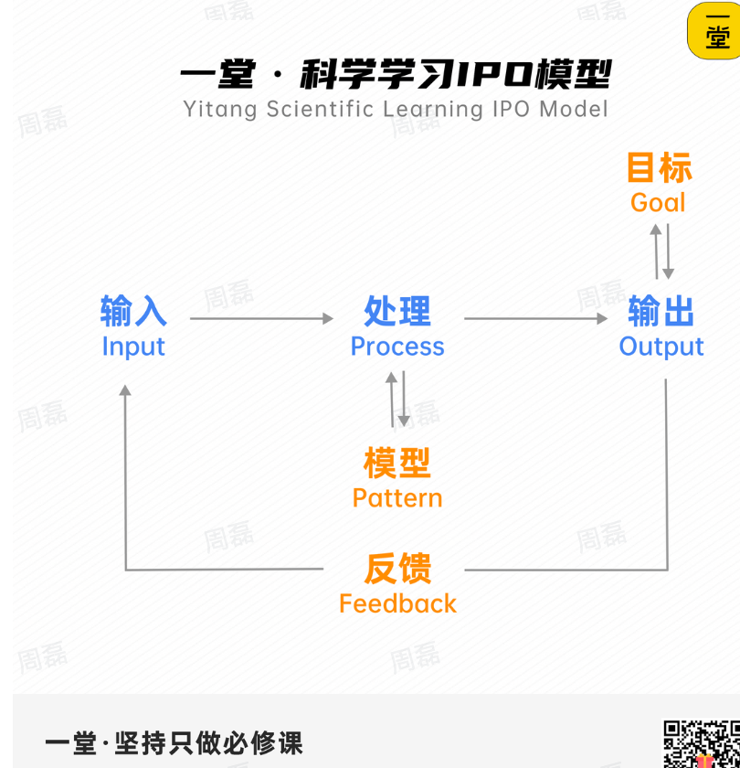

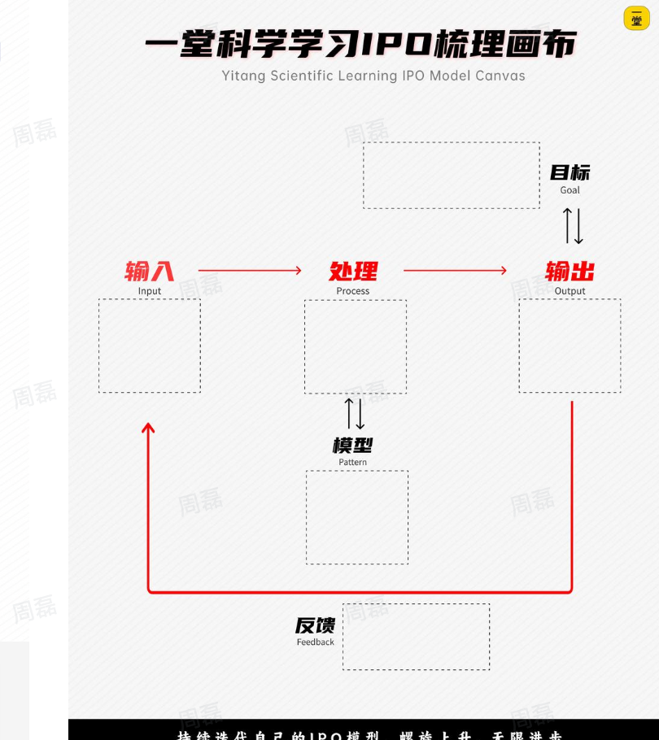

持续迭代自己的IPO模型，螺旋上升，无限进步。

IPO科学学习的魂儿是：**用系统视角诊断学习，让学习能力进入可迭代、可复盘、无限进步的轨道。**

后面讲给孩子，可以从偏科、刷题、背诵、错题讲，但核心一定是系统诊断，不是技巧罗列。

刻意练习：**不是低水平重复，而是结构完整、带反馈的非舒适区训练。**

> 【误区提醒1💡】常见误解是什么？

- 第一，把刻意练习讲成勤奋。不对，勤奋可能只是低水平重复。
- 第二，把刻意练习讲成坚持。坚持很重要，但坚持错误动作，会把错误练得更熟。
- 第三，把刻意练习讲成复盘。复盘只是其中一步，如果没有下一轮动作训练，就还没进入刻意练习。

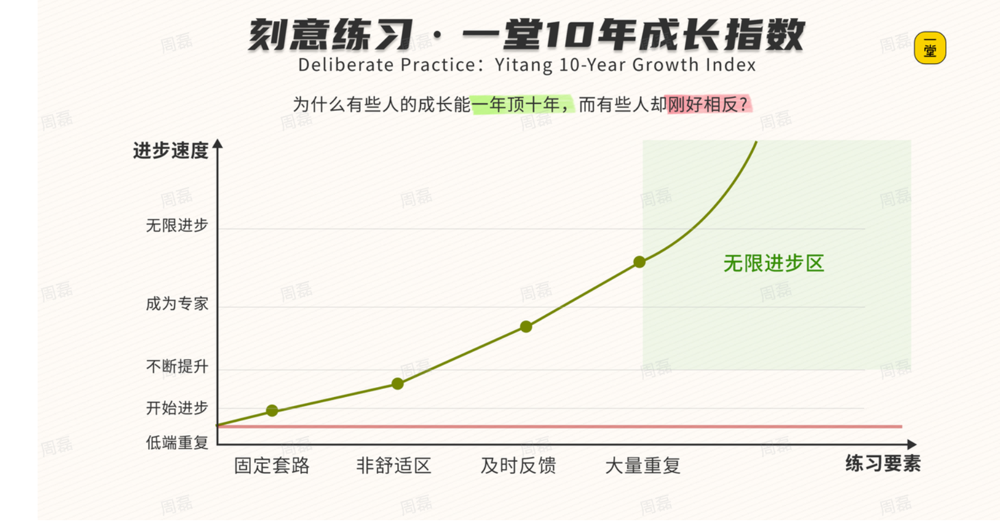

不要把刻意练习讲成“努力就会变强”，它的魂儿是：**找到具体能力、拆出小动作、进入非舒适区、获得及时反馈、持续版本升级。**

> 【误区提醒2💡】后面翻译给孩子，可以讲刷题、练琴、跳绳、作文、演讲，但一定别讲成“多练就行”，要讲“怎么练才算有效”。

个人知识管理这门课，中心思想是：**知识不靠记忆靠系统，能力不靠天赋靠IPO。**

这句话特别适合今天的信息环境，现在很多人不是没有信息，恰恰是信息太多。但问题是：这些信息有没有变成你的知识资产？你需要的时候找得到吗？你能调用吗？你能在实战里更新它吗？如果不能，信息越多，带来的不是力量，而是焦虑。

这门课最重要的是什么？资产化。知识不是被动存储，而是主动变成资产。

不要把个人知识管理讲成“如何搭一个漂亮知识库”。它的魂儿是：通过IPO闭环，让知识可调用、可输出、可更新，并最终服务个人成长建模。

后面翻译给孩子，可以从错题本、读书笔记、主题文件夹讲。但原始课魂一定是系统和资产，不是工具和收藏。

清单体笔记的中心思想是：**用最朴素的格式，分点、分层、独立、专注，把90-100%的精力压在内容质量和逻辑本身。**

清单体笔记的厉害之处，是用极低频的样式消耗，换取极高频率的思考练习。它不只是笔记方法，它是长期训练结构化思考、现场建模、业务解题的一种基本功。

> 【误区提醒💡】不要把清单体笔记讲成笔记美化课，它的魂儿是：用最小格式，把最大精力留给内容质量和逻辑结构，并通过高频练习持续提升思考能力。

### 第二类难题：进行转译

好了，魂儿笃定了，那下一个卡点就是：一堂的成人课程，到底怎么转译成孩子们的版本？

---

## 06 第二类难题：进行转译

青少年化不是把“用户需求”换成“同学需求”，不是把“ROI”换成“划不划算”，不是把“人生红点”换成“你的梦想是什么”。这些只是语言层面的变化。

今天我想给大家一个核心判断：**青少年化不是浅化，也不是换词，是重新研究人群、重新研究场景、重新设计交付。**

真正的转译，是三件事：

- 第一，把成人世界的问题，换成孩子真实会遇到的问题。
- 第二，把抽象方法论，换成孩子当场能完成的动作。
- 第三，把“听懂了”，换成可以观察的变化和产出。

我们一个一个说。

**重点工作：问题研究**

**第一件事：**

先问一个本质问题：什么叫把一堂课转译成孩子的版本？

很多人第一反应是：是不是要把语言讲简单一点？是，但远远不够。语言简单，只是最表层的工作。

所以真正的转译，不是从“成人词汇”到“儿童词汇”，而是从“成人问题系统”到“孩子问题系统”。

比如，需求洞察这个课题。

成人为什么学需求洞察？因为他要创业，要做产品，要判断市场，要避免烧钱，要找到真实用户问题。

孩子为什么要学需求洞察？他不一定要创业。至少大部分孩子不是马上要创业，但他会遇到类似结构的问题：

- 他想组织一个社团活动，觉得自己点子特别好，结果同学不来。
- 他想做一个短视频账号，觉得内容很有趣，结果没人看。
- 他想做班级义卖，觉得这个小商品很好卖，结果摊位前冷冷清清。
- 他想送朋友一个礼物，自己觉得很用心，但对方并没有那么喜欢。

这些就是孩子版的“需求问题”。你看，本质没有变，还是从“我觉得”走向“对方真实需要什么”。但是问题系统变了，成人版是商业机会、市场验证、产品设计；孩子版是校园活动、同伴互动、兴趣项目、作品表达。

**第二件事：**

比如刻意练习。

成人版讲固定套路、非舒适区、及时反馈、大量重复，讲一个人怎么把核心能力练成长期竞争力。

孩子如果只听到这些词，可能觉得很对，但回家以后不知道做什么，所以你要把它换成一个动作，比如：

- 把“我数学不行”，改写成“我在应用题审题第一步经常漏条件”。
- 把“我要努力学英语”，改成“我今天用10分钟只练连读识别”。
- 把“我要坚持练琴”，改成“我今天只练这一小节的节奏，并录音听一遍”。

抽象方法论落到孩子身上，必须变成动作，不然孩子只能听懂，不能使用。

**第三件事：**

很多课的问题不是学生听不懂，而是听懂以后没有变化。

所以青少年版课程一定要问：

- 这节课结束的时候，孩子身上有什么变化是看得见的？
- 他能写出一张卡吗？
- 能完成一个小表格吗？
- 能把一句大而空的话改写成具体动作吗？
- 能设计一个小实验吗？
- 能提交一个小作品吗？

如果没有这个东西，课程很容易停在“听懂了”。

所以大家看，真正的青少年化，不是把原课讲得可爱一点。而是要回答：这个方法论，对这个年龄段的孩子，到底解决什么真实问题？如果这个问题回答不出来，后面所有逐字稿、案例、互动，都会飘。

---

## 07 技巧1：宽而不泛

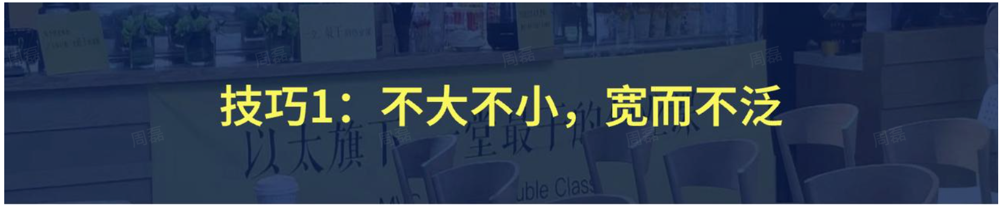

研究完课题魂儿之后，第二步不是马上写逐字稿，也不是马上找案例，而是先确定这节课的边界。

我更愿意把这个技巧叫做四个字：不大不小，宽而不泛。

什么意思？就是这节课的人群不能太大，也不能太小；场景要尽量宽，但不能泛。你要找到一类足够清楚的人群，他们有相似的需求、相似的体感、相似的卡点；同时你又不能只靠一个场景、一个案例，把一门方法课讲成一个问题解决小偏方。

先说第一层，叫不大不小。

很多同学一开始写课程对象，会写得特别大。比如“我的人生红点课程服务小学生、中学生、大学生”，或者“我的时间管理课面向所有青少年”。这个听起来很有覆盖面，但真正做课的时候会很痛苦，因为你连例子都没法举。

比如，讲人生红点：

- 小学生听到人生红点，可能还没有那么强的生涯焦虑，他的入口可能是兴趣、喜欢、长期愿意做的事。
- 高中生听到人生红点，可能马上想到选科、专业、未来方向、我到底适合什么。
- 大学生听到人生红点，可能想到实习、职业选择、人生路径、我要不要按父母期待走。

这三类人的问题不是一回事，你硬放在一节课里讲，就会变得特别散。

所以人群不能太大。不要一上来就说“所有青少年”“小学到大学”“全年龄段都适用”。你可以先切成一个相对清楚的人群，比如小学高年级、初中生、高中生、准大学生、大学低年级。这个粒度通常就够用了。

但反过来，人群也不能切得太小。不要切成“某一线城市、四年级、学奥数、内向、父母都是创业者、又喜欢机器人竞赛的孩子”。你切得越细，当然越具体，但问题是没人需要你的课了。这个课会变成一个私人辅导方案，而不是一节可以共创、可以交付、可以复用的课程。

所以我们追求的是不大不小：大到什么程度？大到这类孩子之间有共性。小到什么程度？小到你能举出真实例子，能描述他们每天遇到的问题，能写出他们的Before和After。

比如“初中生的刻意练习”，这个边界就比“所有青少年的刻意练习”好。因为初中生开始遇到更复杂的学科学习、考试反馈、错题订正、兴趣训练，也开始有“我是不是不擅长”的自我判断。你能讲出很多真实场景。

比如“高中生的科学决策”，也比“青少年的科学决策”更好。因为高中生会遇到选科、竞赛、专业、活动投入、升学路径这些真实选择，他的决策成本更高，焦虑更强，课程也更容易扎进去。

但如果你写“高三上学期、准备强基、物理成绩85分以上、但纠结要不要参加某个营的学生”，它就太窄了。这个当然可以作为一个案例，但不适合作为整节课的人群边界。

所以第一句话大家记住：人群要不大不小。不要大到没法举例，也不要小到只剩一个人。

第二层，叫宽而不泛。

什么叫宽？就是在你选定的人群里，尽量覆盖他们比较常见、比较有共性的多种场景。你不能只讲一个场景，不能整节课都围绕一个特别窄的问题打转。

比如你讲刻意练习，你是数学老师，当然可以讲数学题，但不能全程只讲数学题。因为一堂的刻意练习不是“数学提分课”，它是一套关于能力提升的科学方法。它可以出现在数学错题里，也可以出现在英语口语里，可以出现在篮球投篮里，可以出现在钢琴练习里，可以出现在演讲表达里，也可以出现在孩子用AI修改作文的过程中。

再比如你讲时间管理，当然可以讲写作业磨蹭，但不能把整节课讲成“怎么解决写作业磨蹭”。写作业只是一个场景。

时间管理还会出现在周末安排、兴趣班冲突、考试复习、手机使用、社团活动、比赛准备、AI工具使用这些场景里。

如果你只讲写作业磨蹭，孩子听完会觉得：哦，这节课是教我怎么快点写作业。但时间管理这门课真正要传递的，不只是“别磨蹭”，而是让孩子理解：时间、任务、精力、反馈之间是可以被建模、被安排、被复盘的。

这就是宽。你要让这类孩子听的时候，不断产生“这也跟我有关”“那个场景我也遇到过”“原来不是只有写作业，这是我很多事情里的共同问题”。

但宽不等于泛。泛是什么？泛就是你讲着讲着，什么都沾一点，但没有任何一个场景讲透。比如你说：“时间管理在学习、生活、成长、未来发展中都很重要。”这句话当然对，但孩子听不到画面。

你要避免这种泛。你不能只说“学习场景”“生活场景”“成长场景”，你要落到具体画面：周五晚上说要复习，结果刷短视频刷到11点；周末上午安排了三件事，最后一件都没完成；准备比赛的时候，前面三周都觉得还早，最后两天疯狂赶工；用AI写作文，十分钟生成了很多内容，但不知道怎么筛、怎么改、怎么交付。

这就叫不泛：不是抽象地说很多场景，而是把场景讲到孩子能点头，能想起自己，能进入问题。

所以宽而不泛的标准是什么？就是：你覆盖的场景足够多，能让方法论显出来；但每个场景又足够具体，能让孩子有体感。

这里有一个特别重要的判断：我们做的不是案例课，更不是观点课，而是方法课。

案例课可以只讲一个故事。比如“一个孩子如何解决写作业磨蹭”。但方法课不行。方法课要让孩子听完以后发现，原来写作业、练球、练琴、做项目、准备比赛、用AI学习，背后都有同一个方法论可以迁移。

如果你只讲一个案例，孩子可能只学会处理那个案例。如果你覆盖了几个不同类型的场景，孩子才会开始感觉：哦，原来这背后不是一个技巧，而是一套方法。

比如讲刻意练习，你可以这样铺开：

- 一个场景是学习：错题本写了一本又一本，但下次换个题型还是错。
- 一个场景是运动：投篮练了很多次，但每次只是随便投，没有人反馈手型和发力。
- 一个场景是表达：演讲练了很多遍，但只是从头读到尾，没有针对开场、停顿、眼神做单点训练。
- 一个场景是AI：用AI改作文，每次只是让它“帮我润色”，却没有让它指出结构、论据和表达的具体问题。

这几个场景不一样，但它们背后的共同问题是一样的：孩子以为练习就是重复，但真正的刻意练习，是找到具体卡点，设置反馈，在非舒适区做小步迭代。

比如讲人生红点，也不能只讲“兴趣爱好”。如果只讲兴趣爱好，这节课就很容易变成“你喜欢什么，就去做什么”。但人生红点不是兴趣测试课，也不是励志课，它要帮助孩子识别长期反复出现的线索，并且用小行动去验证。

所以你可以覆盖几个场景：

- 选社团的时候，为什么有些活动你会持续投入，有些只是三分钟热度；
- 选科的时候，为什么有些科目不是分数最高，但你愿意反复研究；
- 做作品的时候，为什么有些事情很累，但你做完会有一种“我还想继续”的感觉；
- 看别人优秀时，为什么有些羡慕只是羡慕，有些羡慕背后其实藏着你的方向线索。

这些场景都不大，但放在一起，就能帮助孩子理解：人生红点不是今天找到终身使命，而是从反复出现的兴趣、优势、投入感、作品欲里，识别一些值得继续验证的线索。

> 【划重点💡】所以大家做课的时候，可以用一个很简单的检查表：

1. 第一，我的人群是不是不大不小？
2. 第二，我的场景是不是宽而不泛？
3. 第三，我能不能列出5到10个这类孩子都可能遇到的典型场景？
4. 第四，这些场景能不能共同证明：这不是一个小技巧，而是一套可以迁移的科学方法？

宽而不泛，本质上是在帮你守住一件事：这节课既要有足够清楚的对象，又要有足够宽的迁移感。

对象清楚，孩子才会觉得“这说的是我”。场景够宽，孩子才会觉得“这不只是一个例子，而是一套方法”。

如果对象太大，课程会虚，对象太小，课程会窄，场景太单一，课程会像案例辅导，场景太泛，课程会像空泛道理。

我们要追求的状态是：一类清楚的人群，几组典型场景，一个共同问题，一套可以迁移的方法。

---

## 08 技巧2：研究before/after

写课的时候，可能你的脑子里会有很多问题：我要讲什么？我要讲哪些概念？我要讲哪些案例？我要用哪些PPT？

但一堂做课要先问另一个问题：孩子从哪里来，要到哪里去？这就是Before和After。

Before是什么？Before就是孩子未经训练之前的真实状态。不是你以为他的问题，不是家长概括出来的问题，而是孩子在具体场景里，现在怎么想、怎么做、怎么误解、怎么踩坑。

> 【划重点💡】那怎么研究Before？我建议大家回答三组问题：

- 这类孩子现在最典型的三个场景是什么？
- 怎么描述这些场景？
- 孩子现在怎么想？怎么做？怎么误解这个问题？在哪些地方反复踩坑？

比如科学决策，面向高中生，你可以写三个场景：

- 第一，选科的时候，不知道物理、历史、化学、生物到底怎么选，只能听父母、听老师、听同学。
- 第二，暑假要不要参加一个竞赛或夏令营，觉得好像都有用，但不知道投入时间值不值。
- 第三，填志愿、选专业的时候，看了一堆热门专业排名，越看越焦虑，最后变成“哪个不吃亏选哪个”。

怎么描述这些场景？比如刚才科学决策在选科的这个场景里：

孩子现在怎么想？他可能会想：这个选择太重要了，选错就完了。别人都说这个专业好，我不选会不会吃亏？我也不知道自己喜欢什么，那就选一个看起来更稳的。

他现在怎么做？他可能会到处问人。问爸妈，问老师，问学长学姐，刷小红书，刷知乎，看排名，看就业薪资。但他很少把信息整理成自己的决策表。

他在哪些地方反复踩坑？1) 只看收益，不看成本 2) 只看热门不看自己 3) 把别人建议当答案，不把别人建议当信息。

这就叫描述Before，不是写一个抽象结论，而是把孩子在场景里的想法、动作、误解、坑，都写出来。

接下来讲After。After是什么？After就是孩子学完以后，你希望他发生什么可观察的变化，After必须尽量变成可观察目标。

> 【划重点💡】那怎么研究After？我建议大家也回答一组问题：

- 孩子学完之后，你希望他发生什么可观察的变化？
- 这节课结束后，孩子要达到的目标是什么？
- 这个目标可被观察吗？能不能把目标拆成至少完成一个动作？

比如，不要只写“建立科学决策意识”。你可以写：孩子能把一个选择拆成至少两个选项，能说出每个选项的得到、失去、风险和检查点，能在7天后回来看一次这个选择有没有需要调整。

比如，不要只写“理解人生红点”。你可以写：孩子能写出3个自己长期反复出现的兴趣线索，能区分“别人觉得我应该做”和“我自己真的会被吸引”的差别，能把一个模糊方向，改写成一个可以继续探索的小任务。

比如，不要只写“掌握刻意练习”。你可以写：孩子能把“我数学不行”改写成“我在应用题审题的第一步经常漏条件”，能找到一个反馈方式，比如对答案、同伴互看、老师点评、录音回放。

如果你写不出Before和After，我建议先不要写逐字稿，因为你不知道这节课到底要把孩子从哪里带到哪里。一节课的故事线，本质上就是从Before到After的桥。不是老师从第一页讲到最后一页，是学生从原来的状态，穿过一组场景、案例、互动、工具和练习，走到一个新的状态。

这是大家做青少年转译最重要的一步。

---

## 09 技巧3：干货点清单

研究完问题边界和 Before/After，最终要有一个呈现的形式，所以就到了第三个技巧：形成干货点清单。

一堂意义上的干货点清单，是把现场讲课才华，提前转化成最小教学单元。什么意思？就是你不要指望自己直播的时候突然灵感爆发，不要指望你到了现场，自然就能讲出好案例、好金句、好互动、好比喻。

真正高质量的课，是在课前酝酿出大量干货点。

孩子的注意力、代入感、理解速度、行动意愿，都不是靠老师一句“这个很重要”建立起来的，它靠的是一个一个小的教学单元：

- 一个场景把他拉进来。
- 一个案例让他点头。
- 一个互动让他开始想自己。
- 一个工具让他能动手。
- 一个金句让他记住。

> 【划重点💡】一堂常见的干货点类型有10种：

1. 思想：就是这节课最核心的判断、本质、中心思想。
2. 案例：案例可以是成功的，也可以是失败的；可以是大案例，也可以是孩子身边的小案例。
3. 金句：知识点很多，但是金句更好记忆。
4. 互动：互动不是热闹一下，互动是把孩子拉进问题里。
5. 唤醒：唤醒就是戳痛点，让学生意识到这说的是我。
6. 图表：很多抽象方法论，如果没有图，就会变成老师嘴里的概念。
7. 工具：工具就是孩子可以拿走用的东西。
8. 悬念：悬念是让孩子愿意跟着你往下走。
9. 秀肌肉：不是炫耀，而是建立信任。
10. 段子：段子不是为了搞笑，段子是让严肃内容有一点呼吸感。

这里我再强调一个新的标准，叫干货点准备系数。

大家后面写逐字稿，不要只准备刚好够用的干货点。你如果一节课最后需要50个干货点，那你前面至少要准备60到75个。也就是准备系数要做到120%到150%。先做加法，再做减法。先把能想到的场景、案例、互动、金句、工具、图表、唤醒点，都充分摊开，然后再筛。

为什么要这样？因为如果你只准备100%的材料，你进入逐字稿的时候就没得选，你会把一些质量一般的案例也塞进去，你会舍不得删掉一个不够准的互动，你会因为没有替代方案，只能用一个成人感很重的例子。

但如果你准备了120%到150%，你就有选择权，选择那些能让孩子代入的，能帮助孩子理解的，能推动孩子行动的，能帮助老师验收的干货点。

---

## 10 技巧4：巧用AI工具

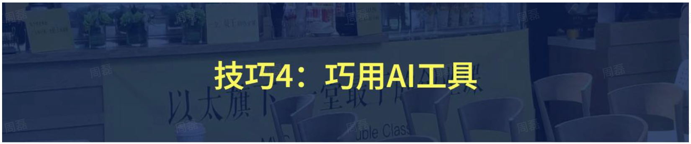

但我知道，大家真正回去动手的时候，还是会遇到一个非常现实的问题：

- 道理我听明白了，但我打开文档的时候，第一行到底写什么？
- 我知道要选年龄段、写场景、做Before/After，但我怎么判断自己写得对不对？
- 我脑子里其实有很多经验和案例，但它们很散，我不知道怎么整理成一节课。

所以接下来，除了今天这场培训本身，我们还会给大家提供一个AI工具，叫课程灵感官Partner。

大家先注意它的定位：课程灵感官Partner更像一个访谈式磨课搭子。

它模拟的不是“替你写课的人”，而是一个懂课程研发的人，坐在你旁边，一点一点追问你，把你脑子里那些还没有整理出来的经验、案例、场景和判断挖出来。它不是直接给答案，而是把一个很大的课题，追问成具体的人群、具体场景、具体问题、具体动作。

所以大家后面用 Partner 的时候，千万不要只是让它帮你“写一篇稿子”，更好的用法，是让它帮你完成几件事。

第一，让它帮你追问课题边界。你到底选的是哪一门课？这门课的魂儿是什么？哪些东西不能讲歪？哪些地方可以转译？哪些地方必须保留一堂方法论的内核？

第二，让它帮你追问人群和场景。不要只写“青少年”，而是具体到小学高年级、初中、高中，甚至具体到某一个真实场景。孩子不生活在概念里，孩子生活在放学、作业、社团、选科、同伴关系、兴趣项目、AI 工具、短视频和家庭沟通里。

第三，让它帮你追问 Before 和 After。孩子现在到底卡在哪里？他现在怎么想、怎么做、怎么误解、怎么踩坑？学完以后，他至少能完成什么动作？能写出什么、说出什么、改掉什么、做出什么？

第四，让它帮你发散干货点。你可以让它帮你一起列场景、案例、金句、互动、工具、图表、悬念、唤醒点。前面我们说过，正式写逐字稿之前，干货点准备量最好做到 120% 到 150%。Partner 很适合帮你做加法。

第五，让它帮你整理逐字稿结构。比如你已经有了很多素材，但不知道怎么排顺序，就可以让 Partner 帮你搭一条主线：怎么开头抓住孩子，怎么讲 Before，怎么给 After，哪里埋钩子，最后给什么动作。

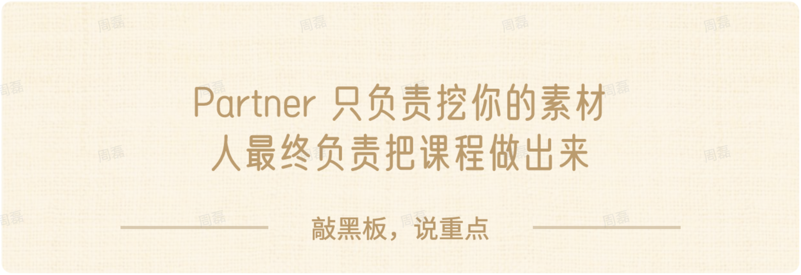

但这里我也要再讲一遍边界：Partner给你的东西，不是终稿。它最后可能会给你一份备课备忘录、一份素材清单、一份干货点清单，或者一版故事线草稿。这些东西都很有用，但它们不是可以直接提交的正式课程。

正常来说，它产出的内容里，可能只有10%到30%最后会进入你的正式稿。因为AI最擅长的是发散、追问、整理和模拟。它可以帮你把东西从脑子里挖出来，可以帮你把散乱素材摊开，可以帮你看到一些可能性。

但最后哪些要，哪些不要；哪个例子是真的，哪个例子只是听起来顺；哪句话像一堂，哪句话太空；哪个场景孩子真的会遇到，哪个场景只是成人想象，这些判断必须由人来做。

所以我们不反对大家用AI。恰恰相反，我们非常鼓励大家用课程灵感官Partner来磨课。

但我们反对的是纯AI稿。不要把Partner生成的内容不判断、不审核、不重写，直接提交上来。

也不要让它编造未经核验的案例。尤其是涉及真实学生、真实家庭、真实学校的时候，不要输入孩子的隐私信息，也不要把未经允许的具体经历直接丢进去。

大家记住一句话：Partner负责帮你把素材挖出来，人负责把课程做出来。

更具体一点：

- Partner可以帮你发散，但不能替你判断。
- Partner 可以帮你追问，但不能替你负责。
- Partner 可以帮你整理，但不能替你交付。

最后真正站在孩子面前讲课的人，是你。真正要判断这门课有没有抓住魂儿、有没有守住边界、有没有孩子体感、有没有可观察动作的人，也是你。

所以今天之后，大家的下一步不是立刻闭门写一篇完美逐字稿。更合理的路径是：带着今天这套标准，先和课程灵感官 Partner 做一轮访谈式磨课。

你可以先把一个课题讲给它听，让它追问你；再把一个年龄段讲清楚，让它帮你找场景；再把 Before 和 After 写出来，让它帮你检查是不是可观察；再一起扩一轮干货点清单；最后再由你自己取舍、重写、整理成课程设计或者逐字稿。

这样，你就不是一个人从空白文档开始。你是带着一套方法、一个访谈式搭子、一批可被筛选的素材，进入第一轮磨课。

---

## 11 第三类难题：线上交付

好，前面选了选题、明确了魂儿、进行了转译，就走到了最后一步，打磨交付。

**重点工作：打磨交付**

我们在作业里发现，一个高频被提到的卡点就是：线上课到底怎么讲？

这里面有几个特别典型的担心：

- 我以前没怎么给青少年讲过课，孩子会不会听不懂？
- 线上课我看不见他们的反应，他们会不会听着听着就走了？
- 我设计了互动，但孩子不回应怎么办？
- 我讲的是一堂的方法论，可孩子没有成人商业经验，会不会觉得离自己很远？

这些担心都非常正常，本质上是线上青少年课程的交付难度，比我们想象中更高。它不是把线下课搬到腾讯会议、飞书、微信群里就结束了，它背后是一套完全不同的教学设计逻辑。

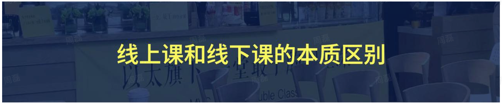

线下课的老师，其实天然拥有一个很奢侈的东西，叫现场反馈。你站在教室里，孩子有没有看你，身体有没有往前倾，眼神是不是开始飘，手里是不是在玩东西，旁边两个孩子是不是开始讲话，你基本上都能看见。你一看不对，马上可以停一下，可以走过去，可以换一个例子，可以点一个孩子回答，可以把节奏往回拉。

线下课还有一个隐性的场域约束。孩子坐在教室里，老师在前面，同伴在旁边，这个空间本身就会形成一种秩序。哪怕孩子没那么想听，他也还在那个场域里，他的身体还在课堂里，老师还有机会把他拉回来。

但线上课不一样。

线上课里面，孩子很可能是一个人在家里，旁边有手机、有平板、有玩具、有零食、有家长的声音、有其他网页，有太多东西在抢他的注意力。你看到的可能只是一个头像，一个摄像头，甚至只是一个名字，但他真实的注意力在哪里，你是不知道的。

更麻烦的是，线上课经常是一种难以控制的线性的听课过程。孩子可能前5分钟认真听，中间10分钟走神，后面又回来听一点。他可能听到了你的结论，但没听到你的铺垫；他可能看到了你的案例，但没理解你为什么讲这个案例；他也可能觉得某一句话和自己无关，就直接把注意力切走了。

所以线上课不是更考验老师的口才，而是更考验老师的预设计。线下课里，有些东西你可以靠现场感补；线上课里，你看不见那么多真实反馈，就必须提前把注意力、互动、产出、转场、收束都设计出来。

> 【互动🙋】来，大家可以在心里先过一下，如果你要给孩子上一节30分钟的线上课，你最担心的是哪一个？

是孩子不愿意听？

是孩子听了但没感觉？

还是孩子听完以后觉得挺好，但不知道自己到底学到了什么？

这三个问题，基本上就是线上课最核心的三个卡点。

第一个叫注意力卡点：怎么让孩子愿意持续听。线上课里，注意力不是默认给你的，孩子不是坐在那里就天然属于你。你每隔一段时间，都要重新给他一个理由，让他愿意继续把注意力交给你。

第二个叫体感卡点：怎么让抽象内容变得和孩子有关。一堂很多方法论是从商业、管理、学习、AI、产品这些领域来的，对成人很有冲击力，但如果你原封不动讲给孩子，他可能会觉得正确，但离我很远。孩子不是不聪明，而是他还没有那些成人场景，所以你要替他把场景翻译出来。

第三个叫收获感卡点：怎么让孩子最后真的觉得自己学到了、能用上。有些课听的时候挺热闹，故事也好玩，互动也不少，但孩子结束以后只记得一个例子，没形成一个可以迁移的理解。这样的课程当下不一定失败，但长期看价值感会偏弱。

所以这一部分，我们就讲一些一堂现在真实在用、而且大家马上能拿去改自己课程的方法。核心就四个：

1）ABACC，2）十指讲香，3）十层解读，4）逐字稿。

所以我们接下来讲四个技巧，实际上就是顺着这三个卡点往下走：

- ABACC解决的是主线问题，先让孩子知道为什么要听、听了有什么用、下一步做什么。
- 十指讲香解决的是局部体感问题，让每一个概念、案例、任务不那么干。

---

## 12 技巧1：ABACC

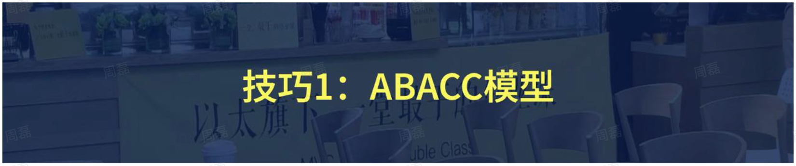

这个方法一堂内部用得非常多，最早是用于非标品说服，比如短视频文案、课程介绍、产品介绍。因为非标品有一个特点，就是用户一开始不一定知道你在讲什么，也不一定知道这东西和他有什么关系。

教育其实也是典型的非标场景，尤其是线上青少年教育。孩子不是天然知道“需求洞察”“刻意练习”“科学决策”“时间管理”这些词为什么重要。

你如果一上来就说，同学们，今天我们来学习一个非常重要的方法论，孩子大概率不会反对，但他心里也不会真的被抓住。

> 【划重点💡】ABACC的完整结构是五步：

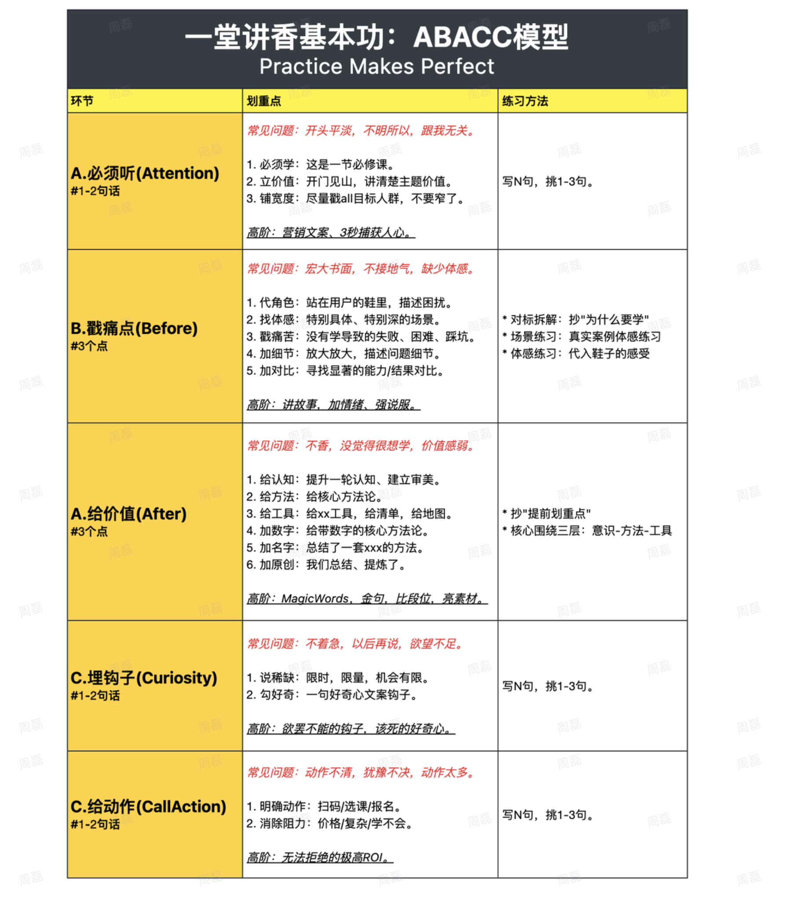

我们把它翻译成教学语言，就是先让孩子觉得这节课和我有关，再让他看到自己现在的问题，然后给他一个学完以后的新可能，再留一点好奇心，最后给他一个马上能做的动作。

我们一个一个拆。

第一个A，Attention，必须听。

在线上课里，开头最怕的是什么？最怕的是老师很有礼貌、很认真、很完整地介绍背景，但孩子完全不知道这和自己有什么关系。比如一上来就说，今天我们要学习需求洞察模型，需求洞察是商业活动中非常重要的底层能力。这个说法没错，但对孩子来说，太远了。

Attention 的核心不是声音大，不是标题夸张，也不是上来讲一个特别热闹的段子。它真正要解决的是一个问题：孩子为什么要在这一分钟，把注意力交给你？他原来可能在刷手机、写作业、发呆、切屏，你必须给他一个理由，让他觉得“等一下，这个好像跟我有关”。

所以第一个 A，不是简单地开个场，它其实是帮孩子完成一次注意力转向。

- 孩子原来不觉得这节课和自己有关，你要让他觉得有关；
- 孩子原来觉得这个概念很远，你要让他觉得很近；
- 孩子原来觉得这事不重要，你要让他发现，好像还挺重要。

这里我给大家三个特别好用的开场范式。大家后面写逐字稿的时候，可以直接拿去套。

第一种范式：这件事很重要，但你可能还不知道。

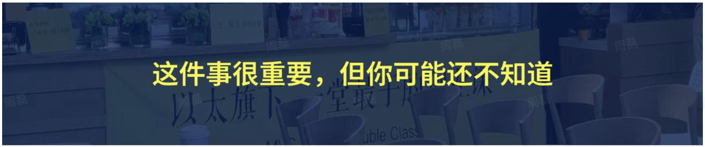

比如你讲需求洞察，可以这么展开：

同学们，你们有没有发现，有些东西你明明不缺，但就是很想买？

比如一个新的笔袋，一个很火的奶茶，一个游戏皮肤，或者一个同学都在用的 AI 工具。

你以为这是你自己突然想要，其实背后很可能有人比你更早知道你会心动。

这个开法的好处是，它没有上来讲概念，而是先把孩子带进一个他熟悉的日常选择里。然后你告诉他：你以为这是随机发生的，其实这里面有规律。

这个时候，孩子会更容易抬头，因为他会感觉，原来我每天遇到的小事背后，还有一套我不知道的方法。

> 【划重点💡】它适合那些孩子低估了重要性的课题，比如时间管理、需求洞察、科学决策、知识管理、领导力。你要做的不是吓唬他，而是让他发现：这不是远处的大词，这是我身边已经在发生的事。

第二种范式，叫：这件事你们通常是这么理解的，但其实可能理解错了。

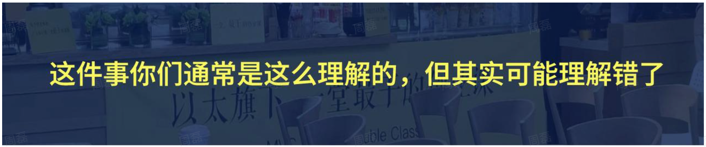

这个范式特别适合讲一堂的方法论，因为一堂很多课，本质上都是在纠正常识误区。

比如刻意练习，孩子通常会以为练习就是多做题、多重复、多花时间。你可以这样展开：

很多同学以为，练习就是把题多刷几遍，把单词多背几遍，把琴多弹几遍。

但如果只是重复已经会的东西，你练得越多，可能只是越来越熟练地停在原地。

这个开场就会抓人。因为它不是顺着孩子的旧理解讲，而是轻轻拧了一下：你以为努力就等于进步，但这件事可能没那么简单。孩子会想，那到底什么样的练习才有用？这时候你就有机会进入刻意练习的核心。

再比如你讲人生红点，可以这样展开：

很多人一听人生红点，就以为今天要找到一个一辈子不变的使命，找到一个特别宏大的梦想。

但对中学生来说，人生红点一开始不一定是使命，它更像一些反复出现的线索：哪些事你会不自觉投入，哪些问题你会特别在意，哪些作品你做完以后还想继续改。

这里也是在纠偏。孩子原来可能觉得人生红点太大、太玄、太遥远，你告诉他，其实不是让你今天找到终身答案，而是先学会识别线索。这个时候，课题就从一个宏大命题，变成了一个可以进入的学习任务。

再比如科学决策，也可以这样展开：

很多同学以为，会决策就是选一个最正确的答案。但真实世界里，很多选择一开始根本没有标准答案。

科学决策不是帮你算出一个永远不会错的选项，而是让你在信息不完整的时候，更清楚地看见收益、成本、风险和检查点。

> 【划重点💡】这个范式的关键，是先说出孩子原来的理解，再温和但明确地指出：这个理解不够准。不是为了否定孩子，而是制造一次认知转弯。只要这个弯转得好，孩子就会愿意继续听。

第三种范式，叫：这件事你们觉得很难、很复杂，其实可以变得很简单。

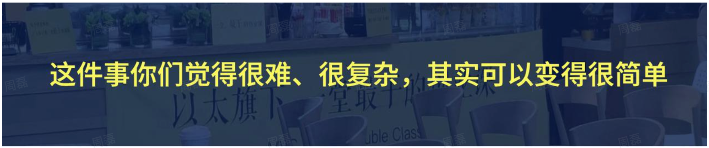

比如你讲科学决策，可以这样展开：

选科、选社团、选竞赛、选专业，听起来都很大，好像每一步都不能错。

但今天我们先不追求做一个完美选择，我们只学一个动作：把一个选择拆成得到什么、失去什么、最坏会怎样、什么时候回来看。只要能拆开，选择就没那么吓人。

这就是把复杂问题简单化。孩子原来觉得决策很大，很成人，很沉重；你告诉他，今天先不用解决人生，只学会拆一个选择。这个时候，他就会愿意跟上。

再比如你讲时间管理，可以这样展开：

很多同学觉得时间管理很复杂，好像要做一张很厉害的计划表，要特别自律，要每天精确到几点几分。

但今天我们先不做复杂系统，我们只做一件事：给任务分盒子。

哪些必须今天做，哪些可以晚点做，哪些其实可以不做。任务一分盒子，脑子就没那么乱了。

这个开法也很适合青少年。因为孩子不怕学习新东西，他怕一上来就觉得自己做不到。你把复杂方法降到一个小动作，他就会觉得：哦，这个我可以试一下。

再比如你讲个人知识管理，可以这样展开：

知识管理听起来像大学生、研究者才需要做的事，但今天我们先不讲复杂工具。

我们只问一个问题：你学过的东西，下一次需要用的时候，你还能不能找回来、用出来、改得更好？如果找不回来，那它就只是存在本子里，不一定真的存在你脑子里。

> 【划重点💡】这个范式特别适合那些孩子一听就有压力的课题，比如科学决策、时间管理、知识管理、AI双三角、产品内核。很多课题如果直接讲名字，孩子会觉得太难了，跟我没关系。但你如果能把它拆成一个简单动作，他就愿意进来。

> 【划重点💡】大家可以发现，这三个 Attention 范式，背后其实都是在制造一个开场的张力。

- 第一种是重要性张力：这件事很重要，但你可能还不知道。
- 第二种是认知张力：你原来这么理解，但其实可能理解错了。
- 第三种是难度张力：你以为它很难、很复杂，但其实可以先变成一个简单动作。

这三个范式，大家后面写每一节课开头的时候，都可以拿来试一下。你可以问自己：我这个课题，最适合从哪一种张力开场？是告诉孩子“这件事比你想象中重要”，还是告诉他“你原来的理解可能不准”，还是告诉他“这件事没有你想象中那么难”？

所以 Attention 的关键，不是你开头讲得多漂亮，而是你有没有在 30 秒到 1 分钟里，让孩子产生一个念头：这事跟我有关，而且我好像有必要继续听。

只要你能把这三个句式里的任意一个写顺，你的开头就不会太差。它至少会比“今天我们学习一个重要方法论”更容易抓住孩子，因为它不是从老师的课程目录出发，而是从孩子的注意力、误解和行动门槛出发。

第二步是 B，Before，戳痛点。

注意，给孩子讲课的时候，戳痛点不是制造焦虑，更不是吓唬孩子。它的意思是，你要说出孩子现在真实存在但还没有被充分意识到的困扰。

比如你讲时间管理，孩子的痛点不是你缺少高效能人士的时间分配系统，这句话太成人了。

孩子的真实痛点可能是：你是不是经常觉得作业也没少写，时间也没少花，但一到晚上还是发现最重要的那件事没做？你明明很忙，但忙完以后反而有点心虚，因为你也不知道今天到底推进了什么。

这个时候，孩子会有体感。因为你说的不是概念，你说的是他某一天晚上10点半坐在书桌前的状态。

线上课里，这种体感特别重要，因为你看不见他的眼神，你只能靠语言把他的注意力拉回来。

第三步是第二个A，After，给价值。

前面讲了问题，后面必须马上给孩子一个新可能。孩子要知道，听完这节课以后，我不是多知道一个词，而是多了一个动作、多了一个工具、多了一种看问题的方式。

比如你可以说：今天这节课讲完，你不一定马上变成时间管理高手，但你至少会学会一个动作：把脑子里一团乱的任务，放进几个清楚的盒子里。你以后不是靠焦虑推进学习，而是靠一个个小盒子安排自己的行动。

这里的价值就比“提高效率”更具体。

第四步是Curiosity，埋钩子。

线上课特别需要钩子，因为孩子的注意力会不断掉出去。钩子不是故弄玄虚，而是给孩子一个继续听的理由。

比如你讲需求洞察，可以说：等一下我们会做一个小练习，你会发现，你最近一次想买但最后没买的东西，其实里面藏着一个非常清楚的需求信号。

孩子会想，什么信号？我买不买东西，怎么还能被分析出来？这个好奇心就能带着他往下走。

第五步是 CallAciton，给动作。

教学里的 CallAction，是给学生一个清楚的课堂动作。

线上课里，动作一定要具体，不能说大家思考一下，因为思考一下对孩子来说太虚了，也很难被老师观察。

更好的说法是：现在给大家 60 秒，在评论区写下你最近一次特别想买但最后没买的东西，只写物品名字就可以。比如耳机、球鞋、盲盒、游戏皮肤、一本书，都可以。

这个动作就很具体，孩子知道要干什么，老师也能看到有没有人动起来。

所以，ABACC 对线上课的意义，就是把一节课从老师把内容讲完，变成孩子被一条故事线带着往前走。

他先被抓住，然后发现问题，然后看到价值，然后被好奇心牵引，最后做一个动作。

只要这个结构在，线上课就不容易散。

大家以后备课的时候，可以先不急着做PPT，也不急着找很多案例。你先问自己5个问题：

1. 我这节课的ABACC是什么？孩子为什么必须听？
2. 他现在有什么真实痛点？
3. 我给他的价值是什么？
4. 我中间埋什么钩子？
5. 我让他立刻做什么动作？

这五个问题想清楚，课程的主线就先稳了一半。

---

## 13 技巧2：十指讲香

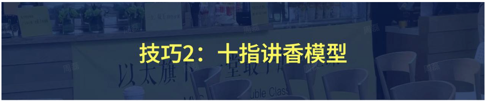

有了ABACC，解决的是整条故事线的问题。但只有故事线还不够，因为一节课里面会有很多局部节点：一个概念、一页图、一个案例、一个任务、一句转场。任何一个局部太干，孩子都可能在那里掉线。

所以第二个技巧叫十指讲香。它的核心很简单：怎么把一个价值点讲得更具体、更有吸引力、更容易被听众感知到。一堂以前在商业表达里经常讲“讲香”，意思不是夸大价值，而是把本来有价值的东西讲到别人真的能感受到。

十指讲香完整来说有两只手：

- 左手是向下做具体，比如场景化、口语化、数字化、故事化、素材化；
- 右手是向上拉价值，比如比喻化、金句化、情绪化、冲突化、升华化。

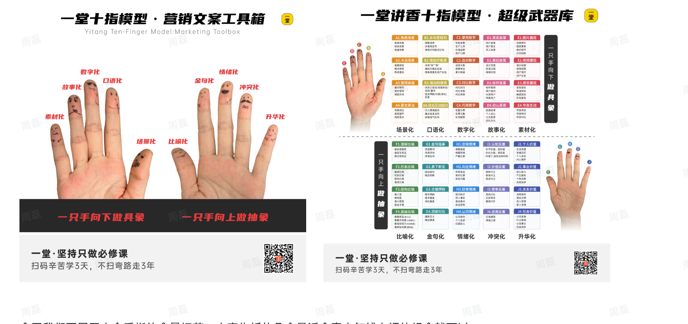

今天我们不展开十个手指的全量细节，大家先抓住几个最适合青少年线上课的组合就可以。

第一个特别重要的是场景化。

很多老师讲不好青少年课，不是内容不对，而是场景错了。你拿成人世界里的公司、客户、融资、增长、组织管理去讲，孩子未必不能理解，但他需要跨太多层，听起来就会有距离。

这些场景不一定宏大，但孩子有体感。只要有体感，他就愿意跟你往下走。很多时候，孩子不是不爱学习复杂东西，而是他需要一个入口。入口近一点，他就愿意进去；入口太远，他还没进去就觉得这不是我的事。

第二个是口语化。

口语化不是把内容讲得很随便，而是把大词翻译成人话。比如“识别真实需求”，可以翻译成“你能不能看出来，一个人嘴上说想要的，和他真正会行动的东西是不是一回事”。

给青少年讲课，特别怕一上来就是抽象名词连着抽象名词。孩子可能每个字都认识，但连在一起没有画面。线上课里，一旦没有画面，他就很容易退回到一种礼貌性听课状态，看起来在线，其实已经不进脑子了。

第三个是故事化。

故事不是为了热闹，而是帮助孩子把概念放进一个可理解的过程里。不要只说“错误的时间管理会导致低效”，你可以讲一个孩子周日晚上赶作业的故事：下午说先休息半小时，结果刷视频刷到晚饭；吃完饭想开始写，又发现资料没找；最后越急越乱，写到很晚还觉得自己一天都在忙。

这个故事讲完以后，你再引出时间管理，孩子就不会觉得你在讲一个空泛道理。因为他已经在故事里看见自己了。

第四个是比喻化。

比喻特别适合青少年，因为它能快速建立认知锚点。

比如讲知识管理，可以说“笔记不是仓库，笔记更像你的第二个大脑。如果你只是把东西塞进去，从来不分类、不调用，那它就不是大脑，只是一个杂物间。”这样的比喻，会比直接讲“知识管理要重视输入、加工、输出”更容易被孩子记住。

第五个是冲突化。

冲突化不是制造矛盾，而是让孩子看到旧做法和新做法之间的差异。孩子很多时候不是不知道该努力，而是不知道自己现在的做法错在哪里。如果你能把差异讲出来，他就会有一种“哦，原来问题在这”的顿悟。

比如讲刻意练习，你可以说：“很多同学以为练习就是重复做题，做得越多越努力。但刻意练习不是把会的东西重复一百遍，而是找到那个你刚好不会、但踮一踮脚够得着的地方，反复打磨。”这里就有冲突：低水平重复和刻意练习不是一回事。

> 【划重点💡】十指讲香和ABACC的关系，大家可以这样理解：

- ABACC是整条路，十指讲香是路上的每一个景点怎么设计；
- ABACC决定孩子愿不愿意一路跟着你走，十指讲香决定孩子走到每一段的时候，有没有看到东西、有没有感觉、有没有记住。

这就是讲香。它不是换几个漂亮词，而是让一个抽象价值点落到孩子能看见、能听懂、能操作的地方。尤其线上课里，老师不能只追求“我讲得准确”，还要追求“孩子有没有感觉”。准确是底线，有感觉才会进入。

> 【提醒💡】不过这里也要提醒一句：青少年化表达，不等于随意改方法论。大家可以讲浅，可以讲具体，可以换场景，可以换比喻，但不能把一堂方法论的底层内核改掉。比如五步法不能为了好记讲成四步法，红九模型不能为了简单改成红五模型。我们做的是翻译，不是重写。

一个比较好的标准是：孩子听起来更容易懂，但成人听完也知道这还是原来的方法论。你只是把门开低了一点，把路铺近了一点，而不是把房子拆掉重盖。

---

## 14 技巧3：十层解读

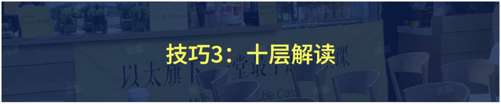

十层解读听起来像是要把内容讲得很复杂，但其实不是。它真正要做的，是把一个知识点和孩子已有的经验、学校学习、生活选择、未来能力连接起来。换句话说，不是往孩子脑子里塞更多信息，而是帮他把原来散落的经验串起来。

在这次讲师培训里，我们不要求大家真的每一个概念都讲满十层。那样会很重，也不适合所有线上课。

很多时候，四个方向就够用：向内看、左右看、向上看、动态看。

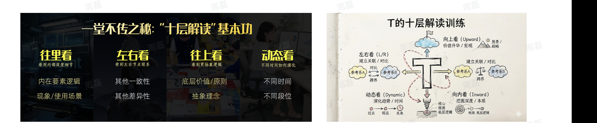

1. 向内看（挖掘深度/本质）：拆解内部构造，看底层逻辑。就是看这个概念的本质是什么。

比如讲刻意练习，你不能只说刻意练习就是反复练。

它的本质是：在明确目标和及时反馈下，持续挑战自己刚好不会的那一小块。这个本质讲出来，孩子才知道它和普通重复不一样。

2. 左右看（建立关联/对比）：与平行工具横向对比。找参照物，建立差异化。就是看它和孩子已经学过、见过、做过的事情有什么关系。

刻意练习可以连接考试订正、体育训练、乐器练习、绘画临摹、游戏升级。孩子会突然发现，原来这些看似不同的事情，背后都有一个共同规律：不是重复越多越厉害，而是反馈越精准、修正越及时，进步越快。

3. 向上看（价值升华/宏观）：连接更高维的系统，找权威背书。就是看它背后训练的是哪种更大的能力。

刻意练习表面上是在讲学习方法，往上看，其实是在训练一个人面对卡点的能力。

一个孩子如果能习惯性地发现自己卡在哪一步，愿意把卡点拆小，并且持续修正，他未来学任何东西都会更稳。

4. 动态看（演化趋势/时间）：放入时间轴，看成长路径。就是下一次遇到类似问题，孩子可以怎么用。

比如你可以问孩子：下次你数学题错了，不要只写一个正确答案就结束。

你可以问自己三个问题：我是不懂概念，还是看错条件，还是步骤不熟？这三个卡点，对应的练法是不一样的。

你看，这样讲完以后，孩子获得的就不是一个孤立知识点。

他会感觉这个东西和自己的考试、运动、兴趣、游戏、未来学习都有关系。这个时候，收获感就出来了。

---

## 15 技巧4：逐字稿

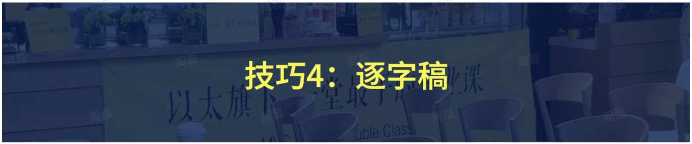

最后一个技巧，是逐字稿。这个东西一堂从很早就开始用，而且我个人觉得，对这次讲师共创来说，它可能是最重要的交付工具之一。

很多人一听逐字稿，会有一点误解，觉得逐字稿是不是写作文，是不是要把课讲得很死，是不是老师照着念就没有现场感了。其实不是。逐字稿的本质不是写作，而是把现场说话能力提前设计出来、训练出来。

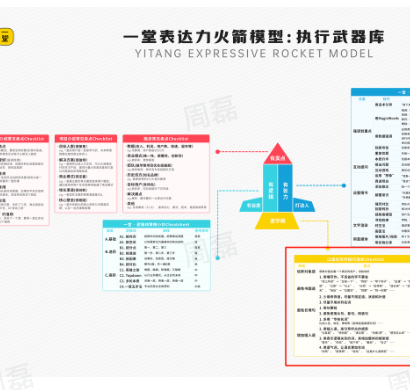

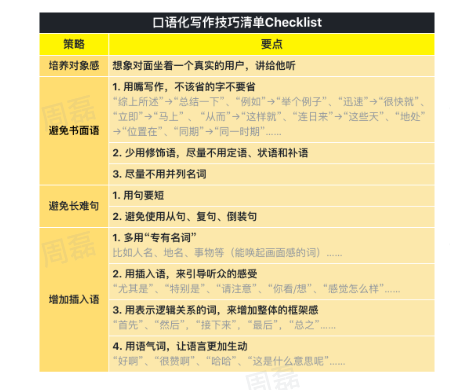

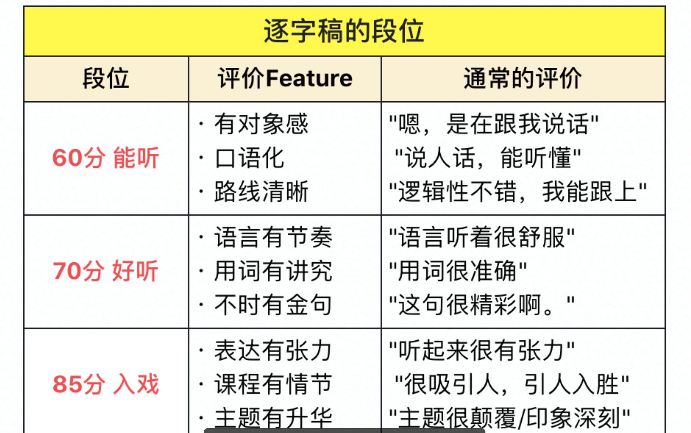

尤其是线上课，逐字稿特别重要。因为线上课的很多问题，现场才发现就晚了。

你讲到第8分钟发现孩子没反应，讲到第15分钟发现互动太虚，讲到第25分钟发现收不回来，这些都不是现场临时能完全解决的，它们要在写稿的时候就提前设计。

没有逐字稿的时候，很多老师备课其实停留在我大概知道我要讲什么。

这在熟悉的线下场景里也许还能撑住，但在线上青少年课里风险很高。

因为你不是只要知道讲什么，你还要知道怎么开头、怎么转场、怎么发起互动、孩子不回应时怎么兜底、最后怎么收束。

逐字稿的第一个好处，是减少临场不确定性。你不需要每一个字都背下来，但关键句、关键例子、关键互动话术，最好提前写出来。这样你到了现场，不会因为紧张或者节奏变化，把最重要的东西漏掉。

第二个好处，是保证课程结构不散。线上课最怕老师讲着讲着，自己也进入发散状态。一个案例很好玩，就多讲了5分钟；一个互动没人回，就慌了；一个概念没解释清楚，就临时补很多。

逐字稿能帮你守住节奏，让每一个部分都有它的位置。

第三个好处，是方便磨课和共创。如果你只有一个PPT，别人很难判断你到底会怎么讲。

但你有逐字稿，教研、同伴、Partner都可以直接帮你看：这个开头抓不抓人，这个例子孩子有没有体感，这个任务指令清不清楚，这个结尾有没有收获感。

第四个好处，是帮助经验不足的讲师建立稳定交付底线。我们不是要求每个老师一上来都是天才型老师，现场随便一讲就特别精彩。

更现实的路径是，我们用逐字稿把表达变成可以训练的东西。你先写出来，再读出来，再改到像人话，再录一遍，再拿反馈继续改。

最后我想把这一部分收回来。线上课难，不是因为孩子天然不爱听，也不是因为老师必须变成表演型人格。线上课难，是因为反馈变少了，注意力更碎了，孩子的听课过程的线性习惯不同了。所以老师必须把很多线下可以临场处理的东西，提前设计出来。

- ABACC是帮你设计完整故事线，让孩子知道为什么要听、听了有什么用、下一步做什么。
- 十指讲香是帮你把局部讲具体，让孩子在每一个关键点上都有体感。
- 十层解读是帮你做最后的连接，让孩子不是只听懂一个例子，而是形成迁移和收获感。
- 逐字稿是把这一切落下来，让它能被练习、被反馈、被修改。

所以，这次我们对讲师的期待，不是大家第一次就讲成一个完美的老师。

更重要的是，你要开始用一套专业的方法准备课程。你不是凭感觉讲，不是靠临场发挥赌状态，而是能把一节课拆成故事线、局部表达、收获感和逐字稿，然后一轮一轮打磨。

---

## 16 写在最后

好，到这里，今天这场培训主体内容基本讲完了。

最后这部分，我想做两件事。

第一，把这次活动的原则和红线再明确说一遍。因为前面我们一直在讲动力、讲方法、讲怎么做，但只要最后这节课要走到孩子面前，它就一定要有底线。

第二，我想再回到开头，讲一讲我们为什么要做这件事。因为我知道，大家听完前面的内容，可能会有两种感觉：一方面会很兴奋，觉得这件事很有意思；另一方面也会觉得，哇，原来做一节真正能给孩子讲的一堂课，这么难。

第一句话：守住底线

这次一堂×探月暑假新实验，本质上不是一次普通的讲师招募，也不是一批课程外包。它是一次开放的、非商业的教育创新实验。一堂这次不向孩子收钱，也不向讲师收/付钱，我们开放的是一堂过去几年沉淀下来的方法论、课程地图和教研标准。

所以越是开放，越要守住边界。不是因为我们想限制大家，而是因为这次面对的是孩子，是青少年，是一堂和探月共同发起的公开实验。我们既要保护孩子的学习体验，也要保护讲师的交付体验，还要保护这次实验本身的信用。

接下来我想讲一下，这个活动到底为什么能够共创，以及共创的边界到底在哪里。

这里面有三条基本原则。

第一条，叫官方授权。

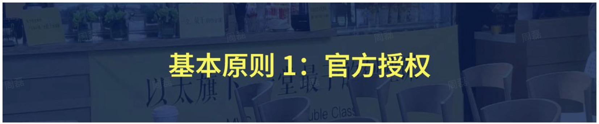

这次我们是首次开放3个大类、15个课题的官方授权。

这件事其实挺不容易的。

因为一堂过去很长时间，本质上是一家做原创教材、原创方法论、原创课程地图的公司。我们不是随便攒一些知识点，也不是把网上资料整理一下，就说这是一门课。我们背后是有大量案例、作业、真实商业实践、学员反馈和教研标准的。

所以这次开放授权，不是说大家可以拿一个标题出去讲，而是说，大家可以在一堂官方课题和官方方法论的基础上，去做青少年化表达，去做场景转译，去做教学设计。

这个授权是机会，也是责任。

大家拿到的不只是一个课题名，而是一套已经有底层结构的内容资产。所以我们希望大家珍惜它，也保护它。

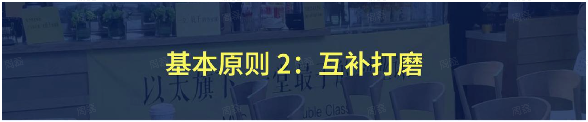

第二条，叫互补打磨。

这也是我觉得这次实验最有意思的地方。

之所以可以互补打磨，前提就是我们之前说的教材教学分离：一堂负责教材的部分，而大家来负责教学的部分。

一堂擅长什么？一堂擅长做方法论，擅长做课程地图，擅长从大量复杂案例里提炼结构，擅长把一个看起来很玄、很散、很凭经验的东西，变成一个可以复用、可以迁移、可以训练的模型。这是我们的稀缺。

我们这次希望招募的老师，你们也有一堂非常欠缺的、你们稀缺的东西。比如：

- 你们可能更懂一个六年级孩子听到需求分析四个字的时候，脑子里到底是什么反应；
- 你们可能更知道一个初中生为什么对时间管理有抵触；
- 你们可能更知道在授课过程中，孩子什么时候会兴奋，什么时候表面点头其实没听懂。

这些东西，一堂在成人课堂里很熟，但在青少年场景里，必须向大家学习。

所以这次不是一堂单向给内容，老师单向执行。

更理想的状态是：

- 一堂提供课程的魂儿，提供方法论的骨架，提供底层标准；
- 各位老师提供真实场景、微观体感、说话技巧、教学技巧、孩子沟通经验。

最后我们一起把它打磨成一门真正能交付的青少年课程。

说白了，一堂有骨架，大家有血肉。骨架不能乱，但血肉一定要长出来。

不然这个课就会变成成人课低龄化，孩子听不进去，老师讲起来也很痛苦。

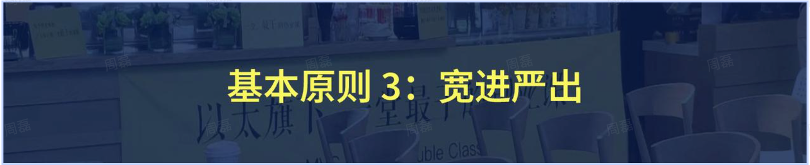

第三条，叫宽进严出。

这句话可能听起来有点硬，但我希望大家理解它背后的善意。

我们默认最后只保留30-50个讲师席位，但目前报名人数已经接近10倍。这个热情我们非常感动，也说实话，有一点点压力，hhhh。

因为教育交付这件事，不是热情够就可以的。

尤其这次面对的是孩子，是青少年，是一堂和探月共同发起的一个公开实验。我们既要保护学生的学习体验，也要保护各位老师的交付体验，还要保护一堂和探月的品牌信用。

原则上我们鼓励多分享，采用宽进严出，大家都能报名：

- 第一轮：提交申请作业
- 第二轮：内部学习和打磨课程，参加分享，对话partner
- 第三轮：提交你的逐字稿，进行入围评审
- 第四轮：正式分享Live（40-120min，私下录课+邀约直播）

宽进，是欢迎大家带着热情和经验进来。

严出，是确保最后交到孩子面前的东西，是靠谱的、清楚的、有质量的。

说完了合作的原则，我也再明确几条红线：

第一条，不改方法论。

大家可以化简方法论，可以用更适合孩子的表达，可以讲浅一点，可以换案例、换场景、换互动、换比喻，但是不能改方法论的内核。比如：

- 一堂五步法，不能为了好记，讲着讲着变成四步法
- 人生红点或者红九模型，不能讲着讲着变成红五模型
- 刻意练习不能讲成多努力就会进步
- 科学决策不能讲成听从内心做选择

我们做的是青少年化转译，不是重新发明一套方法论。

入口可以变，案例可以变，难度可以变，语言可以变，但底层结构不能变。

孩子听起来更容易懂，但懂一堂的人听完以后也要知道，这还是一堂的方法论。

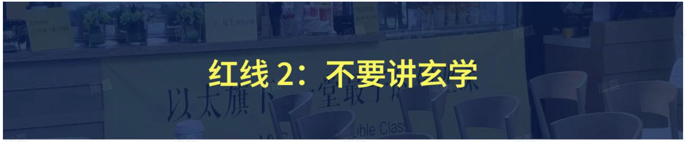

第二条，不要讲玄学。

这里我说得直接一点，不要用那些听起来很有感染力，但最后没有办法观察、没有办法验证、没有办法训练的表达。

一堂的方法论一直有一个很朴素的审美：尽量把事情讲得可观察、可拆解、可练习、可验证。

- 我们可以讲感受，但最后要落到动作；
- 可以讲状态，但最后要落到方法；
- 可以讲启发，但不要把启发包装成定律。

✗比如不要说孩子没有行动，是因为内在能量被卡住了

✓可以说孩子没有行动，可能是任务太大、反馈太慢、第一步不清楚，我们先把任务拆成一个15分钟能完成的小动作。

✗不要说你要提升自己的心力，才能管理时间

✓可以说你先把任务写出来，分成必须做、应该做、可以不做，再给每一类安排固定时间。

青少年课程里：

- 我们要少给孩子贴标签，多给孩子递工具
- 少讲神秘解释，多讲具体动作
- 少下断言，多保留假设和验证

这样课程才是安全的，也才是一堂的味道。

第三条，不要纯AI。

我们不是不让大家用AI。恰恰相反，这次我们会鼓励大家用课程灵感官Partner，帮你梳理大纲、追问场景、发散案例、整理干货点，甚至帮你做一版故事线草稿。

但不能纯AI写完之后，你自己不审核、不判断、不消化，就直接交上来，甚至直接拿去讲。

这会有两个问题：

第一，AI很可能会把一堂的方法论讲偏，表面很顺，里面其实不对。

第二，AI写出来的稿子，往往缺少老师自己的真实场景和微观体感，孩子一听就知道，这个东西离我很远。

所以我们的要求不是禁止AI，而是人要负责。

- Partner可以帮你发散，但不能替你判断；
- Partner可以帮你追问，但不能替你负责；
- Partner可以帮你整理，但不能替你交付。

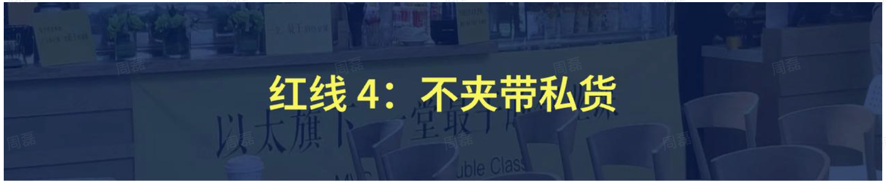

第四条，不夹带私货。

这一条我想特别补一下。因为这次是一个完全开放的非商业活动，一堂不收钱，甚至我们和探月来承担了所有的活动成本，我们只想纯粹地推进这个有价值的教育实验。

我们也不接受任何人借这个机会来做商业转化。

所以大家原则上除了使用一堂的方法论、课程题目和科学框架以外，不要夹带私货。

你不能把这节课变成宣传你自己的产品、训练营、咨询服务，

也不能把它变成“终于有机会讲讲我自己的理论体系”。

比如你反复讲自己的某个产品多好，反复引导孩子或家长关注你的服务，

或者把一堂课题包装成你自己那套没有经过校准的理论，这个就不行。

这次我们做的不是个人观点课，也不是个人品牌课。

我们更像是在做一套面向孩子的、教科书级别的科学方法课。所谓教科书级别，不是说它要很板正、很枯燥，而是说它要尽量站在一个更高、更公允、更科学的视角上。

一堂在这里也不是讲Truman的个人观点，不是讲某一个老师的个人观点，而是尽量站在一个“千人广场”的视角，去提炼一类孩子共同面对的问题，提炼一套可以被更多人理解、练习和复用的方法。

如果后面评审时，我们发现课程里反复夹带个人商业宣传、个人产品、个人理论体系，或者明显把这次开放实验当成自己的获客入口，那我们会直接拒绝。这一点也请大家提前理解。

第二句话：期待惊喜

最后，我想回到开头，再讲一下我们做这件事情的初心和使命。

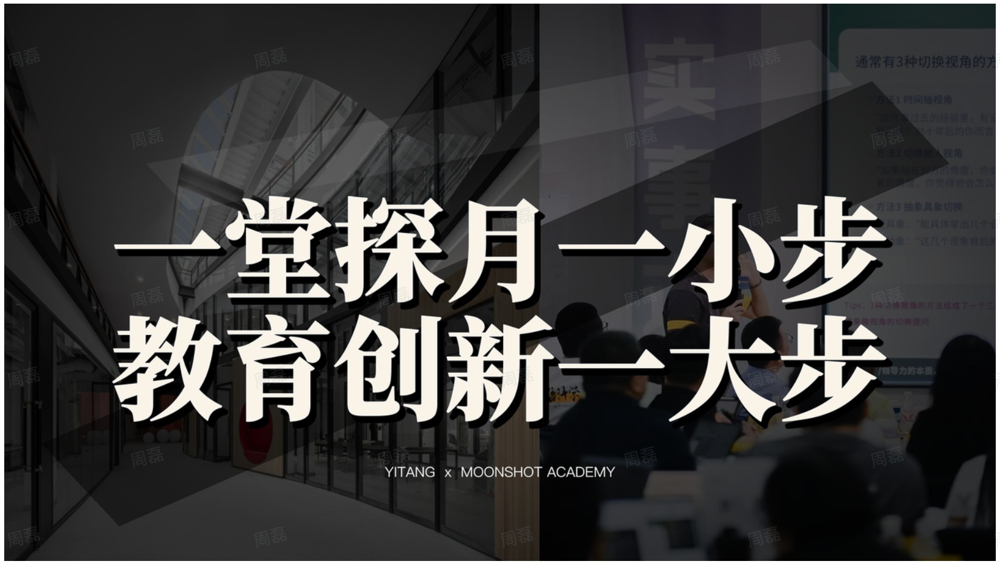

我估计很多同学听完今天这场，会很兴奋。因为你会发现，原来做一节课不是凭感觉讲，不是靠临场发挥，不是把成人课变简单一点，而是有一整套方法可以打磨：抓课魂，定人群，研究 Before/After，做干货点清单，写 ABACC，写逐字稿，一轮一轮改。

但我也估计，会有很多同学听完以后觉得：太难了——原来一节真正给孩子讲的一堂课，成本这么高，要想这么多事情，要改这么多轮，要守住这么多标准。

注定也会有一些同学走到中间，觉得成本太高、时间不够、自己暂时做不到，然后放弃。

这都没关系。

因为这本来就是一次宽进严出的实验。我们不是要求每一个人都必须走到最后，也不是要求每一个人第一次就做出一节完美的课。我们真正想看的是：有没有一批人，愿意先站出来，愿意把这件事当成一个认真作品，愿意把一堂的科学方法，翻译给更早的人。

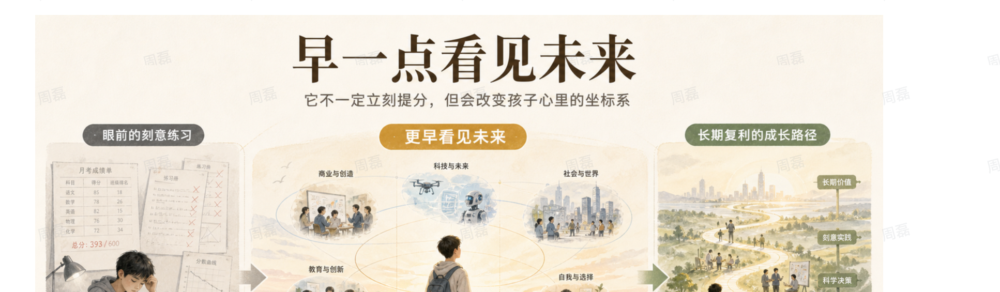

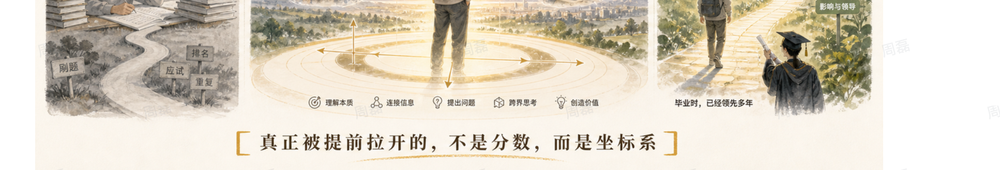

如果一个孩子可以在很早的时候，就开始意识到有一个东西叫用户需求，有一个东西叫产品价值，他会不会更早理解：世界不是围着自己的想法转，真正重要的是别人遇到了什么问题，自己能不能提供价值。

如果一个大学生可以很早意识到，原来创业不是热血、不是灵感、不是拍脑袋，而是一套科学方法：需求、解决方案、商业模式、增长、壁垒，一步一步验证，他未来做项目、做选择、做职业规划，会不会完全不一样。

如果一个中学生可以更早意识到刻意练习，意识到学习背后是有底层逻辑的，他会不会不再简单地把失败归因成“我不行”“我没天赋”，而是能去问：我到底卡在哪一步？我有没有反馈？我是不是只是在低水平重复？

如果一个孩子更早理解时间管理、科学决策、知识管理、人生红点，他可能不会立刻变成一个多么成熟的人。我们也不需要孩子过早成熟。但他会不会在心里提前埋下一些科学的种子？等他以后遇到考试、选择、项目、挫折、机会的时候，这些种子可能会慢慢长出来。

一堂过去的能力，更多覆盖的是毕业之后很多年的——很多人是工作了、创业了、踩坑了、焦虑了，才第一次认真学习用户需求、科学决策、时间管理、刻意练习、人生红点。

但这一次，我们有没有机会更早一点？

有没有机会让一部分孩子，在小学高年级、初中、高中、大学阶段，就先听到这些东西？哪怕他现在不能完全理解，哪怕他只是记住一句话、一个模型、一个案例，会不会在未来某一个时刻，突然帮到他？

这就是这次实验让我觉得特别兴奋的地方。

它注定是艰难的。因为我们不是把成人课简单压缩，不是把PPT换成卡通图，不是把大词换成小词。

我们是真的要把一堂的科学理念，翻译成孩子可以理解、可以练习、可以带走的课程。

但它也让人无限兴奋，甚至有一点野心勃勃。因为你们这次做的，不只是完成一份作业，不只是提交一节课，不只是争取一个讲师名额。你们有机会把一堂的科学理念传播给更多人，传播给更早的人。

把科学体系和理念，带到一个过去从未涉及过得全新的世界。

最后送给大家一句话：守住底线，期待惊喜。

守住底线的意思是，我们这次实验再强调一遍：不要打破底线。我们讲的还是科学方法，讲的还是一堂的基本科学逻辑，倡导的是让孩子尽早理解科学，而不是玄学，不是个人私货，不是商业转化，也不是对一堂方法论的随意改造。

期待惊喜的意思是，大家努力做到最好：多增加一点场景，多增加一点案例，多打磨几轮，多让孩子有体感一点，多让每一个概念落到动作里一点。不要只交一份差不多能讲的稿子，尽量把它当成一个作品。

很有可能，你这节课里的一个案例，一个互动，一个比喻，一个小工具，未来会变成某个孩子很重要的人生资产。也许他很多年以后已经不记得这节课完整讲了什么。

但他会记得：原来做事可以先看需求，原来练习不是重复，原来选择可以拆开，原来我也可以用科学的方法理解自己、训练自己、创造价值。

如果这件事真的发生了，哪怕只发生在一小部分孩子身上，这个实验就非常值得。

所以，再次恭喜今天在直播间的同学。你们已经进入了第一波训练入围。

> 【互动🤦♀️】有信心走到最后的同学，也请你在评论区立下 Flag：一定做课

接下来，带着今天这套方法，去选定你的课题和年龄段，去和课程灵感官 Partner 做一轮访谈式磨课，去整理你的干货点，去写你的第一版逐字稿。

---

## 17 本次作业

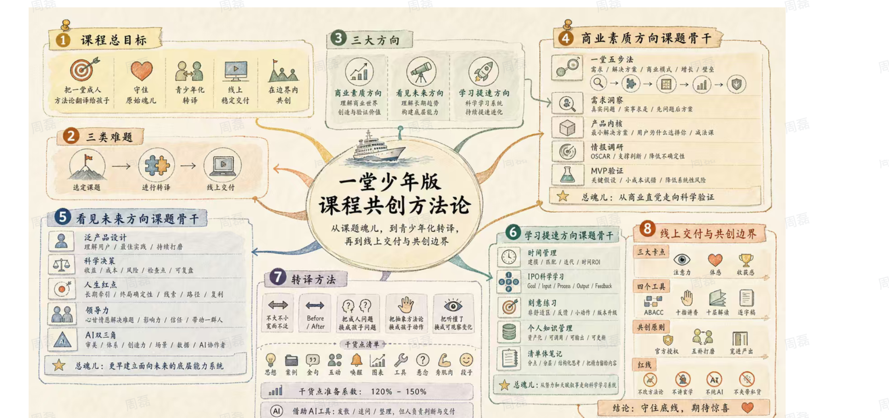

请围绕一堂开放的3大方向、15个课题，选择其中1个课题（如果你想讲多个课题，可以反复提交），提交一份面向青少年的课程设计，这份作业将作为后续讲师入围评审的重要依据。

这次作业允许使用课程灵感官Partner或其他AI工具辅助，但最终判断、筛选、重写和提交必须由人负责。可以用AI帮你追问场景、整理素材、生成初稿，但不能直接提交纯AI稿。

作业包含三个题目：

第一个题目：课题理解题。

你本次所选的课题是什么，你理解的这个课题的魂儿/中心思想是什么？你打算面向哪个年龄段的孩子讲课，他们学习这个课题的必要性是什么？这个课题如果只让你讲5-10句话，这个课题你最想对孩子传递什么？

第二个题目：教学大纲题。

你可以在这个题目里写一写，你选的课题，面向的年龄段，预计讲课时长是多久？你的教学目标是什么，希望通过你的课程让孩子发生什么样的变化（before/after研究）？你可能会选用哪些案例？你可能会纳入哪些干货点？

你可以用清单体笔记的形式来呈现，一方面可以帮你梳理思路，同时便于你后续扩展成课程逐字稿。

第三个题目：教学逐字稿。

你可以基于你的教学大纲完整展开成逐字稿。我们会基于大家的逐字稿情况来敲定最后的讲师（逐字稿越详细越丰富，越容易入选。）

建议大家用飞书来提交，记得开互联网可阅读/编辑权限。

最后，请大家记住这次作业的目标不是写一份漂亮文档，而是开始真正做课。

第一版不用完美，但一定要开始。守住底线，期待惊喜。

好啦，今天的分享就到这里了，感谢大家~

---

<!-- 转录范围：01 ~ 17；图片 74 张 -->

---

*本课程文档由 course-shots-to-local-md 技能转录生成，正文与图片均可在源截图（`/Users/panda/Desktop/03 一堂课程/04 做课培训/`）中逐字回源核对。*
