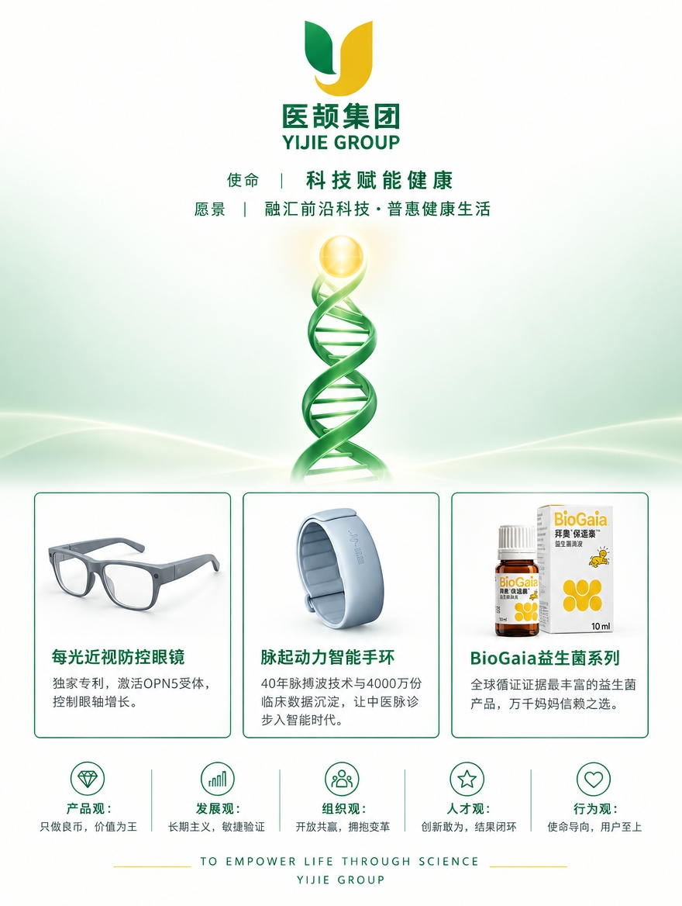

### **贺雷：**非技术CEO半年带传统跑进AI原生

**视频回放**

https://yitanger.feishu.cn/minutes/obcnu52k82mc531bsp8592ik

我们要讲一件更难的事：**怎么把一个人的 AI 能力，复制给一群真实的人，最后推动一个组织改变工作方式。**    

如果你现在正在带团队，或者未来希望自己的组织更快进入 AI 原生状态，这个案例会非常有启发。    

**【思考🙋】**先代入想想，如果你是一个 CEO 或负责人，团队大多数人还不会用 AI，你会先从哪个场景开始推大家使用？你会怎么思考这个问题？    

——    

大家先不用着急回答，但这是一个很重要的问题，可以带着这个问题来听下面这个案例。    

这个案例的主角，贺雷，是一位很新的同学，加入一堂还不到一年，但很快他就引起了我们的注意哈哈。先简单看看他的履历介绍：    

> •之前学的是医学、药学，不是 AI 或工程背景，但喜欢钻研。 

> •2003年起，曾在两家上市药企，从管培生做到高管，见证了中国第一个重量级创新药从立项到商业化的全过程； 

> •2016年自己创业，做医药行业咨询陪跑，曾帮客户把一个处方药从几千万做到6亿+； 

> •2019开始作为联创，将一家中华老字号的中医药企业做到产值增长4倍，年销售额突破10亿； •2025年12月，受邀加入今天案例中的这家公司担任CEO，刚满9个月的时间。      

这个商业成绩真的是不用多说了，很牛啊。但和 AI 看着没什么关系？其实不是的，他的 AI 学习能力和动手能力，也非常厉害，还是花两分钟简单回顾一下。    

贺雷重度使用 AI 是从2024年开始的，也没有比大家更早多少。    

- 刚开始他主要泡在国外某个大模型开放探索平台，不断摸索使用各种大模型； 
- 2025 年开始用 skill creator 自己手搓各种 skill 和 agent； 
- 2026 年，他就已经把这些个人实践带进了新公司的组织建设。 

这个落地进展是挺快的。但实际上他也不是技术或工程背景，只不过不同在于，**他能持续钻研、持续动手、持续折腾。**一个新东西出来，别人还在看热闹，他当天上手，第二天就搓出自己的版本，搓完用完还复盘，总结出自己的认知和经验。    

但真正让他敢在新组织里强推 AI 的，不是他会搓工具，**而是他在上一家公司先爽过。**    

当时他还在上一家中医药公司，业务会对接很多连锁药店等渠道，因为之前的咨询视角，他会想法儿去赋能渠道，进而提升自己的销售额。**于是他会尝试做很多 AI 小产品、小demo，去帮他们解决问题。**    

- 举个例子，连锁药店有几千到上万个 SKU，可每一家药店的产品到底覆盖了哪些适应症、哪些用户，老板自己都说不清楚。他就用 skill 加 Python，**做了一个「经营分析和品类梳理工具」**。工具刚有雏形，连锁老板就不断把自家药店的底层数据交给他，请他帮忙分析和优化品类；    
- 再比如，他还做过一个**「掌上中医药康养师助手」**，把总部主推产品的介绍、诊疗方案和垂类知识放进知识库，帮助药店店员在现场更快、更准地给消费者建议，大大提高销售效率和精准度。    

>  ↓ 原型Demo概览     

这些个原型当时都做得还挺糙的，受业务限制也没有做成正式的产品，却给了他很强的 AI 落地体感：    
1.  碰到问题，**AI first，先试一把**；    
2.  身先士卒，一定要**把自己推到第一线；**    
3.  更重要的，**AI 不只是写写文案，它可以进入真实业务；只要真正有价值，业务人员真的会用、甚至主动把数据交出来。**    

带着这样的体感和信心，他后来加入了现在这家公司。    

简单介绍一下背景。    

**医颉集团**，2024 年组建的新团队，内部员工一百二十人左右，年销售额约 5 亿，背后是深厚的传统医疗和医药背景。团队成员相对年轻、开放，都**想要做一些行业创新。**    

业务上**两个发动机一起烧，一边坚持严肃医疗的循证能力，一边做新「健康消费品」的 C 端商业化**。比如儿童近视防控的国际专利产品、中医药智能手环、总代的全球知名营养品等等这些新东西，都在等着推广、孵化，有机会面向千亿级市场。 

贺雷是在去年12月，被创始团队、**董事长邀请来医颉担任CEO**的。他加入医颉时，规划就很清晰了，他不是抱着“我们试试看 AI”的心态，而是带着一个更大胆的设想：

- 这家公司的基因是，**既要坚持严肃医疗和循证能力，又要做健康消费品和 C 端商业化；**
- 而研究型团队往往不懂商业，商业型团队又可能缺少研究能力。

**那么，既然很难一次找到这么多同时具备两套能力的人，能不能借助 AI 和组织机制，让一个传统医疗背景的团队，逐步获得全新的 AI 战斗力？他给这个目标起了个名字，叫「智能原生组织」。**

还有一个小插曲值得讲一句。他们之前也想过在 AI 和技术上，**借助外部资源**。

公司和一家头部互联网/AI 大厂有很深的战略合作，对方愿意深度陪跑他们，搭平台、搭工具。**但实际真推起来，处处卡壳**，不论是推进速度、周期、定制化程度等等，总有落差。

贺雷反而因此也越来越笃定：**AI 是必经之路，而且智能原生组织不能靠外部“做出来”，必须从组织内部“自己长出来”。**