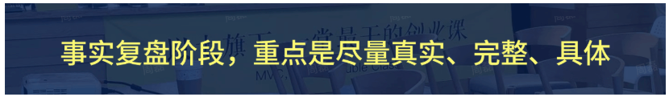
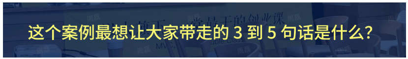
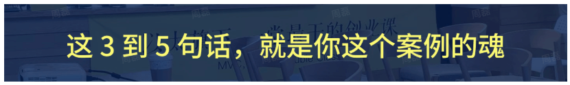
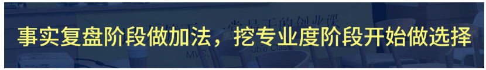
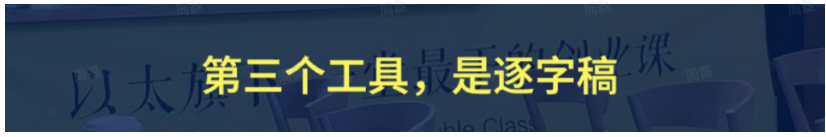
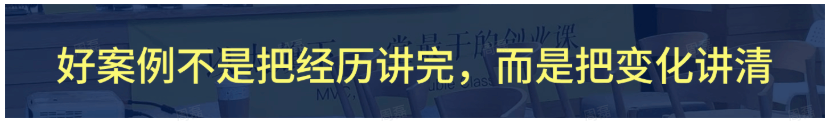

# 如何把汇报打磨成一个好案例 · 课程文档

> 本文档由课程截图转录整理而成。**文字内容完整保留**，截图中的图片、金句卡片、案例封面等视觉元素已从正文中分离，单独存放于 `images/` 文件夹，并在原位置以引用形式嵌入。
>
> 整理原则：
> - 讲课正文逐字转录，保留原本的口语表达
> - 原文中的红字/黄字强调，用 **加粗** 标示
> - 案例代入、互动等标签保留为引用块
> - 截图中的图片只保留图像本身，alt 文本为简短提示

---

## 目录

- [为什么要打磨案例](#为什么要打磨案例)
- [第一步：事实复盘](#第一步事实复盘)
- [第二步：选定魂儿](#第二步选定魂儿)
- [第三步：挖专业度](#第三步挖专业度)
- [第四步：打磨故事表达](#第四步打磨故事表达)

---

## 为什么要打磨案例

今天的分享，算是给大家一次临近终点前的特别提醒。因为越到最后，大家手里的材料一定越多：周报、作业、用户反馈、过程记录、业务数据、团队讨论、复盘文档。但，**材料多，不等于案例好；做得多，不等于讲得清。**

很多同学最后会卡在这里：

> 你明明做了很多事情，但一讲出来像流水账；
> 你明明有一些业务结果，但别人听不懂它为什么重要；
> 你明明经历过很多判断和修正，但最后只讲成了"每一周做了什么"。

你的队伍明明非常优秀，但却表达不出来，这就非常可惜。

所以，今天我想跟大家聊的，就是怎么把这三个月真实做过的事情，打磨成一份真正有价值的案例。

我不太喜欢用"包装"这个词，因为包装听起来像是把一个东西装饰得更好看。但案例打磨不是装饰，它是提炼是翻译，是把真实经历里最有价值的变化、判断和方法重新挖出来，讲清楚。

换句话说，今天我们不是来学怎么把成绩说得更漂亮，而是来学怎么把一件真实发生过的事，讲成一份能被理解、能被相信、也能被别人迁移的案例资产。这个动作，不只是为了最后交一份作业，或者做一次路演。它其实是在帮你把这三个月沉淀下来。

今天的主线很简单，就是教大家如何打磨案例，我会给大家一套打磨案例四步法，但在进入四步之前，我们先看一眼，一份好案例到底应该长什么样。

### 好案例的四个标准

我理解，一份好的案例，至少要满足四个标准：**主线清晰、事实支撑、借假修真、有故事性**。

所谓主线清晰，就是你很明确自己到底想传递什么内容。它有点像我们小时候写作文时说的"中心思想"。当然我们今天不是写作文，但底层意思很像：这个案例讲完以后，你希望大家真正记住什么？

很多案例的问题，不是没有事实，而是事实太多，什么都想讲。增长想讲，产品想讲，交付想讲，团队协作想讲，AI工具也想讲。每一段单独看都没错，但合在一起，听众就会不知道这份案例到底要说什么。

所以主线清晰，不是标题起得好，而是听众听完以后，能说出来：哦，他这次真正讲的是一个什么判断、一个什么方法、一个什么变化。如果听众说不出来，说明这份案例还没有收束成一条线。

你不能空讲观点。你说自己做得好，凭什么？你说团队有变化，变化在哪里？你说这个方法有效，有哪些事实能支撑？

但这里有一个判断很重要：**事实支撑不是材料越多越好。**有些同学会本能地把所有截图都放上来，把所有动作都写上来，觉得这样就显得真实。但真正有用的事实，是能帮助听众理解变化为什么发生的事实。

**做过，不等于必须讲；真实，不等于重要。**

这个是一堂做案例非常重要的一个底层审美。

你的具体业务、具体动作、具体数据、具体项目，其实都是"假"。不是说它不真实，而是说它是一个载体。真正的"真"，是这个案例背后的专业判断、思考框架、方法论，以及可以迁移走的认知。

这个可以迁移走的认知，对内可以指导你下一次的实践，对外就是别人即便不做你的业务也能有收获的内容。

一堂经常讲"教材教学分离"。Truman也经常和我们说，从教学角度来讲，例子和习题不是目的本身，它们是为了帮助大家理解背后的规律和方法。案例也是一样。案例里的业务过程，是为了帮助大家理解方法论怎么在真实场景里应用。

所以一个案例，如果只能让做同样业务的人听懂，当然也有价值，但价值会比较窄。如果一个不做你这个业务、不在你这个行业的人，也能听懂你背后的判断，也能带走一点方法，那这个案例的借假修真就出来了。

有故事性不是编故事，也不是把事情讲得特别夸张。有故事性，是让听众能进入你当时的现场，他愿意一直听下去。他能听懂你一开始遇到了什么问题，后来做了什么选择，哪些地方发生了变化，最后这个变化为什么值得被看见。

所以这四个标准可以压成一句话：**主线让案例不散，事实让案例不虚，借假修真让案例有价值，故事性让案例被听进去。**

> 【🤔互动】大家可以在心里先快速对照一下自己现在手里的案例。如果你已经开始准备路演稿了，可以想一想：你现在最有把握的是哪一项，最没把握的是哪一项？

1. 有些同学可能事实特别多，但是主线还不清楚。
2. 有些同学可能特别知道自己想讲什么，但是事实支撑还不够。
3. 也有些同学可能事实和主线都有了，但是一讲出来就很像工作汇报，借假修真的部分没有出来。
4. 还有些同学内容其实已经很好，但是现场表达上不够有故事性，听众听着听着就会觉得：嗯，我知道你做了不少事，但我没有特别被带进去。

针对大家的卡点，今天我会给大家一套案例打磨四步法，用教研平时打磨案例的思路，把这个事情拆成四步：

> 第一步，事实复盘。
> 第二步，选定魂儿。
> 第三步，挖专业度。
> 第四步，打磨表达。

这四步里面，前面三步其实都是在为你的案例"挖肉""备菜"。最后一步，是把这个案例真正变成一份路演现场能讲出去的表达。

有了这四步，你也能快速判断：我现在这份案例，最需要补的是哪一块。

- 如果事实支撑弱，就先回到事实复盘。
- 如果主线不清楚，就回到定魂儿（中心思想）。
- 如果借假修真不够，就去挖专业度。
- 如果内容有了但不好听，就去打磨故事表达。

接下来我们就来展开讲讲这个四步法。

<!-- 转录范围：00 为什么要打磨案例 -->

---

## 第一步：事实复盘

我们先讲第一步，事实复盘。很多同学一到最后要汇报了，就很自然地开始写稿，开始做 PPT，这个动作很正常，但很容易出问题。

因为你一旦开始写稿，就会不自觉地顺着某一个表达方向往下写。写着写着，你可能就把很多重要事实漏掉了，也可能过早地把一个还没想清楚的主题固定下来。

所以更稳的做法是：**先不要急着写稿，先把事实摊开，列出来。**

哪怕这个案例就是你自己做的，我也建议你先做一轮事实复盘。因为很多人以为自己知道案例全貌，其实只是大致知道自己做过什么。你知道自己开过哪些会，改过哪些版本，交付过哪些东西，但你不一定清楚：

> 这些动作里，究竟是哪一个决策真正扭转了局面？
> 是哪一次调整带来了意想不到的收益？
> 又有哪些当初觉得非做不可的事，现在回头看其实是走偏了？
> ……

事实复盘要做的，就是把所有这些你以为知道、其实并不知道的事实，全部摊在桌面上。

它不是让你罗列功劳，不是只写丰功伟绩，只讲做对的事儿，而是逼你直面那些被忽略的关键节点和潜在错误。

这个过程可能会让你有点不舒服，但它恰恰是帮你把案例价值真正打透的唯一路径——只有当你完整地看见事实全貌，你才知道哪些值得放大、哪些必须避避，也才能在汇报时真正言之有物。

我自己在做案例访谈的时候，通常也是这样。我们一开始不会先问：

> 你这个案例的主题是什么？你最终想怎么讲？哪个案例最重要？

大家可以想象一下，如果你是被访谈人，当你被问到这几个问题的时候，你会不会一上来就很懵？

一上来就定个调，那么结局大多会是：想到哪个说哪个，东拼西凑，越说越乱。

不是因为他们没做过事，恰恰相反，他们做过很多事，一大堆细节记得比谁都清楚。但问题是，这些细节还是碎片，还没有被串成线、织成网。

所以我们会先把事情的全貌打开，怎么打开呢？

你可以想象自己是一个访谈者，一步步追问，把整个事件揭开：

> 这个项目最早怎么开始？一开始手里有什么牌？
> 当时真正要解决的问题是什么？
> 中间发生过哪些关键动作？
> 哪些地方判断变了？
> 哪些地方走了弯路？
> 最后留下了什么结果？
> ……

先别管主题是什么、故事怎么讲、哪个最重要。先把自己当成被访谈对象，认认真真问一遍，把事实理清楚。

因为如果事实没有摊开，后面定魂儿就很容易变成拍脑袋。你可能会先想一个听起来很好的主题，然后再反过来找材料支撑它。这样写出来的东西，现场会有一种包装感。

但如果先把事实摊开，再从事实里面找主线，这个案例会扎实很多。

具体可以从几类事实开始。

**第一类，是起点事实。**起点事实回答的是：一开始是什么状态。这个很重要。因为如果没有起点，后面的结果就会变成一个孤零零的数字。

> 比如你说"我们后来效率提升了"，那原来效率是什么样？
> 你说"我们后来转化变好了"，那原来转化卡在哪里？
> 你说"团队协作变顺了"，那原来到底哪里不顺？

起点状态越清楚，后面的变化越容易被听众感受到。

**第二类，是问题事实。**问题事实回答的是：当时真正要解决的难题是什么。这里不要只写"我们遇到了困难"。这个太泛了。你要尽量写清楚，这个困难具体表现在哪里，它为什么是一个值得被解决的问题，如果不解决会对业务发展有什么影响。

**第三类，是过程事实。**过程事实回答的是：中间做过哪些关键动作。

> 【💡划重点】关键动作不是所有动作。不是说你三个月里做过的每一件事都叫关键动作。关键动作是那些改变判断、改变方向、改变结果的动作。

**第四类，是节点事实。**节点事实回答的是：什么时候出现了关键转折。这个转折可能是一次数据变化，可能是一次用户反馈，也可能是团队意识到原来的判断不对。这个节点很重要，因为它往往是案例故事性和专业度都比较强的地方。

**第五类，是结果事实。**结果事实回答的是：最后发生了什么变化。这里的结果不一定只有业务数字。它也可以是认知变化、流程变化、团队协作方式变化，或者沉淀出了一套新的方法。

不要把结果理解得太窄，否则很多真正有价值的变化会被你漏掉。

**第六类，是弯路事实。**这个很多同学会本能地想删掉，觉得既然最后要路演，就只讲自己做对的部分。其实不一定。

如果一段弯路只是单纯消耗时间，那它可以不讲。但如果这段弯路说明你怎么排除了一个错误方向，怎么修正了一个原来的判断，那它就是有价值的事实。因为案例真正有价值的地方，不只是你最后做成了什么，也包括你是怎么一步一步更接近正确判断的。

所以事实复盘阶段，重点不是写得漂亮，而是尽量**真实、完整、具体**。

这里最怕两件事。

**第一，只写主观感受。**

比如"我觉得这次很有收获""我觉得团队成长很大"。这些感受当然可以保留，但它不能替代事实。你觉得有收获，那到底收获了什么？你觉得团队成长很大，那变化具体发生在哪里？

**第二，只写工作流水。**

比如第一周做什么，第二周做什么，第三周做什么。这个也不是不能写，但是如果只是按时间把所有事情排一遍，最后听众很难抓住重点。

所以事实复盘要做到的，是既不只写感受，也不只写流水，而是把关键事实还原出来。

那怎么把关键事实还原出来？你可以用下面这组问题，像剥洋葱一样，一层层往里问：

> 一开始我们面对的问题是什么？
> 这个问题为什么重要？
> 当时有哪些基础条件？
> 我们做过哪些关键动作？
> 哪些动作改变了后续判断？
> 哪些节点出现了转折？
> 哪些反馈值得保留？
> 最后发生了什么变化？
> 有哪些材料可以支撑这些变化？

这一步步追问下来，你的产物不是稿子，而是一份**事实池**——把所有相关的事实、数据、节点、反馈，全部装进去。

**事实池的原则是：复盘阶段尽量全，上台之后尽量克制。**

好比备菜和上桌，备菜的时候可以多切几样，最后端上桌的菜一定要有取舍。

所以这一阶段，你不用逼自己讲得精彩，也不用焦虑开场怎么写、金句在哪里。你先专心做一件事：把事实摊开，把价值捞出来。

很多案例不是没有价值，是价值还埋在事实里面。事实池就是帮你把这些价值先"挖出来"的工具。挖出来之后，我们才能进入下一步：从这些事实里，找到那条真正的"魂儿"。

<!-- 转录范围：01 第一步 事实复盘 -->

---

## 第二步：选定魂儿

事实复盘之后，下一步不是继续往里堆，而是开始做选择。第二步，是选定魂儿。

这个"魂"是我们教研经常说的一个词。它其实和我们小时候写作文说的中心思想，是类似的意思。就是你要确认：这次通过这个案例，或者通过这次路演汇报，你最想向大家传递什么。

在大航海的路演上如果你没找到"魂儿"会非常吃亏，过去我们很多案主PPT做得很认真，讲一堆动作，讲一堆工具，讲一堆团队怎么配合，数据多么漂亮…但是讲完了一通之后，你会发现投票的时候，很多同学根本记不住他，更记不住他讲了什么。

这就"魂儿"没定住，只是堆叠一堆东西，突突突突地讲了一通，结果讲了和没讲一样，听众啥也没记住。

这里我想特别说一下，定魂不是一上来憋一个漂亮标题。也不是为了让案例显得更高级，硬给它升华一个很大的主题。

**定魂其实是一个很朴素的问题：这个案例最想让大家带走的3到5句话是什么？**

如果你这3到5句话写不出来，后面的内容就很容易散。你会不断往里面塞事实、塞过程、塞结果，但大家没get到你想表达什么。

我以前看到很多同学的复盘，最大的问题不是没有努力，也不是没有结果，而是他没有把"我想讲什么"这件事说清楚。

怎么想清楚魂呢？

有一个很简单的检验方法：你可以先从自己的主观感受进入，比如你可能一开始的感受就是：这次我最大的收获是什么，这次我觉得自己哪里做得不错，这次团队最大的变化是什么…这些感受都可以作为起点。

但不能停在主观感受。

> 你觉得"很有收获"，那要继续问：到底收获了什么？
> 你觉得"做得不错"，那要继续问：为什么算不错？
> 你觉得"团队变化很大"，那要继续问：变化具体发生在哪里？

**主观感受只是起点。**追问下去，才有可能从感受里挖出真正的判断。

具体怎么定魂呢？我建议大家用两组问题，一组对外，一组对内。

**第一问：如果是做我这个业务的人，他们能从我的案例里学到什么？**这一层通常会挖到一些行业know-how。比如这个行业的用户怎么决策，关键卡点在哪里，什么动作有效，什么动作不应该优先做。

**第二问：如果是做类似业务的人，他们能从我的案例里借鉴什么？**这一层可能就不是完全同一个行业了，而是相似模式。比如都是高客单，都是交付型业务，都是私域转化，都是团队协作，都是用AI提效。这个时候，你的案例可能就能给别人一些模式上的借鉴。

**第三问：如果完全不做我的业务，甚至不在我的行业，他们又可以通过我的案例学到什么？**这一层其实就比较接近底层方法论了。因为通常只有方法论是相对可迁移的。放在这次大航海里，因为大家本来就是把一堂的方法论应用到真实商业实战里，所以如果你能在这一层关联到一堂的方法，通常会更好。

比如你到底是怎么做假设验证的，怎么用业务公式拆问题的，怎么用ROI判断优先级的，怎么做用户访谈的。

**对内第一问：这三个月，我们真正拿到了什么结果或者认知？**不一定只有业务结果才叫结果。一个重要认知、一个新的工作方式、一个可以复用的流程，其实也可以是结果。

**对内第二问：我们为什么认为自己做得好？**这个问题很关键。你不能只是说"我觉得我们做得好"。你要问：

> 为什么好？
> 是跟过去的自己比更好了，还是跟同行比更好了，还是跟原计划比更好了？
> 怎么能让大家非常直观地感受到，你说的"好"到底好在哪里？

**对内第三问：我们到底做对了什么？**听众真正想学的，不是你的结果本身，而是你拿到这个结果背后的动作和判断。如果可以的话，你还可以继续问：如果是过去的我，或者其他没有学过一堂方法论的人，在这件事情上可能会怎么做？

> 【💡划重点】这点个问题很有用，因为它天然会带出before和after：听众听到before会觉得很有代入感：对，我以前可能也是这么做的。听到after的时候，就能看到中间的gap，就能感受到方法论的价值。

所以不管是通过对外去想，你想让大家获得什么，还是通过对内去想，你想沉淀什么，最后都是为了找到那3到5句话。

**这3到5句话，就是你这个案例的魂。**

> 【🐱互动】大家现在也可以在心里想一下，如果这次大航海结束，你的案例只能让别人带走3-5句话，那句话大概是什么？

先不用写得很漂亮，它可以很朴素，但一定要有方向。因为这句话出来以后，后面所有内容才知道往哪儿走。

定魂时还有一个提醒：**不要贪多。**一个案例可以有几个支撑判断，但最好只有一个总魂。总魂负责收束，支撑判断负责展开。如果一个案例同时想讲太多主题，最后很可能什么都讲不清。

所以定魂儿这一步，其实是在帮你做一个选择。先确认，哪一个东西是最值得放在主线上的。其他内容可以作为支撑，但是不能都来抢主线。

**魂一出来，案例才从材料堆变成一条主线。**

前面事实复盘，是把材料摊开；定魂，是从这些材料里拎出最值得被看见的那条线。

<!-- 转录范围：02 第二步 选定魂儿 -->

---

## 第三步：挖专业度

定魂之后，进入第三步：挖专业度。这一步，是案例打磨里面真正拉开价值感的一步。

因为前两步，一个是事实复盘，一个是定魂。事实复盘解决的是发生了什么；定魂解决的是我想讲什么。但是一个案例真正有没有价值，往往取决于第三步：你能不能把事实背后的专业判断挖出来。

我们可以简单说，**事实是 What，专业判断是 Why。**很多案例停在 What。

> 我做了用户访谈。
> 我改了流程。
> 我做了测试。
> 我调整了话术。

这些当然都可以讲，但如果只停在这里，听众最多知道你做过什么，不知道你为什么这么做。真正更有价值的是 Why。

> 你当时为什么选择这个动作？
> 为什么没有选择另一个动作？
> 为什么先验证这个假设？
> 为什么这个事实改变了你的判断？
> 为什么这个方法可以迁移到别的场景？

我平时看案例的时候，会特别留意一个地方：这个同学有没有讲出当时为什么这么判断。因为这句话一出来，案例的质感就会很不一样。

如果你你只说自己做了某个动作，它很像一个项目记录。但如果你说，当时我们为什么先做这个动作，为什么没有先做另一个动作，为什么这个动作能帮我们验证一个关键假设，这个时候听众就会开始看到你背后的思考过程。

案例中心真正想要沉淀的，也不是一堆动作，而是这些动作背后的判断。因为动作经常会变，行业不同、业务不同、团队阶段不同，动作都可能不一样。但是判断方式和思考框架，是可以迁移的。

所以挖专业度，不是重新定魂。定魂已经确定了你要讲什么。挖专业度是围绕已经定下来的魂，筛选关键事实，再把这些事实背后的Why挖出来。也就是说，**事实复盘阶段做加法，挖专业度阶段开始做选择。**

你要问：哪些事实最能支撑这个魂？

- 有些事实很热闹，但是不支撑主线，就不要放在主线上。
- 有些事实看起来不大，但是它解释了关键判断，就值得重点挖。

这里还有一个常见误区。

大家不要把专业度理解成把话说得很专业，或者堆很多专有名词，一定一定要说人话。

**专业度不是术语感。专业度是判断力。**

你能不能讲清楚为什么这么做，为什么这个优先级更高，为什么这个事实让你改变判断，为什么这个方法可以被复用。哪怕你说得很朴素，只要判断讲清楚了，专业度就会出来。反过来，如果你讲了很多名词，但是没有讲清楚判断过程，听众反而会觉得空。

所以大家在挖专业度的时候，可以先不要急着找那些听起来很高级的词。

先把朴素的判断讲清楚。
先把当时的选择讲清楚。
先把事实怎么改变判断讲清楚。

这里提醒大家：

- 不要把局部结果说成整体成功。
- 不要把阶段性判断说成长期结论。
- 不要把相关性直接说成因果。

更稳的说法是：**这些事实支持我们做出一个阶段性判断。**这样既有说服力，也比较实事求是。

所以第三步的情绪落点，不是"我终于把所有细节讲完了"，而是"我终于把经历背后的判断讲出来了"。你真正值钱的，不只是做过什么，而是为什么这样做。

<!-- 转录范围：03 第三步 挖专业度 -->

---

## 第四步：打磨故事表达

这里，内容基本成立了。你知道有什么事实，知道要讲什么魂，也知道背后的专业度在哪里。但是最终大家还是要汇报，要在一个有限时间里，把这个案例讲出去。所以第四步，是打磨故事表达。

我这里仍然不用"包装"这个词。因为我们真正要做的不是装饰，而是把已经成立的内容，组织成现场能听进去的表达。

这一部分我只讲三个工具。

> 第一，选好故事线。
> 第二，讲出before和after。
> 第三，用逐字稿稳住现场表达。

故事线不是案例加戏。故事线是给事实选择一个观看顺序。同一组事实，用不同故事线，听众看到的重点会不同。故事线不是为了让你显得会讲故事。**故事线是为了让听众不迷路。**

大家在听一个案例的时候，其实很容易走丢。尤其是三个月的项目，信息太多了。如果你没有给他一条清晰的路，他听着听着就不知道现在讲到哪里了，也不知道这个细节和前面的主线有什么关系。

所以故事线的作用，是帮听众知道：我现在在看什么，我接下来要看什么，最后我要走到哪里。

一堂比较常见的案例故事线，大体可以平行看三种：**英雄之旅、难题攻坚，还有时间线或者阶段线。**

**第一种，英雄之旅，适合讲人或团队的变化。**它更适合承载"原来怎么想，后来经历了什么，最后发生了什么转变"。如果你这个案例最值得讲的，是团队从原来的某种工作方式，变成了另一种工作方式；或者你自己从原来的某种判断方式，变成了新的判断方式，那英雄之旅可能比较合适。

**第二种，难题攻坚，适合讲一个高价值问题怎么被解决。**它更适合承载"难题是什么，关键假设是什么，怎么验证，怎么破局"。如果你这个案例最值得讲的，是一个问题被一步步拆开、一步步逼近答案，那难题攻坚可能更合适。

**第三种，时间线或者阶段线，适合讲项目阶段和里程碑。**它更适合承载"第一阶段做什么，第二阶段发生什么变化，第三阶段沉淀出什么结果"。如果你这个项目本身阶段非常清楚，每个阶段都有明确的关键节点，那阶段线也完全OK。

> 【划重点】这里我想特别提醒一句：这三条故事线没有高级低级。不是英雄之旅听起来就更高级，也不是时间线就一定普通。你要看的，是哪一条故事线最能承载你的案例之魂。

所以故事线选完以后，可以检查一句话：**听众能不能沿着这条线，一路看见变化是怎么发生的。**

如果讲着讲着，一会儿像团队成长，一会儿像工作周报，一会儿又像方法论总结，听众就会迷路。

这个是我觉得提升案例价值感特别好用的方式。

**Before 讲过去怎么做。After 讲这次怎么做。中间的差异，才是价值感。**

如果你只讲after，听众会觉得：嗯，你这次做得不错。但如果你同时讲before和after，听众就会听到：原来这里有一个方法论的变化。

Before/after不一定只对比结果。

- 也可以对比判断方式
- 也可以对比工作方式
- 也可以对比团队协作方式
- 也可以对比你对用户、产品、增长、交付的理解方式

这个对比越具体，价值感越强。这个对比越贴近听众过去的习惯，代入感越强。

但是讲before的时候，也不要把过去讲得很"蠢"。过去的做法往往也有它当时的合理性。真正要讲的是：这次为什么产生了新的判断，新的判断又带来了什么不同选择。

这个差异讲清楚了，方法论的作用就会被看见。

我会很建议大家，在最后路演前，至少要准备一版逐字稿。逐字稿不是作文。它也不是让你现场照着念。**逐字稿的价值，是让你提前把现场表达走一遍。**

很多人会觉得，我自己的案例我最熟，为什么还需要逐字稿？但恰恰是因为太熟，才容易讲散。因为你脑子里有太多细节，现场很容易临时补这个、补那个，讲着讲着主线就散了。

逐字稿能帮你守住主线，保住关键判断，也能帮你提前设计转场和收束。它不要求你一字不差，而是保证重要信息一个不少。说白了，**逐字稿不是为了控上限，是为了控下限。**

写逐字稿之前，可以先列干货点清单：开场、案例之魂、关键事实、专业判断、before/after、故事线转场、结尾收束。这之后，再改成人话。

人话的标准很简单：句子不要太绕，逻辑要清，讲出来像自己平时会说的话。写完以后一定要读出来。默读检查的是文字，朗读检查的是现场表达。凡是读起来太长、太绕、太像文章的地方，都要改。

这里如果大家想表达更有体感，也可以轻轻用一点十指讲香。但这场分享我不展开讲十指。只是提醒大家：**不要让技巧抢走主线，表达技巧的价值，是帮你把已经成立的内容讲出来，而不是替代内容本身。**

到这里，四步其实就讲完了：

> 第一步，事实复盘，是为了避免空；
> 第二步，选定魂儿，是为了避免散；
> 第三步，挖专业度，是为了避免浅；
> 第四步，打磨表达，是为了避免大家听不进去。

所以你真正开始准备的时候，不要一上来就琢磨：我的PPT怎么做得好看一点？也不要一上来就问：我的开场怎么更抓人？…

这些都重要，但不是第一步。先回到事实，再找到主线，再挖出判断，最后再去设计现场表达。

这也是我希望大家今天带走的一个最基础的工作流。如果你后面不知道从哪开始，就不要慌，回到这四步就可以了。

### 写在最后

大航海最后的案例，不只是一份复盘，也不只是一份演讲稿。

它其实是在回答一堂一直很关心的一个问题：**我们怎么把知道，变成做到；再把做到，变成案例；再把案例，变成可以被别人理解、相信、迁移的资产。**

过去大家在一堂学到很多方法论，关键假设、调研、精益、五步法、ROI、业务公式、转化率、泛产品设计、组织协作……这些东西如果只停留在课上，它们是知识。

但当你把它放到自己的业务里，真的用它解决一个问题，真的经历一次判断、验证、修正、迭代，它就开始变成你的能力。

而当你把这个过程复盘清楚，讲给别人听，让别人也能从你的经历里看到方法，它就变成了一份案例资产。

这个时候，你交出来的就不再只是我这三个月做了什么，也不只是我最后拿到了什么结果。它开始变成一个更有价值的回答：**一个人在真实问题里，是怎么变得更清楚、更专业、更有方法的。**

这也是我觉得大航海很珍贵的地方。它不是把大家带到一个终点，它更像是让大家在真实业务里，长出一套以后还可以继续使用的工作方式。你这次打磨案例，其实是在把这套工作方式留下来。

对你自己来说，它是一份实战资产。你以后再做类似事情时，可以回头看到自己当时是怎么判断、怎么验证、怎么修正的。对其他同学来说，它是一份可以借假修真的案例。他未必做你的业务，但他可以通过你的案例，看见一套方法论在真实世界里怎么发生作用。

对一堂来说，这也很重要。因为一堂不是只想把方法论讲在课堂里，我们真正关心的是，这些方法论能不能进入大家的真实业务，能不能让大家真的做出变化，能不能被更多人看见、相信、迁移。这个过程，其实就是在把一个学习型组织，慢慢推向一个实践型组织。

所以最后再回到今天最开始那句话：**做得好，不等于讲得清。**但如果你愿意认真复盘事实，认真定魂，认真挖专业度，再认真打磨故事表达，你就有机会把这三个月讲成一份真正有价值的案例，也有机会带着你的团队取得好的理想的成绩。

好案例不是把经历讲完。好案例是把变化讲清，把判断讲透，把方法带回来。

虽然上面讲了这么多技巧和方法，但是最后我特别想跟大家说：接下来的路演，不用追求面面俱到，也不用担心自己讲得不够漂亮。你站上台，把那个你亲自验证过的判断讲清楚，把那段真实走过的路还原出来——这就是最好的表达。

最后，把这份案例当成你三个月实战的总结，也把它当作你下一段路的起点。

祝大家路演顺利，让更多人看见你/你的团队做过的事、你们长出的判断力，和你们带回来的方法。

谢谢大家。

### 彩蛋Candy

最后最后，给大家准备几份，方便参考学习的优秀汇报案例：

1. 大馨：《老人鞋调研》故事线："英雄之旅" https://yitanger.feishu.cn/minutes/obcnlye36bzz7w8o89624bil
2. 古董《我用一堂做100家奶茶店》故事线：英雄之旅 https://yitanger.feishu.cn/minutes/obcnlyp8k435l1gp18cgy361
3. 大表哥《250的故事：摩托车生产》故事线：英雄之旅 https://yitanger.feishu.cn/minutes/obcnly473ye463k7e8v47p8i

<!-- 转录范围：04 第四步 打磨故事表达 -->
