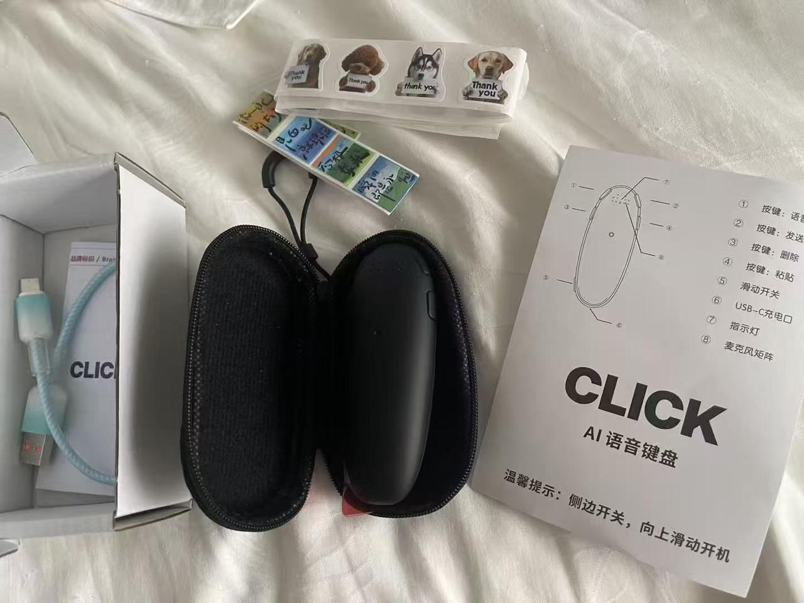
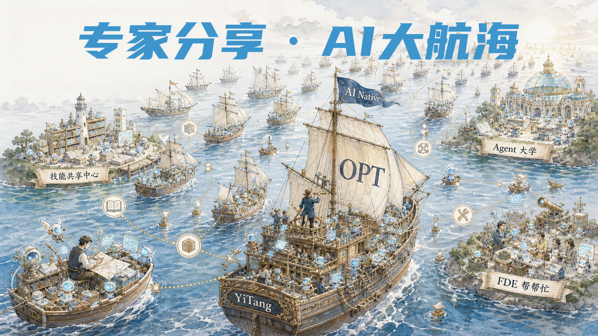

# 01 开源分享·开场与产品诞生缘起

**  回放：****[https://air.yitang.top/live/YOtQSD4Apl](https://air.yitang.top/live/YOtQSD4Apl)**

## 开源分享

### 一、产品诞生缘起：一场源于用户呼声的意外之作

📎 每天使用超100次的ai硬件交互入口.pdf

客观来说，**这款产品从最开始，并不在我们的产品规划清单里，它不是我们预先谋划、自上而下拍板要做的项目，而是在同学们一次次真诚的督促、持续的呼声之下，一步步推着我们完成落地的。**

还记得上一次AI大会那段时间，我们整个团队的重心，全都扑在另外一款主力产品的攻坚上。大家都在连轴转，但是忙里偷闲，同学们会在社群里面自由交流。

就在群聊当中，有同学直接艾特我，跟我说：马老师，你可以尝试做这样一款产品，它可以解决我们当下很多AI使用里的痛点。大家不光是口头畅想，直接把产品构想、使用场景、需求细节全部发到群里。

今天，我特意翻遍聊天记录，把当年最早的那一段原始对话找了出来，就是屏幕上这张截图，大家可以看一看。

#### 1.1 最初设想：寻找一款高频AI硬件，作为配套赠品

当时我们正在打磨另一款产品，一直在思考一个配套方案：我们想找一款和AI深度绑定、用户日常使用频次足够高的硬件，把它作为产品附赠的礼品。

当时我们初步的市场定位非常清晰：

- 终端市场预估售价：200元上下

- 目标硬件成本：控制在100元左右

一开始，我们优先考虑的方案，是AI时钟类产品。为什么会想到它？

- 第一，我们团队本身深耕硬件研发，做这类产品得心应手，边际成本可控；

- 第二，借助时钟持续的人机交互，我们能够持续收集高质量AI语音数据；

- 第三，硬件本身可以持续触达用户，提升用户粘性，潜移默化传递我们的品牌理念。这就是当时我们整套的想法。

#### 1.2 社群需求点燃新项目，严重低估开发难度

就在我们斟酌AI时钟方案的时候，群里同学们持续抛出的需求，吸引了我们全部注意力。初步评估之后，我们主观判断：这款产品整体逻辑不算复杂，开发门槛看起来并不高。 这里必须坦诚地说一句：**当时的我，严重低估了这款产品背后的开发难度。**

最开始我的预估非常乐观：只需要利用硬件项目空档期，用业余碎片化时间，一两个月就能把整套产品打磨完成。硬件项目本身就有阶段性空档，我本来计划趁着这段窗口，快速完成原型、定型。

可真正动手之后才发现，现实工作量，远远超出我们最开始那份产品规划文档的预期，大家可以看屏幕上这张早期规划对比图，理想和实际之间，差距远比想象中大。
