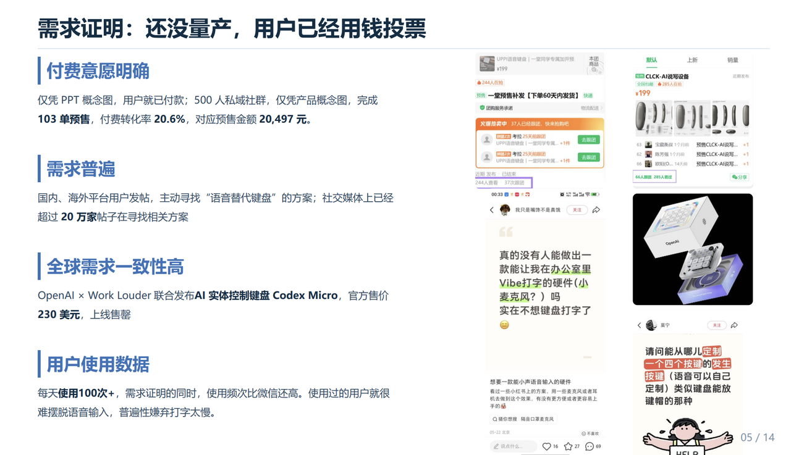

# 02 开源分享·硬件开发的底层逻辑

### 二、硬件开发的底层逻辑：和软件开发完全不是一回事

很多做AI、做软件的朋友，很容易有一个误区：觉得只要功能逻辑想清楚，产品很快就能落地。但硬件开发，和软件开发有着本质的区别。软件迭代可以快速上线、快速打补丁；硬件一旦开模、投产，每一步都牵一发而动全身。

**一套完整硬件产品，要跨越三大阶段：**

1. 技术开发：完成底层方案、算法适配、功能验证

2. 工程开发：解决稳定性、结构、散热、适配各类设备

3. 量产生产：试产、可靠性测试、供应链管控、大批量交付

软件开发几乎不用面对工程落地、量产制造这两大难关。一旦我们决定启动硬件项目，整个研发周期就会被大幅度拉长，中间任何一个环节踩坑，都会导致项目延期。

#### 2.1 早期商业拷问：短期爆款，还是长期可持续产品？

项目刚启动的时候，我们内部其实有非常多争论，也不断反问自己：我们花大量人力物力做出来，它究竟只是一阵热度的一次性网红产品，还是一款能够长期迭代、持续服务用户的长线产品？

同时我们也很清醒：这类语音交互硬件，技术壁垒并没有想象中那么厚重，很难直接构筑巨头级别的护城河。大家有空可以去小红书、各类社区浏览一下，网上已经有大量同类的创意帖子、DIY方案，市场上同类的想法并不稀缺。

#### 2.2 用户主动投喂需求，坚定我们立项的决心

但那段时间，源源不断的用户反馈打动了我们。很多同学，包括不少学姐，专门私信我们，强烈希望我们落地这款产品，甚至主动提出想要加入项目，参与产品转正。

这是非常难得的状态：不是我们猜用户想要什么，**是用户把完整、清晰、真实的需求，直接送到我们面前。** 面对这么明确、强烈的呼声，我们决定，认真试一试，把这款产品做出来。
