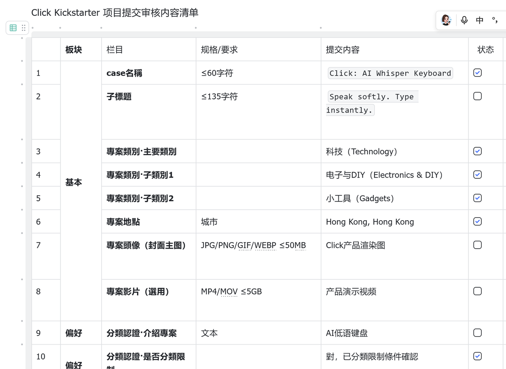

# 03 开源分享·低成本原型验证

### 三、低成本原型验证：翻译笔+麦克风，先行模拟产品体验

正式立项之前，我们没有直接重金投入PCB制版、开模。

**为了低成本验证想法，我自己动手搭建了一套简易原型：**买了一支现成翻译笔，在上面加装猛犸麦克风，用这套组合，模拟完整的使用链路，亲身感受，判断这款产品到底具备多大的市场价值。

#### 3.1 时代背景：早年AI语音能力有限，一次海外工具带来启发

放在当年，AI语音输入法的能力，远不如今天这么强大。在此之前，我长期使用微信输入法、讯飞语音输入，体验其实已经很不错，识别和输入速度，已经能够满足不少场景。

直到我们接触到海外的Typeless这款软件，那一刻真的被惊艳到。它可以自动整理我们产出的内容，还能智能补充相关信息，整套流程行云流水，效率提升非常明显。

看到这个工具之后，我们就在思考：能不能搭配一套专属硬件，复刻、优化这套工作流。同时我们要回答一个核心灵魂拷问：电脑、手机上已经有成熟AI输入法了，用户还有必要额外添置一款硬件吗？这是原型测试阶段，我们最核心要验证的问题。

#### 3.2 原型测试，帮我们规避高额试错成本

如果跳过原型验证，直接进入正式开发，整套流程包含PCB电路板开发、嵌入式底层开发、外壳3D打印定制、配套软件联调。**光是前期开发+多轮测试成本，20万很容易就花出去，**硬件研发每一步都烧钱，整个过程非常煎熬痛苦。 而这套翻译笔+麦克风的简易原型，帮我们用很低的成本跑完全流程，验证产品价值，规避大量试错风险。

