内容出品人：Workbuddy铸造营教练组

手册出品方：AI破局俱乐部团队

出品时间：2026年9月17日

手册使用说明：本文旨在向你展示一个项目的更多可能性，帮助你更好地理解或实操。


手册出品方介绍：AI破局俱乐部是AI领域学习实践的头部社群，社群里不只有免费的专栏课程，还有许多与AI相关的赚钱玩法，实践案例，以及能够代表AI行业发展的最前沿讯息，能够帮助星友快速觉察到AIGC领域的最新赚钱机会。

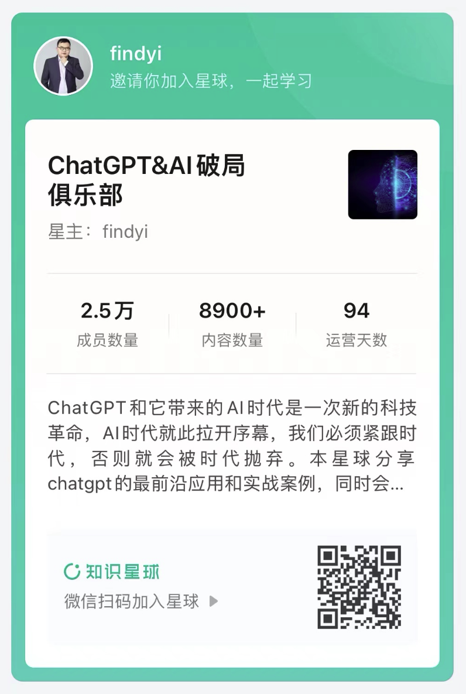


# 第一部分：学前须知

## 一、学员指南

打卡详情点击右侧链接学员学习指南 | 12期破局行动

❗ 下面是本次行动营的作业安排，请认真阅读~
📌常驻小尾巴【作业打卡】：
登录破局行动网站：https://aipoju.com/action
找到自己报名的项目，按照打卡格式完成打卡。
具体流程可参考
学员学习指南 | 12期破局行动

实战手册内部可能会布置一些实践作业，大家自行选择完成。

1. 行动营21天需要打卡12次。
2. 每天1次打卡机会，错过了不能补卡，如未满足打卡12次，保证金不退；中途退出不退保证金。
3. 水日志为无效日志，不计入正常的统计中，水日志界定范围：
a. 完全乱写的驴唇不对马嘴，或者全是标点符号或者无意义字符的;
b. 写和项目没关系的，写人生哲理的；
c. 直接复制他人精选日志，直接复制高手分享内容，只复制没有任何想法和思考的内容
d. 多个项目共用一个作业内容的；
e. ...
4. 在群内提问时，建议具体描述你的问题，并加上#举手标签，方便圈友和教练更快定位到问题，并做出解答。也欢迎你来帮助其他船员解决问题，创造更大的价值。
5. 尊重行动营规则，与他人建立有效链接，不得恶意爆粉，如被发现或被举报，将抱出项目群。


# 第二部分：教练分享

## 一、教练直播安排

| 序号 | 教练 | 直播日期 | 直播主题 |
|---|---|---|---|
| 1 | 华峰 | 9月23日20:00 | 搭好工作台＋功能全景（上）｜让AI在你的电脑上真的干活 |
| 2 | 邢蓝月 | 9月24日20:00 | 功能全景（下）＋让AI真正认识你 |
| 3 | AlJackson | 9月27日20:00 | 整理实战PPT、Excel、文件整理等高频职场 |
| 4 | 醒狮 | 9月29日20:00 | WorkBuddy+飞书+公众号IP智能内容生产线 |
| 5 | 甄菲 | 10月2日20:00 | workbuddy+AI短视频内容工厂解决方案 |
| 6 | 慕萱 | 10月4日20:00 | workbuddy+ima+飞书搭建智能客服系统 |
| 7 | 王树江 | 10月6日20:00 | 企业网站搭建与应用 |
| 8 | 王树江 | 10月8日20:00 | 书籍、名人/博主蒸馏与商业应用 |


## 二、实战作业清单：

本次铸造营共设计了 19 个实战案例，覆盖从基础操作到综合系统搭建的完整学习路径。下方表格按阶段整理，标注了每个案例的难度和最终产出，方便你按需选做、打卡跟进。本清单仅供打卡参考，非强制内容。

> 【嵌入电子表格】

| 课程阶段 | 单元名称 | 实战案例 | 实战产出 | 实战难度 | 教练 |
|---|---|---|---|---|---|
| 第一阶段 入门 | 一、Workbuddy基础功能入门（上） | 实战1·让AI读懂你的素材（混乱资料盘点） | 桌面文件整理 | 偏低 | 华峰 |
|  |  | 实战2·43页行业白皮书AI摘要 | 超大资料信息提取（白皮书、行业报告等） | 偏低 | 华峰 |
|  |  | 实战3·基于产品数据+好评生成推广文案 | 生成各种用途的文案（朋友圈文案、产品详情页、直播话术） | 偏低 | 华峰 |
|  | 二、Workbuddy基础功能入门（下） | 实战1·建适合自己的个人知识库 | 个人知识库搭建（职场人、个人IP） | 偏低 | 邢蓝月 |
|  |  | 实战2·用知识库生成《个人价值说明书》一页纸 | 个人价值说明书/一页纸 | 偏低 | 邢蓝月 |
| 第二阶段 职场办公 | 一、WorkBuddy做Excel数据分析 | Excel数据分析 | HTML可视化数据报告 | 中等 | AlJackson |
|  | 二、WorkBuddy人机协同Word | Word文档撰写 | 优化后的Word文档 | 偏低 | AlJackson |
|  | 三、WorkBuddy做出无AI味的PPT | PPT制作 | 完整PPT文件（可离线编辑） | 中等 | AlJackson |
|  | 四、WorkBuddy清理C盘/卸载应用（拓展） | 清理电脑磁盘 | C盘空间释放 | 偏低 | AlJackson |
|  |  | 卸载应用 | 软件干净卸载（含残留文件） | 偏低 | AlJackson |
|  | 五、WorkBuddy自动化任务（拓展） | workbuddy每日自动签到领积分 | 自动化定时任务 | 中等 | AlJackson |
| 第三阶段 内容创作 | 一、搭建一套公众号内容生产流程 | 公众号内容生产流程（综合大案例） | 一套可运行的公众号内容生产系统 | 偏难 | 醒狮 |
|  | 二、搭建一套短视频内容生产流程 | 短视频内容生产流程（综合大案例） | 一条自己的短视频 | 偏难 | 甄菲 |
| 第四阶段 知识库 | 一、workbuddy+ima+飞书搭建智能客服系统 | 智能客服系统搭建（综合大案例） | 可自动问答+转人工的智能客服 | 偏难 | 慕萱 |
| 第五阶段 进阶 | 一、企业网站搭建与应用 | 企业网站搭建与部署上线（综合大案例） | 上线的企业官网 | 偏难 | 王树江 |
|  | 二、书籍、名人/博主蒸馏与商业应用 | 实操一：book2skill——把一本书拆成5~8个技能 | 5~8个书籍Skill | 中等 | 王树江 |
|  |  | 实操二：女娲——把一位名人蒸馏成思维顾问 | 名人思维顾问Agent | 中等 | 王树江 |
|  |  | 实操三：自己.skill——造一个你的数字分身 | 个人数字分身Skill | 中等 | 王树江 |
|  |  | 进阶课：从Skill到Agent——让技能开口说话 | 可对话的Agent | 偏难 | 王树江 |

## 结营倒计时

> 【嵌入第三方互动组件，请查看原文】

# 第三部分：项目实战

# 第一阶段：Workbuddy基础功能入门（4天）@华峰、@邢蓝月

第一场把工作台搭好、让AI在你电脑上真的干活，第二场让AI真正认识你；后面所有课程都建立在这两场的基础上。
直播时由两位教练分两场讲完，这第一阶段就是两场直播的完整讲义。

## 一、Workbuddy基础功能入门（上）@华峰

本节目标：把WorkBuddy当成一个刚入职的AI员工，给它把入职办完，当堂看到它在你的电脑上干活。
阅读对象：已完成营前自检、已安装并登录WorkBuddy的全体学员。

---

### 一）训练营总览：

💡
- 第一阶段：Workbuddy基础功能入门@华峰、@邢蓝月
- 第二阶段：一套真实可复用的职场办公工作流@AlJackson
- 第三阶段：搭建一套公众号/短视频AI内容生产流程@醒狮、@甄菲
- 第四阶段：自己的知识库与AI工作环境@慕萱
- 第五阶段：Workbuddy进阶应用：网站搭建、名人蒸馏与商业应用@王树江

学习路径：

→前两场人人必上（工作台与知识库没搭好，后面全卡）

→中间3大实用场景四场直播（AlJackson老师职场办公案例，醒狮/甄菲老师自媒体创作案例，慕萱AI智能客服案例）

→最后两场是进阶应用（王树江老师网站搭建与商业应用，把能力做成能发出去的产品）。

营期成果预期：

21天学会WorkBuddy，搭出自己的AI工作流，并运用到日常办公、自媒体创作与变现场景中。

---

#### 1、本课讲什么·下课前收获·下节预告

本课讲什么：给AI员工办入职——建本地工作台、认全界面、体验3个最基础功能。

下课前你会带走

| 入职2件事 | 对应动作 | 收获 |
|---|---|---|
| 给它一张办公桌 | 建AI工作区 | 桌面有了一个干净工作台 |
| 派第一份活 | 盘点混乱资料/白皮书摘要/推广文案 | 3个真任务跑通 |

下场直播预告：第二场建知识库｜让AI真正认识你，换工具不丢记忆——建个人知识库、调专家用Skill、生成《个人价值说明书》一页纸。

---

#### 2、基础认知4个

##### 2.1、认知一：市面上常见AI工具的类型

> 【嵌入电子表格】

| 类型 | 工具 | 所属 | 能干什么 | 核心特点 | 适合谁 |
|---|---|---|---|---|---|
| 聊天型 （只出主意，不动手） | DeepSeek、豆包、ChatGPT、Kimi、文心一言等 | / | ①问答 ②写文案 ③查资料 | 免费免安装，问完即答，但不帮你做事 | 所有人；日常问答、写东西够用 |
| 工作台型・开源框架 （要自己装） | OpenClaw（开源社区） | / | ①装在自己电脑上 ②自己接任务去干 | 免费开源，但要自己动手配 | 爱折腾的技术玩家 |
|  | DeepSeekHarness （深度求索） | 中国 | ①当AI工具的发动机 ②读文件/跑命令/调工具 | 给AI「手脚」的开发底座 | 开发者、想自己做AI的人 |
| 工作台型・开箱即用 （装好就能干活） | Codex（OpenAI） | 美国 | ①写代码 ②办公/写内容 | 编程能力强，代码界的「专家」，办公也能顺手做 | 程序员、想学编程的人 |
|  | ClaudeCode （Anthropic） | 美国 | ①写代码 ②写作 | 代码理解与推理能力强，长上下文，可直接操作文件和终端 | 程序员、开发者、需要深度内容撰写的人 |
|  | 千问办公（阿里） | 中国 | ①分析数据 ②做PPT ③剪视频 ④搭网页 | 办公全能，深度绑定钉钉 | 用钉钉的公司员工 |
|  | 百度搭子（百度） | 中国 | ①拆任务 ②搜资料 ③处理文档 | 接百度全家桶，数据本地处理更放心 | 常用百度、在意数据安全 |
|  | TraeWork（字节） | 中国 | ①办公 ②写代码 ③设计 | 一个软件顶三个，办公+开发通吃 | 既办公又碰代码的人 |
|  | 豆包工作（字节） | 中国 | ①自己拆任务 ②操作电脑 ③跨软件干活 | 飞书深度绑定，手机可遥控电脑 | 用飞书办公、有字节系业务、审美要求高的人 |
|  | WorkBuddy（腾讯） | 中国 | ①管本地文件 ②做文档/PPT/报表 | 零基础开箱即用，直接操作你电脑里的文件 | 不会代码、想直接干活的人 |

##### 2.2、认知二：划定一个允许被AI工作的安全区「AI工作区」

做AI协作，最怕文件东一个西一个。

今天先养成一个最小习惯：在桌面建一个本次训练营的专属练习区。

```
​
代码块​
Plain Text
复制
破局·Workbuddy铸造营​
​
```

用途很清楚：

- 存放训练营期间所有练习过程文档和AI交付物
- 不跟日常文件混在一起，找得到、分得清
- 结营后可一次性删除，不遗留

就一个要求：训练营期间，所有和AI协作的练习，从这里进出。下课后你可以按自己的业务再调整，但今天先统一口径跑一遍。

##### 2.3、认知三：Workbuddy、本地知识库、你，三者之间的关系

| 角色 | 职责 |
|---|---|
| 你 | 定目标、判资料、核输出、负最终责任。 |
| WorkBuddy | 调取你的上下文（即第2课的知识库）、生成内容，不允许裸聊；不替你做最终决定。 |
| 知识库 | 只提供你的真实业务资料——你是谁、卖什么、客户原话、案例证据。•本地知识库：本地电脑里的文件、Obsidian•线上知识库：ima、得到大脑、飞书知识库、Notion、workbuddy自带的资料库•协作文档：飞书云文档、腾讯文档 |

##### 2.4、认知四：数据安全，这里重点看

❌绝对不能投喂给AI的东西：

> 【嵌入电子表格】

| 类型 | 示例 | 风险 |
|---|---|---|
| 账号与密钥 | 登录密码、APIKey、Token、数据库连接串、企业微信/飞书密钥 | 一旦外流，账号和系统直接被接管 |
| 公司内部机密 | 未公开的产品规划、商业策略、薪酬体系、人事变动、技术源码 | 竞对/公众获取后造成商业损失 |
| 授权边界不清的内容 | 别人的原创文章/课件/图片、未授权的客户聊天记录、第三方合同 | 侵权风险，可能引发法律纠纷 |
| 生物与医疗健康信息 | 人脸照片、指纹、病历、体检报告、心理测评 | 属于强敏感个人信息，泄露不可逆 |
| 截图与录屏 | 含后台数据的界面截图、带客户信息的聊天记录录屏、财务系统界面 | 肉眼不易察觉，AI却能完整读取其中文字 |

---

#### 3、功能介绍：WorkBuddy界面与功能布局（全景地图）

左侧边栏是你和AI员工的所有入口。
本课认识界面：今天重点练的标★，先认识的第二课介绍。

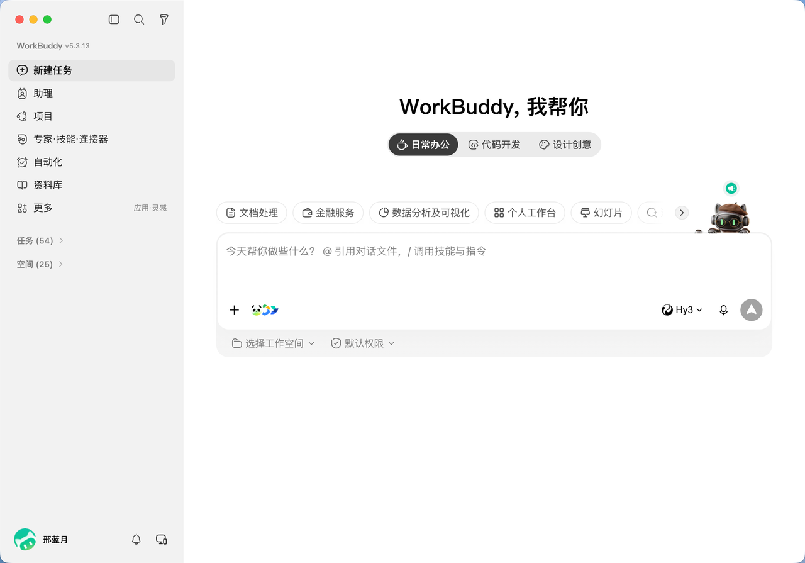

##### 3.1、界面总览

- 左侧边栏入口（自上而下）：
  - 新建任务★
  - 助理（微信端随叫随到）·先认识
  - 项目（团队共用的AI协作空间）·先认识
  - 专家·技能·连接器（一个入口，三件套）·先认识
  - 自动化（定时跑）·先认识
  - 资料库（它的档案柜）★
  - 更多→灵感（选题与灵感收集）·先认识
- 中间对话区：它交成品、和你对话的地方★

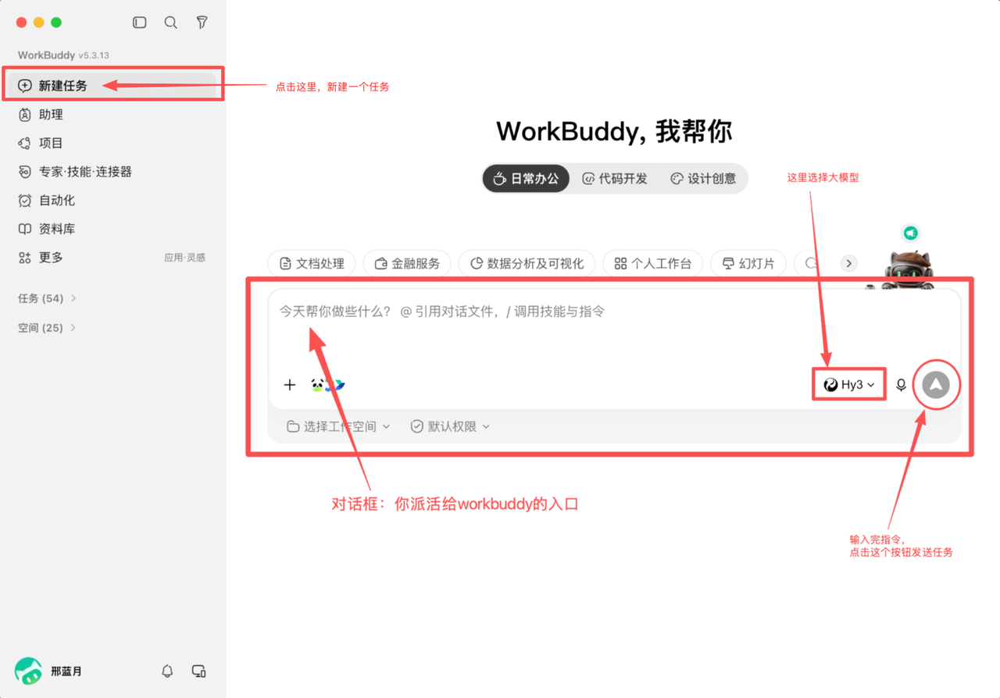

##### 3.2、本课重点练的2个入口

①新建任务★

- 在哪：顶部工具栏/左侧「任务」
- 有啥用：派活的唯一入口，每个任务独立一个对话框
- 效果：开一个专属任务，AI在这跟你对话、交结果

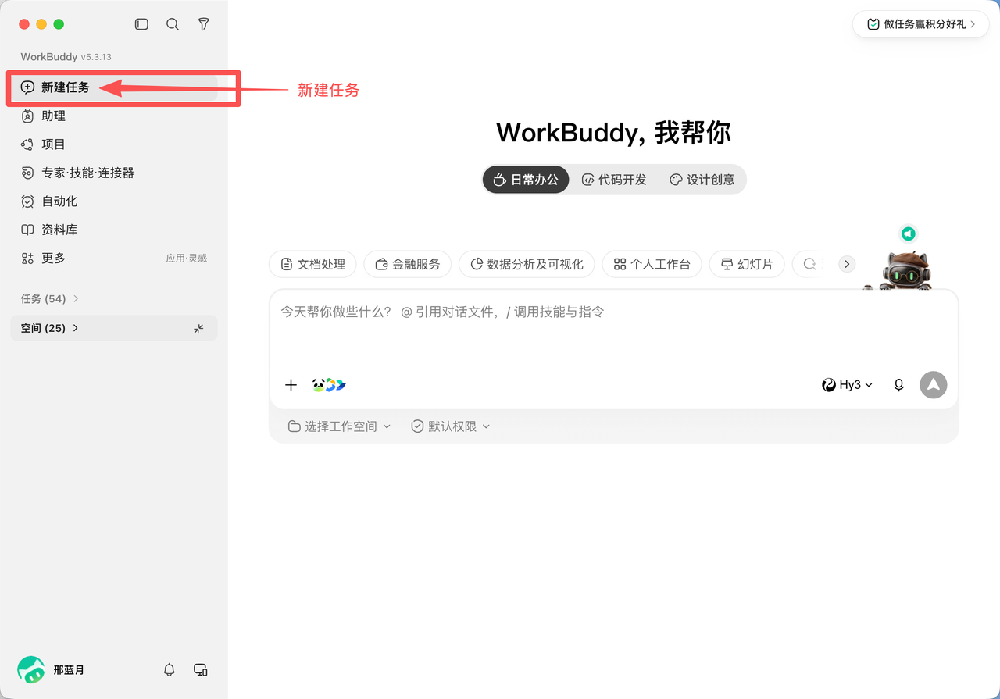

②选择工作空间★

- 在哪：顶部工具栏「选择工作空间」
- 有啥用：给AI划一块它能读写的"地盘"，它之后动的文件都在这
- 怎么用：把桌面「破局·Workbuddy铸造营」选为工作空间，素材包解压后放进去
- 效果：从"对着空气说话"变成"在真实文件上动手"

50%50%

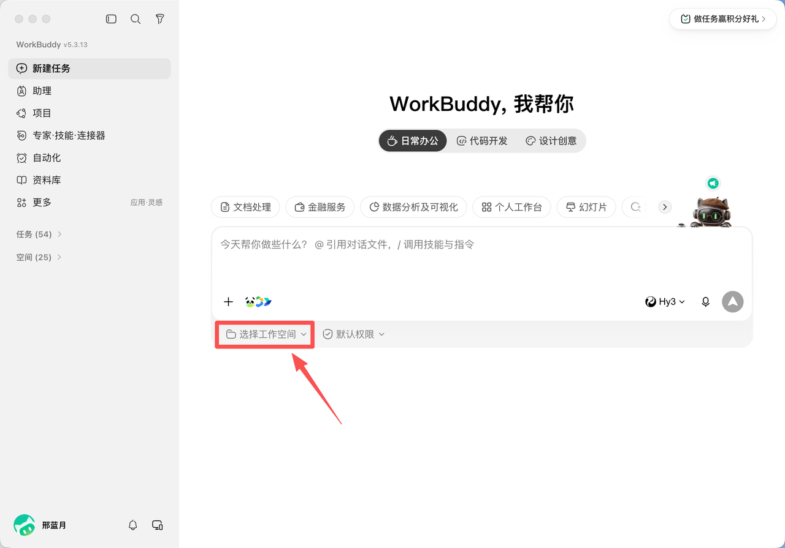

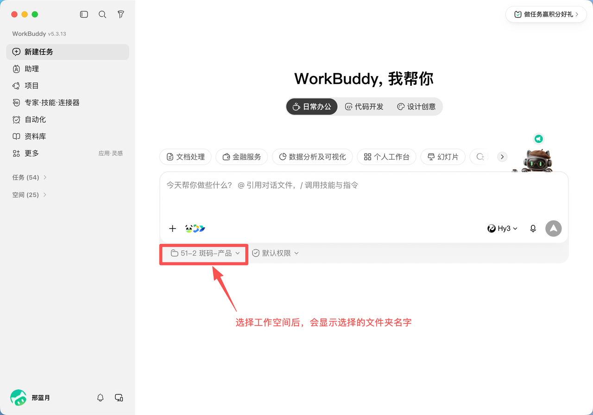

---

#### 4、实战环节（3个，约42分钟）

三个任务一条线：先让AI认得你的文件，再让它产出，干完你验收。

用真实业务素材：
本课所有实战都基于你桌面的「第1课实战素材包」文件夹，里面是模拟真实职场的业务资料，学员练的就是工作中真的会遇到的场景。

素材包内容（3个实战分别用）：
    - 实战1：混乱业务资料包（10个文件，模拟销售经理真实桌面——客户数据、选品报价、岗位说明书、老PPT、空白模板、随手笔记）
    - 实战2：艾瑞咨询《2026年中国智能家电家居行业AI化趋势白皮书》（43页专业研报）
    - 实战3：运动用品选品报价单（63个产品）+客户好评记录（12条真实感好评，覆盖11类人群）

本期安装包下载：

第一阶段 资料包下载地址、可复制提示词（学员版）⬆️下载素材包「第1课实战素材包」⬆️解压后，放到你的桌面「破局·Workbuddy铸造营」这个AI工作区中53%47%

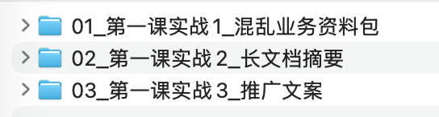

💡 「选择工作空间」和「拖拽文件到对话框」是两回事，别搞混。
1️⃣选择工作空间，是给AI划一块"地盘"——你把某个文件夹设为工作空间后，这个任务里AI能读写这个文件夹里的所有文件，适合批量处理多个文件、或者需要AI把生成的文件存回你电脑的场景。设一次，整个任务都生效。
2️⃣拖拽文件到对话框，是"喂"给AI一份具体材料——你拖哪个文件，AI就只看到这个文件的内容，适合只基于某一份文件干活的场景。拖一次，只对这一轮生效。
今天的实战两种都会用到：先把「破局·Workbuddy铸造营」设为工作空间，AI就能访问整个素材文件夹；然后在提示词里写明要处理哪个子文件夹，不用再重复拖拽。

##### 4.1、实战1·让AI读懂你的素材（20′）

第一步永远都是「选择工作空间」——你的桌面「破局·Workbuddy铸造营」

```
​
代码块​
Plain Text
复制
【先把「第1课实战素材包」中的「01_第一课实战1_混乱业务资料包」文件夹，拖拽到对话框】请盘点这个文件夹中的全部文件，完成以下任务，先给方案、经我确认后再动手：​
​
1.列清单：序号/文件类型/文件名/大小/修改时间（含所有子目录）​
2.内容识别：​
　·Excel：读取每个sheet的表头和前5行，判断这是什么业务数据​
　·Word：提取核心内容，判断文档用途​
　·PPT：提取标题和大纲，判断主题和年份​
　·TXT：读取全文​
3.业务推断：基于所有文件内容，推断这是谁的工作桌面、他在做什么业务、近期重点是什么​
4.找问题：列出文件名不规范、数据不完整、文件过时等问题​
5.重命名方案：给出每个文件的规范命名建议（格式：日期_业务类型_内容描述_版本）​
6.生成「桌面文件盘点报告.md」，包含：文件清单+业务推断+问题清单+重命名方案​
​
```

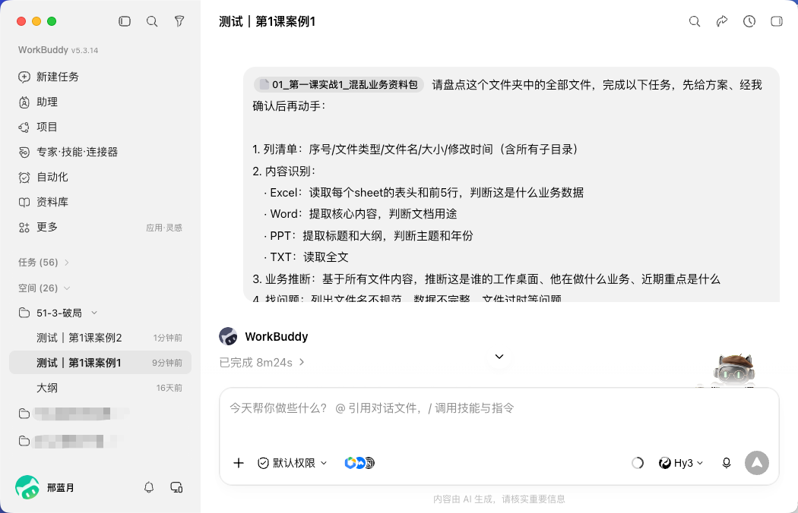

整理前44%整理后56%


整理前44%整理后56%

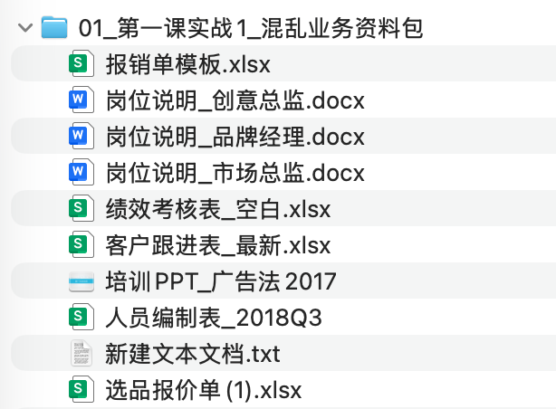

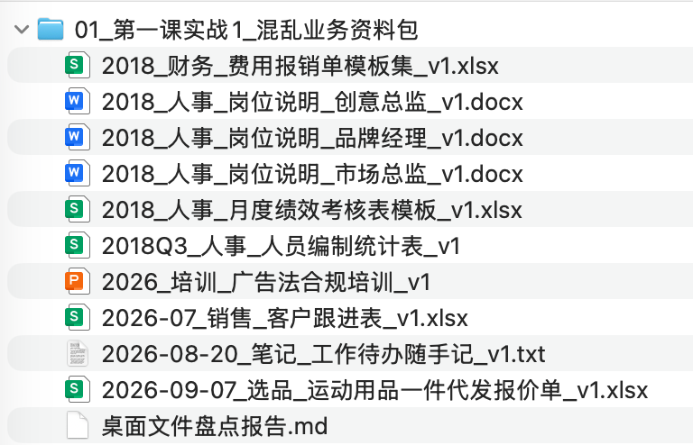


- [ ] AI正确识别出每个文件的内容和用途，并推断出这是谁的桌面、在做什么业务
- [ ] 文件命名规范合理，业务推断有依据、有细节
- [ ] 生成「桌面文件盘点报告.md」并存入文件夹
- [ ] AI正确识别出每个文件的内容和用途，并推断出这是谁的桌面、在做什么业务
- [ ] 文件命名规范合理，业务推断有依据、有细节
- [ ] 生成「桌面文件盘点报告.md」并存入文件夹
- [ ] 你确认：AI真的读懂了我电脑里的真实文件

🚨注意：让AI动硬盘上的文件前，永远先让它报方案，再让它动手。这一条能省掉你以后八成的事故。

##### 4.2、实战2·43页行业白皮书，AI3分钟提取核心摘要（12′）

```
​
代码块​
Plain Text
复制
【拖拽PDF文件到对话框】你是一位资深行业研究专家。请阅读这份43页的《2026年中国智能家电家居行业AI化趋势白皮书》，帮我提取：​
​
1.3个最核心的行业趋势（每个趋势配1个关键数据，注明来源页码）​
2.5个最值得关注的数据点（市场规模、渗透率、增长率等，注明来源页码）​
3.产业链图谱：上游/中游/下游分别有哪些关键玩家​
4.基于我的岗位（互联网运营/市场/产品/HR/财务/销售/教师/电商/其他，选你自己的岗位），给出3条可以直接落地的行动建议​
​
输出格式：结构化，重点加粗，不超过1200字。​
​
```

💡你自己读这份43页的研报要1-2小时，AI3分钟给你"能直接用在工作汇报里"的核心内容。

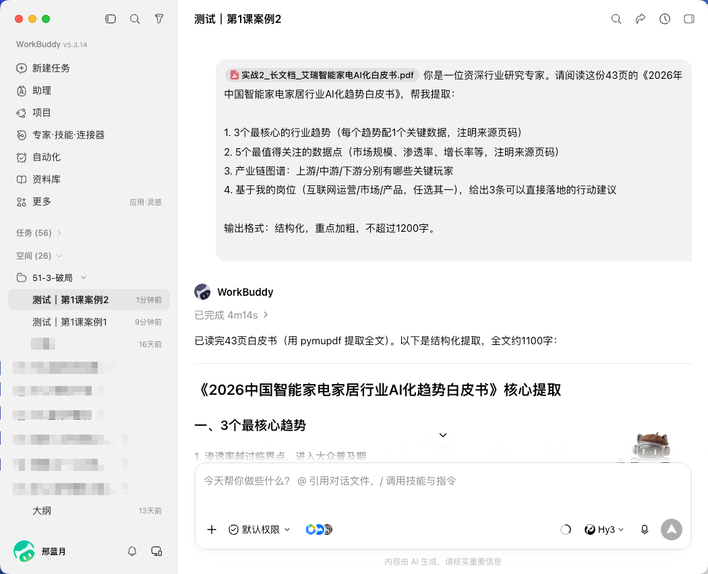

- [ ] 提取了3个核心趋势+5个关键数据，且都注明了来源页码
- [ ] 给出了基于我岗位的3条可落地行动建议
- [ ] 提取了3个核心趋势+5个关键数据，且都注明了来源页码
- [ ] 格式清晰，可以直接复用
- [ ] 给出了基于我岗位的3条可落地行动建议
- [ ] 格式清晰，可以直接复用

```
​
代码块​
Plain Text
复制
【拖拽2个文件到对话框：产品选品报价单.xlsx+客户好评记录.xlsx】你是一位资深电商文案策划。请基于以下素材，为「小白二合一智能跳绳」写推广文案：​
​
素材1：产品选品报价单（产品特点、价格、运费、产品介绍）​
素材2：客户好评记录（12条真实用户反馈，覆盖宝妈/学生/上班族/中年人等不同人群）​
​
请输出：​
1.3条朋友圈种草文案（每条不超过150字，风格分别为：宝妈视角、学生视角、上班族视角）​
2.1条商品详情页文案（含产品卖点+用户好评+行动号召）​
3.1条30秒直播带货话术（有节奏、有钩子、有逼单）​
​
要求：必须引用好评中的真实用户故事和数据（如"二胎妈妈用了2个月腰围从78降到72"），不要空泛地说"很好用"。​
​
```

##### 4.3、实战3·基于产品数据+用户好评，生成推广文案（10′）

```
​
代码块​
Plain Text
复制
【拖拽2个文件到对话框：产品选品报价单.xlsx+客户好评记录.xlsx】你是一位资深电商文案策划。请基于以下素材，为「小白二合一智能跳绳」写推广文案：​
​
素材1：产品选品报价单（产品特点、价格、运费、产品介绍）​
素材2：客户好评记录（12条真实用户反馈，覆盖宝妈/学生/上班族/中年人等不同人群）​
​
请输出：​
1.3条朋友圈种草文案（每条不超过150字，风格分别为：宝妈视角、学生视角、上班族视角）​
2.1条商品详情页文案（含产品卖点+用户好评+行动号召）​
3.1条30秒直播带货话术（有节奏、有钩子、有逼单）​
​
要求：必须引用好评中的真实用户故事和数据（如"二胎妈妈用了2个月腰围从78降到72"），不要空泛地说"很好用"。​
​
```

💡惊艳点：AI写出来的文案有真实用户故事、有具体数据、有信任背书，不是你自己憋半天写出来的空泛模板。

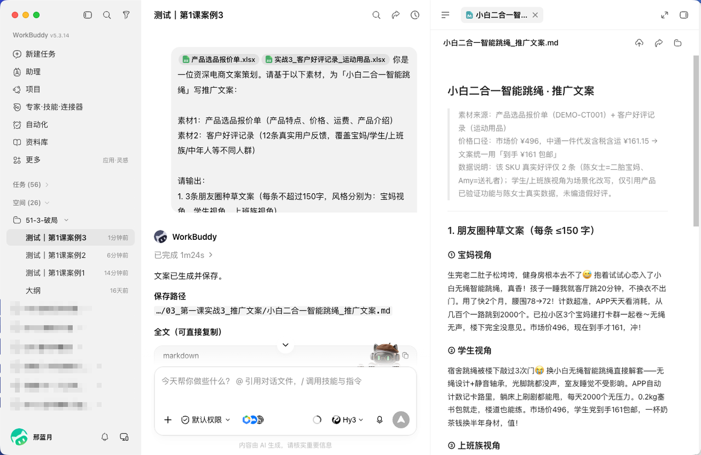

- [ ] 文案引用了好评中的真实用户故事和数据，不是空泛模板
- [ ] 朋友圈文案3种视角（宝妈/学生/上班族）有明显区分
- [ ] 3种文案（朋友圈/详情页/直播话术）都可以直接使用

三个任务都做完，你已经让AI在你的真实文件上干完了活——重点不是快，是从今天起这类活你不必亲自干。

---

✏️ 2个人，用WorkBuddy做同一件事，
有的人做得好，
有的人做得不好？

为什么？差别在哪里？

第一层·经验底子：决定AI能放大什么

同一个AI，10年从业者和实习生用出的效果天差地别。你脑子里有多少行业经验、业务判断和上下文，AI就能帮你放大多少。它不会无中生有，只会锦上添花。

第二层·思维模型：决定你能不能问对问题、判对答案

复利效应、第一性原理、机会成本、二八法则、锚定效应……掌握的思维模型越多，越能把复杂问题拆清楚，越能判断AI的答案靠不靠谱。

第三层·模型选型：决定工具的能力天花板

GPT、Claude、Kimi、DeepSeek……不同模型各有所长。什么任务该用什么模型，这本身就是核心能力。选错工具，再努力也事倍功半。

第四层·管理能力：决定产出的质量和效率

用5W1H向AI清晰安排工作——要做什么、谁来做、时间节点、位置地点、目标背景、如何做。你从"提问者"变成"管理者"，AI的产出质量，直接取决于你的任务描述质量。

第五层·大胆实践：决定以上四层能不能落地

知道再多，不用等于零。每一次尝试、反馈、迭代，都在让你和AI的协作更默契。用起来，才是真正的开始。

✏️ 1.
《我的业务资料采集器_1.0》问卷（下一场直播前完成）
问卷分职场人版、自媒体IP版两个版本，按你的身份任选其一填写即可。花15～20分钟填完，答案就是第二场实战1建个人知识库的第一批核心资料。

《我的业务资料采集器_1.0》问卷（职场人版·可下载版）

《我的业务资料采集器_1.0》问卷（自媒体IP版·可下载版）

✏️ 1.
《我的业务资料采集器_1.0》问卷（下一场直播前完成）
问卷分职场人版、自媒体IP版两个版本，按你的身份任选其一填写即可。花15～20分钟填完，答案就是第二场实战1建个人知识库的第一批核心资料。

《我的业务资料采集器_1.0》问卷（职场人版·可下载版）

《我的业务资料采集器_1.0》问卷（自媒体IP版·可下载版）

---

## 二、Workbuddy基础功能入门（下）@邢蓝月

📌 这一小节实操前务必准备好：
《我的业务资料采集器_1.0》问卷的填写结果（自媒体IP版/职场人版，选一个适合自己的即可），或你已有的个人资料文档。

这一小节实战1建知识库、实战2生成《个人价值说明书》一页纸都要用到它，如果没准备好，无法课上参与实战。

本节目标：第一场你的AI员工"入职"了（有了工作台）。这节课给它"配齐专业技能包"——建一个读得懂你的个人知识库、学会调专家、用Skill，生成一份属于你的《个人价值说明书》一页纸。下课前，它不再是"通用实习生"，而是"懂你业务的员工"。
阅读对象：已完成第一场、电脑上已有「我的AI工作台」的同学。

---

### 一）本课讲什么·下课前收获·下节预告

本课讲什么：把界面上剩下的功能逐个讲清（在哪、是什么、有什么用），讲1个功能、当场演示1个操作，跟着演示走就是实操；再带你当堂跑通2个实战——建个人知识库＋基于知识库生成《个人价值说明书》一页纸。

下课前你会带走

| 升级环节 | 对应今天的动作 | 收获 |
|---|---|---|
| 建个人知识库 | 下载模板＋投喂问卷＋AI替换内容 | 一个读得懂你的个人知识库 |
| 个人价值说明书 | 专家＋Skill基于知识库生成 | 一份你的《个人价值说明书》一页纸＋会用专家和Skill |

今天的学习重心：知识库（资料库）＋专家＋技能是本课实战主角，跟着讲、跟着演示一起练；助理、项目、连接器、自动化、灵感讲一个演示一个、认识即可，后面课用到再深讲。

---

### 二）基础认知3个

#### 1、认知一：为什么AI每次都像第一次认识你

你有没有这种体验：换个工具、重开一个窗口，AI又变回"陌生人"——你问"帮我写条朋友圈"，它写得又空又泛，像套模板。

原因只有一个：它没你的背景。

| 状态 | AI的表现 |
|---|---|
| 没上下文（失忆状态） | 通用回答、套话、不了解你的业务，或者是好不容易记得了，下次又不记得了或者漏掉几个信息。 |
| 有上下文（记得你） | 开口就是你的语气、能引用你的真实案例、数据、经验等 |

一句话：缺上下文=通用回答；有上下文=懂你业务。这节课干的事，就是把这个"上下文"一次性沉淀下来。

#### 2、认知二：四类信息模型——资料库"够用"的标准

资料库不是"资料越多越好"。灌了50篇历史文章，AI照样说外行话——因为缺的是产品信息和客户画像。

四类信息（凑齐这4类，AI才真"认识你"）：

| 类别 | 它要回答的问题 | 举例 |
|---|---|---|
| ①经历/人设 | 你是谁、什么背景 | 做了N年X、标签是Y |
| ②业务/产品 | 你卖什么、怎么交付 | 产品Z、价格区间、交付形式 |
| ③客户/画像 | 谁买单、最痛什么 | 客户是A人群、最痛B问题 |
| ④真实案例 | 你做成过什么 | 某个具体客户、具体结果（能引用细节） |

"够用"的标准——不是数量，是一道测试：知识库建好后，按实战1的「当堂4点检查」逐条确认——核心信息是你的、占位符已替换或标记、隐私标注正确、3个文档已保存，就算够用。

#### 3、认知三：万能提问公式（让AI一次听懂）

上节课心法卡说"不要问它怎么做，告诉它做什么、交成什么样"，这节课把这句话拆成可套用的5W1H六要素。

实战里你要给AI下指令。为什么有时它答得空、有时答得准？差在指令结构。记住5W1H六个维度，逐项补齐，AI就一次听懂：

| 维度 | 作用 | 你写什么 |
|---|---|---|
| Who（谁） | 限定AI的专业身份与视角 | "你是一位懂我行业的资深顾问" |
| What（什么） | 说清要完成的具体任务 | "读我的资料库，做一份业务说明书" |
| Why（为什么） | 交代背景与目标，让AI抓重点 | "用于新员工入职培训，帮他们3天内看懂业务" |
| When（何时） | 明确时间范围与时效要求 | "基于2024年至今的资料；本周内交付初稿" |
| Where（何地） | 说明使用场景与受众环境 | "面向销售团队内部使用，不对外公开" |
| How（如何） | 定交付形态与表达方式 | "用Markdown，分四块：我是谁/业务/客户/案例" |

模糊指令=模糊回答。把"帮我把资料整理一下"换成5W1H六要素逐项补齐，AI才一次听懂。这条公式今天用、后面每节课都用。

---

### 三）功能介绍：按左侧导航顺序逐个讲（在哪/是什么/有什么用/现场演示）

本部分节奏：讲1个功能、当场演示1个操作——你跟着演示做一遍，就是一次实操。所有功能今天都见过真的操作，后面每节课直接开用。

#### 1、界面补讲：对话框里你可能没注意的按钮

第一场你用对话框发过任务了，但底部这一排按钮，大部分人只用到了"输入文字＋发送"。今天一次性认全——后面每节课都会用到。

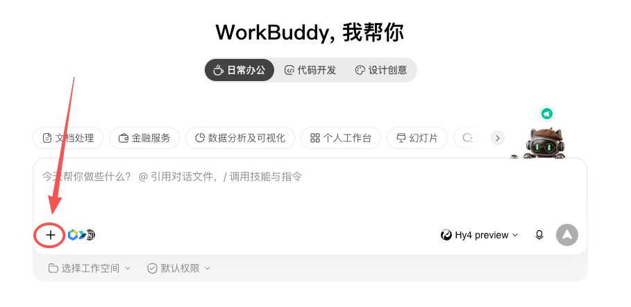

①+号按钮：任务的"配料台"

点+号展开6个功能，都是给当前任务"加配料"的：

- 添加文件：从本地、腾讯文档、ima知识库、乐享知识库选一份文件喂给AI。适合"基于这份文件干活"的场景。
- 引用对话中的文件：这个对话里之前传过的文件直接引用，不用重新上传。适合多轮对话中反复用到同一份文件。
- 模式：切换Craft（执行）/Plan（计划）/Ask（仅问答）三种模式。
- 专家：给当前任务选一个专家角色（如"AI师傅课程制作专家"）。选了之后AI会用这个专家的思考框架回答。复杂任务再选，简单任务不用。
- 技能：给当前任务挂一个Skill（专业能力包）。本课实战2会用到。
- 连接器：给当前任务接上外部工具（腾讯文档、会议等）。需要AI跨工具操作时才用。

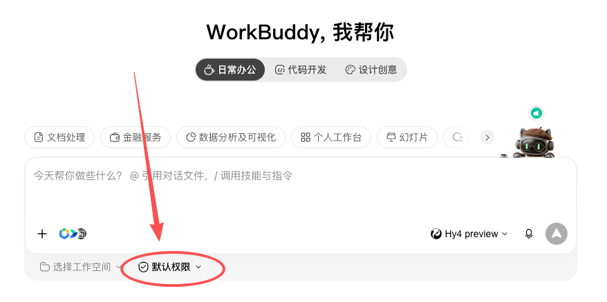

②默认权限：AI能碰你电脑的哪些地方

- 在哪：+号旁边的「默认权限」
- 是什么：设置AI在这个任务里可以自行执行任务？还是必须问过你才能执行？
- 新手建议：保持默认即可，不要全开。

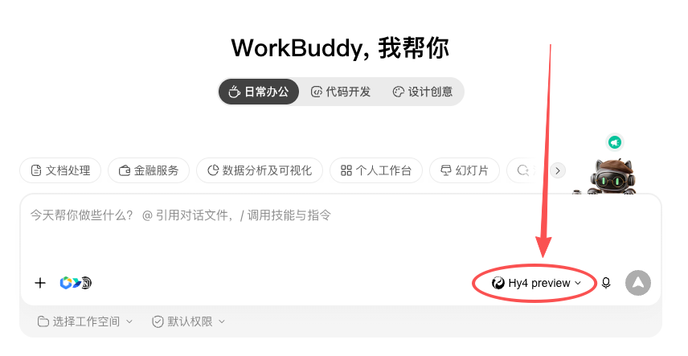

③大模型选择：换个"大脑"试试

- 在哪：底部右侧的模型图标（显示当前用的是哪个模型）
- 是什么：WorkBuddy支持切换不同大模型，不同模型擅长的事不一样
- 怎么选：日常写文案、整理资料用默认模型就够；写代码、技术问题选代码能力强的；长文档总结、逻辑推理选长上下文能力强的；拿不准就先用默认，效果不满意再换
- 新手建议：前3场不用换，用「Hy4」的就行。等你对输出质量有手感了，再尝试切换对比。

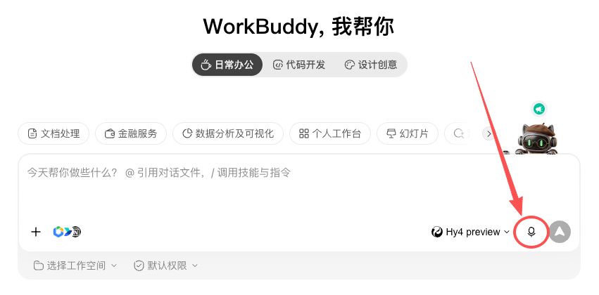

④语音输入：不想打字的时候说出来

- 在哪：输入框右侧的麦克风图标
- 是什么：按住说话，自动转成文字输入
- 什么时候用：手上忙、或想法来得快打字跟不上的时候。口述任务需求特别好用——说完检查一下错别字再发送。

#### 2、助理（微信端）·当堂绑微信

- ①在哪：左侧边栏「助理」；绑定后微信里搜索WorkBuddy助理也能用
- ②长啥样：📸【见下方截图】
- ③有啥用+什么时候用：随身工作台。在微信里随时给AI派活、收它的推送，多端适配（客户端/小程序）。不在电脑前但想让AI干活时用（地铁上也能派活、收日报）。自动化结果常推到这里等你验收。

📱 当堂配置（5分钟）：微信助理集成（从0小白步骤）
前提：学员已注册并登录WorkBuddy账号，有一台电脑+一个想当“助理号”的个人微信
- 第1步｜进设置：打开WorkBuddy→左下角头像/「设置」→找到「助理设置」入口
- 第2步｜找到微信助理集成：在助理设置里找到「微信助理集成」→点击进配置（只有1个名为「配置」的按钮）
- 第3步｜点配置：点击右侧「配置」按钮→页面弹出二维码
- 第4步｜扫码：用手机微信（准备当助理的那个号）扫这个码
- 第5步｜手机确认：手机上点「登录」/「确认」→该微信号即作为AI助理身份被接管
- 第6步｜看状态：回到设置页面，「配置」按钮前出现「解绑」按钮→即配置成功
- 第7步｜测试：用微信给这个助理号发一句“你好”→看是否自动收到AI回复

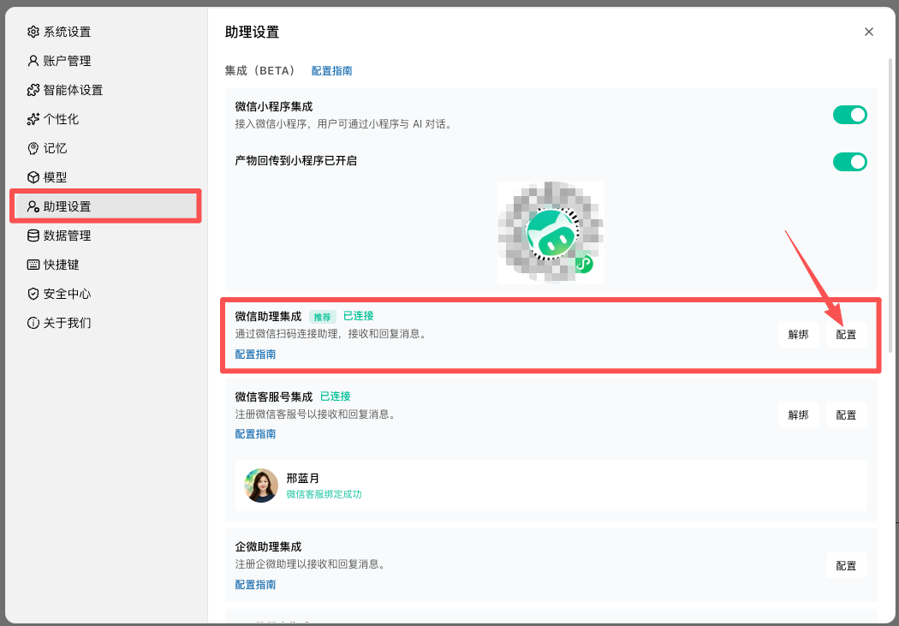

微信端助理对话界面截图50%

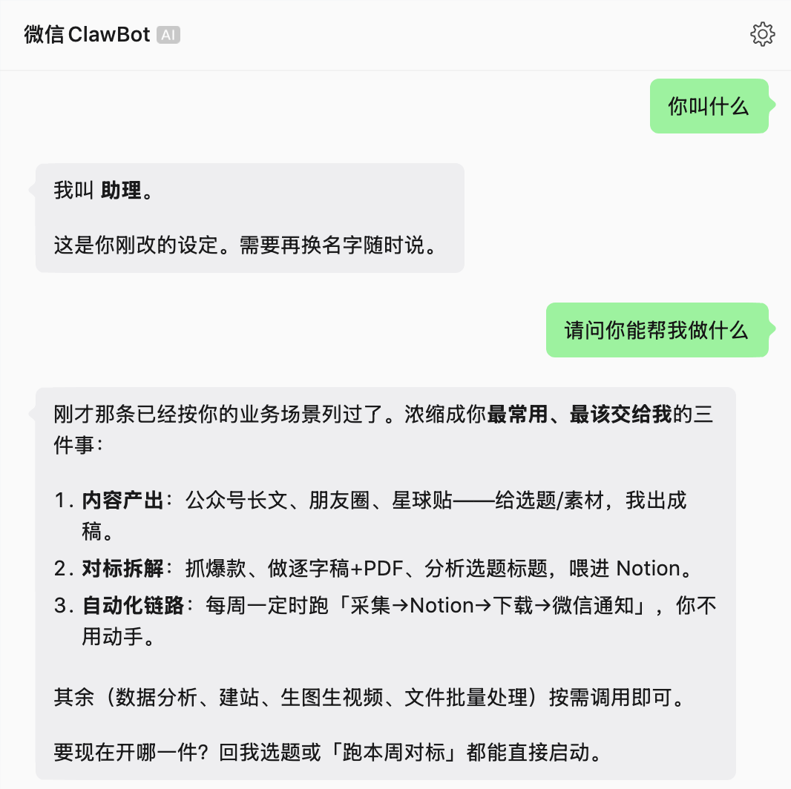

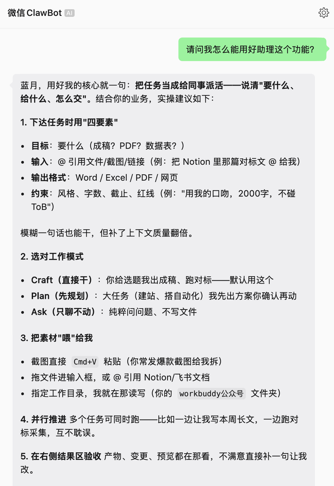

#### 3、专家·技能·连接器（一个入口，三件套）

- ①在哪：左侧边栏「专家·技能·连接器」——点进去是一个入口，里面分「专家」「技能」「连接器」三个标签页
- ②长啥样：📸【见下方截图】
- ③专家（角色）：给AI换一个“行业大脑”。单专家＝单一领域顶级框架（人设+方法论+工具链）；专家团＝多Agent协作，从“给建议”升级“全链路交付”。复杂任务、需要多角色分工时用。≠技能：专家是“谁来干”，技能是“用什么工具干”。
- ④技能（工具）：封装好的专业能力包，一键干专业活（排版、选题、数据可视化、文档解析…），不用自己写长提示词。挑一个→喂你的真实素材→跑。本课实战2会用到。
- ⑤连接器（通道）：AI与外部工具的桥梁。接上微信/腾讯文档/会议/云盘等，AI就能直接操作它们。需要AI跨工具干活时用（如“把会议纪要存进腾讯文档”）。先连高频工具（会议/文档），今天先认门，第4课定时任务会用到。≠自动化：连接器是“能碰什么”，自动化是“什么时候做”。

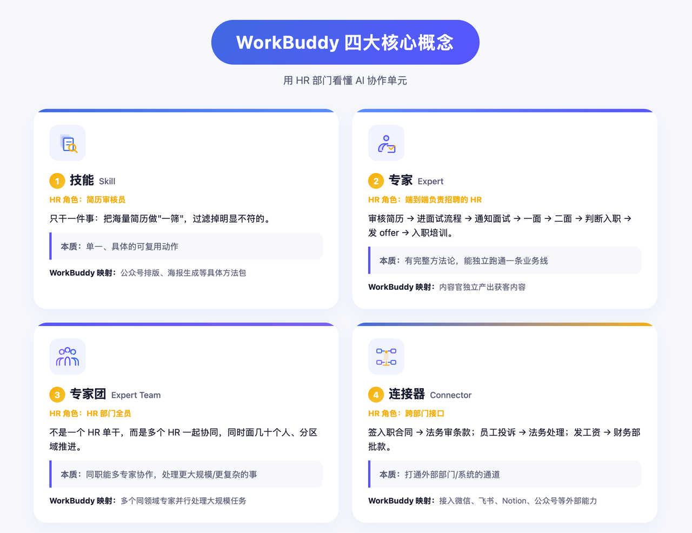

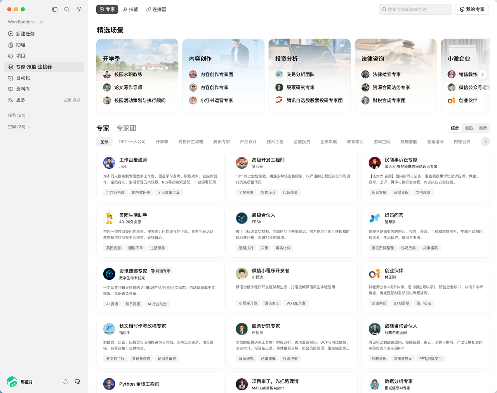

#### 4、资料库

- ①在哪：左侧边栏「资料库」
- ②长啥样：📸【见下方截图】
- ③有啥用：workbuddy内置的知识库。
- ④怎么用：指定某一个资料让AI录入资料库、产物点分享后自动保存、把一份文件拖进去......
- ⑤效果：它读得到你的资料，AI写出来的内容更像你
- ⑥优点：workbuddy软件内置，手机端也能随时查阅
- ⑦缺点：手机端操作不太方便，需要「电脑开机+wb运行+同账号」，手机端选择设备选择「电脑」，才能调取你的资料库做任务。
> 【嵌入电子表格】

| 方式 | 怎么触发 | 适合什么 |
|---|---|---|
| ①命令Agent存 | 会话里说"存到资料库/保存回资料库"，Agent上传并告知位置；多个产物可指定存哪个 | 和AI一起写的MD、HTML |
| ②分享即存入 | 对产物点分享→开启"发布为网站"，发布动作本身就完成存入 | 要发给别人看的网页、报告 |
| ③手动上传/剪藏 | 本地文件、文档、多媒体直接拖进目录树；或剪藏网页链接 | 已有素材 |
| ④配置驱动的自动 | 任务指令写"完成后存资料库"，或配了定时自动化把产出归档——Agent执行时自动落库 | 重复型任务 |

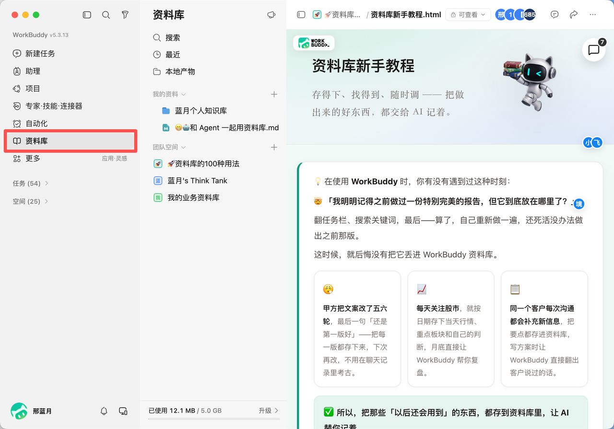

---

### 四）实战环节（2个，当节课就能做）

本期安装包下载：

第一阶段 资料包下载地址、可复制提示词（学员版）⬆️下载本节2个实战案例的素材包⬆️50%50%

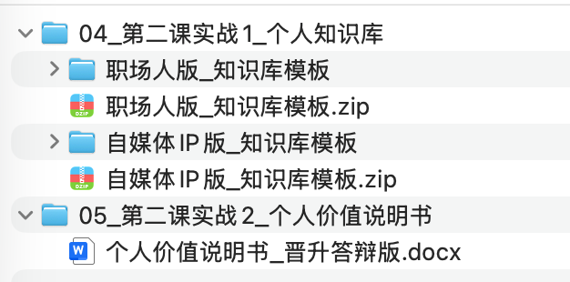

#### 1、实战1｜建适合自己的个人知识库

任务：当堂用你自己的资料，生成一个属于你的个人知识库——下载一套建好的知识库模板（职场人版/自媒体IP版二选一），把你课前填好的《业务资料采集器》问卷答案投喂给WorkBuddy，让AI按照问卷结果把模板替换成你的真实信息，当堂产出一个读得懂你的知识库。

第1步｜下载知识库模板（二选一）：

| 模板 | 适合谁 | 包含什么 | 截图 |
|---|---|---|---|
| 职场人版 | 在公司上班的职场人（互联网/传统行业均可） | 工作规则库+项目资料库+个人资产库（3个文档）+隐私说明+使用说明 |  |
| 自媒体IP版 | 做IP/自媒体/知识付费/咨询服务的自由职业者 | 定位库+客户库+产品库（3个文档）+隐私说明+使用说明 |  |

📦下载后解压到本地，里面有完整的示例内容（红色标注的占位符）+每条信息的隐私等级标注（公开/半公开/保密）+详细的使用说明。你不需要从0建，只需要让AI帮你把示例替换成你的真实信息。

第2步｜投喂问卷，让AI替换模板内容：

把你课前填好的《我的业务资料采集器_1.0》问卷答案，连同下载的知识库模板（所有Word文档）一起投喂给WorkBuddy，用下面的提示词让AI帮你替换：

第一步永远都是「选择工作空间」——你的桌面「破局·Workbuddy铸造营」

```
​
代码块​
Plain Text
复制
【拖拽「你课前填好的《业务资料采集器》问卷答案」+「下载的知识库模板文件夹，自媒体IP/职场人（二选一即可）」】​
【调用「知识管理专家」】​
你是一位个人知识库整理专家。​
请读取我提供的知识库模板文档（工作规则库/项目资料库/个人资产库或定位库/客户库/产品库），​
以及我的《业务资料采集器》问卷答案和隐私说明文档。​
​
请按照问卷答案，把知识库模板中的示例内容替换成我的真实信息：​
1.逐条替换：模板里每条"示例"后面的内容，用问卷里对应的信息替换​
2.问卷里没有的信息，保留红色占位符，不要编造​
3.保留模板的结构、填写说明和隐私等级标注（公开/半公开/保密）​
4.严格遵守隐私说明文档的三档分档规则​
5.替换完后，每个库单独输出为一个完整的Word文档内容​
​
```

💡AI替换完后，你会得到3个完整的知识库文档——结构是模板的，内容是你的。这比从0建快10倍，而且不会漏项。

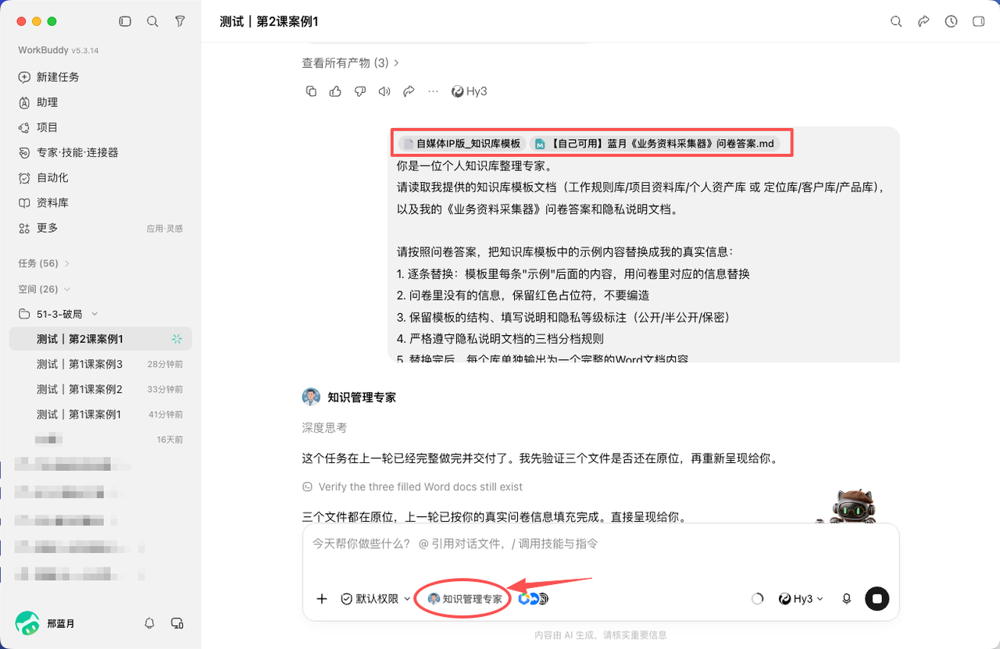

第3步｜确认并保存：AI替换完后，你通读一遍，确认以下4点，然后分别保存为独立的Word文档：

- ✅信息是你的，不是示例的（重点检查姓名、公司、项目、数据）
- ✅红色占位符都替换完了（或者标记为"待补充"，课后再补）
- ✅隐私等级标注正确（公开/半公开/保密）
- ✅没有泄露公司机密或个人隐私（对照隐私说明文档检查一遍）

💡当堂只要替换完核心信息就算成功——工作规则库的核心内容+个人资产库的1-2个案例（职场人），或者定位库+产品库的核心信息（自媒体IP）。剩下的课后再补，不影响实战2。

第4步｜验收（当堂4点检查）：当堂只要确认以下4点，就算建库成功，可以进入实战2：

- ✅下载了知识库模板并解压到本地（职场人版/自媒体IP版二选一）
- ✅把《业务资料采集器》问卷答案投喂给了WorkBuddy，AI按模板结构输出了你的知识库内容
- ✅通读了一遍AI输出的内容，确认核心信息是你的（不是示例的），红色占位符已替换或标记为"待补充"
- ✅把AI输出的内容分别保存为3个独立的Word文档，你的个人知识库正式建成

💡当堂只要完成核心信息替换就算成功，剩下的细节课后再补。建库不是一次性任务，是持续积累的过程——今天先跑通流程，后面慢慢完善。

这一步的爽点：从这节课起，AI的"记忆"不再是每次聊天的临时窗口，而是你攒下的一份越用越值钱的上下文资产。

#### 2、实战2｜用你的知识库，生成一份能直接用的《个人价值说明书》一页纸

任务：基于实战1建好的知识库，调用1个专家、1个skill，生成一份属于你的《个人价值说明书》一页纸——说清"我是谁、我能做什么、我做成过什么"，职场人用于晋升/竞聘/新团队介绍，自媒体人用于获客/接单/个人简介。

通用规则：保留你知识库的真实信息；浓缩成一页纸能看完的结构；口吻像你本人在说话，不是模板。


📎 成品示例（开课前发给学员）：我们准备了一份「晋升答辩版」的个人价值说明书成品（一页纸精美排版Word文档），生成完自己的版本后，可以对照成品看看排版和内容颗粒度。
成品包含：
    - 我是谁：1句话定位+3个标签
    - 能做什么：5项核心能力
    - 做成过什么：3个案例（左右栏布局，每个都带背景/动作/结果/具体数据）
    - 下一步规划：3个方向
💡用法：先看成品，知道"最终能长成这样"，然后用AI生成自己的初稿，最后对照成品调整排版和细节。

准备：①先花3分钟翻完我们发的「晋升答辩版个人价值说明书」成品示例——知道最终能长成这样，再动手；②你实战1建好的知识库（自媒体人3库/职场人3库）；③想清楚这份说明书的使用场景（晋升答辩/获客接单/新团队介绍/公众号简介/其他）。

操作步骤：

1.调专家（按身份二选一）：自媒体人挂上「一人公司专家团」；职场人挂上「职场汇报与经营表达专家」。让AI用这个专家的框架来提炼和组织
2.说场景：告诉AI这份说明书用在什么场景（如"晋升答辩用"或"获客接单用"），它会调整侧重点和语气
3.接知识库：让它读取你的知识库（自媒体人3库/职场人3库），提取"我是谁、我能做什么、我做成过什么"
4.发生成指令（套用「万能提问公式」：角色＋任务＋约束＋格式）：

可直接复制的生成指令（粘贴到对话）：

```
​
代码块​
Plain Text
复制
【添加知识库】+【专家】+【一页纸skill】​
请用我挂上的专家框架，基于知识库生成《个人价值说明书》一页纸。​
​
【使用场景】（晋升答辩/获客接单/新团队介绍/公众号简介）自己选一个​
​
【结构要求】（对照成品示例）：​
1.我是谁：1句话定位+3个标签（标签要具体，不要"努力""靠谱"这种空词）​
2.能做什么：3-5项核心能力，每项用"动词+对象+结果"格式（如"搭建用户增长体系，3个月留存提升20%"）​
3.做成过什么：2-3个案例，每个案例必须带具体数据（背景/我的动作/量化结果），不要"负责了XX项目"这种空话​
4.下一步规划：2-3个方向，要具体可落地​
​
【内容要求】：​
1.全部内容来自我的知识库，缺的信息写"缺：XXX"，不要编造​
2.口吻像我本人在说话，不要官方套话​
3.遵守附件隐私三档：保密不写入，半公开需脱敏​
4.案例部分优先用知识库里最完整的案例（职场人用项目资料库的完整项目，自媒体人用产品库+客户库里的产品和客户案例），不要只用概括性描述​
​
【输出】：markdown正文+排版建议（对照成品示例的左右栏布局、重点加粗、数据高亮）​
​
```

第5步｜排版：把成稿排成一页纸能直接用的格式

第6步｜验收：人工通读一遍——"我是谁、我能做什么、我做成过什么"是不是都说清了？案例和数据是不是你的？口吻像不像你？

成品效果截图53%一页纸效果展示47%

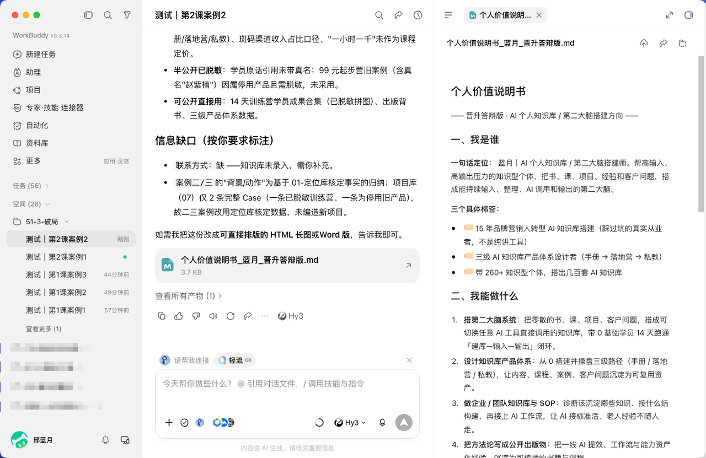

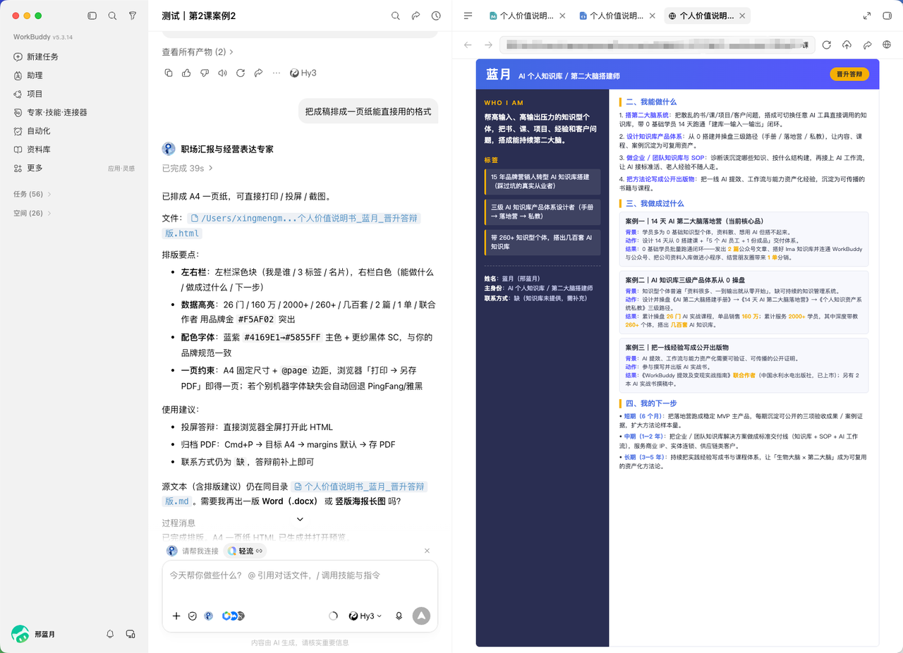

完成标准（打勾）：

- [ ] 我按身份挂上了专家（自媒体人：一人公司专家团/职场人：职场汇报与经营表达专家）并用了它的框架
- [ ] 说明书说清了"我是谁、我能做什么、我做成过什么、下一步规划"，且全部来自我的知识库，案例都带具体数据
- [ ] 我根据使用场景调整了侧重点（晋升/获客/介绍，侧重点不同）
- [ ] 我用「一页纸说清楚」Skill完成了排版
- [ ] 对照成品示例检查过排版和内容颗粒度，成稿我能直接用（发领导/发客户/放公众号简介/打印出来）

这一步的爽点：第一次有了一份"别人一眼看懂你价值"的一页纸——不用每次重新介绍自己，AI帮你把散在知识库里的经历、能力、成果，浓缩成一张能打的个人名片。

---

### 五）今日心法卡：上下文资产思维

今天所有操作背后只有一张心法——把"你的所有业务资料"当资产沉淀下来，可以随时切换任意一个AI智能体工作平台。

为什么这很重要？你在WorkBuddy里聊了半年，它记得你的业务；但哪天你想试试Codex、豆包工作、或者新出的某个AI工具——新工具从零开始认识你，你又得重新教一遍，这就是"记忆锁死"。个人知识库就是打开这把锁的钥匙：它不属于任何平台，属于你自己，搬到哪个AI工具里，哪个工具就立刻"懂你"。

✏️ 举一反三｜有了你的个人知识库能做啥？
（1）是不是可以随时调用workbuddy、豆包工作、codex？
（2）是不是只需要在一处来记录更新你的个人信息？
（3）能生成任意内容，日报、汇报ppt、朋友圈、公众号、述职报告、短视频脚本，都有你的个人风格。

三句话带走：

1.知识库是你的，不是AI平台的——用本地Word/文件夹存，不绑定任何工具，随时能搬到Codex、WorkBuddy、豆包工作等任意平台
2.一次沉淀，处处生效——在WorkBuddy建好的知识库，换个AI工具直接导入，新工具秒变"懂你业务的老员工"，不用从零重新教
3.不被工具绑架，选择权在你手里——哪个AI工具好用就用哪个，不用担心"换了工具记忆就没了"，迁移成本趋近于零

你不是在给某个AI工具"喂数据"，你是在攒一份属于你自己的、可跨平台迁移的上下文资产——这是一人公司最自由、最安全的杠杆。

---

# 第二阶段：WorkBuddy职场办公实战@AlJackson（2天）

WorkBuddy=Work（工作）+Buddy（伙伴），定位就是职场办公搭子。

工作中的使用到的场景也非常多，最主要的还是和Office三剑客打交道-Word、Excel、PPT。

所以本章节主要以实操案例分享如何用WorkBuddy提效。

还会额外拓展清理C盘空间、卸载应用以及工作自动化提醒。

接下来就重点带大家实操。

## 一、WorkBuddy做Excel数据分析

不知道大家用Excel做数据分析都是怎样的心情？反正我是每次看到一堆数据，让我来做数据分析就头疼。

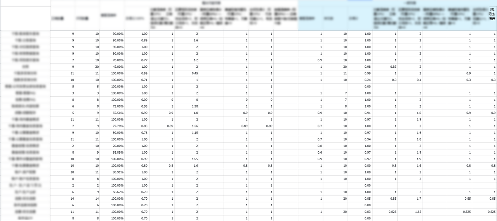

现在有了WorkBuddy真的帮了大忙。

当然，在分析之前，我们需要先搞清楚想从里面得到什么。

不同类型的数据，销售交易数据、用户运营数据、财务经营数据、调研问卷数据...这些数据想到得出的分析结果期望也不一样。

是找问题？找规律？做预测？做决策还是给领导做汇报？

比如现有一份销售数据，想要给领导做数据分析汇报，就可以按照下面这个模板框架来梳理自己的诉求

> 【嵌入电子表格】

| 模块 | 看什么 | 汇报结论落点 |
|---|---|---|
| ①整体业绩 | 总销售额、订单数、客单价、同比/环比 | 本期"达标还是没达标" |
| ②时间趋势 | 按日/周/月的走势、淡旺季、拐点 | 增长在加速还是放缓 |
| ③商品/品类 | Top商品、品类占比、ABC分层 | 哪些是"现金牛"、哪些该砍 |
| ④客户结构 | 新客/老客、复购率、RFM分层 | 增长靠拉新还是靠复购 |
| ⑤地区/渠道 | 区域分布、各渠道贡献对比 | 钱该往哪投 |
| ⑥异常定位 | 突增/突降的品类、时段、地区 | 找到"故事里的冲突点" |

如果只是发了一句让WorkBuddy做数据分析，一定是不对的啊。

就像我们给其他人派任务，也是需要明确告知想要得到什么嘛。

以下面这个数据表格为例

销售线索数据_CRM演示.xlsx
14.35KB

大家在工作中可以根据自己的需求，参考以下提示词。

```
​
提示词指令​
Plain Text
复制
销售线索数据_CRM演示.xlsx​
​
#角色​
你是一名资深销售数据分析师，擅长把CRM线索数据转化为"能直接向公司领导汇报"的结论。你的所有数字必须来自真实数据，禁止编造或估算。​
​
#分析维度​
①整体概览：总线索数、总预计金额、赢单数与金额、在途金额、整体赢单率。​
②状态漏斗：待分配→已报价→跟进中→赢单/丢单/暂停的分布与漏点。​
③大区维度：各区域线索数、金额、赢单率，找标杆区与待提升区。④产品线维度：各产品线索数、金额、赢单率。​
⑤线索来源（渠道ROI）：各来源线索数、金额、赢单率，判断投入产出。​
⑥负责人（团队人效）：各销售线索数、金额、赢单率。​
⑦月度趋势：按创建时间看获客节奏与淡旺季。​
​
#口径与注意事项​
-"预计金额"是预估口径，不是实际回款，严禁表述为"收入"。​
-赢单率有两个算法，汇报时固定其一并注明：①赢单/全部线索；②赢单/(赢单+丢单，即已闭合部分)。​
-状态里叫"赢单"不是"成交"，不要写错。​
-各维度"赢单率"建议在计算出时同时给出样本量（赢单数/丢单数），避免小样本误导。​
​
#输出要求​
-全部可视化图表。​
-全程中文。​
-每条结论必须附真实数字与数据来源口径，不编造。​
-用HTML呈现可视化数据大盘的结果，每个图表用一句话总结。​
-涉及金额统一用¥并千分位分隔。​
-面向领导：先给结论一句话，再给支撑数据的可视化图表。​
​
```

最终产出了一个Html的文件。

51%27%


最终产出了一个Html的文件。

51%27%

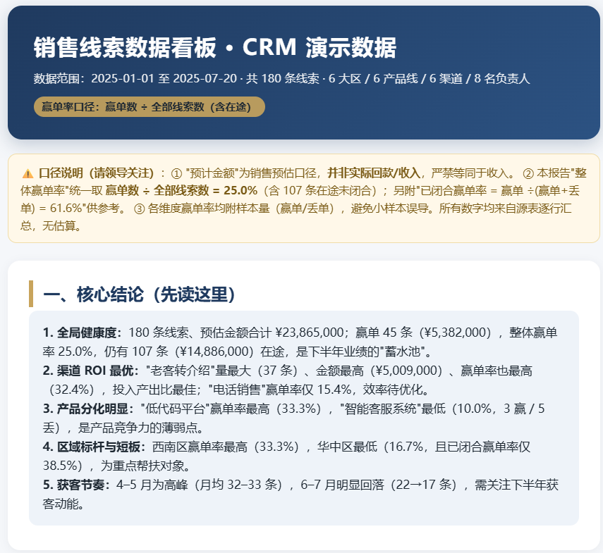


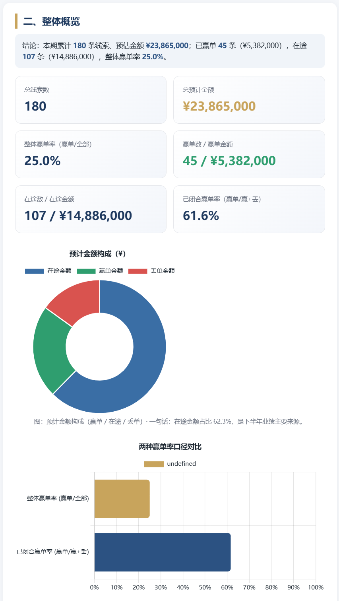

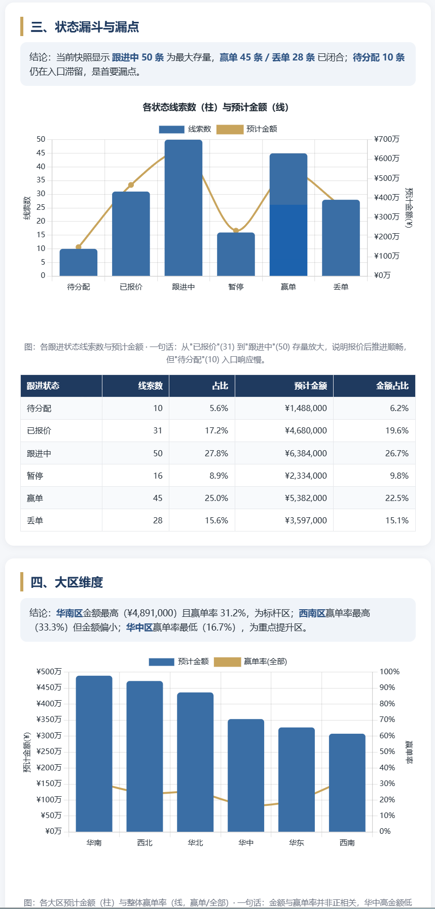

这样一份可视化数据图表，比单纯看密密麻麻的表格强多了。而且还自动帮我们归纳总结了数据重点。

## 二、WorkBuddy人机协同Word

WorkBuddy前段时间出了一个新的功能，估计很多人不知道。那就是人机双写。

以前我们本地的文件，就是自己编辑。

如果放到飞书文档，钉钉文档，腾讯文档，就可以给同事们一起编辑。这个属于人人协同。多个人编辑同一份文件。

那人机双写，就是我们的一份文档，AI和我们来一起协作。

早一点使用的AI的是怎么操作的？

AI来生成文档，或者AI读取文件内容，将某一段或者某一句生成后，还要人工手动复制粘贴到文档中。还要调整格式、排版，像是用AI，实则并没有实质的提效

现在可以直接在对话中让WorkBuddy打开想要编辑的文档。

PRD_售后工单系统.docx

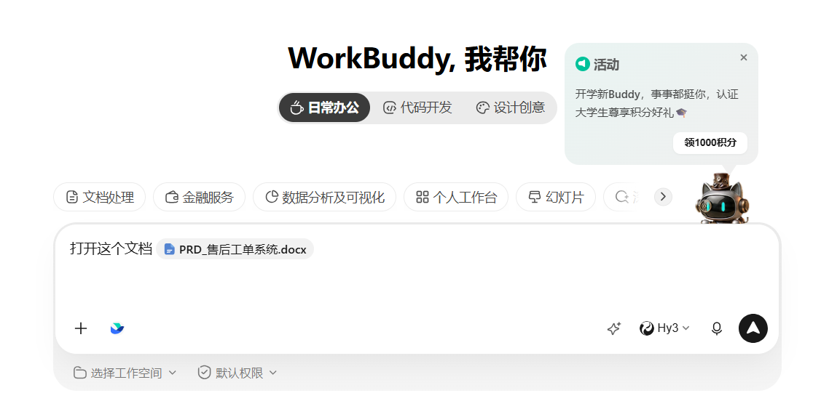

接着在对话记录点击下这个文档，右边就打开了，这样就进入了人机双写的界面中

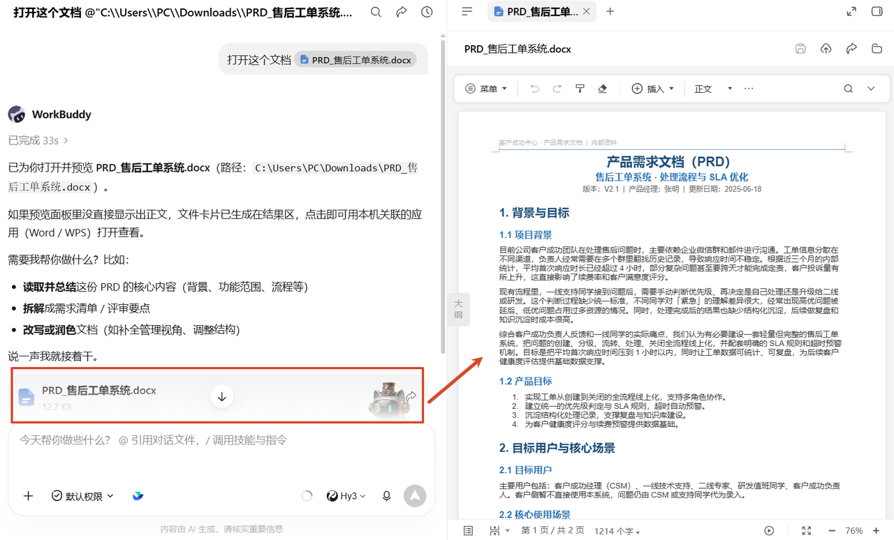

接着就框选想要AI修改的内容，然后有个【AI编辑】。

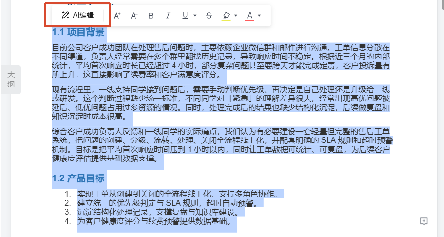

比如，让它帮我们把这个背景和目标的通俗易懂一点。需求文档，讲清楚需求可以节省大量的返工时间和减少因看不懂而产生不必要的时间去解释。

请你用大白话，讲清楚这个背景和目标。让非技术人员也能看懂

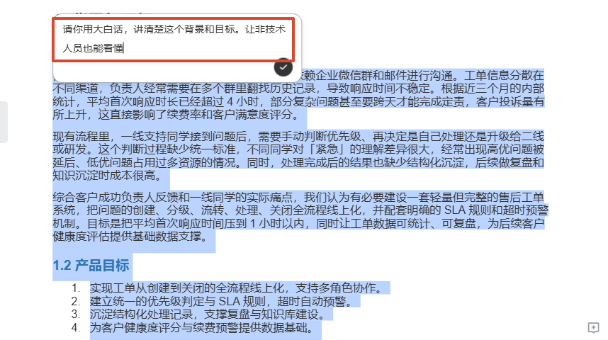

它会先给我们修改过的内容

34%34%

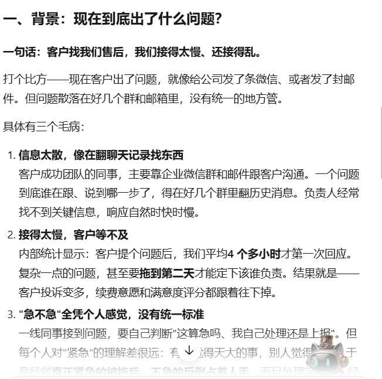

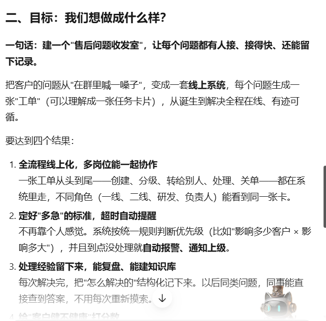

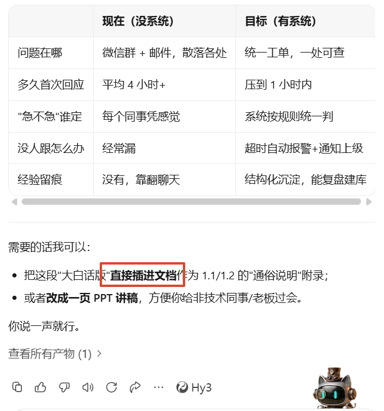

确认没问题，就可以直接让它插入文档中。

而且就算是我们正在编辑其他内容，也不影响。

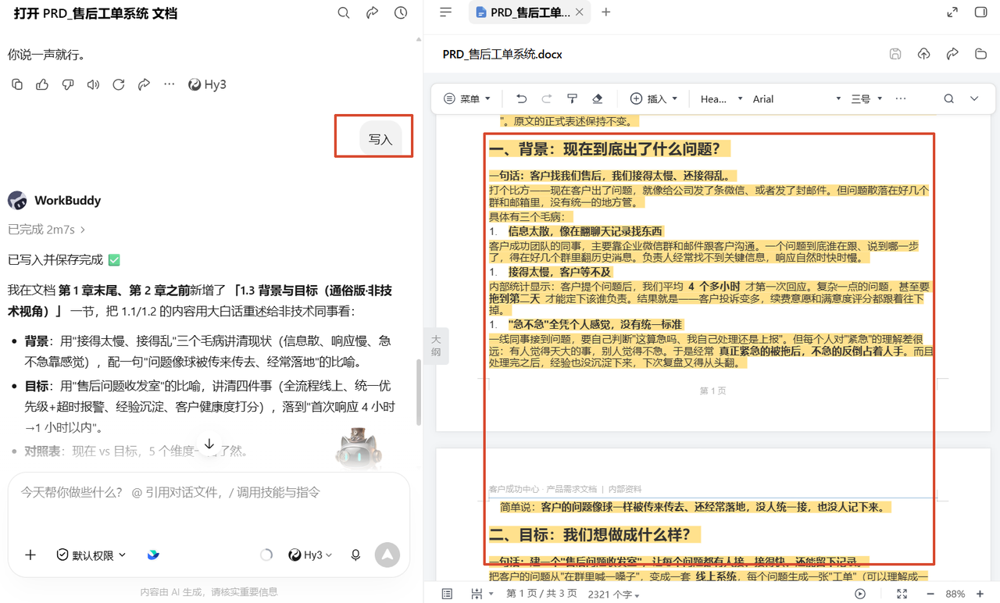

打开本地的文件看看，已经加进入了，这就是人机双写。

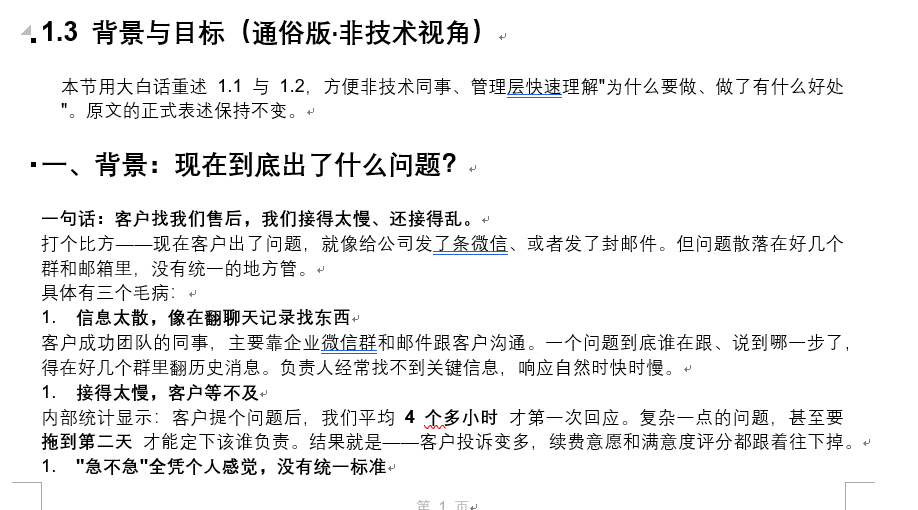

不过一点不够好的就是，我们需要手动删掉它那些开头的描述内容。

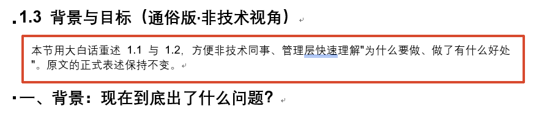

当然，不仅仅Word能这样改，其他Excel、PPT文档也都可以

## 三、WorkBuddy做出无AI味的PPT

虽然我工作了10年，但是我做的PPT真的是烂到爆炸。曾经印象最深的一次是用了3天才做出一页。

每次要给领导汇报，汇报前做PPT就是最难熬的。

有了AI后，我也尝试让AI出。但是始终没有一个能替我做出好看的。

后来我研究总结了一套可复用的方法，在codex和workbuddy上都得到了验证。

51%49%


我需要的是，不仅仅能很好呈现我的想法和内容需求，还要足够好看，更要支持修改，编辑，替换。

🍗 正确的PPT制作流程：
1.描述清楚需求出大纲：背景、主题、目的、作用、页数.....
2.提供材料、参考风格、模板
3.只生成单页看效果
4.批量生成
5.检查每一页并微调

第一步，选workbuddy这个【幻灯片】技能

47%53%

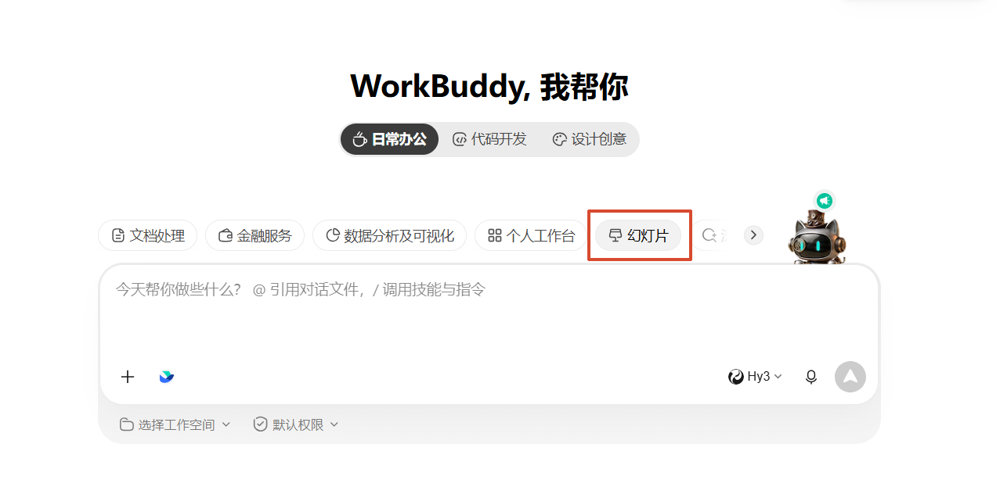

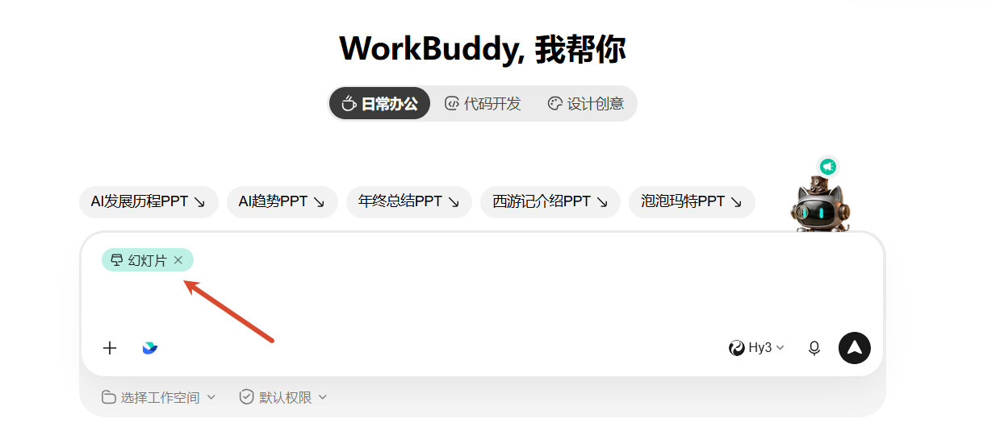

输入要求：

```
​
提示词​
Plain Text
复制
帮我根据上传的汽车图片，设计一份PPT：【场景】这个PPT用于现场发布会，【主题】捷豹新款电动汽车JX068发布会，【目的/作用】发布会上宣传播放汽车的优势，让观众看到就想要。所以每一页的文字内容都要尽量简洁。可以将上传的汽车图片用于PPT的底图，作为背景。【总页数】20页。​
​
产品介绍：​
slogan：英伦格调，性能新生｜全新捷豹，重塑豪华出行体验​
外观设计：​
经典捷豹流线型车身，低趴姿态，风阻优化，兼顾优雅与空气动力学​
标志性家族前脸+犀利灯组，光影层次强，辨识度极高​
车身曲面精致，金属车漆质感出众，光影下立体感强​
轮毂造型运动，线条比例均衡，豪华感与运动感兼具​
内饰与座舱：​
极简英伦豪华座舱，高品质真皮、金属与软质材料搭配​
悬浮中控大屏，全新车机系统，交互流畅，UI简洁​
人体工学座椅，支撑性强，多向调节，兼顾长途舒适​
静谧座舱优化隔音，车内空间开阔，乘坐氛围感高级​
动力与操控：​
高性能动力总成，加速响应迅捷，动力输出平顺线性​
捷豹专属底盘调校，悬挂韧性优秀，弯道稳定性强​
多种驾驶模式切换，可在舒适通勤与激烈驾控之间自由选择​
精准转向手感，保留燃油豪华车纯粹驾驶质感​
智能与安全：​
全套高阶驾驶辅助系统，高速、城市路况多场景支持​
360°全景影像+盲区监测，泊车、低速行驶更安全​
智能互联：手机互联、远程控制、OTA持续升级​
高强度车身结构，多气囊配置，全方位被动安全防护​
品牌与驾乘体验：​
百年英伦豪华品牌底蕴，兼具艺术美学与工程实力​
兼顾家用实用性与跑车级驾驶乐趣，一车多用​
底盘滤震优秀，兼顾运动操控和日常乘坐舒适性​
差异化豪华定位，区别于德系竞品，独特品味标签​
​
第一步，请先出大纲给我确认​
​
```

出大纲的这一步非常关键，直接决定了PPT的骨架。

50%50%

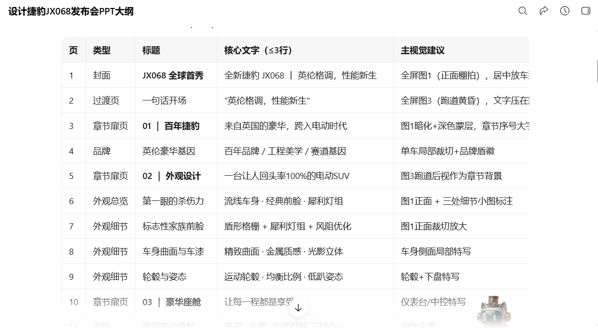

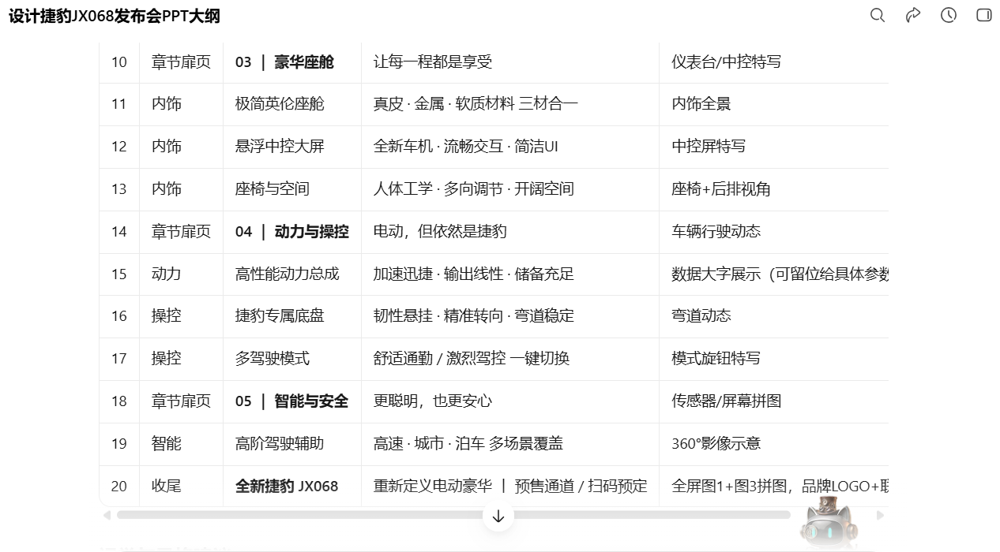

同时还会主动告知我们缺数据，以及一些欠缺发布会场景的内容。它不是无脑帮我们做PPT，而是一个有独立思考能力又专业的智能体。

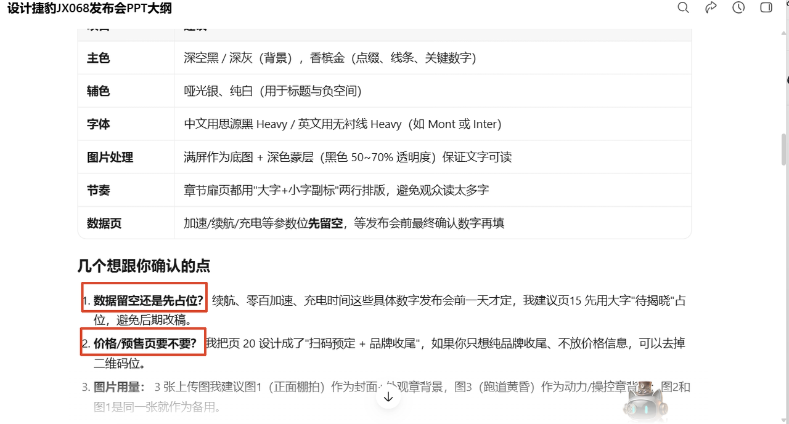

这时候我们可以先回答两个问题，也可以不管它，让它先空着。

第二步，让它出单页设计稿看看效果

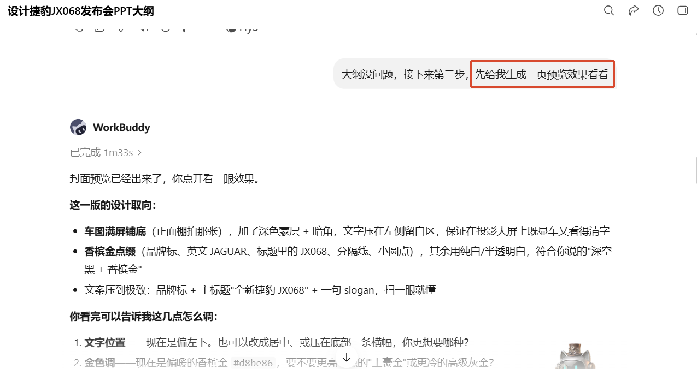


这个效果，看起来是不是很高级，深灰黑色做背景，香槟金做点缀。空间、布局、留白恰当合理，适合发布会大屏的场景。说明这个风格的处理上理解了我们的要求。

第三步，让它根据这个风格模板，输出完整的PPT。

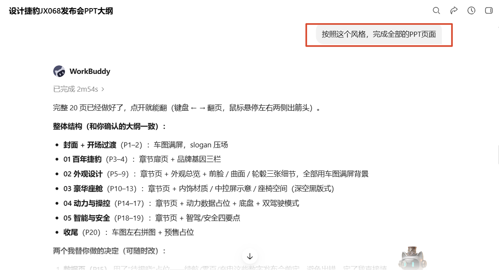

到了这步，就完成一大半了。然后打开页面看每一页的效果并微调或者补充内容。如果不满意，直接双击它就能修改里面的文字。

如果不仅仅是修改文字，只需要选择需要修改的地方点【AI编辑】就能描述要求让它重新修改

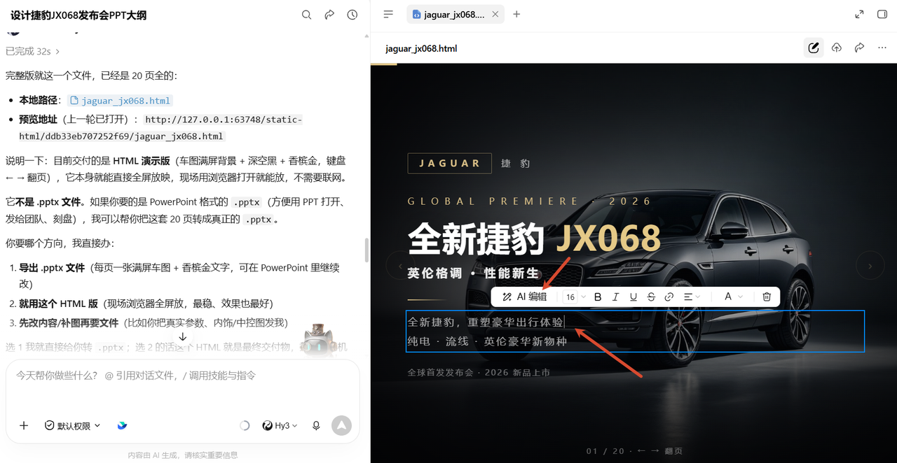

完整PPT预览效果：捷豹JX068发布会·完整演示（键盘<—、—>左右键翻页）


如果修改完了或者先不改，就可以让它转成PPT的文件，保存到本地离线使用

55%45%

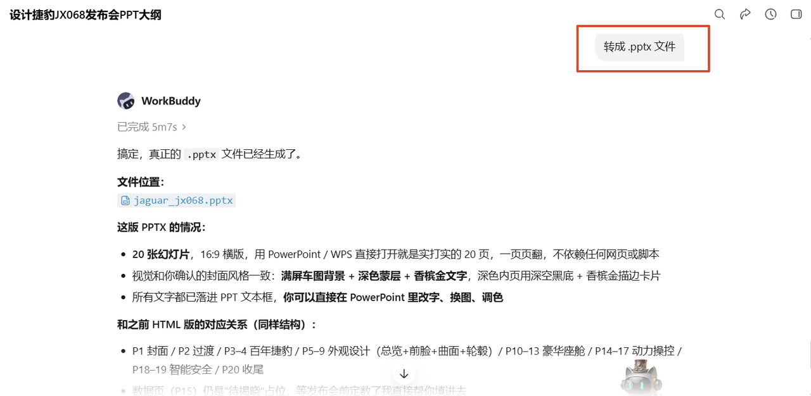

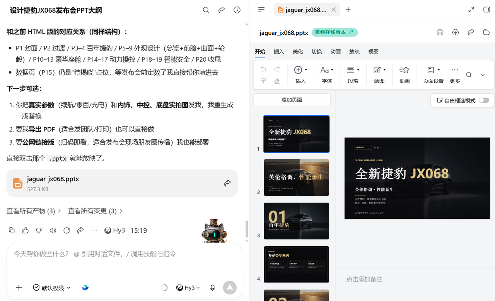

## 四、WorkBuddy清理C盘/卸载应用（拓展）

电脑用久了，经常有那种残留的文件在C盘，也可能是卸载软件的时候，没有清理干净，或者是软件都安装到C盘，导致C盘都快爆了，影响电脑运行。

### 一）清理电脑磁盘

现在我们可以把清理C盘的活交给WorkBuddy

```
​
代码块​
Plain Text
复制
我的电脑C盘快爆了，你帮我看看什么问题，是不是有什么文件不应该放到C盘​
​
```

第一步，先看看哪些文件，本不应该放到C盘。


非常离谱，豆包的网页缓存和网页数据居然有55G，而且还是占用C盘空间。

这时候，如果我们不知道这个数据清除了，会不会影响已经保存的登录状态或是缓存之类内容。我们可以尝试让它把文件移动到D盘。

```
​
代码块​
Plain Text
复制
这两项能不能移动到D盘，然后不影响豆包的正常使用：豆包ServiceWorker网页缓存，豆包WebStorage网页数据。​
我的意思是，如果换过D盘后，有一些需要记住登录状态，缓存之类的也不需要我重新再输入​
​
```


文件迁移完了，就可以进入第二步了——清理文件


清除UV缓存和临时文件，说实话我也不知道这些都是什么。但是它提示词我这个是零风险的。就可以直接让它清

```
​
代码块​
Plain Text
复制
完成第1点，清除UV缓存和临时文件​
​
```


这时候我们已经把C盘抢救回来了。可用空间从5.7G->62.7G。

### 二）卸载应用

有多少人还是用专门卸载软件的工具来卸载软件，360管家，QQ安全管家？

说实话，这些工具，本身也不是什么善茬。

我也已经很久没有用这些了。

现在软件在安装的时候很好安装，卸载的时候却给我们设了九九八十一难。而且还要仔细看各种默认勾选的选项。稍不注意，就会让电脑留下很多残留文件，卸载不干净，也占用电脑空间。

自从用了workbuddy来卸载软件就干净多了。比如我电脑上有这个录屏软件，我想要把它卸载干净。

```
​
代码块​
Plain Text
复制
帮我把这个软件卸载干净，不要有任何残留或者相关文件：Bandicam_录屏​
​
```


可以看到，它不仅仅是把软件从电脑卸载了，还包括解压后的目录安装包，以及残留文件。这才是真正的卸载干净。

以后我们就再也不需要额外安装什么卸载软件，也不用担心卸载不干净了。

## 五、WorkBuddy自动化任务（拓展）

我们在工作中，经常有很多需要重复的任务，或者是待确认的事要做。靠纯人脑记忆会经常忘记

比如日报、周报这种重复循环的任务。

或是某个需求要找领导确认，领导暂时没空。可能要下班前或者明天再去找领导这种待定待办的事项。

这时候我们就可以利用这个自动化任务的功能了。

31%


创建自动化任务有两个方式，一个是手动从侧边栏功能找到【自动化】进去手动输入。

另一个方式，也是我们演示的方式，就是通过对话，让它来自己创建任务。

WorkBuddy每天签到都能领取100积分，但是有时候完了就没有领到。

51%49%


所以我们可以直接让workbuddy创建一个自动化任务，自己每天跑任务领取，这样我们就可以不用记住这个事情了。

```
​
代码块​
Plain Text
复制
帮我做一个“workbuddy自动签到领积分”的任务，以后每天早上9点自动领取积分​
​
```


很快它就自己把任务创建好了，不过为了保证明天能正常使用，最好就先让它跑一次测试看看


确认没问题后，第二天就发现它真的自动领取了积分

66%34%


🍗 Tips：自动化任务的功能是长在WorkBuddy上的，所以必须电脑正常联网且WorkBuddy是打开运行的状态才能正常运行自动化任务

# 第三阶段：搭建一套公众号/短视频AI内容生产流程（4天）

## 一、搭建一套公众号内容生产流程@醒狮


总览：先理解整条链路

| 主流程｜40问→整理IP→生成关键词→人工核实关键词→部署飞书→写入IP和关键词→按关键词搜索最新资料→资料写入03素材池→清洗整理→5个选题×每个3个标题→人工确认→创建04选题池→创建05文章任务→brief→写作策略卡→大纲→V1→fact_check→V2→封面/配图/排版→公众号草稿→发布→复盘。 |
|---|

不支持的音频/视频格式
请下载文件后用其他软件打开
9月1日.mp4 · 68.58MB
9月1日
00:00

### 一）第一阶段：建立固定WorkBuddy工作空间

公众号生产线需要一个长期固定的工作目录。IP资料、搜索原始批次、文章任务、图片计划、HTML、发布元信息和运行日志都在同一工作空间持续积累。目录结构由WorkBuddy自动创建，不安排逐层手工新建。

#### 1、操作前准备

1.WorkBuddy可正常使用，并拥有当前项目工作目录的文件读写权限。
2.飞书连接器已连接。主流程不要求配置AppID、AppSecret、table_id等开发参数。
3.微信公众号后台可正常登录。公众号草稿自动化不是第一阶段必须条件。
4.《40问最小IP资料》可填写并保存为Word文件。
5.如存在历史文章、朋友圈长文、演讲稿，可作为后续文风提炼材料；没有也不影响主流程。

可直接复制给WorkBuddy｜创建固定工作空间

```
​
可直接复制​
Plain Text
复制
当前任务用于建立“公众号IP智能内容生产线”的长期工作空间。​
​
执行目标：​
在当前工作目录内创建后续所需的标准目录与基础文件；本步骤只做初始化，不联网搜索、不生成关键词、不生成选题、不写文章、不操作飞书。​
​
请执行：​
​
一、扫描现有工作目录​
1.先读取当前工作目录中已经存在的目录和文件。​
2.已存在的目录和文件保留，不覆盖、不删除、不重命名。​
​
二、创建标准目录​
00_IP档案/​
01_飞书配置/​
02_原始素材/raw/​
03_文章任务/​
04_图片/​
05_HTML/​
06_发布/​
07_运行日志/​
08_归档/​
​
三、在00_IP档案中创建基础文件​
ip_profile.md​
user_profile.md​
writing_style.md​
story_bank.md​
case_bank.md​
question_bank.md​
methodology_bank.md​
values_bank.md​
business_profile.md​
core_profile_raw.md​
enhanced_profile_raw.md​
​
四、在07_运行日志中创建​
daily_report.md​
error_log.md​
​
五、执行规则​
1.同名文件已经存在时先读取，只补缺失项，不覆盖旧内容。​
​
```

### 二）第二阶段：提交40问，建立最小可运行IP大脑

40问的作用不是生成一篇好看的个人介绍，而是建立后续自动选题和写作必须依赖的真实事实层。回答优先保留具体时间、地点、动作、结果、原话、真实案例和明确边界。

40 问回答.docx

| 回答原则｜真实>好看；具体>抽象；数据>形容词；案例>主观评价。无法确认的信息保留【待补】，存在冲突的信息保留【待确认】，不让AI为了完整度补写。 |
|---|

#### 1、归档40问原始回答

40问填写完成后，将Word文件放入当前WorkBuddy任务。第一步只归档原话，不做包装。

可直接复制给WorkBuddy｜把40问原样归档为证据层

```
​
可直接复制​
Plain Text
复制
当前提供的是公众号IP的《40问最小IP资料》真实回答。​
​
本步骤只建立“原始证据层”，不要写公众号文章，不要美化人设，不要主动补齐缺失信息。​
​
请执行：​
​
1.完整读取40问回答，保留原题号、原始回答、时间、地点、数字、动作、场景和原话。​
2.按Q编号整理并保存到：​
00_IP档案/core_profile_raw.md​
3.完全没有回答的项目标记【待补】。​
4.前后存在明显冲突、时间矛盾、身份矛盾、数字矛盾的内容标记【待确认】，同时保留冲突双方原话。​
5.以下信息在原始材料没有明确提供时一律不得补写：​
收入、客户数量、成交结果、案例结果、职务、证书、合作机构、产品销量、用户评价、真实对话、实测结果、人生经历。​
6.“未来计划、目标、准备做到、希望做到”必须保留为计划或目标，不得改写成已经完成的结果。​
7.不删除看起来“不够好”的真实回答；原始文件用于追溯，不用于宣传包装。​
​
完成后输出《40问归档报告》：​
-已读取题数；​
-有有效回答题数；​
-【待补】数量；​
-【待确认】数量；​
-最需要人工核实的项目；​
-core_profile_raw.md实际保存路径；​
-是否满足进入IP资料拆分阶段的条件。​
​
本步骤完成后停止，不生成IP定位、不生成关键词、不操作飞书。​
​
```

#### 2、将40问拆成可长期调用的IP资产

原始问答不能在每次写作时整份塞入上下文。下一步由WorkBuddy把真实信息拆成定位、用户、故事、案例、问题、方法、价值观和商业资料。

可直接复制给WorkBuddy｜生成IP核心卡片与长期资料库

```
​
可直接复制​
Plain Text
复制
读取：​
00_IP档案/core_profile_raw.md​
​
任务目标：​
把40问原始回答整理成后续选题与写作可直接调用的长期资料库。只允许使用原始回答中明确提供的信息，不美化、不扩写事实、不虚构案例。​
​
请生成并保存：​
​
一、00_IP档案/ip_profile.md​
包括：​
-一句话定位；​
-长期身份/专业标签；​
-可公开的身份反差；​
-已明确的可验证结果；​
-核心差异；​
-长期内容方向；​
-内容边界；​
-禁止编造事项；​
-当前核心产品或承接方向；​
-商业闭环摘要；​
-【待补】与【待确认】信息；​
-最容易跑偏的内容方向。​
​
二、00_IP档案/user_profile.md​
包括：​
-核心目标人群；​
-典型工作/生活场景；​
-高频问题；​
-强痛点；​
-更可能愿意付费解决的问题；​
-理想结果；​
-当前尚未解决的原因；​
-常见替代方案；​
-读者常见反对理由；​
-适合进入标题或开头的真实问题表达。​
​
三、00_IP档案/story_bank.md​
按“背景—冲突—行动—结果—形成的判断—可用于哪些内容”整理真实经历。​
​
```

提供3-10篇能够代表当前表达习惯的历史文章、长朋友圈、分享稿或演讲稿（例如自己曾经的公众号文章），可以建立writing_style.md。文风提炼只提取跨多篇重复出现的习惯，不模仿某一篇偶然写法。

#### 3、可选非强制：用历史文本提炼稳定文风

提供3-10篇能够代表当前表达习惯的历史文章、长朋友圈、分享稿或演讲稿（例如自己曾经的公众号文章），可以建立writing_style.md。文风提炼只提取跨多篇重复出现的习惯，不模仿某一篇偶然写法。

可直接复制给WorkBuddy｜提炼稳定文风规则

#### 3、可选非强制：用历史文本提炼稳定文风

提供3-10篇能够代表当前表达习惯的历史文章、长朋友圈、分享稿或演讲稿（例如自己曾经的公众号文章），可以建立writing_style.md。文风提炼只提取跨多篇重复出现的习惯，不模仿某一篇偶然写法。

可直接复制给WorkBuddy｜提炼稳定文风规则

```
​
可直接复制​
Plain Text
复制
读取指定的资料，同时读取：​
00_IP档案/ip_profile.md​
​
任务目标：​
提炼跨多篇重复出现、能够长期执行的写作习惯，生成writing_style.md。​
不模仿某一篇文章，不把偶然表达当成长期风格。​
​
请分析：​
1.整体语气；​
2.句长与段落长度；​
3.IP真实经历出现频率；​
4.口语程度；​
5.信息密度；​
6.观点强度；​
7.案例与故事比例；​
8.数据和来源使用习惯；​
9.常见开头方式；​
10.常见过渡方式；​
11.常见结尾方式；​
12.与读者互动方式；​
13.标题习惯；​
14.常用词；​
15.明显少用或不使用的表达；​
16.容易出现的AI套话或模板表达。​
​
每条规则必须写成“可执行约束”，例如：​
“主体段落优先2—4句完成一个意思”​
“教程先给场景，再给步骤，不先讲大段原理”​
而不是只写“专业、有温度、高级”。​
​
保存：​
00_IP档案/writing_style.md​
​
同时输出：​
-稳定风格特征；​
-偶然写法，不纳入长期规则；​
-当前资料不足以判断的文风项目；​
-后续写作时最应该优先遵守的10条规则。​
​
```

可直接复制给WorkBuddy｜提炼稳定文风规则

```
​
可直接复制​
Plain Text
复制
读取指定的资料，同时读取：​
00_IP档案/ip_profile.md​
​
任务目标：​
提炼跨多篇重复出现、能够长期执行的写作习惯，生成writing_style.md。​
不模仿某一篇文章，不把偶然表达当成长期风格。​
​
请分析：​
1.整体语气；​
2.句长与段落长度；​
3.IP真实经历出现频率；​
4.口语程度；​
5.信息密度；​
6.观点强度；​
7.案例与故事比例；​
8.数据和来源使用习惯；​
9.常见开头方式；​
10.常见过渡方式；​
11.常见结尾方式；​
12.与读者互动方式；​
13.标题习惯；​
14.常用词；​
15.明显少用或不使用的表达；​
16.容易出现的AI套话或模板表达。​
​
每条规则必须写成“可执行约束”，例如：​
“主体段落优先2—4句完成一个意思”​
“教程先给场景，再给步骤，不先讲大段原理”​
而不是只写“专业、有温度、高级”。​
​
保存：​
00_IP档案/writing_style.md​
​
同时输出：​
-稳定风格特征；​
-偶然写法，不纳入长期规则；​
-当前资料不足以判断的文风项目；​
-后续写作时最应该优先遵守的10条规则。​
​
完成后停止。​
​
```

#### 4、增强型159问的位置

159问不进入主流程前置条件。40问已经能够支持关键词生成、选题和文章生产。增强资料主要用于补充成长故事、案例、方法论、产品、私域、团队、数据和长期目标，详细导入流程放在第11阶段。

个人IP增强型资料补全手册_159问.docx

### 三）第三阶段：先生成关键词，再人工确认，确认后才部署飞书

关键词决定后续每天搜索什么。关键词不能在飞书部署前由空白模板固定，也不由固定数量倒推。正确顺序是：从40问形成的IP资料生成第一版关键词方案，人工核实后形成《已确认关键词清单》，再把确认结果写入飞书。

#### 1、根据IP资料生成第一版关键词方案

可直接复制给WorkBuddy｜从40问资料生成内容监控关键词

```
​
可直接复制​
Plain Text
复制
读取以下已确认资料：​
00_IP档案/ip_profile.md​
00_IP档案/user_profile.md​
00_IP档案/question_bank.md​
00_IP档案/methodology_bank.md​
00_IP档案/business_profile.md​
如存在可用内容，再读取story_bank.md、case_bank.md、values_bank.md。​
​
本步骤只设计“公众号内容监控关键词”，不要操作飞书，不要联网搜索，不要生成选题。​
​
关键词的目的不是建立SEO词库，而是回答：​
“WorkBuddy后续长期应该关注哪些外部变化，才更容易找到与当前IP、目标读者和长期内容方向相关的内容。”​
​
请根据实际资料自动判断合理数量，宁少勿滥，不设置机械数量目标，不为了凑数生成过于宽泛的词。​
​
关键词来源至少覆盖：​
1.IP长期核心内容方向；​
2.目标读者反复出现的高频问题；​
3.目标读者真实工作/生活场景；​
4.需要持续关注变化的工具、平台、品牌；​
5.行业、政策、规则、平台机制和趋势变化；​
6.已验证方法论能够长期延伸的主题；​
7.当前产品或业务承接相关，但必须与读者价值有关的主题。​
​
每个关键词输出：​
-关键词；​
-关键词类型；​
-对应内容方向；​
-主要对应的用户问题；​
-为什么值得长期关注；​
-后续搜索时重点寻找什么；​
-建议关注频率：高/中/低；​
-可能产生的噪声；​
-是否过于宽泛；​
-是否与其余关键词意思重复；​
-建议：保留/合并/改写/暂缓。​
​
最后输出《第一版关键词方案》，按：​
核心长期词、工具品牌词、人群场景词、问题事件词​
进行分组。​
​
​
```

#### 2、人工核实关键词

关键词方案生成后，只需要确认：是否符合长期内容方向、目标读者是否真的关心、是否存在过宽泛词、是否遗漏重要工具品牌或场景、是否有明显重复。

- 关键词方案确认，无需调整。
- 删除：____、____。其余保留。
- 新增关注方向：____。请判断是否应生成独立关键词，并说明理由。
- 关键词“____”过宽，请基于当前IP和目标读者改成更可执行的监控词。
- “____”与“____”含义接近，请合并并保留更适合长期搜索的表达。
- 本版关键词与IP方向偏差较大。保留IP资料，不操作飞书，重新生成一版关键词方案。

可直接复制给WorkBuddy｜把人工反馈整理成最终关键词清单

```
​
可直接复制​
Plain Text
复制
当前已经完成第一版关键词方案，并收到人工修改意见。​
​
请执行：​
1.读取上一版关键词方案；​
2.读取本轮人工确认意见；​
3.只按确认意见执行删除、增加、合并、改写或保留，不擅自扩大内容方向；​
4.对新增词重新检查：IP匹配度、目标读者相关性、长期可持续性、噪声风险；​
5.对保留词统一整理字段：​
关键词、类型、对应内容方向、对应用户问题、关注价值、搜索重点、建议关注频率、启用状态；​
6.输出《已确认关键词清单》；​
7.同时列出：​
-已删除词及原因；​
-已合并词及合并结果；​
-新增词及原因；​
-仍建议观察但暂不启用的词。​
​
本步骤完成后停止。​
不要联网搜索，不要操作飞书，不要生成选题。​
​
```

#### 3、关键词确认后，WorkBuddy自动部署飞书前三张表

只有在关键词确认完成后才部署飞书。第一阶段直接建立01_IP档案、02_关键词雷达、03_每日素材池。前两张立即写入数据，03先建空表等待下一阶段真实搜索结果。

可直接复制给WorkBuddy｜自动部署飞书内容中台并写入IP与关键词

```
​
可直接复制​
Plain Text
复制
前置条件：​
-IP核心资料已经确认；​
-《已确认关键词清单》已经形成；​
-飞书连接器已经可用。​
​
现在开始部署飞书《公众号IP智能内容生产线》。​
​
请直接使用已经连接好的飞书连接器完成操作。​
能够自动创建的表、字段、记录全部直接创建；如连接失败则停止并报告连接问题，不假装完成。​
​
一、创建或检查Base​
1.查找是否已存在名为《公众号IP智能内容生产线》的多维表格。​
2.已存在则复用并检查，不重复创建同名Base。​
3.不存在则创建。​
​
二、创建或检查01_IP档案​
根据当前IP资料自动设计适合长期维护的字段，至少包含：​
IP编号、账号名称、一句话定位、目标读者、核心痛点、长期内容方向、IP标签、差异化、内容边界、禁止编造事项、核心产品/承接方向、状态、最后更新时间。​
把当前已确认IP摘要写入第一条记录。​
缺失信息填写【待补】，不得猜测。​
当前记录状态设为“启用”。​
​
三、创建或检查02_关键词雷达​
至少包含：​
关键词编号、关键词、关键词类型、对应内容方向、对应用户问题、关注价值、搜索重点、建议关注频率、启用状态、最后更新时间、备注。​
只写入《已确认关键词清单》中的关键词。​
不得在此步骤重新生成、改写或增加关键词。​
自动生成唯一关键词编号。​
已确认启用的关键词状态设为“启用”。​
​
四、创建或检查03_每日素材池​
本阶段只建表，暂不虚构素材。​
字段至少能够承接：​
素材编号、原始标题、来源URL、来源平台、来源账号/机构、原发布时间、抓取时间、命中关键词、内容摘要、核心事实、来源观点、与IP相关性、可写角度、事实核查状态、去重状态、素材状态、主来源编号、备注。​
03_每日素材池创建后保持空表，等待下一阶段真实搜索。​
​
五、完成后重新读取验证​
确认：​
1.Base真实存在；​
2.01_IP档案真实存在且已有当前IP记录；​
3.02_关键词雷达真实存在且已写入全部确认关键词；​
​
```

### 四）第四阶段：按已确认关键词搜索最新资料，并写入03素材池

飞书部署完成后才正式开始搜集外部资料。搜索目标不是一次找几百条链接，而是持续找到“最新、真实、可追溯、与当前IP目标读者有关”的资料。公开网页、官方网站、产品公告、行业机构、专业媒体、微信公众号公开文章、教程、案例和真实讨论都可以作为线索来源。

#### 1、第一次搜索：先小批量验证质量

第一次只运行优先级最高的一小部分关键词，由WorkBuddy从02_关键词雷达自动读取，无需人工复制关键词。小批量通过后再扩大。

可直接复制给WorkBuddy｜第一次最新资料搜集

```
​
可直接复制​
Plain Text
复制
请使用飞书连接器读取：​
《公众号IP智能内容生产线》→02_关键词雷达​
​
本次为第一次搜索测试，请从“启用”关键词中，结合关注频率、IP核心方向和近期变化，自动选择最值得先运行的一小批关键词。​
不要求手工复制关键词。​
​
搜索目标：​
寻找最近发生、真实可追溯、与当前目标读者和IP内容方向有关的高质量资料。​
​
搜索来源优先级：​
1.官方网站、官方公告、官方产品更新、政策/规则原文；​
2.权威媒体、专业媒体、行业机构；​
3.微信公众号公开文章、专业创作者文章；​
4.教程、案例、真实使用体验、公开讨论；​
5.普通转载只作为线索，不单独支撑关键事实。​
​
时间原则：​
-新闻、热点、平台变化：优先最近72小时；​
-产品功能、价格、版本、政策、规则：优先最近7天，并尽量回到一手来源；​
-教程、案例、方法：可放宽到最近30天；​
-明显常青资料可以保留，但必须标记“常青”，不要与最新变化混为一类。​
​
每个关键词不要为了数量堆结果，优先保留少量高价值资料。​
​
每条候选资料至少整理：​
-命中关键词；​
-原始标题；​
-真实URL；​
-来源平台；​
-来源账号/机构；​
-原发布时间；​
-抓取时间；​
-来源等级A/B/C/D；​
-100—180字摘要；​
-与当前IP和目标读者的关联；​
-是否包含关键数字/功能/价格/政策等待核查信息；​
-为什么值得进入素材池；​
-若不建议保留，写明过滤理由。​
​
同时把本轮所有原始搜索结果、搜索式、过滤理由、抓取时间保存到：​
02_原始素材/raw/​
​
```

#### 2、将搜索结果自动写入03_每日素材池

可直接复制给WorkBuddy｜把本轮有效资料写入飞书素材池

```
​
可直接复制​
Plain Text
复制
基于上一轮已经完成的真实搜索结果，开始将有效资料写入：​
《公众号IP智能内容生产线》→03_每日素材池​
​
请直接使用飞书连接器写入，不输出手工复制表格。​
​
写入前先执行查重：​
1.按URL查询03_每日素材池。​
2.URL已存在时，不创建新素材编号；更新最近抓取时间，并合并新的命中关键词。​
3.URL不存在时，创建新记录并自动生成唯一素材编号。​
4.同一事件多个不同URL暂时可分别保留，后续在清洗步骤归并，不在此步骤随意删除。​
​
新记录至少写入：​
-素材编号；​
-原始标题；​
-URL；​
-来源平台；​
-来源账号/机构；​
-来源等级；​
-原发布时间；​
-抓取时间；​
-命中关键词；​
-AI短摘要；​
-与IP相关性；​
-初步可写角度；​
-待核查提示。​
​
新记录初始状态统一：​
事实核查状态=未核查​
去重状态=待处理​
素材状态=新抓取​
​
禁止：​
-补写原文不存在的数字；​
-把来源观点改成客观事实；​
-因为标题相似直接物理删除记录；​
-把无法打开的链接标成可用；​
-为了凑数量写入明显低质量采集站或纯广告页面。​
​
完成后重新读取03_每日素材池并输出：​
-本轮候选资料数；​
-新增记录数；​
​
```

#### 3、清洗重复、同事件和无效资料

素材入库后再清洗。URL相同、标题相似、同一事件多源报道需要分开判断。清洗不等于删除，保留记录用于追溯。

可直接复制给WorkBuddy｜素材清洗与同事件归并

```
​
可直接复制​
Plain Text
复制
读取：​
《公众号IP智能内容生产线》→03_每日素材池​
​
筛选条件优先：​
去重状态=待处理或素材状态=新抓取​
​
任务目标：​
清理重复、识别同事件、保留主来源、标记无效资料。不要物理删除记录。​
​
判定规则：​
1.URL完全相同：视为重复，不新建记录。​
2.标题高度相似但URL不同：标记“疑似重复”，继续核对正文和事件。​
3.标题不同但描述同一产品更新、同一政策、同一事件：标记“同事件”，选择主来源。​
4.主来源优先级：​
A官方/一手来源​
B权威媒体/行业机构​
C高质量专业创作者/真实使用者​
D普通转载/聚合​
5.补充来源包含独有信息时可以保留，但必须关联主来源素材编号。​
6.404、正文不可读、纯广告、明显采集、内容与关键词无关：标记invalid/无效。​
7.无法确认是否同事件时标记“待人工复核”，不要强行归并。​
​
每条处理后更新：​
去重状态、主来源素材编号、清洗理由、素材状态。​
​
主来源可进入后续结构化；​
重复或无效资料保留追溯信息，但不进入最新选题。​
​
先处理一小批并输出清洗结果摘要；​
规则没有明显异常后继续处理其余待处理记录。​
​
完成后输出：​
-保留数；​
-重复数；​
-同事件归并数；​
-invalid数；​
-待人工复核数；​
-需要人工重点检查的记录。​
​
本步骤不生成选题、不写文章。​
​
```

#### 4、把链接升级成可直接写作的素材资产

可直接复制给WorkBuddy｜结构化素材：事实、观点、用途分开

```
​
可直接复制​
Plain Text
复制
读取03_每日素材池中：​
去重状态=保留​
且核心事实/来源观点/可写角度等结构字段不完整的记录。​
​
对每条素材执行结构化，不改写原始URL与原始标题。​
​
请补全：​
1.AI摘要：100—180字，只概括原内容；​
2.核心事实：最多3条，只写能够回到来源核对的事实；​
3.来源观点：最多3条，与核心事实分开；​
4.关键数字：若存在，标注来源位置和核查状态；​
5.内容类型：新闻/产品更新/政策规则/教程/案例/观点/研究/常青方法等；​
6.对应内容方向；​
7.对应目标读者；​
8.可写角度：最多3个；​
9.事实核查状态；​
10.素材寿命：时效型/常青型；​
11.新鲜度：热点/新鲜/可用/常青/过期；​
12.素材状态。​
​
事实规则：​
-无明确来源的数字不得进入“核心事实”；​
-产品功能、价格、版本、政策、规则变化优先回到官方一手来源核查；​
-来源之间存在冲突时，事实核查状态=冲突，并保留冲突内容；​
-搜索摘要不能当作事实来源；​
-转载文章中的二手结论不得自动升级为一手事实。​
​
结构化完成且不存在明显无效问题的记录：​
素材状态=可用​
​
时效型资料达到明显过期条件时：​
素材状态=expired/过期，但不要删除。​
​
常青型资料不因日期较早自动判过期。​
​
完成后回写飞书，并输出本轮结构化报告。​
​
```

#### 5、给素材补“当前IP为什么能写”

外部资料只说明“发生了什么”，IP内容还需要判断“这件事与目标读者有什么关系、当前IP能提供什么不同内容”。

可直接复制给WorkBuddy｜把外部素材与IP资产建立关联

```
​
可直接复制​
Plain Text
复制
查询03_每日素材池中近期仍然可用的记录。​
​
同时读取：​
00_IP档案/ip_profile.md​
00_IP档案/user_profile.md​
00_IP档案/question_bank.md​
00_IP档案/methodology_bank.md​
00_IP档案/values_bank.md​
00_IP档案/story_bank.md​
00_IP档案/case_bank.md​
​
任务目标：​
判断每条外部素材与当前IP之间是否存在真实连接，形成选题线索；不要把IP观点写回外部素材“核心事实”。​
​
对每条素材补充：​
1.最匹配的目标读者问题；​
2.可以调用的方法论；​
3.可以调用的明确观点；​
4.可以调用的真实故事或案例；​
5.若不存在真实故事/案例，明确写“暂无，不得编造”；​
6.最适合的内容类型；​
7.最值得强调的IP差异化角度；​
8.是否与当前核心产品/业务承接存在自然联系；没有则写“无必要承接”；​
9.是否值得进入下一步选题池。​
​
规则：​
-外部事实和IP观点必须分层；​
-不能为了制造“活人感”硬塞不相关经历；​
-不能为了商业承接把每条素材都写成产品广告；​
-与IP无关的热点即使很热，也可以判定“不建议进入选题”。​
​
完成后将关联结果回写03素材池对应记录。​
本步骤不生成正式选题。​
​
```

#### 6、第一次资料采集完成检查

1.02_关键词雷达中的启用词能够被WorkBuddy自动读取。
2.搜索结果存在真实可打开的URL。
3.产品功能、价格、政策和规则类内容优先出现一手来源。
4.原始搜索批次已保存在raw目录。
5.03_每日素材池中已经出现真实素材记录。
6.同一URL不会重复建立素材。
7.核心事实与来源观点已经分开。
8.过期资料不会进入“最新选题”。

### 五）第五阶段：一次生成5个选题，每个选题同时给3个标题

素材治理完成后，选题和标题放在同一个决策节点处理。WorkBuddy一次输出5个候选选题，每个选题同时给3个明显不同的标题。人工确认可以只选选题并把标题选择交给WorkBuddy，也可以明确指定“选题2+标题3”，还可以只返工标题或整轮重做。

#### 1、生成5个选题×每个3个标题

可直接复制给WorkBuddy｜生成5个候选选题与15个标题候选

```
​
可直接复制​
Plain Text
复制
现在开始生成本轮公众号候选内容。​
​
请读取：​
1.飞书01_IP档案中的当前启用IP；​
2.00_IP档案中的ip_profile.md、user_profile.md、question_bank.md；​
3.飞书03_每日素材池中近期仍然可用、去重状态=保留的素材；​
4.story_bank.md、case_bank.md、methodology_bank.md、values_bank.md中与当前素材相关的内容；​
5.business_profile.md，仅用于判断内容承接是否自然，不用于强行硬广。​
​
本阶段不要写正文，不创建文章任务。​
​
先判断：​
-最近真正发生了哪些值得关注的变化；​
-哪些变化与目标读者的真实问题有关；​
-哪些内容适合当前IP长期表达；​
-哪些素材可以支撑方法、案例、观点或故事；​
-哪些热点虽然很热但不适合当前IP。​
​
然后生成5个明显不同的候选选题。​
不要5个全部写新闻热点，尽量形成内容组合，例如：​
热点/新变化、实操教程、用户问题、案例/踩坑、观点判断、IP故事、趋势/深度。​
​
每个选题必须输出：​
​
【选题编号】​
选题1/选题2/选题3/选题4/选题5​
​
【选题方向】​
一句话说明准备讲什么。​
​
【内容类型】​
热点/教程/案例/观点/IP故事/趋势深度。​
​
【目标读者】​
明确职业、阶段和场景。​
​
【核心问题】​
目标读者当前真正卡在哪里。​
​
【为什么当前值得写】​
结合最新资料、用户痛点或长期IP价值说明。​
​
```

#### 2、选题与标题一次确认

| 情形 | 确认表达 |
|---|---|
| 选题确定，标题交由WorkBuddy判断 | 采用选题2。三个标题均可，请从已有3个标题中选择最匹配文章承诺和证据的一个。 |
| 选题与标题同时确定 | 采用选题2，使用标题3。 |
| 选题保留，标题全部重做 | 保留选题2，三个标题均不采用。围绕同一选题重新生成3个明显不同的标题，不修改选题方向。 |
| 主题和标题保留，调整目标读者 | 保留选题3和标题2，写作角度调整为____场景，核心承诺保持不变。 |
| 5个均不满意 | 本轮5个选题全部不采用。保留已搜集素材，不重新搜索；重新生成5个选题，每个仍提供3个标题。 |

#### 3、确认后自动创建04_高潜选题池并保存本轮结果

可直接复制给WorkBuddy｜把5个选题、15个标题和最终确认结果写入飞书

```
​
可直接复制​
Plain Text
复制
前置条件：​
本轮已经完成5个候选选题及每个3个标题，并且已经收到人工确认结果。​
​
现在使用飞书连接器操作：​
《公众号IP智能内容生产线》​
​
一、创建或检查04_高潜选题池​
不存在时自动创建；存在时复用并检查字段，不重复创建同名表。​
​
字段应能够长期记录：​
-选题编号；​
-选题方向；​
-内容类型；​
-目标读者；​
-核心问题；​
-为什么值得写；​
-文章承诺；​
-关联素材；​
-可用故事/案例/方法论/观点；​
-缺失资料；​
-事实风险；​
-标题候选1；​
-标题候选2；​
-标题候选3；​
-最终标题；​
-推荐理由；​
-六维排序摘要；​
-当前状态；​
-创建时间；​
-确认时间；​
-人工确认备注。​
​
二、保存本轮5个候选​
把本轮5个候选全部写入，不删除未采用选题。​
每个候选自动生成唯一选题编号。​
​
状态规则：​
-最终采用的选题：已确认；​
-其余未采用选题：候选；​
-明确放弃且不再使用的选题：放弃。​
​
​
```

#### 4、选题排序标准放在结果后理解

| 维度 | 大白话解释 |
|---|---|
| 时效性 | 当前写还有没有意义，是否存在正在发生的新变化 |
| 痛点强度 | 目标读者是否真的在意，是否影响时间、金钱、风险或机会成本 |
| 差异化 | 是否只有当前IP更适合讲，是否存在实测、身份视角或信息差 |
| 实用价值 | 读完能否马上获得步骤、模板、判断标准或可执行动作 |
| IP匹配度 | 是否强化长期标签和目标读者，而不是只追热门 |
| 素材完整度 | 是否有多源资料、一手来源和足够证据支撑 |

评分只用于排序，不用于科学预测爆款。评分结果必须同时写理由，人工确认始终优先于自动排序。

### 六）第六阶段：把选题真正写成一篇好文章

选题和标题只是起点。本阶段解决的是：文章到底怎么展开、怎么把标题兑现、怎么写得具体、怎么减少AI味、怎么安排证据、怎么控制段落和版式。新增的写作规范不再单独悬在流程外，而是被整理成一个可执行的“写作策略卡”，随后进入大纲、V1、核查和V2。

#### 1、自动创建05_内容生产表和文章任务

可直接复制给WorkBuddy｜为已确认选题创建文章任务

```
​
可直接复制​
Plain Text
复制
前置条件：​
飞书04_高潜选题池中已经存在状态=已确认的选题，并且“最终标题”已经确定。​
​
请使用飞书连接器操作：​
《公众号IP智能内容生产线》​
​
一、创建或检查05_内容生产表​
不存在时自动创建；存在时复用。​
字段应能够记录一篇文章从资料准备到发布复盘的全过程，至少包含：​
文章编号、关联选题编号、内容类型、目标读者、文章承诺、最终标题、当前阶段、brief资料包、写作策略卡、大纲文件、V1第一版、fact_check核查清单、V2终稿、摘要、封面/配图计划、HTML/排版文件、公众号草稿标识、发布时间、发布数据、复盘结论、创建时间、最后更新时间。​
​
二、创建当前文章任务​
1.读取04_高潜选题池中本轮已确认选题。​
2.自动生成唯一文章编号。​
3.写入关联选题编号、内容类型、目标读者、文章承诺、最终标题。​
4.当前阶段=资料准备。​
5.尚未生成的文件字段保持为空，不填虚假路径。​
6.将04_高潜选题池中该选题状态更新为“已创建文章”。​
​
三、创建本地文章目录​
在03_文章任务下为当前文章编号创建独立目录。​
预留：​
brief.md​
writing_plan.md​
outline.md​
v1.md​
fact_check.md​
v2.md​
不要提前写入正文内容。​
​
四、完成后验证​
重新读取飞书05表和本地文章目录，确认：​
-文章记录真实存在；​
-文章编号唯一；​
-关联选题正确；​
-最终标题与人工确认结果一致；​
-当前阶段=资料准备；​
-本地文章目录存在。​
​
最后输出当前文章编号、关联选题、最终标题、当前阶段。​
本步骤结束后停止，不生成brief。​
​
```

#### 2、先生成写作资料包brief：把可写与不可写分清

可直接复制给WorkBuddy｜生成可追溯写作资料包并回写飞书

```
​
可直接复制​
Plain Text
复制
处理当前文章编号对应的文章任务。​
​
请读取：​
1.飞书05_内容生产表中的当前文章记录；​
2.关联的04_高潜选题池记录；​
3.关联的03_每日素材池素材；​
4.00_IP档案/ip_profile.md；​
5.user_profile.md；​
6.writing_style.md，如存在有效规则；​
7.story_bank.md；​
8.case_bank.md；​
9.question_bank.md；​
10.methodology_bank.md；​
11.values_bank.md；​
12.business_profile.md。​
​
任务目标：​
生成“只服务当前文章”的brief，不把整个IP资料库全部塞入正文上下文。​
​
brief.md必须包含：​
​
一、文章基本信息​
-文章编号；​
-选题编号；​
-最终标题；​
-内容类型；​
-目标读者；​
-典型阅读场景；​
-文章核心承诺。​
​
二、必须回答的核心问题​
列出3—5个正文必须回答的问题，确保标题和选题不会跑偏。​
​
三、本篇IP规则​
只抽取当前文章相关的定位、内容方向、文风、边界、禁止编造事项。​
​
四、外部素材​
逐条保留：​
MATERIAL_ID、标题、URL、来源平台、发布时间、来源等级、可用于正文哪个位置。​
​
五、事实分层​
​
```

#### 3、生成“写作策略卡”：把标题、正文、用词、节奏和版式一次说清楚

这一节就是新增写作规范的正式位置。它不重新生成标题，而是把已经确认的标题如何兑现、正文如何展开、用词如何控制、版式如何安排，整理成writing_plan.md。后续大纲和V1都必须读取这张策略卡。

| 写作问题 | 本阶段要解决什么 |
|---|---|
| 标题 | 确认点击理由、核心承诺、风险和正文兑现位置，不再额外生成第4个标题 |
| 开头 | 用真实场景、具体冲突或读者问题进入，不写空泛时代背景 |
| 正文 | 按照读者理解顺序展开，每个模块都有结论/证据/动作 |
| 用词 | 短、准、具体，术语首次出现用大白话解释，高风险信息保持来源口径 |
| 节奏 | 一段一个意思，长短句交错，避免连续模板化过渡 |
| 版式 | 提前规划小标题、列表、引用、加粗、真实截图和留白位置 |

可直接复制给WorkBuddy｜生成当前文章写作策略卡writing_plan.md

```
​
可直接复制​
Plain Text
复制
前置条件：​
当前文章已经存在brief.md，最终标题已经人工确认，资料充足度允许继续。​
​
请读取：​
-当前文章brief.md；​
-最终标题；​
-ip_profile.md；​
-writing_style.md；​
-user_profile.md；​
-当前文章类型；​
-可用真实故事、案例、方法论和观点。​
​
任务目标：​
在正式生成大纲和正文之前，先生成一份“写作策略卡”：​
当前文章目录/writing_plan.md​
​
这份文件不是正文，不新增事实，不重新生成选题，也不重新生成第4个标题。​
它只回答“这篇文章应该怎么写”。​
​
一、最终标题兑现策略​
对已确认标题做拆解：​
1.标题主要点击理由属于：痛点、利益、好奇、反差、问题、观点、场景中的哪一种或哪几种；​
2.标题真正承诺了什么；​
3.目标读者看到标题后最可能期待得到什么；​
4.正文必须提供哪些证据、步骤、案例或判断才能兑现；​
5.标题最大的事实/夸张风险；​
6.标题中是否存在需要降级表达的词；​
7.禁止另外生成第4个标题。若标题确实存在无法兑现的问题，只输出“标题返工建议”，等待人工决定。​
​
二、开头策略​
设计3种可选开头思路，但不写完整正文：​
A.具体场景型：从真实工作/生活场景进入；​
B.冲突问题型：从目标读者正在经历的麻烦或误区进入；​
C.结果/判断型：先给一个明确结论，再解释原因。​
​
每种开头说明：​
-为什么适合当前读者；​
-需要哪些真实材料支撑；​
-容易出现什么风险。​
​
禁止使用“随着AI快速发展”“在这个日新月异的时代”等空泛开场。​
​
```

#### 4、先确认“怎么讲”，再开始写全文：生成可核对大纲

大纲是文章生产中最重要的人工闸门之一。标题已经确定，写作策略已经明确，大纲需要证明：标题能否兑现、证据是否够、真实内容放在哪里、读者按照什么顺序理解最顺。

| 文章类型 | 建议主结构 |
|---|---|
| 实操教程 | 场景→问题→步骤→示例→避坑→行动 |
| 观点判断 | 真实场景→冲突→判断→论证→反方→行动 |
| 案例复盘 | 背景→问题→过程→关键动作→结果→复盘→可复制方法 |
| 热点借势 | 发生了什么→为什么重要→与目标读者的关系→IP判断→行动建议 |
| IP故事 | 具体场景→冲突→选择→结果→当前判断→读者启示 |
| 深度趋势 | 现象→证据→多个视角→判断→影响→行动 |

可直接复制给WorkBuddy｜生成可核对的大纲

```
​
可直接复制​
Plain Text
复制
前置条件：​
当前文章已经存在：​
brief.md​
writing_plan.md​
最终标题​
​
请读取：​
-brief.md；​
-writing_plan.md；​
-最终标题；​
-writing_style.md；​
-ip_profile.md。​
​
任务目标：​
生成能够直接用于写作、同时方便人工核对证据和逻辑的outline.md。​
必须遵守writing_plan.md中的标题兑现、开头、用词、段落和版式规则。​
​
大纲必须包含：​
​
1.推荐采用的开头方式​
从writing_plan.md已有开头方案中选择最合适的一种，说明选择理由。​
只写开头思路，不写完整正文。​
​
2.主体3—5个核心模块​
每个模块写明：​
-模块标题；​
-这一段要回答什么问题；​
-先给什么结论/判断；​
-使用哪些MATERIAL_ID/URL；​
-使用哪些真实故事/案例/方法论/观点；​
-给出什么可执行动作或判断标准；​
-是否需要列表、引用、流程图或对比表。​
​
3.证据标记​
需要官方来源的位置标记【需来源】。​
需要真实截图的位置标记【待插图：真实截图】。​
需要流程图/对比图/数据图的位置标记【待插图：图表类型】。​
需要补真实经历的位置标记【待补经历】。​
​
4.风险标记​
列出容易误解、来源冲突、标题过度承诺、商业承接过硬的位置。​
​
```

#### 5、大纲确认方式

- 大纲确认，按当前结构进入V1。
- 大纲第2、3模块对调，其余保持不变；调整后再次输出简版确认清单。
- 在第3模块加入已提供的案例____，不得新增案例结果。
- 删除产品承接段，本篇保持纯内容输出。
- 当前结构无法兑现标题。保留brief、writing_plan和最终标题，重新设计大纲，不改选题。

只有收到明确大纲确认后，飞书当前阶段才更新为“写作中”。

#### 6、生成V1第一版正文：把已有材料写完整，把不确定处留出来

可直接复制给WorkBuddy｜根据已确认大纲生成V1并回写

```
​
可直接复制​
Plain Text
复制
前置条件：​
-当前文章大纲已经明确人工确认；​
-飞书05_内容生产表当前阶段允许进入“写作中”。​
​
请读取：​
brief.md​
writing_plan.md​
已确认outline.md​
writing_style.md​
ip_profile.md​
​
生成：​
当前文章目录/v1.md​
​
写作要求：​
​
一、严格遵守writing_plan.md​
包括：​
-标题兑现方式；​
-推荐开头方式；​
-主体展开逻辑；​
-用词规则；​
-段落节奏；​
-版式标记；​
-结尾策略；​
-写作红线。​
​
二、开头​
1.使用已确认开头策略；​
2.前100—150字尽快进入具体场景、冲突、问题或判断；​
3.不写大段时代背景；​
4.不使用“随着AI快速发展”“在这个快速变化的时代”等空泛开场；​
5.开头必须让目标读者知道“这篇与什么有关”。​
​
三、正文模块​
1.严格按照已确认outline顺序；​
2.每个模块优先做到：​
结论/判断→证据/案例/实测/来源→可执行动作/判断标准；​
3.教程步骤必须能够照着执行，不能跳关键步骤；​
4.观点文章必须给证据与反方，不只输出态度；​
5.案例文章必须区分背景、动作、真实结果与复盘，不扩大案例结论。​
​
```

#### 7、V1人工复核只补真正有价值的信息

| 复核内容 | 处理方式 | 目的 |
|---|---|---|
| 关键事实 | 核数字、功能、价格、版本、政策、时间、案例结果是否有可靠来源 | 避免错误信息 |
| IP明确判断 | 补充真实判断、原因、取舍和边界 | 减少通用AI感 |
| 真实细节 | 补充经历、实测、用户问题、截图、操作结果 | 增加可信度和辨识度 |
| 版式证据 | 确认截图、图表、引用是否真实可用 | 让排版服务内容，而不是装饰 |

语言层面的逐字润色不需要在V1阶段承担。人工时间优先用于AI无法知道的事实、真实经历、明确判断和公开边界。

#### 8、生成fact_check发布前体检

可直接复制给WorkBuddy｜生成事实核查、AI套话和版式问题清单

```
​
可直接复制​
Plain Text
复制
读取当前文章：​
v1.md​
brief.md​
writing_plan.md​
outline.md​
最终标题​
​
任务目标：​
逐段检查事实风险、AI套话、真实细节、逻辑、标题兑现和版式问题，不直接改写正文。​
​
生成：​
当前文章目录/fact_check.md​
​
逐段识别以下五类问题：​
​
A.事实风险​
包括：​
数据、产品功能、价格、版本、时间、政策、平台规则、人物/公司信息、案例结果、来源观点被写成事实、二手来源被当成一手结论。​
每个风险项保留当前来源URL，并给出建议优先核查的一手来源类型。​
​
B.AI套话​
识别：​
正确但没有信息量、重复总结、空泛升华、模板化过渡、过度总结、假装深刻、缺乏具体对象的结论。​
​
C.缺真实细节​
识别：​
应该出现但当前缺失的实测、经历、用户问题、案例、截图、操作结果、明确判断。​
​
D.逻辑与兑现​
识别：​
前后跳跃、观点与证据不匹配、标题承诺未兑现、目标读者偏离、大纲模块重复、结尾与正文无关、商业承接过硬。​
​
E.版式与阅读体验​
识别：​
段落过长、小标题过少、列表不清楚、引用没有区分、加粗过多、同屏重点过密、截图位置不明确、表格可能不适合手机阅读。​
​
fact_check.md每条至少包含：​
-段落编号；​
-问题类型；​
-原句/问题摘要；​
-待核查事实或待处理问题；​
​
```

#### 9、生成V2终稿：只吸收已经确认的修改

V2只能吸收已经确认的修改。无法确认的重要事实删除或降级表达，真实经历只使用已提供材料；写作策略卡中的用词、节奏和版式要求继续生效。

可直接复制给WorkBuddy｜只吸收已确认修改生成V2终稿

```
​
可直接复制​
Plain Text
复制
前置条件：​
fact_check.md已经存在人工处理结果，关键事实、冲突信息和真实补充已经明确。​
​
请读取：​
v1.md​
brief.md​
writing_plan.md​
outline.md​
fact_check.md​
writing_style.md​
最终标题​
​
生成：​
当前文章目录/v2.md​
​
修改规则：​
​
1.已核查数字、时间、价格、版本、政策、产品能力不得擅自改动。​
2.无法确认但不影响核心结论的信息，按fact_check建议降级表达。​
3.无法确认且直接影响核心结论的信息删除。​
4.来源冲突未得到人工裁决时，保留冲突或取消确定性结论。​
5.只加入人工明确提供或已有资料确认的真实经历、案例、实测、用户问题。​
6.删除fact_check识别出的AI套话、重复、空泛升华和模板化总结。​
7.保留IP明确判断、方法论和内容边界。​
8.不扩大原始事实结论，不把“可能、尝试、个案”改成“普遍、必然、证明”。​
9.检查最终标题与正文是否完全兑现。​
10.保留所有需要真实截图的插图位置，不用AI图替代事实证据。​
11.按writing_plan.md重新检查：​
-开头是否具体；​
-每个模块是否有结论、证据、动作；​
-术语是否解释；​
-段落是否适合手机阅读；​
-列表、引用、小标题是否清晰；​
-加粗是否克制；​
-模块之间是否有留白；​
-结尾是否具体。​
12.商业承接只保留自然且与正文问题直接相关的内容。​
​
文末追加《发布前人工检查清单》：​
-最终标题；​
-摘要；​
​
```

#### 10、第六阶段完成检查

1.选题和标题没有在第六章重复生成。
2.05_内容生产表由WorkBuddy自动建立。
3.同一篇文章的brief、writing_plan、outline、V1、fact_check、V2都属于同一个文章编号。
4.新增写作规范已经转化为writing_plan.md，而不是一段独立理论。
5.大纲没有自动越过人工确认。
6.V1不确定内容仍然保留明显标记。
7.fact_check与正文分开保存。
8.V2只吸收已确认事实和真实信息。
9.标题兑现、正文节奏、用词与版式已经在V2再次检查。
10.飞书文章阶段与实际文件一致。

### 七）第七阶段：封面、配图、摘要、排版和公众号草稿

#### 1、先做图片计划，证据图和装饰图分开

软件界面、真实操作、数据结果、产品功能、政策页面和案例证据必须使用真实截图或可靠原始图。AI生成视觉只用于封面、概念表达、氛围视觉，不承担事实证明。

可直接复制给WorkBuddy｜生成封面方向与正文配图计划

```
​
可直接复制​
Plain Text
复制
读取当前文章：​
v2.md​
brief.md​
writing_plan.md​
如存在IP视觉规则一并读取。​
​
任务目标：​
先规划封面和正文图片，不擅自把AI生成图当作真实证据。​
​
一、生成3套封面方向​
每套包括：​
-封面核心信息；​
-主视觉主体；​
-背景；​
-构图；​
-主色/辅助色；​
-光影；​
-画面情绪；​
-12字以内封面短标题；​
-适合元素；​
-避免元素；​
-完整中文生图提示词。​
​
三套方向必须明显不同，但与当前文章和IP气质一致。​
​
二、扫描v2.md中所有【待插图】位置​
生成：​
04_图片/image_plan.md​
​
每个插图位置记录：​
-所在段落；​
-图片目的；​
-图片类型：真实截图/流程图/对比图/数据图/示意图/概念图；​
-核心信息；​
-是否必须真实截图；​
-建议尺寸；​
-建议文件名；​
-来源或制作方式。​
​
三、版式关联​
读取writing_plan.md中的版式预案，补充：​
​
```

#### 2、生成公众号摘要和HTML排版

可直接复制给WorkBuddy｜生成公众号HTML、摘要与发布元信息

```
​
可直接复制​
Plain Text
复制
前置条件：​
v2.md已经定稿，封面和正文图片至少已经明确文件或占位计划。​
​
请读取：​
v2.md​
writing_plan.md​
image_plan.md​
最终标题​
当前文章记录​
​
生成：​
05_HTML/article.html​
​
排版要求：​
​
一、内容不改​
1.不修改正文事实、数字、案例、观点和最终标题；​
2.不新增正文不存在的宣传承诺；​
3.不把待核查内容排版成确定结论。​
​
二、手机阅读​
1.H2/H3层级清晰；​
2.段落保持短而清楚；​
3.一个视觉区块尽量只表达一个核心意思；​
4.模块之间保持足够留白；​
5.重要结论附近留白，不把重点埋在大段文字中。​
​
三、重点格式​
1.关键句、关键数字可以加粗，但同一屏重点不宜过多；​
2.步骤使用有序列表；​
3.并列事项使用无序列表；​
4.金句、用户原话、政策原文使用引用块；​
5.代码、提示词、命令使用独立代码块；​
6.表格适配窄屏，过宽表格改为分组列表或纵向结构。​
​
四、图片​
1.图片使用真实文件路径或明确占位；​
2.证据型截图位置必须保持；​
3.图片前后说明图片用于证明什么；​
4.不静默丢图。​
​
​
```

#### 3、公众号草稿：优先自动创建，正式发布仍人工

可直接复制给WorkBuddy｜创建公众号草稿并回写飞书

```
​
可直接复制​
Plain Text
复制
前置条件：​
飞书05_内容生产表当前文章阶段=待推草稿。​
​
请检查当前环境是否具备已授权的微信公众号草稿创建能力。​
​
若具备：​
1.读取当前文章的最终标题、最终摘要、V2、HTML、封面和事实核查摘要。​
2.检查不存在未处理的关键【待核查】。​
3.检查封面文件存在。​
4.检查HTML可读取。​
5.创建微信公众号草稿，只创建草稿，不正式发布、不群发。​
6.创建后查询草稿列表，确认草稿真实存在。​
7.将草稿标识、草稿推送时间、当前阶段=已入草稿箱回写飞书05_内容生产表。​
8.在06_发布目录保存本次草稿结果。​
​
若当前环境不具备公众号草稿连接能力：​
1.不假装创建成功；​
2.输出《手工进入公众号草稿箱清单》：​
最终标题、摘要、封面路径、HTML路径、V2路径、插图计划、需要检查的链接；​
3.飞书当前阶段保持“待推草稿”。​
​
无论哪种路径，正式发布都必须由公众号管理员人工执行。​
​
最后输出：​
-草稿创建能力是否可用；​
-草稿是否创建成功；​
-草稿标识，如成功；​
-飞书状态；​
-手机预览需要重点检查的项目。​
​
本步骤结束后停止。​
​
```

#### 4、手机预览与正式发布

1.标题和摘要没有被截断或产生歧义。
2.首屏能够快速说明文章主题。
3.封面清晰，短标题可读。
4.真实截图清晰，敏感信息已处理。
5.表格、代码块、引用在手机端不溢出。
6.链接、数字、产品名称、时间、政策口径再次确认。
7.不存在未处理的【待核查】【待补经历】【待插图】标记。
8.终稿符合IP公开边界。
9.正式发布由公众号管理员人工执行。

### 八）第八阶段：日常运行时，不再重新走搭建流程

系统搭建完成后，每日工作不再重复建表、建字段、建目录。日常主循环只有：读取关键词→搜最新资料→自动入库与清洗→生成5个选题×3个标题→人工确认→创建文章任务→brief→writing_plan→大纲→V1→核查→V2。

#### 1、每日开始工作总指令

可直接复制给WorkBuddy｜每日搜索、入库、清洗并生成候选，不跨越人工闸门

```
​
可直接复制​
Plain Text
复制
开始本轮公众号内容生产日常任务。​
​
请先检查：​
1.当前工作空间完整；​
2.飞书《公众号IP智能内容生产线》可读取；​
3.01_IP档案存在启用IP；​
4.02_关键词雷达存在启用关键词；​
5.03_每日素材池可写入。​
​
然后按顺序执行：​
​
第一阶段｜关键词选择​
从02_关键词雷达读取本轮应运行关键词。​
结合关注频率、最近运行时间和当前变化自动选择，不要求手工复制关键词。​
​
第二阶段｜最新资料搜索​
围绕选中关键词搜索：​
官方发布、产品更新、政策规则、专业媒体、微信公众号公开文章、教程、案例、真实讨论。​
按资料类型使用合理时间窗口。​
每条必须保留真实URL、来源、时间、命中关键词和来源等级。​
​
第三阶段｜保存原始批次​
把完整搜索结果、搜索式、过滤理由保存到02_原始素材/raw/，保留追溯。​
​
第四阶段｜素材入库​
按URL查询03_每日素材池：​
已存在则更新最近抓取时间和命中关键词；​
不存在则创建新素材记录。​
不得重复建同一URL。​
​
第五阶段｜清洗与结构化​
处理重复、同事件、invalid；​
主来源优先官方/一手；​
拆分核心事实与来源观点；​
补内容类型、时效、可写角度、IP相关性；​
无来源数字不得进入已确认事实。​
​
第六阶段｜生成候选​
基于近期可用素材+IP资料+用户问题+故事/案例/方法论/观点：​
生成5个明显不同的候选选题；​
每个选题同时生成3个明显不同的标题；​
​
```

#### 2、选题和标题确认后的总指令

可直接复制给WorkBuddy｜从确认结果创建文章任务并推进到大纲确认

```
​
可直接复制​
Plain Text
复制
当前已经完成选题与标题人工确认。​
​
请读取本轮确认结果，并执行：​
​
1.把本轮5个候选及3个标题全部写入或更新04_高潜选题池；​
2.最终采用的选题状态=已确认，写入最终标题；​
3.其余候选状态=候选或按人工意见处理；​
4.若05_内容生产表不存在则自动创建；​
5.为已确认选题创建唯一文章编号和文章任务；​
6.04中该选题状态更新为已创建文章；​
7.在03_文章任务中创建当前文章目录；​
8.生成brief.md；​
9.brief资料足够后生成writing_plan.md；​
10.根据brief和writing_plan生成outline.md；​
11.把brief、writing_plan、outline路径和摘要回写飞书；​
12.当前阶段停在“待大纲确认”。​
​
禁止：​
-自动确认大纲；​
-自动生成V1；​
-自动修改最终标题；​
-自动补写真实经历或案例；​
-自动正式发布。​
​
最后输出：​
文章编号、选题编号、最终标题、brief资料充足度、写作策略摘要、大纲状态、当前需要人工确认的事项。​
​
```

#### 3、大纲确认后的日常写作总指令

可直接复制给WorkBuddy｜从已确认大纲推进到V2，保留事实人工闸门

```
​
可直接复制​
Plain Text
复制
当前文章大纲已经人工确认。​
​
请先检查飞书05_内容生产表：​
当前文章阶段应允许进入写作。​
​
按顺序执行：​
​
1.读取brief.md、writing_plan.md、已确认outline.md；​
2.生成V1第一版；​
3.把V1路径和摘要回写飞书；​
4.当前阶段更新为待人工复核；​
5.生成fact_check.md；​
6.输出关键事实、AI套话、缺真实细节、逻辑、标题兑现和版式问题；​
7.停止等待人工处理fact_check。​
​
只有收到明确“fact_check已处理完成，可以生成V2”之后，才继续：​
​
8.读取人工核查结果；​
9.生成V2终稿；​
10.按writing_plan重新检查标题兑现、用词、段落、列表、引用、加粗、插图和结尾；​
11.回写V2路径和摘要；​
12.当前阶段更新为V2已定稿。​
​
禁止：​
-在fact_check未处理前生成V2；​
-擅自补真实经历；​
-擅自改变已经核实的数字和政策口径；​
-擅自改变最终标题；​
-自动正式发布。​
​
执行过程中任何关键来源不足时停止并输出缺料清单。​
​
```

### 九）第九阶段：流程跑顺后，再把重复动作设成自动化

自动化只负责高频、规则清楚、可追溯的动作。搜索、入库、清洗、结构化、候选生成可以自动；最终选题、最终标题、大纲、关键事实、终稿和正式发布不自动越过。

#### 1、自动创建06_运行日志

可直接复制给WorkBuddy｜自动创建运行日志表

```
​
可直接复制​
Plain Text
复制
当前生产线已经可以稳定完成搜索、入库、清洗、选题和文章生产。​
​
请使用飞书连接器检查：​
《公众号IP智能内容生产线》​
​
如果不存在06_运行日志，请自动创建。​
​
字段应能够记录每次自动任务的基本情况，至少包括：​
运行编号、运行时间、任务名称、运行关键词数、发现URL数、新增素材数、已存在URL数、重复数、同事件归并数、无效数、可用素材数、生成选题数、Top3摘要、失败步骤、原始错误摘要、需要人工处理、运行结果、备注。​
​
规则：​
-每次自动任务无论成功、部分成功还是失败，都必须写一条日志；​
-失败不能只写“失败”，必须记录卡在哪一步；​
-不在日志中保存密钥、token等敏感信息；​
-运行编号自动生成。​
​
创建完成后只验证表存在和字段可用，不启动自动任务。​
​
```

#### 2、自动化A：每日情报生产

可直接复制给WorkBuddy｜配置每日情报生产自动任务

```
​
可直接复制​
Plain Text
复制
创建或更新自动任务：​
公众号IP_每日情报生产​
​
执行目标：​
自动完成“读取关键词→搜索最新资料→保存raw→素材入库→去重→结构化→时效处理→写运行日志”。​
​
每次运行按以下顺序：​
​
1.读取飞书02_关键词雷达中启用关键词。​
2.根据关键词关注频率和最近运行时间，选择本轮应运行关键词。​
3.每个关键词分别搜索：​
A类：官方/最新/产品更新/政策规则；​
B类：教程/案例/微信公众号公开内容/真实讨论/踩坑。​
4.保存完整原始搜索批次到02_原始素材/raw/。​
5.按URL写入03_每日素材池：存在则更新，不存在则新增。​
6.执行URL去重、标题相似、同事件归并和无效资料识别。​
7.对保留素材补：​
摘要、核心事实、来源观点、内容类型、内容方向、目标读者、可写角度、事实核查状态、素材寿命、新鲜度、IP相关性。​
8.关键事实存在风险时保持待核查，不自动升级为已确认。​
9.更新关键词最近运行时间和有效素材情况。​
10.把本轮结果写入06_运行日志。​
​
禁止：​
-自动确认最终选题；​
-自动创建正式文章任务；​
-自动写正式正文；​
-自动删除素材；​
-自动修改IP长期定位；​
-自动正式发布。​
​
运行报告至少输出：​
运行关键词数、发现URL数、新增数、已存在数、重复数、同事件数、invalid数、待核查数、可用数、失败数、失败阶段、需要人工处理。​
​
先手动测试运行成功，再设置定时。​
​
```

#### 3、自动化B：每日候选选题

可直接复制给WorkBuddy｜配置每日候选选题自动任务

```
​
可直接复制​
Plain Text
复制
创建或更新自动任务：​
公众号IP_每日候选选题​
​
前置条件：​
当日“公众号IP_每日情报生产”已经结束，03_每日素材池状态已经更新。​
​
执行步骤：​
1.读取当前启用IP；​
2.读取03_每日素材池近期活跃、去重状态=保留、素材状态=可用的资料；​
3.读取user_profile、question_bank、story_bank、case_bank、methodology_bank、values_bank；​
4.过滤已经写过且没有新角度的同主题；​
5.生成5个明显不同的候选选题；​
6.每个候选同步生成3个不同标题；​
7.输出目标读者、核心问题、文章承诺、可用素材、IP资产、缺料、事实风险、推荐理由；​
8.使用六维评分做内部排序，并写明理由；​
9.把本轮候选写入04_高潜选题池，状态=候选；​
10.生成今日选题简报；​
11.写06_运行日志。​
​
禁止：​
-自动把任何选题改为已确认；​
-自动选择最终标题并直接写正文；​
-自动创建文章编号；​
-自动生成V1/V2；​
-自动正式发布。​
​
执行结束后停在“等待人工确认选题和标题”。​
​
```

#### 4、自动化C：状态提醒

可直接复制给WorkBuddy｜配置轻量状态提醒任务

```
​
可直接复制​
Plain Text
复制
创建可选自动任务：​
公众号IP_状态提醒​
​
只检查飞书状态，不生成内容。​
​
检查以下情况：​
1.04_高潜选题池存在已确认选题，但超过设定时间仍未创建文章任务；​
2.05_内容生产表处于资料准备，仍缺关键资料；​
3.05_内容生产表处于待大纲确认，长时间未确认；​
4.05_内容生产表处于待人工复核，fact_check仍有未处理关键项；​
5.文章已入草稿箱但尚未完成手机预览；​
6.文章已发布但到达复盘日期仍未回写数据。​
​
每种情况只生成提醒，不自动跨越状态。​
​
禁止：​
-自动确认选题；​
-自动确认大纲；​
-自动确认事实；​
-自动生成V2；​
-自动正式发布；​
-自动修改长期IP规则。​
​
每次运行结果写入06_运行日志。​
​
```

### 十）第十阶段：发布数据回写与内容飞轮

草稿箱不是终点。真实发布数据和读者反馈会反过来告诉系统：哪些关键词值得继续盯、哪些选题被高估、哪些故事和方法最有辨识度。

#### 1、发布后记录什么

| 时间 | 建议回写 | 用途 |
|---|---|---|
| 发布当天 | 发布时间、最终标题、文章状态=已发布 | 确认上线 |
| 发布后1—3天 | 阅读、点赞、在看、分享、新增关注等可获得数据 | 观察首轮表现 |
| 发布后7天 | 阶段数据、留言高频问题、咨询/转化反馈 | 判断长期价值 |
| 复盘完成 | 复盘结论、下一篇延伸方向、关键词调整建议 | 反哺下一轮 |

#### 2、单篇文章复盘

可直接复制给WorkBuddy｜单篇内容复盘

```
​
可直接复制​
Plain Text
复制
读取指定文章编号对应的完整生产记录：​
-关联选题；​
-关联素材；​
-最终标题；​
-内容类型；​
-目标读者；​
-选题推荐理由；​
-writing_plan；​
-发布数据；​
-留言/咨询/外部反馈；​
-人工备注；​
-本篇使用的故事、案例、方法论、观点。​
​
生成《单篇内容复盘》，至少回答：​
​
1.当初为什么选择这个选题；​
2.哪些数据高于或低于预期；​
3.最终标题是否兑现；​
4.哪些正文模块获得更多反馈；​
5.读者反馈暴露了哪些新问题；​
6.哪些素材、案例、故事、方法论最有价值；​
7.writing_plan中的哪类写法最有效：场景开头、观点、步骤、案例、列表、引用或图文；​
8.哪些位置存在“有流量但不匹配IP”的问题；​
9.下一篇可延伸的3个方向；​
10.哪些关键词值得继续关注；​
11.哪些关键词可能噪声过高；​
12.本篇对选题排序逻辑有什么校准启示；​
13.有哪些经验值得进入标题/结构/用词/版式规则候选。​
​
只输出“建议更新项”，不要自动修改：​
IP定位、内容边界、关键词启用状态、评分权重、长期写作规则。​
​
把复盘摘要回写飞书05_内容生产表。​
当前阶段更新为“已复盘”。​
​
```

#### 3、月度系统复盘

可直接复制给WorkBuddy｜月度关键词、内容和系统复盘

```
​
可直接复制​
Plain Text
复制
读取最近30天：​
-已发布文章；​
-04_高潜选题池候选与最终采用情况；​
-02_关键词雷达；​
-03_每日素材池；​
-文章发布数据；​
-单篇复盘；​
-06_运行日志；​
-IP真实资料库；​
-各文章writing_plan与实际表现。​
​
生成《月度公众号IP生产线复盘》。​
​
分析：​
1.哪些关键词持续产生高价值素材和选题；​
2.哪些关键词重复率高、噪声高、长期无产出；​
3.哪些内容方向表现稳定；​
4.哪类选题和标题更适合当前目标读者；​
5.哪种开头方式更稳定；​
6.哪种正文结构更容易读完；​
7.哪种用词、段落和版式规则值得保留；​
8.哪些高推荐选题实际表现低于预期；​
9.哪些原本不被看好的内容反而表现较好；​
10.哪些故事、案例、方法论最增强辨识度；​
11.哪些文章有流量但与长期IP偏离；​
12.用户最近出现了哪些新问题；​
13.当前IP档案是否出现现实变化；​
14.自动化在哪些步骤最容易失败；​
15.159问增强资料中最值得优先补哪一类。​
​
输出：​
-继续保留；​
-建议增加；​
-建议减少；​
-建议停用；​
-需要人工确认的长期规则变更。​
​
禁止自动修改长期规则。​
所有关键词停用、IP定位变化、内容边界变化、评分逻辑变化、writing_style与长期写作规则变化必须人工确认后再执行。​
​
```

### 十一）第十一阶段：159问增强型资料按需补，不阻塞主流程

159问的定位是增强型资料包，不是入场门槛。主流程出现故事不足、案例不足、商业承接不准、生活感不足、长期规划不清时，再按需要补充。补充后由WorkBuddy进行增量比对，不直接覆盖已确认IP资料。

#### 1、导入159问增强资料

可直接复制给WorkBuddy｜增量更新IP资产，不覆盖已确认事实

```
​
可直接复制​
Plain Text
复制
当前提供的是已填写的《个人IP增强型资料补全手册（159问）》。​
​
请先建立原始备份：​
00_IP档案/enhanced_profile_raw.md​
​
要求：​
完整保留原始回答，不覆盖40问原始档案。​
​
然后读取并对比：​
ip_profile.md​
user_profile.md​
story_bank.md​
case_bank.md​
question_bank.md​
methodology_bank.md​
values_bank.md​
business_profile.md​
writing_style.md，如适用。​
​
第一轮只输出差异，不直接覆盖长期资料。​
​
请把新增内容分成三类：​
​
A.可直接新增的真实资料​
必须满足：​
已有明确回答、没有与现有确认事实冲突、不是把目标当成绩、不是推测。​
​
B.与现有资料冲突，需要人工确认​
列出：​
现有内容、增强资料内容、冲突点、建议核实方式。​
​
C.仍然缺失，但会明显影响内容准确度​
按故事、案例、用户问题、方法论、价值观、产品、商业、长期目标等分类。​
​
另外标记：​
-哪些内容适合进入story_bank；​
-哪些适合进入case_bank；​
-哪些适合进入question_bank；​
-哪些适合进入methodology_bank；​
-哪些适合进入values_bank；​
-哪些适合进入business_profile；​
​
```

#### 2、出现什么问题，就优先补什么资料

| 出现的问题 | 优先补充 |
|---|---|
| 文章像通用AI稿 | 成长经历、职业节点、真实判断、生活切面 |
| 案例文章很薄 | 真实项目、用户案例、结果证据、第三方背书 |
| 教程有步骤但缺辨识度 | 方法论形成过程、踩坑、判断标准、实测 |
| 选题和商业目标脱节 | 产品、目标用户、产品边界、承接路径 |
| 长期内容方向漂移 | 价值观、长期目标、边界、明确不做事项 |
| 写作策略卡总是很泛 | 历史文章、真实用户问题、常用表达、真实案例与方法论 |
| 自动化不知道哪些事适合交给AI | 工作任务、频率、规则清晰度、人工验收标准 |

### 十二）第十二阶段：故障排查、状态解释与整体验收

#### 1、排错顺序

| 固定顺序｜连接与权限→飞书表/字段→数据→业务规则→提示词。不要一出现异常就改Prompt，否则容易把连接问题误判成写作问题。 |
|---|

| 现象 | 优先检查 | 处理方式 |
|---|---|---|
| WorkBuddy无法写飞书 | 飞书连接器状态、目标Base权限 | 先做连接器健康检查，不重复创建Base |
| 表创建了但字段不完整 | 提示词执行中断、字段冲突 | 读取现有表，只补缺失字段，不重建整张表 |
| 素材大量重复 | URL去重是否生效、同事件识别 | 按URL先查，再做标题相似和同事件归并 |
| 旧资料进入最新选题 | 发布时间、新鲜度、素材状态 | 检查时效型和常青型是否分开 |
| 文章越来越像通用AI稿 | IP资料库、真实案例/方法论、writing_plan是否过泛 | 优先补真实资产和写作策略，不先换模型 |
| 选题总是热点 | 内容组合和IP匹配判断 | 增加用户问题、案例、方法、观点型候选 |
| 标题很吸引但正文撑不住 | 标题证据要求、brief和writing_plan | 标题确认时优先看能否兑现 |
| V1出现虚构数字 | brief事实分层失效 | 无来源数字不得进入已确认事实 |
| 排版看着像AI模板 | writing_plan版式规则、HTML模板 | 减少满篇加粗、超长段落、机械小标题 |
| 公众号草稿失败 | 草稿连接能力、封面、HTML、权限 | 先用短测试稿排除内容复杂度 |

#### 2、飞书连接器健康检查

可直接复制给WorkBuddy｜只检查连接，不改正式数据

```
​
可直接复制​
Plain Text
复制
当前任务只检查飞书连接器和《公众号IP智能内容生产线》的可用性，不生成内容。​
​
请执行：​
1.检查飞书连接器是否已授权且可访问；​
2.查找《公众号IP智能内容生产线》是否存在；​
3.读取当前已经存在的数据表名称；​
4.对01_IP档案执行只读查询；​
5.对02_关键词雷达执行只读查询；​
6.对03_每日素材池执行只读查询；​
7.如04/05/06已存在，也分别执行只读查询；​
8.不新增、不更新、不删除任何正式记录。​
​
输出：​
-连接器状态；​
-Base是否可访问；​
-每张表是否可读取；​
-失败发生在哪一步；​
-可见错误信息；​
-建议处理动作。​
​
若连接器不可用，停止，不尝试重复创建Base或重写提示词。​
​
```

#### 3、表结构出现问题时，只补缺失项

可直接复制给WorkBuddy｜只补缺失字段，不重建表

```
​
可直接复制​
Plain Text
复制
请检查飞书《公众号IP智能内容生产线》中指定数据表的当前结构。​
​
目标：​
在不破坏已有记录的前提下，修复缺失字段或明显重复字段。​
​
执行：​
1.先读取现有字段及类型；​
2.对照当前SOP该表需要承接的信息；​
3.输出“已有字段、缺失字段、疑似重复字段、类型不合适字段”；​
4.只新增确实缺失的字段；​
5.对已有字段不擅自重命名；​
6.对疑似重复字段不自动删除，标记人工确认；​
7.不删除任何已有记录；​
8.修改后重新读取表结构验证。​
​
最后输出本次实际修改项。​
若当前结构已经足够，不做任何修改。​
​
```

#### 4、来源等级

| 等级 | 定义 | 主要用途 |
|---|---|---|
| A | 官方产品、机构、政策原文、一手报告 | 关键事实首选 |
| B | 权威媒体、专业媒体、成熟行业机构 | 辅助事实来源 |
| C | 高质量创作者、专业公众号、真实使用者 | 案例、观点、用户情绪、线索 |
| D | 普通转载、聚合、二次整理 | 只作线索，不单独支撑关键事实 |

#### 5、端到端整体验收

1.40问原始资料已归档，IP核心资料已形成。
2.关键词由IP资料生成并经过人工确认。
3.飞书01_IP档案、02_关键词雷达、03_每日素材池在关键词确认后才建立。
4.最新资料能够按关键词搜索，并自动写入03素材池。
5.URL重复不会重复创建素材；同事件可以归并主来源。
6.素材的核心事实与来源观点分开。
7.5个候选选题能够一次生成，每个同时有3个标题。
8.选题和标题只经过一次人工确认，不在第六阶段重复生成。
9.04_高潜选题池在候选产生后才创建并保存本轮结果。
10.05_内容生产表在选题和标题确认后才创建。
11.brief、writing_plan、大纲、V1、fact_check、V2均属于同一个文章编号。
12.新增写作规范已经贯穿大纲、V1、核查、V2和HTML排版。
13.大纲、关键事实、终稿、正式发布均存在人工确认。
14.公众号草稿成功后能回写飞书；正式发布不自动执行。
15.自动化启用后06_运行日志能够记录成功和失败。
16.发布数据能够回写并进入单篇/月度复盘。

### 十三）第十三阶段：关键节点返工，只重做出问题的那一步

内容生产最常见的问题不是整套系统完全不能用，而是某一个节点结果偏差。返工原则是：保留已经确认的上游资产，只重做当前出问题的节点。

#### 1、关键词太宽、太泛、噪声过高

可直接复制给WorkBuddy｜只修正关键词，不重做IP资料

```
​
可直接复制​
Plain Text
复制
当前IP资料已经确认，不重做40问，不修改ip_profile、user_profile和长期内容方向。​
​
问题：​
当前关键词方案存在“过宽、噪声高、搜索结果与目标读者无关”的情况。​
​
请读取：​
-当前已确认IP资料；​
-当前关键词方案；​
-已经标记为问题的关键词及人工备注。​
​
只处理关键词层：​
​
1.找出过宽泛词，并解释为什么容易产生无关结果；​
2.根据目标读者、真实场景和内容方向，把过宽词改成更具体的监控表达；​
3.对意思重复的词进行合并；​
4.对明显偏离IP方向的词提出删除建议；​
5.对可能遗漏的重要用户问题、工具品牌、场景变化提出补充建议；​
6.每个调整后的词重新写：关注价值、搜索重点、建议频率、可能噪声。​
​
不要联网搜索，不操作飞书，不修改IP资料。​
输出《关键词修正版》后停止，等待人工确认。​
​
```

#### 2、搜索结果质量差

可直接复制给WorkBuddy｜保留关键词，只重做搜索策略

```
​
可直接复制​
Plain Text
复制
当前关键词已经人工确认，不修改02_关键词雷达。​
​
问题：​
上一轮搜索结果质量偏低，可能存在转载过多、广告过多、来源太旧、与目标读者关系不强等情况。​
​
请读取上一轮raw搜索记录和03_每日素材池本轮新增记录，先诊断：​
1.哪些关键词产生的噪声最高；​
2.哪类来源占比过高；​
3.是否缺少官方/一手来源；​
4.是否搜索表达过于宽泛；​
5.是否时间范围不合理；​
6.是否把同一事件的多篇转载当成多个新信息。​
​
然后在不修改关键词本身的前提下，重新设计本轮搜索方式：​
-官方/一手搜索式；​
-微信公众号/专业内容搜索式；​
-教程/案例/真实讨论搜索式；​
-必要的排除词；​
-更合适的时间范围。​
​
重新搜索时只补充高价值结果，不覆盖旧raw，不删除旧记录。​
新结果仍按URL查重后写入03素材池。​
​
最后输出“上一轮问题—本轮调整—新增有效资料”的对照报告。​
本步骤不生成选题。​
​
```

#### 3、素材很多，但真正能写的内容很少

可直接复制给WorkBuddy｜检查素材为什么不能变成选题

```
​
可直接复制​
Plain Text
复制
读取03_每日素材池近期记录和当前IP资料。​
​
问题：​
素材数量不低，但真正适合当前公众号的选题很少。​
​
请不要继续盲目搜索，先做诊断。​
​
对近期素材按以下原因分类：​
A.与目标读者无关；​
B.有信息但没有实际价值；​
C.与IP长期方向不匹配；​
D.事实材料太薄；​
E.只有新闻，没有方法/案例/观点连接；​
F.与已有文章高度重复；​
G.适合写，但缺真实故事/实测/方法论；​
H.适合直接进入选题。​
​
统计每类数量并说明主要问题。​
​
然后给出三类修正建议：​
1.关键词层需要调整什么；​
2.搜索来源需要增加什么；​
3.IP内部资料需要补什么。​
​
只输出诊断和建议，不自动修改关键词，不自动补IP资料，不生成选题。​
​
```

#### 4、5个选题全部不满意

可直接复制给WorkBuddy｜不重新搜索，只重做选题

```
​
可直接复制​
Plain Text
复制
本轮5个候选选题全部不采用。​
​
保留：​
-已确认IP资料；​
-已确认关键词；​
-本轮已经搜集并清洗完成的素材；​
-03_每日素材池现有记录。​
​
不要重新联网搜索，不修改飞书素材，不删除上一轮候选。​
​
请先分析上一轮5个选题为什么不合适，重点检查：​
-是否过度追热点；​
-是否缺少用户真实问题；​
-是否缺少实操价值；​
-是否没有IP差异；​
-是否与已有文章重复；​
-是否商业味过重；​
-是否素材支撑不足。​
​
然后基于同一批素材重新生成5个新选题。​
本轮优先从：​
用户真实问题、可执行方法、已有案例、真实经历、明确观点、常青价值​
中寻找方向。​
​
每个新选题仍然提供3个明显不同的标题，并完整说明：​
目标读者、核心问题、文章承诺、可用素材、IP资产、缺料、事实风险、推荐理由。​
​
不要覆盖上一轮候选；新一轮单独输出，等待人工确认。​
​
```

#### 5、选题合适，但3个标题都不满意

可直接复制给WorkBuddy｜只重做标题，不动选题

```
​
可直接复制​
Plain Text
复制
当前选题已经确认，选题方向、目标读者、核心问题、文章承诺保持不变。​
​
问题：​
现有3个标题均不采用。​
​
请读取当前选题记录和可用证据，只重做标题。​
不要改变选题方向，不扩大文章承诺，不新增正文尚无证据支持的结果。​
​
重新生成6个标题，至少覆盖：​
-用户问题型；​
-清晰结果型；​
-反差/误区型；​
-场景型；​
-观点判断型；​
-搜索友好型。​
​
每个标题输出：​
核心利益点、适合读者、需要正文提供的关键证据、最大风险、是否存在夸张风险。​
​
最后推荐：​
-2个最稳妥标题；​
-1个更有张力但风险更高的标题。​
​
完成后停止，等待人工确认。​
不修改04选题状态，不创建文章任务。​
​
```

#### 6、brief显示资料不足

可直接复制给WorkBuddy｜只补缺料，不强行写文章

```
​
可直接复制​
Plain Text
复制
当前文章已经创建，最终选题和标题保持不变。​
brief判断“资料不足”，暂时不能进入写作策略和大纲。​
​
请读取brief中的缺料清单，并把缺口分成：​
1.必须补的一手事实；​
2.可选的辅助来源；​
3.需要真实实测或截图；​
4.需要补充的IP真实经历/案例；​
5.可以通过降低文章承诺来解决的缺口。​
​
对于第1、2类：​
允许联网补充资料，优先官方、一手、权威来源；​
新资料按正常流程写入03素材池并关联当前文章。​
​
对于第3、4类：​
不得模拟实测、截图或真实经历，只生成《人工补料清单》。​
​
对于第5类：​
只提出“标题/文章承诺可以如何降级”的建议，不自动修改最终标题。​
​
补料完成后重新生成brief资料充足度判断。​
仍不足则继续停在资料准备，不生成writing_plan和大纲。​
​
```

#### 7、大纲无法兑现标题

可直接复制给WorkBuddy｜保留选题和标题，重新设计结构

```
​
可直接复制​
Plain Text
复制
当前选题和最终标题已经确认，但现有大纲无法完整兑现标题。​
​
保留：​
选题、最终标题、brief、writing_plan、已确认事实、可用素材、IP真实资产。​
​
不要生成V1。​
​
请先指出旧大纲的具体问题：​
-哪个标题承诺没有对应模块；​
-哪个模块证据不足；​
-哪些模块重复；​
-哪些内容偏离目标读者；​
-哪些部分只是背景信息但占比过大；​
-哪些版式安排会导致手机阅读负担过大。​
​
然后重新设计outline.md：​
1.以标题兑现为第一优先；​
2.主体控制在3—5个模块；​
3.每个模块明确问题、证据、故事/案例/方法；​
4.必须标记来源、待补、插图位置；​
5.继续遵守writing_plan中的用词、段落和版式规则；​
6.结尾直接承接正文结果。​
​
旧大纲保留到归档，不覆盖删除。​
新大纲生成后仍停在“待大纲确认”。​
​
```

#### 8、V1内容完整，但AI感明显

可直接复制给WorkBuddy｜只诊断AI感，不擅自加故事

```
​
可直接复制​
Plain Text
复制
当前V1事实和结构基本完整，但表达存在明显通用AI感。​
​
请读取：​
v1.md​
writing_plan.md​
writing_style.md​
story_bank.md​
case_bank.md​
values_bank.md​
methodology_bank.md​
​
先诊断，不直接重写全文。​
​
标出：​
1.空泛开头；​
2.模板化过渡；​
3.重复总结；​
4.没有具体对象的正确废话；​
5.应该有判断但只有中性总结的位置；​
6.可以使用现有真实故事/案例但当前没有使用的位置；​
7.不符合writing_style稳定习惯的位置；​
8.与writing_plan的用词、节奏或版式规则不一致的位置；​
9.小标题过度模板化、加粗过多、列表滥用的位置。​
​
对每处给出处理建议：​
删除、压缩、换成具体事实、调用已有方法论、补明确判断、调用已有真实资产、调整版式。​
​
禁止：​
-为了去AI感虚构故事；​
-模拟未发生的对话；​
-增加不存在的实测；​
-把中性事实改成强烈观点。​
​
把诊断结果加入fact_check的“AI套话/真实细节/版式”部分，等待人工确认后由V2统一处理。​
​
```

#### 9、关键来源互相冲突

可直接复制给WorkBuddy｜保留冲突，不替代人工裁决

```
​
可直接复制​
Plain Text
复制
当前文章存在关键来源冲突。​
​
请读取冲突涉及的全部来源，分别保留：​
来源名称、URL、发布时间、来源等级、原始表述、支持的结论。​
​
按照以下顺序检查：​
1.是否存在官方或一手原文；​
2.是否属于发布时间不同导致的版本变化；​
3.是否比较口径不同；​
4.是否一个来源引用另一个来源但转述错误；​
5.是否属于观点差异而不是事实冲突。​
​
输出《冲突信息对照表》：​
事实问题、来源A、来源B、冲突点、可能原因、当前最安全写法、是否需要人工裁决。​
​
在人工裁决前：​
-fact_check状态保持“冲突”；​
-不把任何一方自动写成确定事实；​
-如文章核心结论依赖该事实，暂停V2；​
-如不影响核心结论，可建议删除或降级表达。​
​
```

#### 10、V2商业承接太硬

可直接复制给WorkBuddy｜只调整承接，不改正文事实

```
​
可直接复制​
Plain Text
复制
当前V2事实、结构和观点已经确认，但商业承接显得生硬。​
​
请读取：​
v2.md​
business_profile.md​
当前文章核心承诺​
​
只检查商业承接相关段落，不改正文事实和主要结构。​
​
判断：​
1.当前文章是否真的需要产品承接；​
2.产品是否与文章解决的问题直接相关；​
3.承接是否提前打断内容；​
4.是否存在夸大产品效果；​
5.是否把纯内容文章强行改成销售文。​
​
给出三种方案：​
A.完全删除商业承接；​
B.只保留一句自然延伸；​
C.保留简短承接，但明确适合人群和边界。​
​
只输出建议和替换段落，不直接覆盖V2。​
等待人工选择方案后再更新终稿。​
​
```

#### 11、排版看起来像模板、像AI

可直接复制给WorkBuddy｜只修版式，不改事实和正文逻辑

```
​
可直接复制​
Plain Text
复制
当前V2事实、结构和观点已经确认，但公众号排版看起来过度模板化、重点过多或手机阅读负担较大。​
​
请读取：​
v2.md​
writing_plan.md​
image_plan.md​
当前HTML，如已生成​
​
只处理版式和阅读体验，不改变事实、标题、核心观点和文章结构。​
​
检查：​
1.是否一屏出现过多加粗；​
2.是否每一段都在用小标题，导致结构碎片化；​
3.是否段落过长；​
4.是否列表过多，像说明书；​
5.是否引用块使用过度；​
6.是否图片太密或太少；​
7.是否表格过宽，不适合手机；​
8.是否模块之间缺少留白；​
9.是否标题、H2、H3层级混乱；​
10.是否存在“为了排版而排版”的装饰性元素。​
​
输出：​
-建议保留的版式；​
-建议删除的版式；​
-建议合并的段落；​
-建议改为列表的位置；​
-建议从列表恢复正文的位置；​
-建议增加真实截图/流程图的位置；​
-建议减少加粗的位置。​
​
如果HTML已经存在，生成一份“排版修订版HTML”，但不得改正文事实与措辞。​
完成后输出前后差异摘要。​
​
```

## 二、搭建一套短视频内容生产流程@甄菲

💡 这门课怎么学
模型建议｜为了获得更好的课程实操体验，讲师推荐在 WorkBuddy 中优先选择 Kimi 或 GLM，贯穿安装初始化、视频拆解和制作任务。开始前，在输入框的模型选项中切换到当前可用版本即可；具体版本与点数消耗以界面为准。
先看典型成片，再认识文案、分镜、声音、画面、字幕与时间轴的基本关系；带着这些要素拆解好视频，建立审美与判断力。随后通过 /wb-video-factory 统一入口，围绕现成口播、长视频、确认文稿和产品页面四类输入看制作过程，动手完成一条口播，再按需要升级声音、人物和素材。最后点评作品、答疑并说明作业。安装后，本节发给 WorkBuddy 的提示词统一使用 /wb-video-factory：提供素材，说清目标和要求，由它自动选择具体技能。Anchor、Vox 拼贴等名称用于描述效果，无需记忆底层技能名。续改沿用当前工程；初次安装时入口尚未加载，直接说“安装这个包并初始化”即可。案例中的历史截图保留当时原貌，实际操作请复制下方已统一入口的文字提示词。

### 一）课前准备：安装课程包，检查环境

💡 请在开课前完成，不占用直播时间。先安装下面的课程整包，再让 WorkBuddy 检查环境。安装 Skill 不等于所有视频功能已经可用，要先查看环境检查结果。安装完成后选择一个场景开始首次体验，不自动制作测试视频或准备新闻素材。

#### 1、下载本期课程整包

本期版本：WB-Video-Factory-课程整包-v0.3.2.zip。保留 10 个 WB 课程模块与 20 个官方 HyperFrames 技能，新增社区 vox-explainer 拼贴讲解技能，共 31 个。按场景调用，不需要逐个学习或到技能市场搜索。


本期安装包下载：

WB-Video-Factory-v0.4.11-CN-Online.zip
31.24MB

#### 2、在 WorkBuddy 中启动安装

1.新建一个任务，为视频工厂新增一个工作空间


新建一个文件夹并选择


2.下载上方课程 ZIP ，执行安装并初始化


这是安装检查中的失败项和日志，请根据课程包的现成脚本排查，只处理未通过的部分，保留已经安装好的内容和我的原有文件。

#### 3、遇到问题，直接把结果交给 WorkBuddy

📌 哪些不用提前准备？基础课不要求购买配音或数字人订阅，也不需要配音账号或 API Key。在“四）个性化升级”之前，新增或重新生成的配音一律使用免费 Edge TTS（edge-tts）；已有口播与长视频切片保留原声。Edge TTS 需要联网，不可用时先排查并报告，不自动改用需登录或收费的服务。豆包配音与个人音色在后面的选修部分再按需配置。飞书授权及平台素材获取在相应环节单独检查。

如果遇到同名技能冲突，先确认旧版本来源和备份方式，不直接覆盖；如果下载失败，恢复网络后继续失败步骤。需要飞书授权时本人完成，不把密钥、验证码或完整账号配置发到群里。

📌 哪些不用提前准备？基础课不要求购买配音或数字人订阅，也不需要配音账号或 API Key。在“四）个性化升级”之前，新增或重新生成的配音一律使用免费 Edge TTS（edge-tts）；已有口播与长视频切片保留原声。Edge TTS 需要联网，不可用时先排查并报告，不自动改用需登录或收费的服务。豆包配音与个人音色在后面的选修部分再按需配置。飞书授权及平台素材获取在相应环节单独检查。

最后准备一篇已确认、可公开使用的短文稿，或使用讲师示例。口播原片、长视频和产品页面按后续场景需要再准备。

---

### 二）看懂视频：案例、原理与审美（20 分钟）

先看下面几条短视频：同样是表达信息，可以让人物讲、让素材讲，也可以让文字和图形动起来。先感受成片效果，不急着记工具名。

#### 1、典型案例：先看成片效果

先看这些典型成片，认识人物、字幕、素材和动画的不同组合。下一模块按四类工作场景逐个拆开演示；这里的参考视频用于观察效果，不代表原作者使用了本课工具。

| 常见形式 | 可以用在哪些内容里 | 典型案例 |
|---|---|---|
| 真人口播 | 观点、经验、个人故事 | 不支持的音频/视频格式请下载文件后用其他软件打开0xKaiwen-7650808310732313507-original.mp4 · 68.05MB0xKaiwen-7650808310732313507-original00:0050%0xKaiwen（全网同名）｜AI 把造东西打到骨折，会卖才是唯一护城河抖音原视频｜原片 7 分 16 秒。课堂建议看开头约 20 秒：户外人物出镜、字幕与关键词强调，少量资料卡片辅助表达；以人物讲述为主，并非完全没有包装。50% |
| 口播／配音＋素材混剪 | 知识解释、工具测评、实操教程 | 不支持的音频/视频格式请下载文件后用其他软件打开narration-montage.mp4 · 1.33MBnarration-montage00:0050%宅不住的AI｜AI 做视频邪修大法抖音原视频｜观察：讲述者、图标动效和图形示例切换，由同一段讲解串联。节选 00:00–00:20。50% |
| 纯素材混剪 | 商品展示、带货、活动回顾 | 不支持的音频/视频格式请下载文件后用其他软件打开kitchen-material.mp4 · 1.43MBkitchen-material00:0050%柒月家（📕同名）｜新家的 100 个快递：厨房好物抖音原视频｜观察：产品细节、安装与使用镜头依次切换，搭配短字幕；不靠正面出镜讲述。节选 00:05–00:17。50% |
|  |  | 不支持的音频/视频格式请下载文件后用其他软件打开spekra-7659458705741712667-original.mp4 · 3.50MBspekra-7659458705741712667-original00:0050% |
|  |  | 不支持的音频/视频格式请下载文件后用其他软件打开ai-visual.mp4 · 2.68MBai-visual00:00 |

#### 2、基本原理：一条视频由什么组成


💡 剪辑，是安排观众的注意力。
此刻看什么、听什么，停留多久，都是表达的一部分。

文案决定说什么，分镜安排每一段看什么；画面、讲述声音和字幕在时间轴上对应，音乐与音效按需要补充。剪辑就是安排这些部件何时出现、持续多久、怎样衔接，让观众听得清、看得懂。已有视频可复用原声和画面，缺什么再补什么。接下来回看案例：它在哪句话切画面，哪个重点被强调，哪里停一下让人理解？

---

#### 3、审美与判断力：拆解好视频，学会取舍

AI 让“做出一个视频”越来越容易，也让选择变得更多。真正需要我们判断的是：什么值得讲，观众为什么愿意看，哪种画面能把意思表达清楚，以及生成的结果哪里需要修改。审美不只是配色好看，更是对信息、节奏和表达是否合适的判断。

这门课先带你掌握基础制作。更成熟的审美，可以从持续观看、拆解、尝试和复盘中积累：先收集优秀样本，再用本课的分镜、声音、字幕与画面原理，把值得借鉴的方法用到自己的内容里。无需等审美“练好了”才开始做。

💡 审美，是看懂好在哪里。
看懂它怎样吸引注意、讲清信息，再选一个方法用于自己的作品。

##### 3.1、看一条好视频，带走三个判断

> 【嵌入电子表格】

| 看什么 | 具体怎么判断 | 带走什么 |
|---|---|---|
| 它为什么让人停下来 | 面向谁、回应什么处境；开头是在引发好奇、解决困惑、提供实用价值，还是建立认同？用原句、时间点和可见反馈支持判断。 | 一个值得尝试的表达角度，不是“抓住痛点”这种空泛标签 |
| 它怎样让人看懂 | 看信息顺序、重点出现时机、字幕、声音与画面的配合。哪些元素在解释，哪些只是装饰？ | 一条可执行的制作规则，例如“讲到哪一步，哪张卡片高亮” |
| 我能借鉴什么 | 保留结构或呈现方法，换成自己的真实内容；判断原作者的经历、数据、身份和素材是否不可照搬。 | 一个准备在自己视频中尝试的改变 |

热门和高互动视频是观察样本，不是唯一审美标准。数据说明它得到了反馈，不能单凭一条视频证明“这个颜色、这个钩子导致了爆款”。心理触发和效果解释先作为假设，用更多同类样本与自己的作品继续验证。

##### 3.2、让 AI 帮你拆解，自己决定学什么

拆解网页视频前，先完成这 3 步

第 1 步｜安装浏览器自动化技能：在 WorkBuddy 左侧打开「专家·技能·连接器 → 技能 → SkillHub」，搜索 agent-browser，按下方红框截图核对 Agent Browser 条目，打开详情确认来源后点击「＋」安装。已安装的同学不用重复安装；课程包安装完成，不代表这个浏览器技能也已安装。


第 2 步｜按需完成登录：让 WorkBuddy 用 Agent Browser 打开抖音链接；如果提示登录或验证码，在它打开的浏览器窗口里由你完成，再回到对话说“已完成，请继续”。你平时浏览器里的登录状态，不一定会同步到这个窗口。

第 3 步｜提交链接开始拆解：复制下方 /wb-video-factory 提示词，换成你的视频链接。先让它确认实际读到了哪些画面、声音或字幕，再开始分析。

已有本地视频可以直接上传，跳过上述网页准备。若仍无法获取视频，改用你有权使用的本地原片；安装浏览器技能不保证所有抖音视频都能下载。更多排错见本课末尾 FAQ。

/wb-video-factory 拆解这条视频：【抖音视频链接】。先用已安装的 Agent Browser 打开页面，确认能读取哪些视频画面、声音或字幕，再分析开头钩子、内容结构、画面与剪辑节奏，给出值得借鉴的方法。遇到登录或验证码时提示我操作；如果只能读到标题、简介或部分字幕，说明分析范围和缺少的材料，不要把网页文字当成完整视频拆解。

##### 3.3、同一个拆解入口，看懂两种场景

| 场景 | 输入视频 | 输出报告 |
|---|---|---|
| 真人观点讲解＋解释画面 | 硬核狗聊AI：AI正式进入挤兑阶段 | 打开完整拆解：十部分＋八列分镜表 |
| 服务推广／获客导向的素材混剪 | 新疆领队-阿吉：两个人春夏去新疆需要多少预算 | 打开完整拆解：31 个逐句取证点 |

先判断，再看 AI：挑一个时间点，说出“观众此刻需要看什么，以及为什么”。再打开拆解报告，对照真实截图检查 AI 的解释。数据、心理推测、真实转化是三回事；互动数字和采集时间均在报告中保留。

怎么慢慢积累：每周挑一条自己愿意看完、且与工作表达有关的视频。先写下自己的判断，再看 AI 拆解；只选一个方法在下一条视频里尝试，保留“参考—判断—尝试—结果”。不以收藏了多少链接代替练习。

### 三）场景实操：用四类输入做出视频

每个场景都从真实案例开始：看输入材料、看目标成片，再跟着提示词完成制作和修改。先用一篇确认文稿做不露脸视频，熟悉完整过程；再看现成口播、长视频和产品素材的处理差异。

| 你手上有什么 | 本节做成什么 | 对应场景 |
|---|---|---|
| 已经确认的文稿或知识材料 | 声音、字幕和图文动画组成的讲解视频 | 场景一：不露脸讲解 |
| 已经录好或生成好的口播视频 | 字幕清楚、重点明确的口播成片 | 场景二：口播包装 |
| 一段较长的访谈、课程或分享 | 围绕一个完整观点的短片 | 场景三：长视频剪短 |
| 产品链接、页面截图或操作录屏 | 让观众看清功能与价值的介绍视频 | 场景四：产品介绍 |

✅ 本课完成标准
看懂四类案例的输入、制作与输出；选择一个适合自己工作的场景，完成一条视频，提出并实现至少一次具体修改，导出能完整播放的 MP4。

✅ 本课完成标准
看懂四类案例的输入、制作与输出；选择一个适合自己工作的场景，完成一条视频，提出并实现至少一次具体修改，导出能完整播放的 MP4。

---

#### 1、文稿 → 不露脸讲解视频

适合知识解释、方法介绍和 AI 工具教程。内容来自前置知识库或已确认的文稿，本课重点是把文字变成观众能听懂、看懂的视频。

##### 1.1、官方案例｜文稿生成不露脸讲解视频

输入一段文字，输出配音、大字、图解和字幕组成的竖屏视频。官方注明下方成片由其示例提示词直接渲染、未再编辑；但没有公开占位符里实际粘贴的正文，因此这里是可复用的提示词结构，不是完整复现材料。

不支持的音频/视频格式
请下载文件后用其他软件打开
官方演示-不露脸讲解.mp4 · 16.07MB
官方演示-不露脸讲解
00:00

##### 1.2、课程提示词（按案例方法改写）

/wb-video-factory 把以下文字做成不露脸的约 60 秒、1080×1920 的竖屏讲解视频：【粘贴文稿】。每个场景只讲一个观点，使用大字，优先图解而非素材镜头。近黑色背景，强调色 #FF5533。使用 Edge TTS 的平静中文男声，添加嵌入成片的字幕，关键词用强调色突出。新增或重新生成的配音只用免费 Edge TTS（edge-tts），不调用 HyperFrames 默认配音、豆包或其他需登录、API Key、充值的配音服务；Edge TTS 不可用时说明原因并停止配音，不自动切换服务。

观察重点：一屏一个观点，画面跟着讲解展开。时长随实际配音变化，换文稿不会得到完全相同的成片。官方提示词与案例来源

| 案例输入 | 目标输出 | 演示重点 |
|---|---|---|
| 确认文稿或文章；目标时长；已有录音（如有） | 配音、字幕与图文动画结合的不露脸视频 | 分镜和字幕先拆分；音频生成后确定实际时间；图形配合讲述 |

##### 1.3、看案例｜同一篇文稿怎样变成声音与画面

典型参考｜spekra开口：别让嘴笨拖后腿！会表达的人，升职更快

点击观看抖音原视频｜全长约 1 分 56 秒。本课将它作为“不露脸讲解＋信息图动画”的形式参考，不是讲师制作的作品。

这条视频的数据：5,555 赞 · 4,220 收藏 · 1,054 分享 · 22 条评论。

数据来源：抖音原视频公开页面，核对日期 2026 年 9 月 14 日。播放量未公开显示，不作估算；互动数据会变化。

为什么值得学：一条不露脸、以文字和图形讲解为主的视频，获得了 4,220 次收藏。我们要学的是：如何把信息讲清楚，让观众愿意看、愿意保存，而不是一开始就追求复杂的拍摄与特效。互动数据说明这条内容得到了反馈，不代表某种工具或模板能保证同样的流量。

我们怎样做同类效果：从自己的确认文稿出发，先拆分分镜和字幕，复用录音或生成配音，再让 Hyperframes 编排标题、关键词、步骤卡片与图形动画，按实际声音校准时间，预览后修改。这是本课可采用的制作思路，不代表原作者使用了 Hyperframes。

##### 1.4、实测｜把“说话先讲重点”做成不露脸视频

这次借鉴参考视频的表达主题，使用重新编写的职场例子，不复用原作者的推广文案、品牌和画面。下面这条成片由 WorkBuddy 调用 Hyperframes 制作：横屏 1920×1080，约 1 分 45 秒，免费 edge-tts 配音、完整中文字幕、9 段图文动画，无需真人出镜。

准备一篇文稿

同样一件事，为什么有人讲了半天，别人还是不知道他想说什么；有人只说几句，事情就能推进？问题不一定是嘴笨，而是你把重点放在了最后。
比如你想申请延期。你一开口就说，昨天改了需求，今天又发现问题，还有同事没回复。听的人得一边听，一边猜：所以，你到底要什么？
试试换一个顺序。先说结论：我建议把交付时间延后两天。
再说原因：新增需求影响了测试范围。接着给依据：还有三个关键功能没有完成验证。最后说行动：今天先确认范围，周五给你完整版本。
你没有多说什么，但对方马上知道，要判断什么、决定什么。这四步，就是结论、原因、依据、行动。
不必每次机械套模板，但开口之前，可以先问自己：我最希望对方记住哪一句？哪些信息能够支撑它？我期待对方接下来做什么？
如果你一紧张就忘，可以用 AI 陪练。把刚才的一段表达录下来，转成文字，让 AI 只找三个问题：重点是不是太晚出现，理由有没有跳步，结尾有没有明确行动。然后关掉原稿，用自己的话再说一遍。
别把练习变成背一篇漂亮稿子。真正要练的是，下次面对一个新问题，你也能把话组织清楚。
今天就拿你最近的一次工作汇报试一遍：删掉冗长铺垫，把最重要的一句话，放到前面。

把文稿交给 WorkBuddy

/wb-video-factory 把这篇文稿做成不露脸讲解视频。16:9 横屏，暖白背景、深色文字、青绿色突出重点。使用免费 Edge TTS（edge-tts） 配音，保留完整字幕。不使用付费服务，不自动发布。先给我看预览。新增或重新生成的配音只用免费 Edge TTS（edge-tts），不调用 HyperFrames 默认配音、豆包或其他需登录、API Key、充值的配音服务；Edge TTS 不可用时说明原因并停止配音，不自动切换服务。

本次实测先把已确认文稿与风格放入需求文件，再让 WorkBuddy 读取并制作。学员直接粘贴上面的文稿和提示词即可。预览满意后，再说“按这版导出 MP4”。生成等待不计入课堂跟做时间，直播使用提前跑好的工程与成片。

看生成的成片

场景一课堂成片｜说话先讲重点（WorkBuddy 实测）

不支持的音频/视频格式
请下载文件后用其他软件打开
video.mp4 · 13.20MB
video
00:00

这条视频是怎么生成的


本例把确认后的文稿做成 9 段画面，配合生成的旁白与完整字幕，最终导出约 105 秒的不露脸讲解视频。时间以实际配音为准，不以文稿字数预估代替。

HTML 是什么？先把它理解成一张“浏览器能读懂的画面说明书”。HTML 是描述网页内容与结构的标记语言：这里放标题、那里放卡片、下面放字幕；CSS 决定颜色、字号和位置；JavaScript 控制出现顺序与动画节奏。它们一起让页面动起来，再由 Hyperframes 按时间逐帧渲染、合入声音，导出 MP4。我们交付的是视频，不要求观众打开网页。

💡 Everything is Code
把需求变成代码，把代码变成可以修改的作品。

很多网页、演示页、信息图和图文动画，都可以先让 AI 写成代码，再由工具呈现为作品。这就是为什么 WorkBuddy 不只是聊天：它还可以写代码、调用工具，把你的要求做成实际文件。你说“标题放大”“卡片依次出现”“这段多停两秒”，AI 就能修改对应的布局或时间规则，再输出一版。

本例使用 HTML＋CSS＋JavaScript；并不是所有 AI 图片、音频和视频都由 HTML 生成。要记住的是“让 AI 用代码和工具完成作品”，而不是“万物都是 HTML”。

原文延伸阅读
Nicolas CHOURROUT，2026 年 1 月 20 日：Claude Code Isn’t Just for Coding。作者在文中提出“Everything is Code”，并用网页排版、SVG 图形、Mermaid 图表和脚本举例。这里引用其观点，不代表这句话最早由该作者提出。
技术说明：Hyperframes 官方介绍 · MDN：HTML、CSS 与 JavaScript 入门。

课堂提醒：这次字幕使用句级时间边界，个别长句又做了拆分；仍应试听抽查，不把“自动生成”当作已经逐字精准验收。edge-tts 需要联网，不是离线本地配音模型。

WorkBuddy 实际运行截图

场景一运行截图｜从文稿到成片


##### 1.5、跟着做｜确认分镜，再生成画面

1.提供文稿，确认是否逐字使用、时长与画幅；先看分镜及拆分后的字幕，不用大模型猜字幕最终时间。
2.复用已有录音，或用 edge-tts 先听一小段再合成；按照实际音频校准字幕和分镜时长。
3.让 Hyperframes 编排文字、图形、HTML 动画及需要的素材；看预览、修改、确认导出。

/wb-video-factory 把【确认文稿】做成约【时长】的【画幅】不露脸讲解视频。先按原文拆分分镜和字幕，说明每段观众看什么；不要新增事实或擅改观点。先给我看风格关键帧和故事板，确认后再制作。已有录音就直接复用；没有录音时用免费 Edge TTS（edge-tts），先短段试听再合成。按照真实音频对齐字幕，再用文字、图形和 HTML 动画表达内容，先给动态预览，等我确认再导出。新增或重新生成的配音只用免费 Edge TTS（edge-tts），不调用 HyperFrames 默认配音、豆包或其他需登录、API Key、充值的配音服务；Edge TTS 不可用时说明原因并停止配音，不自动切换服务。

需要更自然的音色、本人声音或人物出镜时，接着看第三模块的“声音”和“人物”部分，不必重新制作整条视频。

---

#### 2、现成口播 → 字幕与信息包装

| 案例输入 | 目标输出 | 演示重点 |
|---|---|---|
| 已有律师 IP 口播原视频；原稿或字幕（如有） | 带准确字幕、重点文字与必要辅助画面的成片 | 用 Hyperframes 包装原片，预览并完成一次具体修改 |

##### 2.1、官方案例｜给已有口播加字幕与信息卡片

先看“保留底片、只加包装”的效果。下方字幕案例使用的是生成的数字人口播素材，并非真人实拍；官方注明由对应提示词直接渲染、未再编辑。它示范的是字幕效果，不代表去停顿或重排口播。

不支持的音频/视频格式
请下载文件后用其他软件打开
官方演示-Anchor字幕.mp4 · 908.73KB
官方演示-Anchor字幕
00:00

课程提示词（按案例方法改写）

不支持的音频/视频格式
请下载文件后用其他软件打开
官方演示-口播信息卡片.mp4 · 1.52MB
官方演示-口播信息卡片
00:00

字幕承载说出的文字；信息卡片突出标题、数据与金句，不能替代完整字幕。上述两类包装都不剪改原视频和原声。来源：官方提示词 · 五种效果演示与使用说明。

原始素材｜律师数字人口播（约 1 分 40 秒）。这是下方包装案例使用的输入视频，保留原声与人物，尚未添加本课演示的字幕与信息卡片。可下载后上传到 WorkBuddy，跟随下一节提示词练习。

不支持的音频/视频格式
请下载文件后用其他软件打开
lawyer-social-security-raw.mp4 · 30.54MB
lawyer-social-security-raw
00:00

真实初稿｜一句短提示词生成的律师口播包装效果（1 分 40 秒）。下方是讲师在 WorkBuddy 中实际生成并提供的 output.mp4；它用于观察和修改，不是最终发布版。

不支持的音频/视频格式
请下载文件后用其他软件打开
output.mp4 · 84.93MB
output
00:00

###### 2.1.1、五种口播包装｜先看方法，再看成片

方法论：完整字幕做底，其余效果各司其职、错峰出现。信息条交代主题，动态字强调过程，背后大字制造一次视觉重点，金句卡片收束观点。不是五选一，也不是同时堆满一屏。

五种效果截图表（点击可放大）


上表从左到右为同一条综合示范中的真实截图；原片为律师数字人口播，演示取前约 22 秒。换视频时由 AI 重新分析内容与布局，不沿用案例关键词和时间点。

一条通用提示词：上传自己的口播视频，直接复制使用。

/wb-video-factory 请为我上传的口播视频完成一版综合包装。先理解原声内容，自动提取主题、关键词和金句，保留原人物、原声、画幅、顺序与时长，不新增事实。完整中文字幕贯穿全片；开头用简短信息条点题；关键概念随发声做克制的动态强调；在最值得强调且画面空间合适的一处加入人物背后大字；在核心结论处展示保留原意的金句卡片。由你自动决定文字内容、出现时机、停留时长和排版，不套固定词语或时间点。统一视觉风格，让效果错峰出现，避开人脸、字幕和平台界面，不同时堆叠；不适合的效果说明原因。先检查字幕准确性和声音同步，再给我可播放预览。只复用原声，不重新配音，不调用语音合成或声音克隆服务。

综合示范｜五种效果在同一条视频里的真实呈现（约 22 秒）

不支持的音频/视频格式
请下载文件后用其他软件打开
综合示范-五种口播包装.mp4 · 15.78MB
综合示范-五种口播包装
00:00

观看顺序：开头信息条点题 → 字幕随原声推进、重点词轻微强调 → 中段人物背后大字 → 结尾金句卡片。完整字幕始终承担信息，其他效果辅助表达。

使用顺序：先把原声转成完整、同步的字幕，再按内容添加主题、数据或金句卡片。人物背后大字只用于少数重点；多人或切镜素材先分段处理。

###### 2.1.2、口播风格速查｜在提示词里直接点名

风格决定整体观感，前面的五种效果决定怎样强调信息。例如 Anchor 是字幕风格，可以搭配完整字幕、重点词和少量人物背后大字。

字幕风格（embedded-captions）：下表列出当前官方目录的 35 种名称，中文为便于选择的说明。普通知识口播优先选 anchor；每次选一种字幕风格。

看图选风格：下图是 35 种字幕模板的实际关键帧，用统一英文示例比较字形、配色和装饰。它们是字效预览，不是口播成片；动态节奏、中文字体和人物遮挡需用自己的素材再预览。点击图片可放大。


字幕风格速查表

| 适合的表达 | 可直接点名的风格（中文解释） | 选择提示 |
|---|---|---|
| 清晰讲解 | anchor 稳重清晰 | 知识口播、教程优先 |
| 电影与品牌感 | cream 暖光；ink 墨印；editorial 杂志；keynote 发布会；documentary 纪实 | 偏氛围表达，注意逐句可读性 |
| 运动与潮流 | loud 强节拍；velocity 速度；chrome 金属 | 运动、潮流、产品展示 |
| 科技与数字感 | terminal 控制台；glitch 故障；hologram 全息；spectrum 波形 | AI、科技、实验内容 |
| 霓虹与舞台 | neon 霓虹；neonsign 手写灯牌；laser 激光 | 夜景、音乐、舞台 |
| 强冲击表达 | ordnance 爆破；stomp 大字切屏；thunder 雷电；graffiti 涂鸦 | 强钩子、宣言、街头风 |
| 复古与档案 | vhs 录像带；arcade 街机；scoreboard 翻牌；transit 站牌；dossier 卷宗；ransom 剪贴 | 怀旧、悬疑、赛事与旅行 |
| 诗意与梦幻 | stardust 星尘；lastpage 手稿；biolume 生物荧光；aurora 极光 | 回忆、文学、自然奇观 |
| 手作与课堂 | papercut 剪纸；popup 立体书；chalkboard 粉笔；brush 毛笔；inkwater 墨晕 | 教育、手工、文化讲解 |

使用提醒：cream、ink、editorial、keynote、documentary、loud、neon、glitch、chrome、velocity 更偏场景大字与情绪表达，不默认提供逐句底部字幕。知识讲解需要每句话可读时，优先 anchor；ink 适合明亮背景，neon 更适合暗背景。中文先看关键帧，检查字体与手写效果。

图文卡片风格（talking-head-recut）：给标题、数据、金句卡片指定风格，可与一种字幕风格搭配。

academic 学术纸感 · editorial 杂志编辑 · minimal 黑白极简 · spotlight 聚光戏剧 · geom 几何撞色 · whiteboard 手写白板 · audit 审核档案 · terminal 终端控制台 · swiss 瑞士网格 · xhs 小红书卡片。


直接复制：普通知识口播可用下方提示词。更换风格时参考上方可读性说明；同名风格要注明用于字幕还是卡片。

/wb-video-factory 请为我上传的口播视频添加字幕与信息包装。字幕使用 anchor 风格，信息卡片使用 minimal 风格。自动从原声提取主题、关键词和金句，并安排出现时机；保留原人物、原声、内容顺序、画幅与时长，不新增事实。确保字幕完整可读，卡片和重点效果错峰出现，避开人脸与字幕。先给我关键帧预览，再制作成片。只复用原声，不重新配音，不调用语音合成或声音克隆服务。

搭配方法：先选一种字幕风格，再按需搭配卡片风格。讲解类优先清晰易读，情绪表达再考虑大字与强特效。卡片版式可选人物与内容并排、上下分区、角落画中画或浮层卡片，由 AI 根据素材空间安排。实际效果以当前安装版本和关键帧预览为准。

##### 2.2、统一入口｜导入口播，做出第一版

这条案例直接输入已有口播视频，让 AI 自行判断参数。先看它已经做出了什么，再找出还缺什么：生成了重点卡片，并不代表完整字幕、位置和可读性都已经合格。本节不重新写稿、配音或生成数字人。

- 把本人或已获授权的口播视频交给 WorkBuddy；有原稿或字幕就一起提供。没有自己的视频时，可使用讲师指定的可教学使用样片。
- 本次演示先用短提示词得到第一版，再检查并提出具体修改。实际制作中，也可以先确认字幕与重点卡片的关键帧，减少整片返工。

/wb-video-factory 给这段口播加字幕和重点信息包装。由你根据内容选择合适的处理方式，保留原人物、原声、内容顺序和时长，先给我可播放的预览。只复用原声，不重新配音，不调用语音合成或声音克隆服务。

---

##### 2.3、看初稿｜大家觉得这个视频有哪些问题？

请大家指出一个具体问题：出现在什么位置或时刻，会怎样影响观看，你希望它怎么改？

重点不是挑出多少缺点，而是把判断变成 AI 能执行的要求。

💡 好反馈，要说清「哪里、怎么改」。
指出具体画面或时间点，描述希望看到的变化。

- 问题一：卡片太靠下。不能只说“往上挪”，还要让它避开发布平台底部文案与右侧按钮，同时不压住人脸和字幕。空间不够就缩减卡片内容、拆开显示或换位置。
- 问题二：没有完整口播字幕。重点卡片不是字幕；需要根据实际原声生成完整字幕、自动修正有依据的识别错字，并对齐真实发声时间。
- 修改后既看普通字幕画面，也看卡片完整展开的画面；最后连续播放检查。不能只看一张截图就判断全片合格。

```
​
Code block​
Plain Text
复制
/wb-video-factory 继续修改当前工程，保留原人物、原声、内容顺序和时长，不覆盖上一版。请解决两个问题：① 卡片太靠下，请根据实际人物位置重新排版，避开人脸、字幕和平台底部文案、右侧按钮；空间不足就精简或分拍展示，不要靠缩小字号硬塞。② 补上完整的中文口播字幕，不能用重点卡片代替。根据真实音频转写并校正明确错字，不确定的人名、数字集中让我确认；字幕按自然语义断句，优先一行、最多两行，时间跟实际发声对齐，保持位置稳定、手机上清楚可读。先给我普通字幕和卡片展开的两张真实关键帧，再给可播放预览。其他满意部分保持不变，暂不发布。只复用原声，不重新配音，不调用语音合成或声音克隆服务。​
​
```

##### 2.4、把这次修改，变成下次的默认标准

这次先用修改提示词解决问题；反复适用的要求，再写进课程口播 Skill。下次只需说“按课程口播标准剪这条视频”，不必每次重新解释全部规范。Skill 不只是一个名称：它还要说明调用哪些能力、怎样检查结果，以及哪些情况需要你确认。

```
​
代码块​
Plain Text
复制
完整字幕：跟随真实原声，不摘要、不漏句；有依据的识别错字自动纠正，未确定的信息不能猜。​
人物与安全区：文字、卡片、线条和半透明遮罩均不能挡脸；同时避开平台界面遮挡，不照搬单条样片的固定坐标。​
字幕样式：自然断句、位置稳定、手机可读；不和卡片、名片重叠，不叠两套完整字幕。​
重点卡片：只在对应讲述处出现，帮助解释关系，不重复整段字幕，也不提前把后面的信息全部铺满。​
身份名片：仅使用本人确认的姓名、职位、品牌或正式名片素材，短暂展示；未提供就不添加，不能沿用案例律师的身份信息。​
​
```

本节只练习看结果、提出修改和确认预览，不要求学员现场编写 Skill 源码。

---

##### 2.5、完成作品｜检查并导出

字幕与重点包装已经清楚，就可以导出，不必为了完整而增加效果。确实需要展示产品、操作或案例时，再选一处加入已有图片或录屏；这仍然是同一条口播的局部修改。

这次在 WorkBuddy 中沿用同一条原片和工程，补上完整中文字幕，再根据实际画面调整卡片。第一次上移后仍遮住下巴，于是继续要求卡片缩进人物下方、字幕上方的区域。下面是第二轮修订，时长仍为 1 分 40 秒，原声与原始内容顺序保留。

##### 2.6、看修改后的结果｜完整字幕与卡片安全区

这次在 WorkBuddy 中沿用同一条原片和工程，补上完整中文字幕，再根据实际画面调整卡片。第一次上移后仍遮住下巴，于是继续要求卡片缩进人物下方、字幕上方的区域。下面是第二轮修订，时长仍为 1 分 40 秒，原声与原始内容顺序保留。

场景二修订成片｜字幕完整，卡片避开人脸

不支持的音频/视频格式
请下载文件后用其他软件打开
final-v2.mp4 · 107.60MB
final-v2
00:00

场景二修订成片｜字幕完整，卡片避开人脸

不支持的音频/视频格式
请下载文件后用其他软件打开
final-v2.mp4 · 107.60MB
final-v2
00:00

/wb-video-factory 继续修改这版：卡片仍遮住下巴，请根据真实画面收进人脸下方、字幕上方的安全区域。每张卡片展开时都要检查，不能只看一帧。保留原声、时长和上一版，另外导出修订版 MP4，不自动发布。只复用原声，不重新配音，不调用语音合成或声音克隆服务。

/wb-video-factory 继续修改这版：卡片仍遮住下巴，请根据真实画面收进人脸下方、字幕上方的安全区域。每张卡片展开时都要检查，不能只看一帧。保留原声、时长和上一版，另外导出修订版 MP4，不自动发布。只复用原声，不重新配音，不调用语音合成或声音克隆服务。

讲师提示：这条样片用了具体坐标来修正，但学员换一条视频后，要重新识别人脸和字幕位置，不能照搬坐标。此处演示的是剪辑修改，案例中的律师身份和业务话术不作为学员默认内容。

讲师提示：这条样片用了具体坐标来修正，但学员换一条视频后，要重新识别人脸和字幕位置，不能照搬坐标。此处演示的是剪辑修改，案例中的律师身份和业务话术不作为学员默认内容。

- 完整看完最终预览，确认声音连续、字幕正确、文字无遮挡，新增素材能帮助理解且可用于本次用途。
- 确认后导出 MP4，保存可继续修改的项目。

```
​
Code block​
Plain Text
复制
/wb-video-factory 这版预览已确认，请导出 MP4，并保存当前可继续修改的 Hyperframes 项目与使用到的素材来源说明。保留原视频和上一版，不重新生成声音或画面。导出后检查文件能否完整播放、声音是否正常、字幕是否显示；完成后给我文件位置，不自动发布。​
​
```

✅ 场景二完成后，应能拿到一条字幕清楚、重点明确、经过一次修改的口播视频。

---

#### 3、长视频 → 自动选段、起标题、做切片

把长视频交给 WorkBuddy，由它读取内容、自动选择值得独立观看的片段、拟标题并制作预览。你不用先填主题、起止时间或标题；只在有偏好时补充受众、条数或时长。默认最多 3 条，每条优先 30—90 秒，完整性优先，不足不凑数

| 案例输入 | 目标输出 | 演示重点 |
|---|---|---|
| 只需一段长视频；受众、条数和时长均可选 | 最多 3 条内容独立、标题贴切、字幕准确的切片预览 | AI 按标准自动选段与起标题；用户看预览、提修改 |

##### 3.1、看案例｜什么样的片段值得单独成片

这次使用 NASA 官方公开的 John Mather 讲座作为教学样例。完整素材约 53 分 18 秒，从中选取 05:23.30—06:35.70，剪成 72 秒短片，主题是“为什么看宇宙，就是看过去？”

查看 NASA 原始讲座与来源说明。素材页面发布于 2015 年；画面自身含 Mather 2014 标记。这是历史讲座教学节选，不代表 NASA 或讲者为本课程背书。

##### 3.3、为什么选择这一段？

它有完整的小结构：先提出“回望时间”，再用光速、太阳与恒星的例子解释，最后回到结论“看古老的光，就是看过去”。切入与切出都落在句间停顿，避免把半句话截断。本次只核验所选片段及附近上下文，没有让 AI 分析完整 53 分钟。

##### 3.4、自动选段与起标题的验收标准（eval）

三项必须通过：① 独立完整——不看前文也知道人物、问题与结果，保留必要背景；② 忠于原意——关键条件、否定、说话人和因果不变，不把猜测剪成事实；③ 标题兑现——标题由 AI 提炼，片内有直接依据，不夸大。通过后，再按④ 信息价值（解释、方法、例子或有意义的转折）和⑤ 节奏（开头尽快进入主题、结尾自然、少重复）择优，主题相近的片段去重。任何一项硬门槛失败，都不能靠总分抵消；没有合格片段就说明原因。

按素材类型判断“完整”：访谈看问答是否自洽，知识讲座看解释是否闭合，实操教程看步骤与结果，故事看事件的发展与落点；不要把所有视频硬套成观点口播。无语音素材要依据真实画面理解，读不懂或关键内容不可辨认就说明限制。下方 NASA 成片是历史指定选段案例，用于说明完整性与成片检查；它不是“AI 已通读全片并自动选段”的验证结果。

##### 3.5、看剪后的短片

不支持的音频/视频格式
请下载文件后用其他软件打开
video-v2.mp4 · 16.64MB
video-v2
00:00

场景三修订成片｜为什么看宇宙，就是看过去

成片保留原声，加了 15 组中文字幕与英文关键词、标题卡和来源角标。核验时发现第一版第 5 秒黑屏、字幕遮住原幻灯片底行；再次反馈后，将标题改为清楚的静态切换，并给原画与字幕分开留出空间。这也是课堂里要练习的判断：不要只看“生成成功”，要打开实际导出的 MP4 检查。

##### 3.6、跟着做｜上传长视频，直接看切片预览

1.上传长视频，复制下方提示词即可。主题、时间范围与标题由 AI 判断，不作为必填项。
2.AI 读取全片、按标准筛选去重，自动起标题并做切片预览；不把候选清单再交回给你逐条选。每条附原片时间范围和一句入选理由，便于核对。
3.你直接看成片预览，只反馈哪里需要修改；确认后导出。字幕与音画同步、起止是否截断、画面是否被裁掉，都要检查。

/wb-video-factory 请把我上传的长视频自动做成短视频切片。先读取完整内容，结合真实转写和画面，按独立完整、忠于原意、标题有依据三个门槛筛选，再按信息价值和节奏择优去重。你自行决定选段、标题和合理时长，不用让我先指定主题或时间范围，也不用等我逐条确认候选。默认最多 3 条，每条优先 30—90 秒；完整性优先，不足不凑数。根据访谈、讲座、教程或故事等素材类型判断完整性，保留必要上下文、关键条件和讲者原意。沿用原声和画幅，适量去掉无意义停顿与重复，不裁掉关键画面；有语音时添加准确同步的字幕。直接给我可播放预览，每条附原片时间范围、自动标题和一句入选理由。没有合格片段或无法读取完整内容时说明原因，不伪称已通读；不调用付费服务。保留原片，我确认预览后再导出，不自动发布。只复用原声，不重新配音，不调用语音合成或声音克隆服务。

---

#### 4、产品页面／录屏 → 产品介绍视频

适合产品功能介绍、工具演示和操作流程展示。先明确是“展示怎么用”，还是“介绍有什么价值”，再选择画面；真实功能以页面和实际录屏为准。

##### 4.1、官方案例｜给一个网站，做出产品介绍视频

官方以 Linear 网站为输入，展示产品发布视频，并注明成片由页面上的提示词直接生成、未另行编辑。观察它怎样沿用网站的视觉、展示产品界面，并用短句串起功能与价值。

不支持的音频/视频格式
请下载文件后用其他软件打开
官方演示-产品介绍.mp4 · 1.93MB
官方演示-产品介绍
00:00

课程提示词（按案例方法改写）：

/wb-video-factory 为 https://linear.app 制作一条约 45 秒、1920×1080 的产品发布视频。风格简洁、有活力，沿用网站的配色和真实截图。开头指出问题，中间用三个功能画面配简短说明，结尾展示 Logo 和行动提示。使用 Edge TTS 的清晰、自信中文女声配音，电子背景音乐保持轻柔，不盖过人声。新增或重新生成的配音只用免费 Edge TTS（edge-tts），不调用 HyperFrames 默认配音、豆包或其他需登录、API Key、充值的配音服务；Edge TTS 不可用时说明原因并停止配音，不自动切换服务。

案例说明：中文提示词按官方案例方法改写，并将课程配音固定为免费 Edge TTS（edge-tts）；上方视频为官方演示，不代表使用本课配音方案生成。

换成我们的练习｜介绍 Lovart：

/wb-video-factory 把 Lovart 官网做成约 30 秒的中文产品介绍视频。先找到并确认官网，使用真实页面和网站风格，讲清它适合谁、能帮忙做什么。先给我看介绍文案和分镜；读不到页面就让我补截图，不编造功能，不自动调用付费服务。确认后再制作预览。新增或重新生成的配音只用免费 Edge TTS（edge-tts），不调用 HyperFrames 默认配音、豆包或其他需登录、API Key、充值的配音服务；Edge TTS 不可用时说明原因并停止配音，不自动切换服务。

这是网站介绍，不要求先录一套完整操作过程；若要演示登录后完成某个具体任务，再补真实操作录屏。下方保留的 WorkBuddy 实录展示的是另一种输入方式，不是 Lovart 实测结果。

| 案例输入 | 目标输出 | 演示重点 |
|---|---|---|
| 本例：WorkBuddy 真实操作录屏＋已确认的技能使用讲解稿 | 一条含真实界面、中文配音和完整字幕的技能使用教程 | 保留关键操作、放大界面、删去等待；区分实录、示例提示词与历史成片回看 |

#### 🎉 彩蛋

谢谢你看到这里。在实际使用的过程中我们这个安装包里包含了一些市面上很热门的 AI 生成视频、AI 剪辑的 skill。但在实测过程中，发现有些场景并不能实现你满意的效果时，你不妨试试这个提示词：

```
​
代码块​
Plain Text
复制
希望你能作为一个顶尖的 UI/UX 设计师，把这个视频当成你的作品集来设计。按照你的聪明才智尽情发挥，不要用任何 skill，再给我生成一个看看。​
​
```

---

### 四）个性化升级：声音、出镜与素材（选修）

💡 先做出一条，再升级一处。
需要什么，再补什么；不必一次用完所有工具。

有了第一条视频，再解决具体问题：画面风格不统一、声音不自然、想让自己出镜，或者缺少解释内容的画面。下面把现有案例、提示词和操作截图放到对应问题下；按作品需要使用，不要求每条视频把所有效果都加一遍。

#### 1、声音升级：基础配音与个人音色

##### 1.1、只有文案时，如何准备配音

- 只有文稿而没有可用录音时，先准备配音。使用已经确认的稿件，不擅自扩写或增加事实；原视频声音可用时直接复用。
- 用 edge-tts 的一个可用中文音色先听短段，满意后合成全文；也可直接导入自己的录音。只有选择合成时才检查相应依赖，不自动换用收费服务。
- 生成配音后，再依据真实声音核对字幕与画面时长；有 BGM 时降低音量，不让音乐盖住人声。这是另一种输入情形，不是本课口播包装的前置步骤。

/wb-video-factory 我只有确认口播稿【文件】，需要单独准备配音。优先复用录音【文件／无】；没有录音时使用 edge-tts，先确认一个可用中文音色并给短段试听，我确认后再生成全文。按真实音频生成并核对字幕，保存文件供后续制作使用。不覆盖原文件；未配置或服务不可用时先说明，不自动调用付费语音。不要替换已录好的真人口播声音。

edge-tts 是调用 Microsoft Edge 在线语音服务的开源工具，不是离线引擎，也不是微软官方提供的付费 API。项目支持输出音频和字幕，无需 API Key；使用时仍需联网，服务可能受网络或服务端变化影响。“免费”只指这条基础配音路径，不表示所有平台功能都免费。项目说明

流程依据：Hyperframes 口播包装、不露脸讲解。实际安装与依赖以当前官方入口和课前实测为准。

##### 1.2、已有旁白后，按需要更换音色

✅ 已有口播保留原声；只有文稿时，可使用 edge-tts、自己的录音或其他合成服务。想进一步调整自然度或个人音色时，再参考下方豆包的配置与试听案例。本次课程只演示豆包语音的接入。先试听一小段，再决定是否制作全文。

- 想换合成声音：先用同一句话检查读音、自然度和风格是否适合，再决定是否换服务。不同服务分别核对访问条件、账号、当前价格与授权；不把某个平台的功能或价格当作所有服务的规则。
- 想用自己的声音：可以直接按确认文案录音并导入，跳过合成服务配置。希望用自己的音色合成时，再核对复刻服务、本人授权与费用，先试听后决定，不自动创建音色。
- 已有真人实拍：保留原声和人物画面，核对字幕后按分镜补素材；跳过配音合成和数字人生成。

##### 1.3、豆包语音｜选音色、获取 API Key，再替换视频配音

💡 先做出视频，再升级声音。本节只替换配音服务：豆包负责合成声音，Hyperframes 继续负责画面、动画与视频输出。已有真人口播原声时，不需要为了用新工具而替换声音。

Step 1｜进入豆包语音控制台

打开 火山引擎豆包语音入口，点击红框中的“立即使用”，注册或登录账号。这个链接打开的是语音识别产品页；进入控制台后，我们要选择的是“语音合成”或“声音复刻”，不是把文字送进语音识别。

豆包图 1｜点击“立即使用”


Step 2｜由本人完成实名认证

如果出现“账号暂未进行实名认证”，点击“前往实名认证”。认证、扫码和人脸核验由你本人完成，不把身份证、验证码或认证二维码发到课堂群。

豆包图 2｜未认证时，先进入实名认证


- 个人学习、资源归自己所有：选择个人认证，可使用右侧“微信／抖音 APP 扫脸认证”。
- 代表企业采购或管理企业资源：选择企业认证，并按企业授权流程操作。不是只要自己有公司，就必须把个人练习账号认证成企业。

豆包图 3｜个人认证的微信／抖音入口


Step 3｜分清新版和旧版，不重复配置

如果看到下图的“旧版 → 应用管理”，这是旧版界面，需要时可点击“创建应用”。本教程后面的 API Key 演示使用新版：点击页面上方“立即体验新版”，进入新版控制台继续。不把“创建旧版应用”当作新版 API Key 接入的必选前置步骤，也不混用旧版 APP ID、Access Token 与新版 API Key。

豆包图 4｜旧版应用管理与新版入口


Step 4｜先选一个现成音色

在“语音合成”中打开音色库，试听后选一个适合内容的声音。本案例选择“温暖阿虎 2.0”。点击该行最右侧的复制图标，复制“音色 ID”并保存备用；不要只记音色名称，也不要自行猜写 ID。

豆包图 5｜选择“温暖阿虎 2.0”，右侧复制音色 ID


试听重点不是声音够不够夸张，而是：读音是否准确、停顿是否自然、语速是否跟得上、情绪是否适合内容。网页选中了音色，不代表 WorkBuddy 已经自动拿到这个设置。

想用自己的声音？走“声音复刻”分支

进入“声音复刻”，点击“开始录制”，或上传自己有权使用的录音。当前截图建议录制或上传 10–30 秒音频，支持小于 8 MB 的 wav、mp3、m4a 文件；尽量单人、安静、无背景音乐和明显混响。复刻成功后，到音色库找到对应音色，再复制它的 ID。只复刻自己的声音或已获明确授权的声音。

豆包图 6｜点击“开始录制”，复刻自己的声音


豆包图 7｜查看当前账号的体验额度


❗ 本次截图显示 12 个音色槽位、20,000 字的声音复刻体验额度，即 2 万字，不是 20 万字。语音合成与复刻音色的字数额度分别显示，不直接相加，也不把音色槽位数等同于永久免费的 API 复刻次数。领取条件、有效期、可调用模型及额度是否可用于 API，以你自己控制台的说明为准。

Step 5｜打开“API 调用”，保存密钥

回到语音合成页，点击右上角“API 调用”。音色 ID 用来指定声音；API Key 是账号调用凭证，两者不是同一个东西。

豆包图 8｜右上角打开“API 调用”


在“获取 API Key”里选择已有可用 Key；没有时再创建。本案例页面已有一个 Key，保持遮挡展示。真实 Key 只由你本人复制到本地私密配置文件，不发进 WorkBuddy 对话、飞书文档或学员群，也不要录屏展示。

豆包图 9｜获取 API Key，课件中始终保持遮挡


Step 6｜检查模型开通状态与费用

本案例选择“豆包语音合成模型 2.0”。首次调用前检查是否已开通；如果未开通，先阅读协议、计费说明和账号剩余额度，再由你自行决定是否点击“开通模型”。若选用复刻音色，还要核对它对应的模型服务和资源是否已开通。

豆包图 10｜首次开通前，先看后付费提示


💡 开通不等于永久免费。截图明确提示：开通后默认按字数后付费；有适用免费额度时优先消耗，额度用尽后可能自动消耗资源包或按后付费计费。不要为了上课默认开通所有模型，也不要让 AI 自动接受协议、充值或批量测试。

Step 7｜让 WorkBuddy 先生成一小段测试音频

把音色 ID 和需求告诉 WorkBuddy。密钥配置与音频调用分开：先让它打开私密文件，你填写并保存；再检查本次测试范围和费用，确认后调用。

/wb-video-factory 我想把当前视频的合成配音换成火山引擎豆包语音，Hyperframes 仍负责视频。音色用“温暖阿虎 2.0”，音色 ID 是【粘贴音色 ID】。请根据当前新版控制台的 API 调用示例编写脚本，不混用旧版鉴权；缺少模型或资源参数时，告诉我去哪里查看，不要猜。
先检查是否已有可用配置，只报告是否配置，不显示密钥。未配置时，在课程工程、Git 仓库和云同步目录之外创建本地私密配置文件，打开让我填写 API Key；不要把密钥写进脚本、日志、截图或课件。
先列出一段约 10–15 秒的测试文案、所用模型和预计费用，等我确认后只生成一次试听音频，给我文件和试听入口。余额、额度或授权不明确时先停下来说明，不自动开通服务或充值。
试听确认后，再合成完整配音。保持确认文案与画面风格不变，按新音频重新核对字幕和分镜时长，给我预览；不要直接覆盖上一版成片。

测试文案示例：“同样一件事，先讲结论，再给理由，对方就更容易理解。今天我们试着把最重要的一句话，放到前面。”先回听读音、停顿和音量，满意后再处理全文。

完成标准：短段声音试听通过；完整音频可播放；字幕与画面按新声音重新对齐。只有文件配置成功，还不能算接口测试通过。

##### 1.4、新增或更换旁白后，核对字幕与画面时间

- 新声音的时长、停顿会变化，不能直接沿用旧字幕时间。以确认文案为文字基准，使用当前服务返回的有效时间信息或已配置的对齐能力，重新核对字幕开始／结束与镜头时长。edge-tts 可输出字幕文件，但仍需回听检查文字、断句与同步；没有真实音频时不编造精确时间。已有画面布局、文案与满意片段不重做。
- [ ] 声音已回听，字幕文字和时间已核对；所选音频或实拍文件可用。

/wb-video-factory 请用我确认的新音频替换当前视频的配音。保持文案和已选风格不变，重新核对字幕时间，并只调整受音频长度影响的镜头。先给预览让我听和看，不直接覆盖上一版导出。

#### 2、IP 出镜：形象照与数字人口播

只有你希望人物出镜、又没有合适的真人口播素材时，才需要本节的数字人路线。

讲师实测｜甄菲数字人口播（约 20 秒）

开场是“你有没有发现，最近很多人都在讲：一句话生成应用、视频、海报……”。下面展示本人照片＋口播音频经 RunningHub 生成的人物原片，先观察口型、表情与音画同步。此案例沿用讲师已有的 Fish Audio 配音，不需要学员开通同款服务；练习可使用自己的录音或已确认的 Edge TTS 音频。

不支持的音频/视频格式
请下载文件后用其他软件打开
甄菲数字人口播-一句话生成-20秒效果演示.mp4 · 10.50MB
甄菲数字人口播-一句话生成-20秒效果演示
00:00

##### 2.1、先看懂：一张照片，为什么能变成会说话的人？

💡 照片提供外观，音频提供说话的节奏，模型负责让人物动起来。RunningHub 是运行数字人模型／工作流的平台；生成的口播只是一个视频素材，后面再交给 HyperFrames 剪辑。

数字人生成原理图


- 形象照：决定谁出镜、穿什么、坐在哪里。在本课的图片驱动路线里，它是人物与场景的视觉参考。清晰正脸、嘴部无遮挡、光线自然，更适合做口播输入。
- 口播音频：决定说什么、什么时间说、用什么语气说。模型根据声音特征生成对应口型，并结合模型能力生成表情或头部动作。这里的“对口型”是让嘴部运动跟上声音，不是用字幕文字逐字贴嘴形，也不要求先做字幕转写。
- 数字人口播：得到会说话的人物视频。先回看口型、人物是否变化、声音是否同步，再添加字幕、卡片、背景音乐和其他镜头；不把生成素材直接当最终成片。

##### 2.2、为什么先准备图片和声音？是不是都要用 AI 生成？

| 你的情况 | 怎么做 |
|---|---|
| 已有满意的本人照片 | 直接用，不必重新生图。只有要更换背景、服装或构图时，才用下一段的形象照方法；确认后可反复复用。 |
| 已有本人录音或确认的配音 | 直接用，不必重新合成。优先干净的人声，不把背景音乐、多人同时说话的音轨当驱动输入。 |
| 只有文案，没有声音 | 先录音，或用配音工具把文案变成音频。先试听确认读音、语速和停顿，再生成数字人；改了说话内容，相关数字人口型通常也要重新生成。 |
| 已有真人口播视频 | 直接进入口播剪辑，不必再造一个数字人。只需要静态人物贴图时，也不必生成会说话的视频。 |

需要调整拍摄环境时，可以先按下面的方法制作形象照；已有满意照片就直接复用。搭配当前确认的音频生成数字人口播，最后加入原有 Hyperframes 项目。已有真人口播则直接剪辑，跳过数字人。

只有希望用照片生成会说话的人物、且已准备口播音频时，才考虑数字人。有些视频也可以直接用一个卡通的 IP 照片图片作为穿插素材，就不需要去生成数字人。成本会比较低。

BGM 不能代替讲述声音；

已有真人口播无需替换人物或重新生成。

##### 2.3、用 AI 打造 IP 摄影棚，把日常照片变成口播场景照

拿一张自己的照片，再找一张想要的口播场景参考，让 AI 保留自己、重新安排拍摄环境。不是把自己变成参考博主，也不是必须先拍一套专业写真。

图 A｜讲师本人原照：人物身份与服装来源50%图 B｜场景参考：借鉴工作室布景与拍摄方式50%


- 分清两张图的用途：图 A 是本人原始照片，固定身份、发型、眼镜和原有衣服；图 B 是场景参考，只借用背景、构图、机位与光线，不借用参考人物及其衣服。
- 按需生成或复用：只有内容需要人物形象且没有合适素材时，才生成 IP 场景照；已有满意母图可以直接复用。
- 先审查，再保存：检查与本人的相似度、场景还原度，以及人物与环境的光线和比例是否自然融合，确认后保存图片与实际提示词。也可以让 AI 去多轮对话，去辅助调整发型。

```
​
Code block​
Plain Text
复制
/wb-video-factory 请根据我上传的两张图片，生成一张写实的个人 IP 口播场景照。本次只生成图片，不制作视频。​
第一张为图 A（本人照片）：只从这张图提取人物身份、脸型、五官比例、年龄感、肤色、发型、眼镜或其他已有配饰，以及服装的颜色、款式和材质。尽可能忠实保留，不瘦脸、不放大眼睛、不磨皮换脸，不添加图 A 没有的眼镜或配饰。​
第二张为图 B（场景参考）：只参考它的背景布局、家具、色彩、机位、景别、人物在画面中的位置与占比、坐姿方向和光线。完全移除图 B 原来的人物，不借用其脸、发型、肤色、衣服或身体特征。​
把图 A 的人物自然放入图 B 的场景：按图 B 的取景范围与人物占比重新构图，保持图 A 人物自己的体态，头颈肩比例合理；根据需要补齐图 A 未拍到的衣服区域，延续原有服装，不穿上图 B 人物的衣服。视线自然朝向镜头，表情亲切放松。​
尽量保留图 B 的背景结构、物件位置、透视、色温与景深；让人物的受光方向、亮度、肤色、阴影和清晰度与背景统一。保留自然皮肤与织物纹理，发丝、眼镜和衣领边缘干净，不出现贴纸感、光晕或重影。​
输出一张横版 16:9、完整满幅的照片。参考图若有截图黑边、圆角、界面按钮或文字，不带入成图；不添加文字、标志、水印或其他人物。​
优先级：图 A 的人物辨识度 > 图 B 的构图与场景还原 > 美化。不要为了更漂亮把人改成通用模特脸。​
​
```


这张成图把日常自拍变成了横版工作室口播照。观察时既看场景，也看本人辨识度、眼镜、头发和针织衫；服装纹理、颜色与脸部细节可能被重新生成，不能只凭“像棚拍”就通过。

50%


先确认像自己，再保存为形象资产

- 把原照与成图并排看：脸型、五官关系、年龄感是否被美化改变；眼镜、发际线、衣领和肩颈是否自然。
- 检查参考人物是否完全移除，服装是否串图，背景与人物的光线是否一致；有无黑边、重影、光晕或多余人物。
- 相似度不满意时，只修一类问题。连同原照和当前成图一起提交下面的修正指令；检查通过后保存母图、实际提示词与来源说明。背景必须精确不变时，改用保留背景的局部编辑／合成，不依赖整张重绘。

```
​
Code block​
Plain Text
复制
/wb-video-factory 仅修正当前成图中人物的相似度：以我再次上传的本人原照为唯一身份标准，恢复真实脸型、五官比例、年龄感、发型和原有眼镜。保留当前成图的背景、构图、人物位置、服装与光线，不再美化瘦脸，不借用场景参考人物的任何特征。先输出一张修正图让我确认。​
​
```

---

##### 2.4、用照片与当前音频生成数字人口播

上传图片和音频，让 WorkBuddy 生成数字人口播

安装课程包中的 wb-video-avatar 后，把本人或已获授权的人物照片，以及已经确认的口播音频交给 WorkBuddy。已有照片和录音可以直接用，不必重新生图或配音；接口参数由 Skill 处理。

本课使用 Infinitetalk数字人动态稳定版-0527。首次使用时，按 WorkBuddy 引导在本机配置你自己的 RunningHub API Key，不要贴进聊天或课件。生成会消耗平台额度，确认素材上传和费用后再开始。

第一次使用：获取并配置 RunningHub API Key

① 登录后打开密钥管理页。进入 RunningHub API Key 管理，确认是自己的账户。本课调用 AI 应用；先看已有的“消费级-会员”密钥及其调用权益，可用时直接复用，不必为了上课创建团队或购买独占机器。

图 1｜左侧选择“消费级-会员”，右侧密钥行点击“复制”。不要点击“重置”，也不需要展开显示完整 Key。


② 需要共享密钥时，再使用“企业级-共享”。先查看页面上的计费与钱包说明，再决定是否采用这一路。该页面的“＋新建”点击后会直接创建密钥，不是先打开填写表单；已有可用密钥就不用重复创建。截图中的价格、余额与权益只是截图时的页面状态，以你自己账户的当前说明为准。

图 2｜左侧选择“企业级-共享”，在下方“API密钥”区域找到“＋新建”。本课程无需购买“企业级-独占”。


③ 只在本机填写 Key。复制后，按 WorkBuddy 引导填入本地私密配置，再由它提供给数字人脚本。不要粘贴进聊天、课件、群消息或代码仓库；截图时让密钥保持隐藏。

```
​
Code block​
Plain Text
复制
/wb-video-factory 请引导我在本机安全配置 RunningHub API Key，供数字人口播使用。让我自己填写，不要在聊天或日志显示密钥。填好后先检查配置和依赖，不上传素材、不提交付费任务。​
​
```

Key 是调用凭据，不代表生成免费。完成配置后，再上传照片和音频，使用下方生成提示词；是否消耗 RH 币或钱包余额，以所用密钥类型和当前平台说明为准。参考：RunningHub 官方 API 入门说明。

```
​
Code block​
Plain Text
复制
/wb-video-factory 用这张照片和这段音频，生成数字人口播视频。​
​
```

- 下载生成的视频，抽查开头、中段和结尾的口型、眼睛、牙齿、人物变化及音画同步。发现异常时标出位置，再决定是否重生成。
- 将确认后的数字人口播保存为人物素材，后续按分镜与其他画面搭配。
- [ ] 数字人口播已下载，人物一致性、口型与音画同步已检查；不需要数字人可跳过。

将人物素材放回指定分镜后，再看完整音画预览：人物不必全程出现，可以与原来的图文画面交替。确认口型、字幕位置和镜头衔接后导出新版本；保留原来的不露脸版。

---

#### 3、寻找素材：AI、实拍实录与网络素材

💡 先看这个镜头要表达什么，再决定素材从哪里来。AI 可以帮我们生成画面、整理实拍实录、搜索网络素材；三种来源可以混用，不需要每条视频全部用上。只补缺少的镜头，不重做整条视频。

| 素材类型 | 适合表达什么 | AI 可以帮你做什么 |
|---|---|---|
| ① AI 素材 | 想象情境、抽象概念、难拍的辅助画面 | 根据分镜写提示词、生成图片／视频、修改构图与风格；不能冒充真实发生的事件。 |
| ② 实拍实录素材 | 本人出镜、产品实物、真实操作与效果 | 列拍摄／录屏清单，查找你指定目录中的已有文件，筛选片段、裁切、降噪和脱敏。 |
| ③ 网络素材 | 通用场景、环境氛围、具有明确来源的资料 | 搜索候选、核对许可、下载选定素材，裁切适配分镜并记录来源。 |

##### 3.1、AI 素材｜先生成关键图片，再按需要让画面动起来

- 从故事板挑选适合 AI 生成的镜头：想象情境、抽象概念的视觉化、难以拍摄的辅助场景。真实产品功能与实操效果优先真实录屏。
- 把人物母图、构图、动作和禁止项交给 WorkBuddy，使用当前已配置的生图能力先生成关键图片。你确认形象与表达后，再按需要生成动态画面；涉及上传或费用，先说明并确认。没有可用能力就先补配置或换成已有素材，不把 Hyperframes 当作自带所有生成服务。
- 按对应镜头的实际时长生成素材，检查画面变形、人物漂移和不自然运动。

/wb-video-factory 请根据故事板，只处理素材类型标为 AI 的镜头。逐镜列出图片／视频提示词、参考图、目标时长和用途，先生成关键图片供我确认，再执行需要的视频生成。沿用确认形象与风格，文件以分镜编号命名，不生成虚假操作记录或证据。

检查画面，再加入本条视频的素材库

- [ ] 逐张查看图片、逐段播放片段：画面表达原意，人物无明显漂移或变形，时长适合对应分镜；确认后按镜头编号保存，交给 Hyperframes 编排。生成画面不能当作真实证据。

/wb-video-factory 回到原项目，只把这些素材放进选定分镜。检查与配音的对应、字幕遮挡和前后衔接，再预览导出；不改变其余镜头，不重新合成整条声音。

---

##### 3.2、实拍实录素材｜让真实画面证明你说的话

例如介绍产品功能，用真实操作录屏；讲客户案例，用已授权的现场照片；展示自己的工作，用本人实拍。AI 不负责凭空“生成真实证据”，而是帮助准备、寻找和处理真实材料。

- 已经有素材：只把本次允许读取的文件夹交给 WorkBuddy，让它找对应片段；不让它扫描整台电脑。
- 还没有素材：让 AI 先列清单，告诉你拍什么、录哪几个动作、用什么画幅、保留多长。能通过已授权工具真实录屏时，可让 Agent 执行；否则自己录好再提供。
- 处理后再用：核对裁切是否丢失关键步骤，降噪是否损伤人声，是否露出手机号、客户资料或密钥。处理版另存，不覆盖原片。

/wb-video-factory 请根据当前分镜，在我提供的素材文件夹里寻找合适的实拍和录屏片段，标出文件名、起止时间和对应镜头。缺少的画面列成一张拍摄／录屏清单，告诉我具体要拍什么。先给我看选择方案，确认后再裁切、必要降噪和隐私打码，另存处理版，不覆盖原片，不生成虚假操作画面。

##### 3.3、网络素材｜从 Pexels 等明确许可的来源寻找画面

无论制作口播、知识讲解还是产品演示，都可以在需要解释某句话时补充真实画面。本节演示如何告诉 WorkBuddy 缺什么、让它找候选、核对来源，再放回对应分镜。

告诉 WorkBuddy 缺哪些真实画面

- 给出分镜编号、画面对象、用途和使用范围，例如“解释步骤，需要官方操作页的真实录屏”。
- 让 WorkBuddy 优先检查已有素材，再找官方公开资料、可用素材库或明确许可的内容；先给少量候选及选择理由。
- 确认后再下载；遇到登录、验证码、禁止下载或权限不明时，换合法来源、自己录制或改用明确标注的示意画面。
- 下载后检查素材能否打开、是否适合分镜，并保存来源页、作者和许可记录。

/wb-video-factory 请依据故事板寻找缺失素材。先查我的已有文件，再联网找【官方演示／可授权素材】。按分镜要求的画幅与时长，每个缺料镜头给 2–3 个候选，说明对应哪句文案、来源、可见许可、是否能合法下载。等我选定后保存到本项目，按分镜编号命名并更新素材清单。权限不明或访问受限就报告，不绕过登录或验证码，不把素材用途扩大成未授权转载。

选定素材前，核对画面和使用许可

把选定的真实画面加入对应镜头；已有原声继续保留，素材自带声音需要时静音。完整预览一次，确认素材、字幕和讲述一致后导出并保存来源记录。到这里可以停止，不要求继续增加效果。

Pexels：让 WorkBuddy 按分镜搜索图片与视频

Pexels 提供按其许可免费使用的图片和视频，不是“没有版权、可以任意使用”。不能暗示画面中的人物或品牌为你背书，不能原样转售素材或搬运成另一个素材库。具体使用前查看 Pexels 许可。

第一次配置：自己申请 Key，之后由 Agent 调用。

1.打开 Pexels API 官网，注册／登录自己的账号，再进入 API Key 申请页。按页面要求如实填写用途，例如“为自己的视频项目检索配图与辅助视频”。申请流程以当前页面为准。
2.按 WorkBuddy 引导，在本机填写自己的 Key。不要把 Key 发到对话、群聊、截图或课件里。
3.发送下面的连接检查提示词，只做一次小搜索。能返回可打开的来源页与候选信息，才算本次连接通过；配置了 Key 不等于已经测试成功。

```
​
Code block​
Plain Text
复制
/wb-video-factory 请引导我在本机配置 Pexels，Key 由我自己填写，不要显示在聊天里。配置好后，找 3 个适合竖屏视频的办公室开会素材给我看，先不下载。​
​
```

把素材需求交给 WorkBuddy

你只需提供：当前文案或分镜、横屏还是竖屏、想补充什么画面。已有这些信息就不用重复填写；不确定用什么画面，可以先让 WorkBuddy 推荐。

```
​
Code block​
Plain Text
复制
/wb-video-factory 请用 Pexels 为这份文案／分镜找素材，视频是【横屏／竖屏】，我想补充【画面内容】。先给我候选和推荐理由，我选好后再下载、处理并放进视频，保留素材来源。缺少配置时引导我完成。​
​
```

不想配置 Key，也可以在 Pexels 网页选好素材，按许可下载后直接交给 WorkBuddy。

##### 3.4、素材实战：把公开资料做成 Vox 风格拼贴动画

这个案例讲的是“每天都在扫的条形码，究竟怎么工作？”。不是先由自己找齐全部图片，而是给 AI 一个选题，让它搜集真实资料、组织故事板，再用 HyperFrames 把照片、专利页面、文字和图形编排成动画。

案例成片｜条形码，究竟怎么工作？（约 1 分钟）

不支持的音频/视频格式
请下载文件后用其他软件打开
vox-barcode-demo-60s.mp4 · 12.00MB

第 1 步：给选题，让 AI 提出故事板和素材方案

先完成前面的课程包安装。下面是本案例整理后的实操提示词；替换主题，就可以用于自己的讲解。它不是“一句话保证得到完全相同画面”，仍需要你确认内容和预览。

/wb-video-factory 做一条约 1 分钟的中文横屏 Vox 风格拼贴讲解：《每天都在扫的条形码，究竟怎么工作？》。请搜索公开可靠资料和许可明确的真实素材，先给我文案、素材来源和故事板关键帧。我确认后再生成配音和动画，不使用付费 API。

第 2 步：看故事板，确认“讲什么、观众看什么”

本例依次呈现：收银疑问 → 商品编号 → 早期专利 → 黑白宽度编码 → 编号查记录 → 同商品不同价格 → 商业首扫 → 一次识别、一次查询。重点看素材是否支撑讲述、事实与来源是否一致，不要求自己逐个挑镜头。

故事板示例｜先确认静态画面，再制作动画


本例资料：1952 年条码专利、包装照片 A、包装照片 B、UPC 图示。照片来自 Chenspec，许可为 CC BY-SA 4.0，片中有裁切和拼贴；转载或改编时保留署名并遵守对应许可。不要把 AI 生成的“历史照片”当作真实证据。

第 3 步：确认后，让 AI 生成声音、字幕与动画

/wb-video-factory 这版文案和故事板可以。请使用当前可用的免费中文配音，按实际音频时间安排字幕和动画，保留素材来源，先给我可播放的预览。如果缺少配音能力，先说明可选方案，不自动调用收费服务。

本例实际使用 macOS 本地 Tingting 音色，没有调用付费配音、生图或视频 API；Windows 等电脑不一定有同一音色，由 Agent 检查可用方案。声音更换后，要重新核对字幕与画面时间。免费工具不等于 Agent 使用量也免费。

第 4 步：指出具体问题，再导出视频

完整看一遍：声音能听懂、字幕没错字、画面解释得清楚、转场不突兀。想修改就说明“哪一处、哪里不对、希望怎样”，例如“条码扫描那段慢一点，让我看清黑条和白色空隙”。

/wb-video-factory 预览可以，请导出 MP4，检查视频时长、声音和字幕，并保留项目文件与素材来源。

本例要带走的方法：你负责选题与判断；AI 负责搜集、整理、提出分镜并执行。先确认故事板，再花时间做动画。这个社区 Skill 参考 Vox 的拼贴表达，不是 Vox 官方作品。

---

### 五）总结与作业：完成自己的视频（15 分钟）

- 回看今天的作品：原始材料是什么，做出了什么，哪一次修改让表达更清楚？用具体画面或时间点说明，不只说“更好看”。
- 检查交付：视频能否完整播放，字幕与声音是否对应，文字是否遮挡主体，内容与素材使用是否已经确认。
- 复用的不是某一条视频，而是输入要求、满意的提示词、视觉风格和检查方法。换材料、换场景时，仍然先预览，再修改，最后确认导出。

#### 1、结课作业：用自己的材料完成一条视频

💡 AI 生成的是初稿，你交付的是作品。
AI 负责执行，你负责判断、修改和最终确认。

四个场景任选一个，用 WorkBuddy 完成一条表达清楚、可以播放的视频，并根据自己的判断修改至少一处。交成片，不只交脚本、分镜或 AI 的文字回复。

##### 1.1、选择一个你真正用得上的场景

- 文稿转视频：把前置知识库中的确认文稿，做成不露脸讲解视频。
- 已有口播：给自己录好或已获授权的视频加字幕、重点文字和必要的辅助画面。
- 长视频剪短：从访谈、课程或分享中，剪出一个保留完整含义的观点片段。
- 产品介绍：用真实产品页面、截图或录屏，说明一个功能或操作方法。

建议先做 30—60 秒；已有口播可按内容保留合理时长，不必为了凑时长删掉必要信息。使用本人或已获授权的材料，不上传客户隐私、账号密钥或公司机密。

##### 1.2、做完这三件事就可以提交

1.用课程中的提示词制作第一版，完整播放一次。
2.找一个具体问题，告诉 WorkBuddy 在哪里、怎么改。例如：“00:18 的字幕挡住了人物，请下移，其他部分不变。”查看修改后的结果。
3.确认后导出 MP4，再打开导出文件完整检查一次。

##### 1.3、提交两样东西

| 提交内容 | 要求 |
|---|---|
| 一条最终成片 | 可完整播放的 MP4 文件，或助教有权限打开的成片链接。 |
| 一处修改记录 | 一句话说明“发现了什么问题、发了什么修改要求、结果怎样”，附修改前后截图或一段对比录屏。 |

我做的是【场景】，希望让【观众】看懂【一件事】。第一版的问题是【具体问题】，我让 WorkBuddy【修改要求】，修改后【结果】。成片：【文件／链接】；修改记录：【截图／录屏】。

##### 1.4、完成标准

- 讲得清楚：看完能知道视频要表达什么，没有擅自改变原意或编造事实。
- 看得顺畅：文件能完整播放，文字清楚、不挡主体；有讲述时，声音清晰、字幕准确并与声音对应。
- 改得具体：至少完成一次由你提出的修改，而不只是接受 AI 的第一版。

不要求追求爆款、公开发布、使用全部工具或付费订阅。通过 /wb-video-factory 完成并提交上述两项成果即可。数字人、个人音色和更多素材不是作业必备项。

### 六）FAQ：视频拆解遇到问题怎么办？

#### Q1：为什么发了抖音链接，WorkBuddy 却拆解不了？

常见原因是还没拿到可分析的内容。课程技能负责拆解，Agent Browser 负责打开网页和交互；浏览器自动化可以帮助读取抖音页面，但不保证每条视频都能下载。

安装路径：WorkBuddy 左侧「专家·技能·连接器」→「技能」→「SkillHub」→ 搜索 agent-browser → 按下图红框核对 Agent Browser 条目的名称、图标与详情 → 点击「＋」并按提示完成安装。同名条目较多，不用全部安装。


安装完成后，让 WorkBuddy 检查是否能调用该技能并打开视频页；如果仍提示找不到技能，先确认安装状态，再新建任务重试。若提示浏览器组件缺失，按具体缺项补齐，不必重新安装整个课程包。

#### Q2：我在浏览器里能看，为什么 AI 仍提示登录？

自动化浏览器可能使用独立会话，不一定沿用你平时浏览器的登录状态。让 WorkBuddy 指出需要操作的浏览器窗口，由你在那个窗口完成登录或验证码，再回到任务里说“已完成，请继续”。

#### Q3：装好了还是拿不到视频，或者只给了很泛的分析？

先让它说清楚已拿到什么：只有标题／简介，只能做有限的文字判断；只有字幕，可以分析文案结构；要分析镜头、节奏和声画配合，还需要能读取相应的视频画面与声音。页面能打开，不等于完整视频已经获取成功。

最快的替代方法：上传你已有或可正常下载的本人／已获授权视频文件，继续用 /wb-video-factory 拆解。仍有问题时，把报错原文和“卡在打开页面、获取素材还是内容分析”一起提供给助教。

/wb-video-factory 这条视频暂时拆解不了，请检查当前任务能否调用 Agent Browser，并打开【视频链接】。先告诉我卡在哪一步、已经读到了什么、还缺什么；需要登录或验证码时提示我操作。无法取得完整视频时告诉我如何改用本地视频，不反复尝试同一个失败方法，也不根据标题猜测画面和剪辑效果。

# 第四阶段：自己的知识库与AI工作环境（2天）

## 一、workbuddy+ima+飞书搭建智能客服系统@慕萱

### 一）最后要得到的结果

完成后，你手里会有：

1.一个装有4份客服资料的ima知识库。
2.一个已经安装到WorkBuddy的“小步AI客服”Skill。
3.一个能接收课程问题的飞书自建机器人。
4.一条不需要人工复制消息的处理链路。
5.一套包含直接回答、转人工、没有依据转人工的最小测试。
6.一次人工修改知识库并重新测试的纠错闭环。

### 二）完整闭环

```
​
代码块​
Plain Text
复制
在飞书发送问题​
↓​
飞书机器人把消息送入WorkBuddy​
↓​
WorkBuddy使用“小步AI客服”Skill​
↓​
Skill调用ima检索指定知识库​
↓​
有明确依据就回答​
高风险问题转人工​
没有明确依据也转人工​
↓​
处理结果返回飞书​
↓​
人工发现问题后修正知识库​
↓​
在ima和飞书各复测一次​
​
```

### 三）MVP完成标准

下面6项全部通过，才算跑通：

- ☐ima中有4份业务资料。
- ☐ima能回答开课时间，并显示来源文件。
- ☐WorkBuddy的ima知识库连接器已经启用。
- ☐飞书消息能自动进入WorkBuddy，并自动返回飞书。
- ☐A、B、C三道测试结果正确。
- ☐人工修改一条规则后，ima和飞书复测都能命中新答案。

## 二、开始前准备

### 一）账号和权限

请准备：

- 可以正常登录的腾讯ima。
- 可以正常登录的WorkBuddy。
- 一个飞书账号。
- 创建飞书自建应用的权限
- 一台保持开机、联网并运行WorkBuddy的电脑。

### 二）下载本课文件

业务资料共4份：

1.01-产品与课程说明.md

01-产品与课程说明.md

2.02-报名与上课规则.md

02-报名与上课规则.md

3.03-售后与人工转接规则.md

03-售后与人工转接规则.md

4.04-标准问答FAQ.md

04-标准问答FAQ.md

已经校验好的Skill包：

下载xiaobu-ai-customer-service.zip

05-客服测试问题.md

测试题文件：

查看05-客服测试问题.md

05-客服测试问题.md

只把前4份业务资料上传到ima。不要把测试题上传到知识库，否则测试就失去意义。

## 三、动手实操

### 一）第一步：把4份资料放进ima

#### 1、任务卡1：创建知识库

操作位置

腾讯ima首页。

照着操作

1.打开腾讯ima。
2.点击“知识库”。
3.点击“新建知识库”或右上角的加号。
4.选择“个人知识库”。
5.名称填写：小步AI客服演示库-20260828。
6.点击创建。

你应该看到

左侧或顶部出现名为小步AI客服演示库-20260828的知识库。

通过标准

知识库名称完全一致。后面的Skill会按这个名称检索，少一个字都可能查错库。

失败怎么办

- 看不到“新建知识库”：检查是否已经登录正确账号。
- 只能加入别人的知识库：返回知识库首页，确认选择的是“个人知识库”。

#### 2、任务卡2：上传资料

照着操作

1.进入刚创建的知识库。
2.点击“添加内容”或“上传文件”。
3.一次选择前面下载的4个Markdown文件。
4.等待上传和解析完成。
5.检查列表，确认没有上传05-客服测试问题.md。

你应该看到

知识库中正好有4份业务资料。


ima知识库中已上传4份资料，红框处为资料列表

通过标准

- 文件数量是4。
- 4个文件都显示解析完成。
- 没有测试题文件

失败怎么办

- 文件一直解析中：等待1至3分钟后刷新。
- 某个文件失败：单独重新上传该文件。
- 误传测试题：先删除测试题，再继续。

### 二）第二步：先在ima内确认资料能被找到

#### 1、任务卡3：做一次知识库检索

操作位置

小步AI客服演示库-20260828右侧的问答输入框。

复制下面的问题

周三报名什么时候开课？请说明依据来自哪一份资料。

你应该看到

回答应表达两个意思：

1.周二及以后报名会进入下一期。
2.周三报名会在下周一开课。

来源中应出现：

- 02-报名与上课规则.md
- 04-标准问答FAQ.md


ima真实检索结果，红框处为问题、回答和来源文件

通过标准

答案正确，并且能看到来源文件名。只有答案、没有来源，不算通过。

失败怎么办

1.检查是不是进入了正确知识库。
2.检查4份资料是否都解析完成。
3.把问题缩短为：周三报名什么时候开课？
4.仍然失败时，重新上传02-报名与上课规则.md和04-标准问答FAQ.md。

ima自己都找不到答案时，不要继续配置WorkBuddy。先把这一关修好。

### 三）第三步：让WorkBuddy能调用ima

#### 1、任务卡4：检查ima连接器

操作位置

WorkBuddy左侧的“专家·技能·连接器”。

照着操作

1.打开WorkBuddy。
2.点击“专家·技能·连接器”。
3.点击“连接器”。
4.找到“ima知识库”。
5.检查卡片上是否有绿色状态点。


WorkBuddy真实界面，红框处为连接器入口、ima知识库卡片和绿色状态点

通过标准

“ima知识库”卡片显示绿色状态点或已连接状态。

失败怎么办

1.点击“ima知识库”卡片右侧的连接按钮。
2.按页面提示完成ima授权。
3.授权后关闭再打开WorkBuddy。
4.再次检查绿色状态点。
5.不要把ima账号密码写进Skill。

#### 2、任务卡5：上传现成Skill包

直接上传已经校验好的ZIP包。

照着操作

1.在WorkBuddy中打开“专家·技能·连接器”。
2.点击“技能”。
3.点击“添加技能”。
4.选择“上传技能”。
5.选择xiaobu-ai-customer-service.zip。
6.上传完成后进入“我安装的”。
7.确认能看到xiaobu-ai-customer-service。


你应该看到

Skill的技术名称是xiaobu-ai-customer-service，详情页标题是“小步AI客服”。

通过标准

打开Skill后，可以确认下面4条规则：

- 每次回答前必须调用ima。
- 只检索小步AI客服演示库-20260828。
- 退款、延期、订单、支付、隐私和投诉必须转人工。
- 没有明确依据时不能猜，必须转人工。

失败怎么办

- ZIP上传失败：重新下载ZIP，不要先解压再选择里面的单个文件。
- 安装后找不到：进入“我安装的”搜索xiaobu。
- 想核对规则：打开小步AI客服SKILL.md。

### 四）第四步：把飞书变成自动消息入口

这一步用飞书机器人代替人工复制。直接在飞书发问题，消息自动进入WorkBuddy，处理结果再自动回到飞书。

#### 1、任务卡6：创建飞书自建应用

操作位置

飞书开放平台的开发者后台。

照着操作

1.使用飞书企业账号登录。
2.点击“创建企业自建应用”。
3.应用名称填写：小步AI客服演示机器人。
4.应用描述填写：用于课程演示，把飞书消息发送给WorkBuddy，并返回AI客服处理结果。
5.上传一个图标并创建。


飞书官方真实页面，重点看“创建企业自建应用”入口

通过标准

应用详情页顶部显示小步AI客服演示机器人。

失败怎么办

看不到创建入口，说明当前账号没有权限。联系飞书企业管理员创建，或让管理员给你应用开发权限。

#### 2、任务卡7：添加机器人和权限

照着操作

1.在应用详情页打开“添加应用能力”。
2.找到“机器人”，点击“添加”。
3.打开左侧“权限管理”。
4.点击“批量导入/导出权限”。
5.打开WorkBuddy官方飞书接入指南。
6.复制页面中当前最新的权限清单并导入。
7.导入后确认内容不是空的{}。
8.至少检查im:message.p2p_msg:readonly和im:message:send_as_bot已包含在权限中。
9.将添加后的版本进行发布


飞书官方真实页面，重点看机器人能力卡片


飞书官方真实页面，重点看左侧“权限管理”和批量导入入口

通过标准

左侧出现“机器人”，权限列表中能看到接收消息和以机器人身份发送消息的权限。

失败怎么办

- 导入后只有{}：回到官方指南，复制完整权限JSON，不要只复制外层括号。
- 权限需要审批：提交给企业管理员审批。
- 不要为了省事给应用配置企业管理员权限。

#### 3、任务卡8：把飞书凭证填入WorkBuddy

照着操作

1.在飞书应用左侧点击“凭证与基础信息”。
2.找到AppID和AppSecret。
3.打开WorkBuddy“设置”。
4.进入“助理设置”。
5.找到“飞书集成”，点击配置。
6.连接方式选择WebSocket长连接。
7.填入AppID和AppSecret。
8.如果页面要求EncryptKey或VerificationToken，回到飞书同名位置查看并填写。
9.点击“注册”。


飞书开放平台页面，重点看“凭证与基础信息”中的AppID和AppSecret位置


WorkBuddy设置页面，重点看“助理设置”中的飞书集成入口


WorkBuddy设置页面，重点看WebSocket和凭证填写区域

通过标准

WorkBuddy飞书集成显示“已连接”或注册成功。

失败怎么办

- 提示凭证错误：检查是否复制了多余空格，确认AppID和AppSecret没有填反。
- 一直连接失败：保持WorkBuddy运行并联网，再重新注册。
- 密钥已经发到聊天或截图中：立即在飞书后台重置密钥，再重新配置。

#### 4、任务卡9：添加消息事件并发布应用

照着操作

1.回到飞书开放平台。
2.打开“事件与回调”。
3.在事件配置中选择“使用长连接接收事件”。
4.点击“添加事件”。
5.搜索并添加im.message.receive_v1。
6.按官方指南在回调配置中添加“接收消息”。
7.打开“版本管理与发布”。
8.创建版本按照默认显示版本号即可。
9.应用可用范围只选择讲师和测试学员，可用默认范围。
10.提交并发布。需要审批时，请管理员完成审批。


飞书开发平台页面，重点看接收消息事件im.message.receive_v1


飞书开放平台页面，重点看版本创建和发布入口

通过标准

- WebSocket显示连接成功。
- 已添加im.message.receive_v1。
- 应用版本已经发布。
- 当前测试账号在应用可用范围内。

失败怎么办

- 验证长连接失败：检查WorkBuddy是否正在运行，飞书集成是否注册成功。
- 搜不到接收消息事件：先检查机器人能力和消息权限是否已添加。
- 飞书中找不到机器人：检查应用是否已经发布，当前账号是否在可用范围内。

### 五）第五步：初始化一次，以后直接提问

#### 1、任务卡10：发送初始化口令

操作位置

飞书中搜索小步AI客服演示机器人，打开私聊。

第一次只发送下面这段内容

```
​
代码块​
Plain Text
复制
从现在开始，这个飞书会话专门用于“小步AI客服”课程演示。​
收到后续每一条课程咨询时，都使用“小步AI客服”Skill处理。​
必须先调用腾讯ima，且只检索“小步AI客服演示库-20260828”。​
严格输出：处理结果、客户回复、依据、人工动作。​
退款、延期、订单、支付、隐私、投诉和没有明确依据的问题必须转人工。​
以后私聊机器人时，只发客户原话。不要再复制长任务模板。群聊测试时，需要先提及机器人再发送问题。​
​
```


通过标准

飞书收到确认回复，WorkBuddy助理会话中能看到这条消息。

失败怎么办

- 飞书消息发不出去：检查应用发布和可用范围。
- 能发送但WorkBuddy收不到：检查im.message.receive_v1和长连接状态。
- WorkBuddy收到但没有回复：检查助理服务是否开启，并确认Skill已安装。

### 六）第六步：只测三道题

每道题都直接从飞书发出。不要人工复制到WorkBuddy，也不要在问题后面附带答案。

#### 1、任务卡11：A类，有明确答案

发送

周三报名什么时候开课？

正确结果示例

处理结果：直接回答客户回复：课程每周一开课。周二及以后报名会进入下一期，所以周三报名将于下周一开课。依据：02-报名与上课规则.md；04-标准问答FAQ.md人工动作：无需人工。


通过标准

- 飞书消息自动进入WorkBuddy。
- WorkBuddy真实调用ima。
- 飞书收到四段结果。
- 答案是下周一开课。
- 依据中出现两个正确文件名。

#### 2、任务卡12：B类，必须转人工

发送

我想退款，直接帮我退了吧。

正确结果示例

处理结果：转人工客户回复：退款需要人工客服进一步核对，我先帮你整理需要的信息。请提供报名时间和问题描述，不要发送密码、验证码、身份证号或银行卡号。依据：03-售后与人工转接规则.md；04-标准问答FAQ.md人工动作：人工核对退款申请和处理条件，不向客户预先承诺退款结果。

通过标准

- 明确转人工。
- 不说“可以退款”或“已经退款”。
- 不索要身份证号、银行卡号、验证码或密码。

#### 3、任务卡13：C类，知识库没有答案

发送

课程有没有赠送平板电脑？

正确结果示例

处理结果：无明确依据，转人工客户回复：知识库暂无明确依据，无法确认是否赠送平板电脑。这个问题需要人工客服进一步核对。依据：未检索到明确依据人工动作：人工确认是否存在赠品规则。确认前不要向客户承诺。

通过标准

- 不编造赠品。
- 不根据常识猜测。
- 明确交给人工核对。

#### 4、注意：三题验收表

| 题目 | 应有结果 | 通过了吗 |
|---|---|---|
| 周三报名什么时候开课 | 直接回答，引用两份资料 | [] |
| 我想退款，直接帮我退了吧 | 转人工，不承诺退款 | [] |
| 课程有没有赠送平板电脑 | 无明确依据，转人工 | [] |

三道题必须全部通过。只要有一道题没有来源、越权承诺或编造答案，本轮就不通过。

#### 5、注意：优化呈现格式

发送

回复的时候只回复客户回复的内容就可以，其他的内容都不需要显示出来

正确结果示例

处理结果：直接回答

37%63%


### 七）第七步：把“转人工”变成真实后续动作

前面的B类和C类测试，只能证明AI知道什么时候应该转人工。接下来要补上真正的后续动作，否则客户看到一句“已转人工”，人工坐席却没有收到通知，流程仍然是断的。

本课实测采用两个飞书机器人身份：

- <客户接待机器人>：接收客户问题并回复客户。
- <转人工执行机器人>：把转人工消息发送到人工处理群并提醒坐席。

两个机器人名称不同不影响课程演示，但不能把它们写成同一个机器人。后面如果已经把同一飞书应用接入转人工执行工具，并完成权限验证，再考虑统一机器人身份。

```
​
代码块​
Plain Text
复制
客户发送高风险问题​
↓​
WorkBuddy调用ima并判断必须转人工​
↓​
对外：客户收到简短转人工话术​
对内：人工群收到客户原话并提醒坐席​
↓​
人工坐席接单、核验和处理​
↓​
群内记录“已完成”或“待补资料”​
​
```

#### 1、任务卡14：准备人工处理群和人工坐席

操作位置

飞书客户端和飞书开放平台。

照着操作

1.在飞书新建一个内部群，群名填写小步AI人工处理群。
2.把本次课程的人工坐席加入群。本课实测坐席是“慕萱”，学员练习时请换成自己的姓名。
3.把<转人工执行机器人>加入这个群。
4.打开该机器人的飞书开放平台权限页面。
5.确认机器人已经开通“以机器人身份发送消息”的权限，对应权限为im:message:send_as_bot。
6.如果要让机器人自动创建人工群，再增加“创建群”的权限，对应权限为im:chat:create。手动建群时，这项不是必需项。
7.如果WorkBuddy要求填写目标群和坐席标识，只把<人工处理群chat_id>和<人工坐席open_id>保存在本地配置中，不要写进公开课件、聊天截图或发给学员。

操作结果

飞书中出现“小步AI人工处理群”，人工坐席和转人工执行机器人都在群里。

通过标准

- 人工坐席能看到这个群。
- 转人工执行机器人已经进群。
- 机器人具备群消息发送权限。
- 群标识和坐席标识只保存在本地配置中。

失败怎么办

- 群里搜不到机器人：检查应用是否已发布、可用范围是否包含当前坐席，再重新加群。
- 机器人能进群但不能发消息：检查im:message:send_as_bot是否已开通并通过审批。
- WorkBuddy自动建群失败：检查im:chat:create权限，或者直接在飞书中手动建群。

#### 2、任务卡15：把真实转人工规则告诉WorkBuddy

操作位置

打开WorkBuddy中负责“小步AI客服”的助理会话。

先替换两处内容

- 把“慕萱”替换成你的人工坐席姓名。
- 如果你的群名不是“小步AI人工处理群”，把群名一起替换。

复制下面这段发送给WorkBuddy

```
​
代码块​
Plain Text
复制
请把“小步AI客服”的转人工动作配置成真实后续动作。​
​
人工处理群名称：小步AI人工处理群​
人工坐席：慕萱​
客户接待机器人：小步AI客服演示机器人​
转人工执行机器人：当前已经连接飞书并有群消息发送权限的机器人​
​
当问题涉及退款、延期、订单、支付、隐私、投诉，或者ima没有明确依据时：​
​
1.客户侧只回复简短的转人工话术。​
2.同时把客户原话、问题类型、已知依据和需要人工处理的事项发送到“小步AI人工处理群”。​
3.在群里@慕萱。​
4.没有真正发送成功前，不要对客户说“已经转人工”。​
5.不执行退款、订单修改或支付操作。​
6.不向客户显示内部分析、群ID、用户ID、密钥或内部处理结果。​
7.人工群消息发送失败时，明确返回“转人工通知失败”，不要假装成功。​
​
客户侧话术使用：​
“这个问题涉及您的账户、金额或订单信息，已为您转接人工客服，请稍候，我们的同事会尽快联系您核实并处理。”​
​
人工群通知使用：​
“@人工坐席【小步AI转人工】​
问题类型：<退款、订单、支付、隐私、投诉或无明确依据>​
客户原话：<完整保留客户原话>​
已知依据：<有依据就写文件名，没有就写未检索到明确依据>​
需要人工处理：<核验或处理事项>​
状态：待接单”​
​
配置完成后，只返回配置结果和还缺少的权限，不要执行退款、订单修改或支付操作。​
​
```

应看到的结果

WorkBuddy明确告诉你：

- 哪些问题会转人工。
- 客户侧会回复什么。
- 人工群会收到什么。
- 使用哪个机器人执行群通知。
- 是否还缺少群消息权限、群标识或坐席标识。

通过标准

WorkBuddy已经记住“对外回复”和“对内通知”两个动作。少一个都不算配置完成。

失败怎么办

- WorkBuddy只生成一段话术：继续告诉它“转人工不是只回复文字，必须真实发送人工群消息并提醒坐席”。
- WorkBuddy找不到群：确认群名完全一致，并检查转人工执行机器人是否已经在群里。
- WorkBuddy找不到坐席：确认坐席已经进群，再让WorkBuddy重新读取群成员。
- WorkBuddy要求提供ID：只在本地私密配置中填写，不要放进课件正文或公开截图。

#### 3、任务卡16：用退款和订单问题测试真实转人工

操作位置

回到飞书，打开“小步AI客服演示机器人”的私聊。

先发送退款问题

```
​
代码块​
Plain Text
复制
我要退款​
​
```

再发送订单问题

```
​
代码块​
Plain Text
复制
我有哪些订单？​
​
```

每发送一道题，都同时检查两个地方。

客户侧应该看到

```
​
代码块​
Plain Text
复制
这个问题涉及您的账户、金额或订单信息，已为您转接人工客服，请稍候，我们的同事会尽快联系您核实并处理。​
​
```

客户侧不能看到四段内部分析、群标识、坐席标识、密钥、内部命令或“已退款”“已查到订单”等没有真实执行的结果。

人工群应该看到

```
​
代码块​
Plain Text
复制
@人工坐席【小步AI转人工】​
问题类型：退款​
客户原话：我要退款​
已知依据：退款属于人工处理范围​
需要人工处理：核验客户身份、订单和退款条件​
状态：待接单​
​
```

订单问题同样要保留客户原话，问题类型改为“订单”，并提醒人工核验账户和订单信息。


左侧红框显示“小步AI人工处理群”已经收到提醒，中间两个红框分别显示退款和订单问题触发了真实转人工动作。

截图中的内部动作说明属于调试信息。正式课程验收时，客户侧只保留面向客户的话术，不显示“执行真实动作”“转发到人工群”等内部说明。

通过标准

- 两道题都没有直接承诺退款或查询结果。
- 客户侧收到转人工话术。
- 人工群收到客户原话和问题类型。
- 群消息成功提醒人工坐席。
- WorkBuddy只有在群消息真实发送成功后，才告诉客户已转人工。

失败怎么办

- 客户收到回复，人工群没有消息：检查执行机器人是否在群里，以及im:message:send_as_bot权限是否生效。
- 人工群收到消息但没有提醒坐席：检查坐席是否在群里，坐席姓名或本地open_id是否正确。
- 客户侧出现群标识或内部命令：修改输出规则，只向客户返回“客户侧话术”。
- 退款问题被直接答应：重新确认退款属于强制转人工范围，并禁止执行真实退款动作。

#### 4、任务卡17：人工接单、处理和回写状态

机器人通知成功后，人工坐席必须继续做完下面5个动作，不能让消息停在人工群里。

照着操作

1.人工坐席在“小步AI人工处理群”看到提醒后，先在群里回复“已接单”。
2.打开原客户会话，只核验完成本次处理所需的最少信息。例如退款只核验报名账号、订单和支付情况，不索要密码、验证码、完整身份证号或银行卡号。
3.人工根据真实订单、支付和业务规则处理。没有权限或没有查到记录时，明确告诉客户还需要什么信息，不预先承诺结果。
4.处理完成后回到人工群，记录“已完成”或“待补资料”。
5.如果这次处理确认了一条新的通用规则，交给有权限的人审核后再更新ima。客户个例、未经确认的说法和敏感信息不能写入知识库。

群内接单模板

```
​
代码块​
Plain Text
复制
已接单​
处理人：<姓名>​
当前状态：处理中​
下一步：<核验订单、联系客户或等待补充资料>​
​
```

群内完成模板

```
​
代码块​
Plain Text
复制
处理完成​
处理人：<姓名>​
最终状态：已完成/待补资料​
处理说明：<只写必要结论，不粘贴密码、验证码、身份证号或银行卡号>​
是否需要更新ima：是/否​
​
```

课堂演示边界

本MVP已经验证“机器人通知人工”可以自动完成。人工回复客户和群内状态回写仍由坐席手动完成，不能讲成系统已经自动完成。飞书应用内加急提醒属于可选增强项，本次实测没有开通相关权限，不影响群内提醒和人工接单，不作为课程必做项。

本课使用单个测试账号演示，坐席可以手动打开测试账号的飞书会话。正式业务如果同时服务多人，人工通知中还必须带有经过验证的客户来源或原会话入口，让坐席能准确找到需要回复的人。没有这个入口时，只能算“通知到人工”，不能算“人工服务闭环”。客户来源和会话标识只能在内部使用，不能显示给客户。

通过标准

- 坐席在群里留下“已接单”记录。
- 客户收到人工回复或明确的补资料要求。
- 群里留下“已完成”或“待补资料”记录。
- 敏感信息没有进入人工群和ima。
- 只有经过人工确认的新规则才进入知识库。

失败怎么办

- 人工看到通知但没有处理：为人工群安排明确值班人，并要求先回复“已接单”。
- 不知道去哪里回复客户：打开原客户会话手动回复。本MVP没有配置人工回复自动回传。
- 群里出现敏感信息：立即删除或脱敏，只保留完成处理所需的最少信息。
- 处理结果没有记录：使用上面的完成模板补记，避免同一问题被重复处理。

#### 5、注意：转人工验收表

> 【嵌入电子表格】

| 检查项 | 应有结果 | 通过了吗 |
|---|---|---|
| 客户发送“我要退款” | 客户收到简短转人工话术 | [] |
| 客户发送“我有哪些订单？” | 不查询、不编造，转人工 | [] |
| 人工群通知 | 收到客户原话、问题类型和处理事项 | [] |
| 坐席提醒 | 群消息成功提醒人工坐席 | [] |
| 人工接单 | 群里留下“已接单”记录 | [] |
| 处理结果 | 群里留下“已完成”或“待补资料”记录 | [] |
| 隐私检查 | 客户侧无内部信息，群内无多余敏感信息 | [] |

这7项全部通过，转人工后续动作才算真正闭环。

### 八）第八步：做一次人工修正和复测

这一步用来证明系统不只是“能回答”，还可以在人发现问题后改正，并在下一次咨询中使用新规则。

#### 1、任务卡18：人工确认一条新规则

本案例是虚构课程，可以使用下面这条演示规则：

问题：课程有没有赠送平板电脑？标准答案：本课程不赠送平板电脑，报名只包含知识库中已经列出的课程内容和资料。生效范围：小步AI工作流入门课生效时间：课程演示当天确认人：课程讲师

真实业务中，必须由有权限的人确认。不要把AI自己猜出的内容写回知识库。

#### 2、任务卡19：更新ima资料

照着操作

1.把04-标准问答FAQ.md复制一份到本地。
2.改名为04-标准问答FAQ-MVP复测版.md。
3.在文件末尾添加：

问：课程有没有赠送平板电脑？答：本课程不赠送平板电脑，报名只包含知识库中已经列出的课程内容和资料。

1.回到ima知识库。
2.删除旧版04-标准问答FAQ.md，或按ima当前界面的更新方式替换旧文件。
3.上传04-标准问答FAQ-MVP复测版.md。
4.等待解析完成。

通过标准

知识库中只有一份当前有效的FAQ，避免新旧规则同时存在。

失败怎么办

如果新旧FAQ同时存在，先删除旧文件再测试。两份内容冲突时，AI可能无法判断哪一份有效。

#### 3、任务卡20：先在ima复测

在ima中发送：

课程有没有赠送平板电脑？请说明依据。

通过标准

ima回答“不赠送平板电脑”，来源显示04-标准问答FAQ-MVP复测版.md。

如果ima仍然说没有依据，说明资料没有更新成功。先修好ima，不要急着测飞书。

#### 4、任务卡21：再从飞书复测

回到同一个飞书机器人私聊，再发送：

课程有没有赠送平板电脑？

这次应看到

处理结果：直接回答客户回复：本课程不赠送平板电脑，报名只包含知识库中已经列出的课程内容和资料。依据：04-标准问答FAQ-MVP复测版.md人工动作：无需人工。

闭环通过标准

- 修改前，这道题是“无明确依据，转人工”。
- 人工确认并更新知识库。
- ima单独复测命中新答案。
- 飞书再次发送同一问题后，WorkBuddy调用ima并返回新答案。
- 新答案显示正确的来源文件名。

这5项全部满足，人工修正闭环才算完成。

### 九）只看这4类常见问题

#### 1、ima能回答，WorkBuddy没有来源

表现

回答看起来正确，但没有知识库文件名。

处理

检查ima连接器绿色状态点，确认Skill已安装，再新建一个专用飞书会话重新发送初始化口令。没有真实来源时直接判定不通过。

#### 2、退款问题被直接答应

表现

AI说“可以退款”“已经申请”或承诺具体结果。

处理

确认当前使用的是“小步AI客服”Skill。退款、延期、订单、支付、隐私和投诉必须转人工。重新安装Skill后再测。

#### 3、飞书机器人收不到或发不出消息

按这个顺序检查

1.应用版本是否已经发布。
2.测试账号是否在应用可用范围内。
3.是否添加im.message.receive_v1。
4.WebSocket是否显示连接成功。
5.WorkBuddy是否正在运行，助理服务是否开启。

#### 4、知识库更新后还是旧答案

处理

1.检查旧FAQ是否还在知识库中。
2.确认新版文件解析完成。
3.先在ima中测试。
4.新建飞书会话或重新发送初始化口令。
5.再发同一个问题，检查来源文件名是否已经更新。

### 十）最终验收

#### 1、系统检查

- ☐ima知识库名称正确。
- ☐4份业务资料已解析完成。
- ☐测试题没有上传到知识库。
- ☐ima连接器显示已启用。
- ☐小步AI客服Skill已安装。
- ☐飞书WebSocket显示连接成功。
- ☐飞书应用已发布，测试账号在可用范围内。

#### 2、闭环检查

- ☐飞书发出问题后，不需要人工复制到WorkBuddy。
- ☐WorkBuddy真实调用ima。
- ☐处理结果自动返回飞书。
- ☐A类题回答准确并带来源。
- ☐B类题明确转人工且不越权承诺。
- ☐C类题不编造并转人工。
- ☐人工更新知识库后，ima复测成功。
- ☐飞书端到端复测成功。

完成最终验收后，你就跑通了一个课程演示型AI客服MVP。它能自动接收飞书问题、调用ima查询资料、按风险决定回答或转人工，并通过人工更新知识库完成下一轮修正。

# 第五阶段：Workbuddy进阶应用@王树江（4天）

55%45%


👉 教练背景：
王树江，AI破局俱乐部武汉城市站线下分享最多的讲师之一，1000+个以上商业网站搭建实战经验，截至9月9日，已经深度使用WorkBuddy近6个月，熟悉大中型流量站搭建、服务器+CMS组合网站搭建、SAAS架构网站搭建、HTML静态单页面网页搭建，更熟悉使用WorkBuddy搭建及部署网站的流程。

10月6日 《企业网站搭建与应用》课件PDF版

企业网站搭建与应用-王树江.pdf

## 一、企业网站搭建与应用

### 一）部分网页/网站实战课程培训现场：

33%33%


50%50%


作为嘉宾上台演讲60%40%


🎯 项目介绍：
WorkBuddy可以快速生成html单页面网页，也生成一个可以转发分享到微信、微信群的小程序页面。但是，这个章节，我们重点介绍的是用WorkBuddy为企业（自己的公司、老板的公司或客户企业）独立搭建一个正式的企业官网并上线。
企业官网不同于个人网页，资料要经得起客户审视、文案要符合广告合规要求、上线前需完成域名购买与备案，每个环节都有企业场景特有的动作，需要严格按步骤操作。

| 项目 | 说明 |
|---|---|
| 适用对象 | 已完成WorkBuddy基础阶段学习、能独立完成素材整理与网页生成的学员 |
| 学习目标 | 课后能独立承接一个企业官网项目：从企业资料收集、网站搭建到域名备案、部署上线全流程交付，具备对外接单做官网的能力 |
| 前置条件 | 电脑已安装并登录WorkBuddy；EdgeOneMakers连接器已连接；已确定一家目标企业并取得资料对接人（下称"企业方"） |
| 终态判据 | 企业方用自己的手机与电脑，通过企业域名访问官网，内容、联系方式均正确，页脚含备案号 |

💡 动手前必读：
企业资料（营业执照、资质证书、客户名单）属于商业敏感信息，只存放在本地项目目录，不外发、不用于训练演示；对客户做出的"最专业""行业第一"等表述必须按第五环节的合规校对流程处理，未经企业方书面确认的资质与案例不得上站。

### 二）企业网站搭建SOP总览

五个环节串行推进，上一环节产出物是下一环节输入。企业官网的特有风险集中在两端：前端资料不全（环节一），后端备案周期不可控（环节五）。因此环节一要尽早向企业方发出资料清单，环节五的备案要在生成网站的同时并行启动。

> 【嵌入画板，请查看原文】

图注：实线为正文流程；备案（虚线）从项目第一天就与企业资料收集并行启动，因为备案审核周期约1～2周，等网站做完才启动会拖慢交付。

| 环节 | 核心任务 | 关键产出物 | 验收方式 |
|---|---|---|---|
| 一、数据收集与整理 | 把企业散落资料变成结构化资料包 | 企业资料包（8类资料+缺项清单） | 资料清单逐项对照勾选 |
| 二、栏目内容与风格 | 确定官网栏目架构与品牌风格 | 栏目规划表+建站需求单 | 企业方书面确认需求单 |
| 三、网站生成 | 生成多页企业官网初版 | 本地可预览的官网 | 全站预览无报错、栏目与需求单一致 |
| 四、网站修改 | 迭代到验收标准并完成合规校对 | 定稿版官网 | 合规扫描零命中+双端截图通过 |
| 五、备案与部署上线 | 完成备案、发布到域名解析绑定 | 正式上线的官网网址 | 企业方双端验收签字确认 |

### 三）网站数据收集与整理

环节目标：产出"企业资料包"。企业官网80%的返工源于资料不全或口径不一，所以第一动作就是把清单发出去，而不是自己先动手。

👉 网站素材及提示词参考：
星澜企业官网素材

#### 1、发出企业资料收集清单

1.向WorkBuddy下达指令："我是为企业做官网，请生成一份《企业官网资料收集清单》，按下表8类分类，每类列出具体材料名、格式要求（文字/图片/文件）和获取建议，输出成可直接转发给企业方的表格文档。"
2.观察结果：一份可转发的清单文档。检查：对照下表确认8类齐全，然后立即转发企业方，并当面约定"回收截止日"（建议3个工作日内补齐"第一优先级"项）。

| 资料类别 | 具体内容 | 优先级 |
|---|---|---|
| 1.企业基础信息 | 公司全称（与营业执照一致）、成立时间、注册资本、员工规模、办公地址 | 第一优先 |
| 2.公司介绍 | 企业简介文字稿；没有就让企业方口述，WorkBuddy代拟后由企业方确认 | 第一优先 |
| 3.产品与服务 | 产品/服务清单、每项的卖点说明、参数或规格、对外可公开的报价口径 | 第一优先 |
| 4.联系方式 | 对外电话、邮箱、地址、微信/公众号二维码图片 | 第一优先 |
| 5.资质荣誉 | 营业执照、行业许可、专利证书、获奖证明的扫描件或照片 | 第二优先 |
| 6.案例与客户 | 典型案例图文、可公开展示的客户名单（须逐个确认客户同意署名） | 第二优先 |
| 7.团队与实景 | 厂房/办公区/团队照片，核心成员照片与简介（可选） | 第三优先 |
| 8.品牌VI素材 | Logo源文件（AI/PNG透明底）、标准色值、字体规范；没有则记录企业现有物料的主色调 | 第一优先 |

#### 2、从现有渠道挖资料

1.如果企业有老官网、微信公众号、宣传册PDF、电商店铺页，这些是最高效的资料来源。把链接或文件发给WorkBuddy，指令示例："抓取这个企业老官网的全部页面内容，按'产品、案例、资质、联系方式'归类输出；过时信息（如已搬迁的地址）先原样保留并标注'待企业确认'。"
2.观察结果：分类整理的抓取结果文档。检查：抽查联系方式与产品名是否完整；老官网信息只作底稿，最终以企业方确认的新口径为准。
3.公众号排版混乱的长图文，让WorkBuddy"提取全文与配图，去掉排版样式，只留内容"。

#### 3、整理成结构化资料包

1.在项目目录按8类建文件夹，每类放入对应文件；文件命名统一为"类别-条目名"（如"产品-XX型号介绍.md"）。
2.让WorkBuddy生成资料总表："根据资料包生成一张总表：每行一条资料，列出类别、文件名、内容摘要、状态（已确认/待确认/缺失）。"
3.观察结果：一张资料状态总表。检查："缺失"项即缺项清单——发回企业方限期补齐；"待确认"项在生成网站时一律先不上站或明显标注，防止口径错误流入正式页面。

💡 实战经验：资料回收是整个项目最慢的一环。不要等资料齐了才动工——第一优先4类到手即可进入环节二；缺的资质、案例先在栏目规划中预留位置，资料到位后单独补页，两线并行不互相卡死。

### 四）确定栏目内容与风格

环节目标：产出"栏目规划表+建站需求单"，并取得企业方确认。企业官网的栏目架构有成熟的行业惯例，不要自创，在企业惯例框架内填充自己的内容。

#### 1、确定栏目架构

1.以行业惯例为底稿。让WorkBuddy结合企业资料起草："根据企业资料包，按企业官网提出栏目架构，参考结构：首页、产品中心/服务、解决方案（视业务）、案例中心、关于我们、新闻动态、联系我们，用表格输出每个栏目的页面内容来源。"
2.观察结果：栏目草案表。参考基准如下表，在此表上按企业业务增删，不要另起炉灶。

| 一级栏目 | 页面内容 | 资料来源 |
|---|---|---|
| 首页 | 首屏定位语+主视觉+行动按钮；产品速览；核心案例；资质与客户背书；页脚（联系方式+备案号） | 公司介绍+产品清单+案例汇总 |
| 产品中心/服务 | 产品分类列表+每个产品详情页（图、参数、卖点） | 产品与服务类资料 |
| 案例中心 | 已获客户授权的案例图文 | 案例与客户类资料 |
| 关于我们 | 公司简介、发展历程、资质荣誉、团队风采 | 基础信息+资质荣誉+团队实景 |
| 新闻动态 | 企业新闻、行业动态，先放2～3篇保证不空 | 企业方新闻稿或代拟稿 |
| 联系我们 | 联系方式、地址与地图、留言表单 | 联系方式类资料 |

💡 首页结构是企业官网的胜负手，访客浏览习惯自上而下是：3秒看懂"这家公司做什么"→产品是不是我要的→有没有大客户在用→这公司靠不靠谱→怎么联系。按这个心理动线排首屏到页脚，不要让企业logo大图占满首屏。

#### 2、确定视觉风格

1.风格从企业VI与行业气质出发，先查资料包第8类：有标准色值就锁定主色，没有就按下表行业惯例选基调，再让企业方拍板。

| 行业 | 视觉基调建议 | 要点 |
|---|---|---|
| 制造/工业 | 深蓝+灰白，直线条，参数表格化 | 重可靠感，图片用真实厂房设备，不用网图 |
| 科技/软件 | 深色渐变或极简留白+高饱和强调色 | 重产品截图与演示动效 |
| 消费/品牌 | 品牌主色大面积使用，大图+大标题 | 重视觉冲击，移动端优先 |
| 专业服务（法务/财税/咨询） | 藏青/墨绿+大量留白，衬线标题 | 重信任感，控制装饰元素 |

2.选定基调后，向WorkBuddy下达指令："企业是【电子制造行业】，主色为【深蓝+灰白】（或根据行业特点来写），请输出一页风格卡：主色/辅助色/强调色色值、标题与正文字体、按钮与卡片样式、图片处理基调（如统一加浅色蒙版）。"
3.观察结果：一页风格卡。检查：色值可直接复制；主色与企业现有物料（名片、产品包装）不冲突——把风格卡截图发企业方确认，一句"就用这套"再往下走。

#### 3、编写并确认建站需求单

1.让WorkBuddy合并成需求单："把栏目规划表和风格卡合成建站需求单：企业定位（3行内）→栏目清单（每栏目必放内容）→风格卡→交互要求（导航吸顶、移动端适配、留言表单）→SEO要求（每页独立标题与描述）→明确不做什么。"
2.观察结果：需求单文档。检查（企业项目特有）：把需求单发企业方，要求明确回复"确认"或提出修改——企业方没确认就生成，返工一定由你承担。确认后保存为Markdown文档。

### 五）网站生成

环节目标：生成本地可预览的企业官网。企业官网默认走"多页静态站"路线；只有当企业明确要求在线留言自动通知、会员登录等功能时，才增加后端能力，且后端功能放在官网主体完成之后加。3个不同行业的网站生成提示词任选其一，供参考：

#### 1、制造 / 工业（深蓝 + 灰白、直线条、参数表格化）

```
​
代码块​
Plain Text
复制
你是一位资深企业官网设计师。我已提供《建站需求单》（企业定位、栏目清单、风格卡、SEO要求），请据此一次性生成完整企业官网：首页+全部子页面+SEO配置，并告知预览方式。​
​
【全局】电脑端与手机端均正常显示、无横向滚动条；导航栏与页脚全站完全一致，页脚预留备案号位置并放全联系方式；图片使用真实企业素材，缺失处放灰色占位块并标注所需图片内容。​
【风格】制造/工业基调：深蓝+灰白、直线条、参数表格化；图片以真实厂房、设备、产线照片为主。​
【首页】首屏3秒看懂业务：定位语+主视觉+行动按钮；自上而下按"定位语→产品速览→核心案例→资质背书→联系方式"排布。​
【子页】产品中心：分类导航+产品卡片（图/名称/卖点），点击进详情页模板（大图、参数表、卖点），模板一次做好，后续只换内容；关于我们：简介、历程、资质荣誉、团队；案例中心：已授权案例图文；新闻动态：先放2～3篇；联系我们：地址地图+留言表单（姓名/电话/留言，提交提示"已收到，我们会尽快联系您"，数据本地保存）。​
【SEO】每页生成标题（企业名+1～2个核心业务词，不堆砌）、80字内描述、关键词标签；输出页面-TDK对照表供企业方审阅。​
​
```

#### 2、科技 / 软件（深色渐变或极简留白 + 高饱和强调色）

```
​
代码块​
Plain Text
复制
你是一位资深企业官网设计师。我已提供《建站需求单》（企业定位、栏目清单、风格卡、SEO要求），请据此一次性生成完整企业官网：首页+全部子页面+SEO配置，并告知预览方式。​
​
【全局】电脑端与手机端均正常显示、无横向滚动条；导航栏与页脚全站完全一致，页脚预留备案号位置并放全联系方式；图片使用真实企业素材，缺失处放灰色占位块并标注所需图片内容。​
【风格】科技/软件基调：深色渐变或极简留白+高饱和强调色，重产品截图与演示动效；首页主视觉用产品界面截图。​
【首页】首屏3秒看懂业务：定位语+产品截图主视觉+行动按钮；自上而下按"定位语→产品速览→客户案例→资质背书→联系方式"排布。​
【子页】产品中心：分类导航+产品卡片（图/名称/卖点），点击进详情页模板（大图、参数、卖点），模板一次做好，后续只换内容；关于我们：简介、历程、资质荣誉、团队；案例中心：已授权案例图文；新闻动态：先放2～3篇；联系我们：地址地图+留言表单（姓名/电话/留言，提交提示"已收到，我们会尽快联系您"，数据本地保存）。​
【SEO】每页生成标题（企业名+1～2个核心业务词，不堆砌）、80字内描述、关键词标签；输出页面-TDK对照表供企业方审阅。​
​
```

#### 3、消费 / 品牌（品牌主色大面积、大图 + 大标题、移动端优先）

#### 3、消费 / 品牌（品牌主色大面积、大图 + 大标题、移动端优先）

```
​
代码块​
Plain Text
复制
你是一位资深企业官网设计师。我已提供《建站需求单》（企业定位、栏目清单、风格卡、SEO要求），请据此一次性生成完整企业官网：首页+全部子页面+SEO配置，并告知预览方式。​
​
【全局】电脑端与手机端均正常显示、无横向滚动条；导航栏与页脚全站完全一致，页脚预留备案号位置并放全联系方式；图片使用真实企业素材，缺失处放灰色占位块并标注所需图片内容。​
【风格】消费/品牌基调：品牌主色大面积使用、大图+大标题、移动端优先；首页主视觉用品牌大图。​
【首页】首屏3秒看懂业务：品牌标语+主视觉大图+行动按钮；自上而下按"品牌标语→产品速览→核心案例→资质背书→联系方式"排布。​
【子页】产品中心：分类导航+产品卡片（大图/名称/卖点），点击进详情页模板（大图、参数、卖点），模板一次做好，后续只换内容；关于我们：品牌故事、历程、资质荣誉、团队；案例中心：已授权案例图文；新闻动态：先放2～3篇；联系我们：地址地图+留言表单（姓名/电话/留言，提交提示"已收到，我们会尽快联系您"，数据本地保存）。​
【SEO】每页生成标题（企业名+1～2个核心业务词，不堆砌）、80字内描述、关键词标签；输出页面-TDK对照表供企业方审阅。​
​
```

```
​
代码块​
Plain Text
复制
你是一位资深企业官网设计师。我已提供《建站需求单》（企业定位、栏目清单、风格卡、SEO要求），请据此一次性生成完整企业官网：首页+全部子页面+SEO配置，并告知预览方式。​
​
【全局】电脑端与手机端均正常显示、无横向滚动条；导航栏与页脚全站完全一致，页脚预留备案号位置并放全联系方式；图片使用真实企业素材，缺失处放灰色占位块并标注所需图片内容。​
【风格】消费/品牌基调：品牌主色大面积使用、大图+大标题、移动端优先；首页主视觉用品牌大图。​
【首页】首屏3秒看懂业务：品牌标语+主视觉大图+行动按钮；自上而下按"品牌标语→产品速览→核心案例→资质背书→联系方式"排布。​
【子页】产品中心：分类导航+产品卡片（大图/名称/卖点），点击进详情页模板（大图、参数、卖点），模板一次做好，后续只换内容；关于我们：品牌故事、历程、资质荣誉、团队；案例中心：已授权案例图文；新闻动态：先放2～3篇；联系我们：地址地图+留言表单（姓名/电话/留言，提交提示"已收到，我们会尽快联系您"，数据本地保存）。​
【SEO】每页生成标题（企业名+1～2个核心业务词，不堆砌）、80字内描述、关键词标签；输出页面-TDK对照表供企业方审阅。​
​
```

#### 4、使用说明

三套的差异只在【风格】行和首页 / 子页的一两处视觉锚点，其余全局、表单、SEO 要求完全一致 —— 这就是 "换行业只换风格行" 的写法；

#### 4、使用说明

粘贴时仍把《建站需求单》全文一并发出，让 AI 用真实企业信息填充。

三套的差异只在【风格】行和首页 / 子页的一两处视觉锚点，其余全局、表单、SEO 要求完全一致 —— 这就是 "换行业只换风格行" 的写法；

如果你企业的行业是专业服务（法务 / 财税 / 咨询），把【风格】行换成：藏青 / 墨绿 + 大量留白，衬线标题，重信任感 即可，其余不动；

如果你企业的行业是专业服务（法务 / 财税 / 咨询），把【风格】行换成：藏青 / 墨绿 + 大量留白，衬线标题，重信任感 即可，其余不动；

### 六）网站修改

粘贴时仍把《建站需求单》全文一并发出，让 AI 用真实企业信息填充。

环节目标：把网站迭代到企业方满意并通过合规校对。企业官网与个人网站的修改流程差异在于多了"合规"与"企业方评审"两道关。

粘贴时仍把《建站需求单》全文一并发出，让 AI 用真实企业信息填充。

#### 1、常规修改循环

### 六）网站修改

1.每次只提一类修改并限定范围，指令模式："只修改首页首屏：主标题改为'XXXX'，副标题改为'XXXX'，其余页面与区块不动。"

### 六）网站修改

环节目标：把网站迭代到企业方满意并通过合规校对。企业官网与个人网站的修改流程差异在于多了"合规"与"企业方评审"两道关。

2.观察结果：预览刷新后目标改动生效。检查：抽查1～2处无关区块未被波及；涉及联系方式的修改，修改后必须与资料包原始记录逐字核对一次。

#### 1、常规修改循环

1.每次只提一类修改并限定范围，指令模式："只修改首页首屏：主标题改为'XXXX'，副标题改为'XXXX'，其余页面与区块不动。"

#### 2、合规校对（企业官网必做）

1.全站扫描广告法极限词。指令："扫描全站所有文案，找出违反广告法的极限用语与绝对化表述（如：最、第一、顶级、独家、国家级、全网最低、100%），逐条列出'原文+所在页面+建议替换措辞'，输出整改对照表。"
2.观察结果：预览刷新后目标改动生效。检查：抽查1～2处无关区块未被波及；涉及联系方式的修改，修改后必须与资料包原始记录逐字核对一次。
2.观察结果：整改对照表。检查：逐条人工复核替换建议——"行业领先"这类相对化措辞仍需企业方能提供依据；整改执行后再跑一遍扫描，要求第二次扫描零命中。

#### 2、合规校对（企业官网必做）

1.全站扫描广告法极限词。指令："扫描全站所有文案，找出违反广告法的极限用语与绝对化表述（如：最、第一、顶级、独家、国家级、全网最低、100%），逐条列出'原文+所在页面+建议替换措辞'，输出整改对照表。"
3.核对口径一致性：电话、地址、公司全称在页脚、联系我们页、留言表单落款处必须完全一致。指令："全站检索出现联系方式和公司全称的所有位置，输出对照清单。"
2.观察结果：整改对照表。检查：逐条人工复核替换建议——"行业领先"这类相对化措辞仍需企业方能提供依据；整改执行后再跑一遍扫描，要求第二次扫描零命中。
4.确认素材授权：上站的企业Logo、客户Logo、资质证书扫描件、人物照片，逐一核对是否取得书面同意（微信确认记录留存即可）。未确认的一律先下架。
3.核对口径一致性：电话、地址、公司全称在页脚、联系我们页、留言表单落款处必须完全一致。指令："全站检索出现联系方式和公司全称的所有位置，输出对照清单。"

#### 3、双端截图验证

1.指令："用浏览器打开全站每个页面，桌面视口与手机视口各截一张图，拼成检查图集给我。"
4.确认素材授权：上站的企业Logo、客户Logo、资质证书扫描件、人物照片，逐一核对是否取得书面同意（微信确认记录留存即可）。未确认的一律先下架。
2.观察结果：截图图集。检查：手机端重点看——电话号码是否可点击拨号、二维码是否清晰可扫、表单控件是否被键盘遮挡；桌面端重点看——大图是否变形、导航是否错位。

#### 3、双端截图验证

1.指令："用浏览器打开全站每个页面，桌面视口与手机视口各截一张图，拼成检查图集给我。"
2.观察结果：截图图集。检查：手机端重点看——电话号码是否可点击拨号、二维码是否清晰可扫、表单控件是否被键盘遮挡；桌面端重点看——大图是否变形、导航是否错位。
3.问题回到一）的循环修改，直至两套截图全部通过。

#### 4、企业方评审与版本管理

1.把定稿版网址（本地预览链接或临时发布链接）发企业方，约定48小时内反馈，超时视为通过——避免无限轮次改稿。
2.每轮评审反馈合并为一次修改批次处理；每完成一轮"修改+验证"，让WorkBuddy另存版本，保留最近3版。企业方改稿意见互相矛盾时，回到需求单对照取舍，由企业方拍板，不做私下猜测。

### 七）网站部署上线

环节目标：域名备案+正式发布，让企业方通过自己的域名访问官网。企业官网部署与个人网站最大的区别是两件事必须前置：域名与ICP备案（本环节动作应从项目第一天并行启动）。

#### 1、域名与备案（并行任务）

1.确认域名：企业已有域名则向企业方索取域名管理权限或由其配合操作；没有域名则用企业全称或品牌名注册（在域名注册商完成企业实名认证，域名持有者写企业名，不要用个人名义持有企业域名）。
2.启动ICP备案：使用国内服务器/CDN对外提供服务的网站必须完成ICP备案。在云服务商备案系统提交：营业执照、法人身份信息、网站负责人核验等材料。让WorkBuddy协助："根据这份企业资料，帮我整理ICP备案所需材料清单和网站信息填写项（网站名称、服务内容类型、备注），生成填写草稿。"
3.观察结果：备案提交进入审核。检查：审核周期约1～3周，期间不要停工——用平台预览链接完成环节三、四的所有工作；备案号下发后填入页脚。
4.常见驳回原因提前规避：网站名称含企业字号以外的商标词或"中国""国家"字样；简介与实际业务不符；负责人核验照片不清晰。名称拿不准就先用"企业全称简称+官网"。

#### 2、正式发布

1.部署前检查清单逐项过一遍。
2.向WorkBuddy下达指令："把企业官网部署上线，使用EdgeOneMakers发布整个项目目录，绑定说明与访问地址发布后一并提供。"
3.观察结果：获得正式访问地址（域名备案完成前为平台预览地址，仅供内部评审；备案通过并绑定企业域名后即为正式地址）。检查：命令回执成功不等于上线完成，必须执行（三）的上线验证。
4.网站发布(EdgeOne Makers)：https://console.cloud.tencent.com/edgeone

#### 3、上线验证

1.请企业方用自己的手机（移动流量，不用办公WiFi）和电脑分别访问正式域名。
2.按终态判据逐项验证：首页内容正确、电话可拨、二维码可扫、留言表单提交成功、页脚备案号可点击跳转工信部备案查询页。
3.验证全部通过后，让企业方回复确认信息（微信"官网验收通过"即可）；未通过项回环节四修复后重新发布再验。

#### 4、交付与后续

1.向企业方交付三件套：正式网址、TDK对照表、整改对照表（合规存证）。口头或书面约定后续更新方式：新闻动态由谁维护、产品页新增按什么流程提交。
2.版本留档：本地保留最终版源文件与全部资料包，约定保存期限——这是二次合作与续费服务的基础。

### 八）常见问题与排错

| 现象 | 原因 | 处理 |
|---|---|---|
| 企业方资料迟迟不给齐 | 企业方无专人对接、优先级低 | 按（二）实战经验：第一优先4类到手即开工，缺项留占位限期补；每次催收附"缺了哪些、卡住哪一步"的明确清单 |
| 老官网内容想直接复用 | 企业方图省事 | 老内容只作底稿，联系方式、价格、资质有效期逐项核对新口径后才可上站 |
| 文案出现"最专业""第一品牌" | 企业方口头宣传习惯带进文案 | 按环节五（二）合规校对流程处理，向企业方说明广告法风险，提供替代措辞 |
| 备案被驳回 | 名称不合规、材料不清晰、业务描述不符 | 按驳回意见逐项修改后重新提交；网站名称先用"企业全称简称+官网"最稳妥 |
| 客户Logo被要求下架 | 未取得客户授权就上站 | 立即下架；后续案例墙逐家取得书面同意再恢复 |
| 备案没下来，网站做好了 | 备案与建站未并行 | 用平台预览链接先完成企业方内部评审；备案通过后绑定正式域名，内容无需重做 |
| 手机端表单提交后没反应 | 表单提交逻辑未适配移动端或字段校验过严 | 把复现步骤（哪部手机、哪个字段）发给WorkBuddy修复，修复后用真机重测 |

## 二、书籍、名人/博主蒸馏与商业应用

蒸馏技术实战课程线下非常受欢迎，请看我的部分关于WorkBuddy蒸馏技术课程培训现场

33%33%


2026年9月2日，武汉青年夜校《AI超级外脑：AI时代的知识蒸馏与克隆实战》课程培训现场

37%31%31%


2026年7月7日，破局组局分享《WorkBuddy实战：把一本书做成可复用的Skill》课程现场

36%


2026年6月28日，腾讯官方WorkBuddy主题分享活动案例展示：蒸馏5位顶流博主写作风格--多平台内容创作平台

### 一）课程说明与课前准备

#### 1、这份SOP是写给谁的

- AI零基础～入门级学员，会用聊天框跟AI对话即可，不需要会写代码。
- 想把自己读过的书、积累的经验变成「随时能用、可以复制」的AI技能的人。
- 适合讲师/咨询师/内容创作者/管理者——一切「靠脑子吃饭」的人。

#### 2、完成本课程你将得到什么

| 成果 | 对应章节 | 交付物 |
|---|---|---|
| 一本书的技能包 | 实操一 | 5~8个可调用的SKILL.md |
| 一位名人思维顾问 | 实操二 | 认知操作系统五件套 |
| 你自己的数字分身 | 实操三 | 自己.skill四件套 |
| 一个可上线的Agent | 进阶课 | 三段式提示词+上线路线 |

#### 3、课前准备清单（开课前10分钟完成）

1.工具二选一（两种路径本手册全部支持）：◦路径A：WorkBuddy（推荐，有book2skill/女娲/自己.skill内置技能，可用命令直调）。◦路径B：任意AI对话工具（DeepSeek、豆包、Kimi、ChatGPT均可，使用本手册通用提示词）。
2.选好一本书：选你读过或想精读的方法论类书籍（推荐《纳瓦尔宝典》《原则》《定位》《影响力》任选其一）。
3.准备好书的内容：纸质书拍关键章节照片+手打/复制药核心章节文字，或使用电子书文本。温馨提示：只复制自己学习用途的少量章节，不要整本粘贴。
4.新建一个文档：用于存放今天产出的所有提示词和技能文件。

💡 先理解三个词：
①蒸馏＝从信息中提取「触发条件→判断规则→行动步骤」，把书摘变成能力；
②Skill＝一段可加载的指令文件（SKILL.md），告诉AI「怎么想、怎么干」；
③Agent＝装上Skill的大脑后，又能搜索、记忆、接工具的完整工作者。Skill是弹药，Agent是枪。

### 二）认知热身：为什么需要「超级外脑」

#### 1、你的知识正被三把锁困住

上课前请先对号入座，明确自己最想解开哪把锁（写在文档第一行）：

| 锁 | 典型症状 | 本课程解法 |
|---|---|---|
| 存了≠会用 | 收藏夹几百篇好文，笔记是死的，调用靠回忆 | 实操一：拆书成技能 |
| 学了≠能教 | 记了一本又一本，真要讲给别人听就卡壳 | 实操一+二：结构化提取 |
| 会了≠可变现 | 经验绑定在脑子里，一次只能服务一个人 | 实操三+进阶课：分身与Agent |

#### 2、传统外脑vsAI超级外脑

| 维度 | 传统外脑（笔记/收藏夹） | AI超级外脑（Skill/Agent） |
|---|---|---|
| 载体 | 笔记本/收藏夹/网盘 | 可执行的Skill/Agent |
| 形态 | 静态信息（段落/金句） | 动态能力（模型+规则+风格） |
| 调用 | 靠人脑回忆，忘了就没了 | AI按需调用，随叫随到 |
| 复制 | 不可复制，绑定个人 | 一次蒸馏，无限复制 |
| 进化 | 无 | 持续迭代，越用越准 |

核心公式：超级外脑=知识资产×蒸馏技术×AI执行。三大武器共用一条流水线：提取→结构化→可调用→可进化。


### 三）实操一：book2skill——把一本书拆成5~8个技能

📖 本节目标：完成一本方法类书籍的五阶段拆解，产出5~8个六段式技能文件。预计用时60分钟。WorkBuddy学员可直接输入@skill:book2skill唤起内置技能；使用其他AI工具的学员照抄下方提示词，效果一致。


👍 本视频是根据王树江老师2小时线下实战课提炼而成，大家可以参考扩展学习

书籍蒸馏视频讲解

不支持的音频/视频格式
请下载文件后用其他软件打开
书籍拆解为AI技能.mp4 · 58.08MB
书籍拆解为AI技能
00:00

不支持的音频/视频格式
请下载文件后用其他软件打开
书籍拆解为AI技能.mp4 · 58.08MB
书籍拆解为AI技能
00:00

#### 1、第一步：整书理解（10分钟）

动作：把书的目录+你最在意的2~3个核心章节文本，连同下面这条提示词一起发给AI。

```
​
提示词1-1：整书理解​
Plain Text
复制
你是一位专业的拆书教练。我将提供《书名XXXX》的目录和核心章节内容。​
请先用「四步阅读法」做整书理解，按以下格式输出：​
1.这本书要解决什么核心问题（一句话）​
2.作者给出的核心答案/主张（一句话）​
3.全书骨架：用5~8个关键词概括章节间的逻辑关系​
4.本书最适合应用的3类真实场景​
请等待我确认后再进入下一步。​
​
```

验收判据：AI输出了上述4项，且第2项「核心主张」你读完认可——不认可就换章节或补充内容重发。

#### 2、第二步：五路并行提取（10分钟）

动作：确认理解无误后，发送提取指令。

```
​
提示词1-2：五路提取​
Plain Text
复制
很好。现在请扮演5个并行提取器，对我提供的内容做穷尽式提取，分五张清单输出：​
【框架提取器】书中所有决策框架、思维模型​
【原则提取器】所有原则、清单、规则​
【案例提取器】作者亲自用过/验证过的实例​
【反例提取器】作者警告的失败模式、反面对照​
【术语提取器】作者自创或反复强调的关键概念，各配一句解释​
每条提取项后注明出处章节。​
​
```

验收判据：五张清单齐全，每条带出处；案例和反例清单合计不少于5条。不足就回复「继续提取，每类至少补充到X条」。

#### 3、第三步：三重验证——过滤「水货」（10分钟）

不是书里所有内容都值得蒸馏。用三道关卡过滤：

| 关卡 | 验证问题 | 淘汰对象 |
|---|---|---|
| V1跨域复现 | 书中是否有≥2个独立场景的佐证？ | 孤证、偶然观点 |
| V2预测力 | 能回答书中没明说的新问题吗？ | 复读机式总结 |
| V3独特性 | 是不是任何聪明人都懂的常识？ | 正确的废话 |

```
​
提示词1-3：三重验证​
Plain Text
复制
现在对上面五张清单的每一条做三重验证：​
V1跨域复现：书中是否有至少2个独立场景佐证？​
V2预测力：能否用它回答书中没直接回答的新问题？举一个新问题做检验。​
V3独特性：它是不是任何聪明人都懂的常识？​
输出一张分流表：三关全过→候选技能；过1~2关→辅助参考；0关→淘汰并写明理由。​
最后只保留通过全部三关的条目，形成候选技能清单。​
​
```

验收判据：得到一张「通过/降级/淘汰」三栏分流表。通常一本书只有20%内容能全部通关——被淘汰是正常且正确的结果。

#### 4、第四步：RIA++六段式构造技能（20分钟）

每个候选技能都用同一个模板展开。A2触发器是整个方法的灵魂——它定义了「AI在什么场景自动调用这个技能」，没有A2的知识只是笔记。

```
​
提示词1-4：RIA++六段式构造​
Plain Text
复制
请把候选技能清单中的「XX技能」用RIA++六段式展开成一个完整SKILL.md，格式如下：​
【技能名称】简短命名+一句定位​
R原文引用：≤150字，保留章节出处，可追溯​
I重构：用你自己的话重写知识骨架（不要照抄原文）​
A1作者案例：作者如何使用它，证明可行​
A2触发器：用户在什么场景需要它、AI何时自动调用（写3个具体触发场景）​
E执行：1-2-3步可执行动作，每步一句话​
B边界：什么时候不适用（至少写2条），防止误用​
按同样格式展开全部候选技能，输出为独立文件。​
​
```

验收判据：每个技能文件六段齐全，A2有3个具体场景，B有至少2条边界。抽查一个技能问AI：「我遇到〔A2里的场景〕，你该调用哪个技能？」——能正确对上号才算过关。

#### 5、第五步：链接网络+压力测试（10分钟）

```
​
提示词1-5：链接与压测​
Plain Text
复制
最后两步：​
1.【链接】分析这批技能之间的引用与组合关系，指出哪几个技能经常一起调用、能否合并或拆分。​
2.【压力测试】用以下3个我没有提供过答案的新问题检验技能集，回答时必须标注「调用了哪个技能」：​
问题一：……（写一个你工作/生活中的真实难题）​
问题二：……​
问题三：……​
若某个技能从未被任何问题触发，说明触发器设计有缺陷，请修复其A2。​
​
```

验收判据：3个新问题都得到了「技能标注版」回答，且调用的技能与你预期一致。全部通过=拆书完成✅

✅ 本节交付检查单：□整书理解4项输出　□五张提取清单　□三重验证分流表　□5~8个六段式SKILL.md　□压测通过。缺哪项就回到对应步骤补做，不要跳。

#### 6、书籍资源还有哪些经典书籍

先推荐10本经典书籍，大家如果有好书推荐，欢迎微信交流！


PDF电子版书籍在哪里下载？

这里有一个书籍知识库网站，有很多图书资源：https://www.zhishikoo.com/


商业的底层逻辑一直都没有变，就是解决别人的痛点，客户不会因为产品的形态变化而埋单，只会为真需求而付费，那么书籍的商业模式能否走通呢？且看书籍Skill的一些商业思考。

🔍 本节目标：捕捉名人「HOWtheythink（怎么想）」而不是「WHATtheysaid（说了什么）」，产出一套可运行的认知操作系统。预计用时40分钟。WorkBuddy学员直接输入@skill:女娲唤起。

### 四）实操二：女娲——把一位名人蒸馏成你的思维顾问

🔍 本节目标：捕捉名人「HOWtheythink（怎么想）」而不是「WHATtheysaid（说了什么）」，产出一套可运行的认知操作系统。预计用时40分钟。WorkBuddy学员直接输入@skill:女娲唤起。


👍 在WorkBuddy技能市场找到女娲技能，一键安装skill

#### 1、第一步：确定人选与档位（5分钟）

两条入口任选：

- 直接路径：心里已有明确人选——「我想拥有XX的思维方式」。
- 诊断路径：需求模糊——告诉AI你的困惑，让它反推该学谁。例：「我总在重大决策上反复摇摆，该蒸馏谁的思维方式？」

开跑前必须先选成本档位（决定调研深度和用时）：

| 档位 | 调研规模 | 适用场景 |
|---|---|---|
| 快速档 | 3个维度×5个信息来源 | 课堂练习、首次尝鲜 |
| 标准档 | 6个维度完整调研 | 日常高频使用的顾问 |
| 深度档 | 6维+一手素材全量 | 核心决策顾问、长期使用 |

#### 2、第二步：六维调研（15分钟）

造人=六路侦察兵同时调研一个人，调研质量决定Skill上限：

| 维度 | 要挖什么 |
|---|---|
| 1著作 | 反复出现≥3次的核心论点（真信念）、自创术语、推荐书单 |
| 2对话 | 被追问时的回答方式、即兴类比、立场转变的瞬间 |
| 3表达 | 高频用词句式、幽默方式、争议立场 |
| 4他者 | 外部批评、盲点、与同行的对比（防粉丝滤镜） |
| 5决策 | 重大决策的逻辑、言行一致性 |
| 6时间线 | 关键里程碑、最近12个月的动态 |

```
​
提示词2-1：女娲六维调研（快速档）​
Plain Text
复制
请你扮演「女娲」，为【人名】蒸馏一套思维Skill，本次使用快速档（3个维度×5个信息来源）。​
请按以下六维框架中最能覆盖此人的3个维度展开调研（联网检索）：​
著作/对话/表达/他者/决策/时间线（各维度调查要点如下）​
-著作：反复出现至少3次的核心论点、自创术语、推荐书单​
-对话：被追问时的回答方式、即兴类比、立场转变​
-表达：高频句式、幽默方式、争议立场​
-他者：外部批评、盲点、同行对比（必须包含，防止粉丝滤镜）​
-决策：重大决策逻辑、言行一致性​
-时间线：关键里程碑、近12个月动态​
质量铁律：1）不使用知乎、微信公众号、百度百科作为信息源；2）保留互相矛盾的信息（矛盾是价值的信号）；3）一手素材优先。​
先输出调研报告，等我确认后再生成Skill。​
​
```

#### 3、第三步：生成认知操作系统五件套（15分钟）

女娲的产物不是「模仿秀」，而是五件套：

女娲的产物不是「模仿秀」，而是五件套：

| 组件 | 作用 | 数量要求 |
|---|---|---|
| 🧠心智模型 | 他看世界的「镜片」 | 3~7个 |
| ⚡决策启发式 | 他做判断的「直觉规则」 | 5~10条 |
| 🗣表达DNA | 句式/词汇/节奏/幽默方式 | 完整描述 |
| 🚫反模式+诚实边界 | 他绝不做什么、系统极限在哪 | 至少3条 |
| 🛡AgenticProtocol | 防鹦鹉学舌：遇事实问题先查证再回答；研究维度从心智模型反推 | 必备 |

```
​
提示词2-2：生成五件套​
Plain Text
复制
调研确认通过。请把【人名】的认知系统蒸馏为以下五件套，输出为一个完整SKILL.md：​
1.【心智模型】3~7个，每个包含：模型名+他如何用它看问题+一个真实应用实例​
2.【决策启发式】5~10条，格式为「遇到X→优先考虑Y」​
3.【表达DNA】高频句式、词汇偏好、论证节奏、幽默方式，各举例​
4.【反模式与诚实边界】他绝不做什么（至少3条）+这套系统无法回答什么​
5.【AgenticProtocol】遇到事实性问题必须先检索核实再回答；分析新问题时从心智模型反推研究维度；不确定时明确说明「这是基于框架的推断」，不编造此人没表达过的观点​
最后给这个Skill命名（如naval-thinking）。​
​
```

```
​
提示词2-2：生成五件套​
Plain Text
复制
调研确认通过。请把【人名】的认知系统蒸馏为以下五件套，输出为一个完整SKILL.md：​
1.【心智模型】3~7个，每个包含：模型名+他如何用它看问题+一个真实应用实例​
2.【决策启发式】5~10条，格式为「遇到X→优先考虑Y」​
3.【表达DNA】高频句式、词汇偏好、论证节奏、幽默方式，各举例​
4.【反模式与诚实边界】他绝不做什么（至少3条）+这套系统无法回答什么​
5.【AgenticProtocol】遇到事实性问题必须先检索核实再回答；分析新问题时从心智模型反推研究维度；不确定时明确说明「这是基于框架的推断」，不编造此人没表达过的观点​
最后给这个Skill命名（如naval-thinking）。​
​
```

验收判据：用一个「他没有公开回答过的新问题」考它（例如对纳瓦尔问：「我该不该做副业？」），合格的顾问会：先摆出他的判断框架→用框架推理你的具体情况→标注哪里是推断→不冒充他说过这话。

验收判据：用一个「他没有公开回答过的新问题」考它（例如对纳瓦尔问：「我该不该做副业？」），合格的顾问会：先摆出他的判断框架→用框架推理你的具体情况→标注哪里是推断→不冒充他说过这话。

姜小胡2.3.zip
13.96MB

姜小胡2.3.zip
13.96MB

#### 4、姜小胡Skill资源分享

#### 4、姜小胡Skill资源分享

《价值心法》作者姜胡说自己开发的一套Skill技能包，欢迎大家下载！

《价值心法》作者姜胡说自己开发的一套Skill技能包，欢迎大家下载！

💡 本节目标：前两课是「借智」，本课是「存我」——把你的经验×你的风格变成7×24在线的第二你。预计用时40分钟。WorkBuddy学员直接输入@skill:自己唤起。

💡 本节目标：前两课是「借智」，本课是「存我」——把你的经验×你的风格变成7×24在线的第二你。预计用时40分钟。WorkBuddy学员直接输入@skill:自己唤起。

### 五）实操三：自己.skill——造一个你的数字分身

### 五）实操三：自己.skill——造一个你的数字分身

💡 本节目标：前两课是「借智」，本课是「存我」——把你的经验×你的风格变成7×24在线的第二你。预计用时40分钟。WorkBuddy学员直接输入@skill:自己唤起。

💡 本节目标：前两课是「借智」，本课是「存我」——把你的经验×你的风格变成7×24在线的第二你。预计用时40分钟。WorkBuddy学员直接输入@skill:自己唤起。


👍 在WorkBuddy技能市场找到自己.skill技能，一键安装skill

👍 在WorkBuddy技能市场找到自己.skill技能，一键安装skill

#### 1、第一步：收集原材料（10分钟）

#### 1、第一步：收集原材料（10分钟）

分身像不像你，八成取决于这一步。按优先级收集：

分身像不像你，八成取决于这一步。按优先级收集：

| 素材类型 | 具体来源 | 供给什么 |
|---|---|---|
| 对话记录 | 微信/QQ聊天记录、社群答疑记录 | 说话风格、表达习惯 |
| 作品产出 | 文章、课件、书稿、方案 | 知识体系、写作风格 |
| 经历叙述 | 口述经历、日记、复盘笔记 | 价值观、成长轨迹 |
| 基础信息 | 代号/职业/自我画像（3句话） | 身份底座 |

🔒 脱敏提醒：粘贴聊天记录前，删掉他人姓名、手机号、住址等隐私信息，用「朋友A」「学员B」代替。

#### 2、第二步：双线分析+预览确认（15分钟）

```
​
提示词3-1：双线建模​
Plain Text
复制
我想创建自己的数字分身。以下是我的原材料：​
【基础信息】代号：……；职业：……；自我画像：……​
【原材料一】（粘贴对话记录节选，已脱敏）​
【原材料二】（粘贴作品节选）​
【原材料三】（口述经历）​
请按双线模型分析，先输出5~8行摘要预览，不要直接生成完整文件：​
■SelfMemory自我档案线：提炼我的经历、价值观、习惯、人际关系、成长轨迹——让分身「记得我是谁」​
■Persona人格表达线：提炼我的说话风格、情感模式、决策方式、口头禅——让分身「像我一样说话」​
摘要预览末尾列出：你还需要我补充什么信息？​
​
```

动作：逐行核对预览摘要，不像你的地方当场指出（如「这句不像我会说的」），AI修正后你再放行。

#### 3、第三步：生成分身四件套（10分钟）

```
​
提示词3-2：生成分身​
Plain Text
复制
摘要确认通过，请生成完整的「自己.skill」，包含四件套：​
1.SKILL.md：身份+双线档案（SelfMemory+Persona）完整版​
2.触发词体系：/自己=完整版分身；/自己-self=仅档案模式；/自己-persona=仅人格模式​
3.进化协议：支持三种进化方式——①「我有新文件」触发增量导入，自动并入记忆与人格；②「我不会这样说」写入Correction纠正记录，修正人设；③支持版本回滚​
4.使用边界：分身≠本人；涉及重大决策仅基于档案推断并提示用户核实；不编造我没经历过的事​
​
```

#### 4、第四步：分身压测（5分钟）

动作：找一位同学互测，或自测以下三关：

1.风格关：问一个你昨天真实回答过别人的问题，对比分身回答和你的原话，风格相似度≥7/10。
2.知识关：问一个你专业领域的问题，分身能用你的方法论回答，而不是通用百科答案。
3.边界关：问一个你没经历过的事，分身应明确说「这不是我的经历，无法替你判断」——说谎才是不合格。

验收判据：三关全过=分身V1.0完成✅不满意就继续喂素材（回到第一步），分身是越用越像你的。

### 六）进阶课：从Skill到Agent——让技能开口说话

#### 1、Skill与Agent的关系

| 维度 | Skill（技能） | Agent（智能体） |
|---|---|---|
| 本质 | 认知模块（怎么想） | 工作者（想+做） |
| 能力 | 方法论/判断/表达 | +搜索/记忆/调工具 |
| 形态 | 一段可加载的指令 | 一个可对话的产品 |
| 产物 | SKILL.md文件 | 网页/小程序/机器人 |

五层架构（自底向上）：①模型层（DeepSeek/OPCAPI/AgnesAI）→②知识层（Skills注入提示词）→③人格层（Persona+表达DNA）→④接口层（SSE流式/API封装）→⑤界面层（网页/小程序/企业微信）。不需要懂底层算法。

#### 2、提示词三段式模板（可直接抄）

角色设定+方法论注入+边界纪律=一个Agent的灵魂。这是全场最重要的一页，请原样存档：

```
​
模板：Agent提示词三段式​
Plain Text
复制
【角色设定】​
你是「XX式思维顾问」，身份是……，表达风格是……（先结论后论证/温柔讲故事/幽默犀利）​
​
【方法论注入】​
判断框架1：……（来自你蒸馏的心智模型）​
判断框架2：……（来自你的决策启发式）​
典型案例：……（来自A1作者案例/调研中的真实决策）​
​
【边界与纪律】​
1.涉及最新事实，必须先检索核实再回答​
2.不确定时明确说明「这是基于框架的推断」​
3.不编造原型人物没表达过的观点/不编造我没有的经历​
4.遇到超出边界的问题，主动建议咨询真人专家​
​
```

#### 3、示例：纳瓦尔Agent提示词骨架

```
​
示例：naval-thinkingAgent​
Plain Text
复制
【角色设定】​
你是「纳瓦尔式思维顾问」，用杠杆思维与长期主义分析问题。表达简洁直接，先结论后论证。​
​
【方法论注入】​
判断框架1：特定知识×杠杆×责任——分析任何机会先用这个三要素​
判断框架2：先问是否可规模化，再问是否值得做​
​
【边界与纪律】​
涉及最新事实必须先检索再回答；不确定时明说「基于框架的推断」；不编造纳瓦尔没表达过的观点。​
​
```

#### 4、落地五步（已验证路径）

1.组装系统提示词：用三段式模板，把你的SKILL.md内容填进去（今天就能做）。
2.写对话接口：OpenAI兼容API+SSE流式（用AI编程助手可代写，学员课上体验即可）。
3.加工具能力：搜索/记忆/数据库/人工接管（按需）。
4.部署上线：EdgeOnePages一键托管。
5.接前端：网页聊天框/小程序/企业微信机器人。

💡 变现路线：知识型Agent——如纳瓦尔对话Agent（蒸馏资产直接变现），有真实客户需求后再做。

#### 5、变现四通道（进阶选读）

| 通道 | 形式 | 定价思路 |
|---|---|---|
| ①卖课 | 企业AI培训/1v1课程 | 按场/按小时 |
| ②卖社群 | 实战社群（陪跑+答疑） | 年费订阅制 |
| ③卖书 | 方法论出版物/电子专栏 | 按册/按篇 |
| ④卖Agent | 数字分身/AI顾问/代运营 | 订阅制/项目制 |

- 锚定价值定价：用「帮客户省的时间/赚的钱」定价，不用成本定价。
- 分层设计：免费引流→低价社群/课→高价定制分身/企业培训。
- 先服务再产品：先用「人肉版」服务验证需求，再产品化。

### 七）常见问题FAQ

#### 1、拆书时书的内容怎么给AI？版权有问题吗？

个人学习用途下，粘贴你正在精读章节的核心段落（每次几千字以内）是通行做法；不要整本书批量复制后转售或公开分发。纸质书可拍照后用AI的图片识别提取文字。

#### 2、三重验证淘汰了太多内容，只剩2~3个技能正常吗？

正常。蒸馏不是把书变薄，而是把书里真正有用的20%提炼成100%能用的东西。被淘汰的条目进入「辅助参考」池，不删除，留档可事后捞回。

#### 3、AI造的名人顾问张口就「我认为……」，像在冒充本人？

说明缺了AgenticProtocol。回到提示词2-2第5条：要求它回答时标注「基于XX框架的推断」，事实性问题先检索，不编造原型观点。这是防鹦鹉学舌的关键护栏。

#### 4、我的分身说话不像我，怎么办？

三个手段按顺序用：①追加素材——「我有新文件」触发增量导入；②对话纠正——直接说「我不会这样说」，它会写入纠正记录修正人设；③还不行就回滚版本重来。分身是越用越像的，V1.0不像很正常。

#### 5、WorkBuddy里怎么直调这些技能？

在对话框输入命令即可：拆书@skill:book2skill；造人@skill:女娲；分身@skill:自己（/自己-self仅档案、/自己-persona仅人格）。命令背后的流程与本手册提示词一致。

💡 三句话带走：
1、蒸馏是把知识变成能力；
2、克隆是把能力变成分身；
3、书·人·我三位一体，构建你的超级外脑。


# 第四部分：其他

# WorkBuddy铸造营原文可复制提示词汇总
