# 5层实验讲透：硅基组织行为学和“人类迁徙计划”

超过29.8万人在一堂学习

已累计完成9.39亿字的创业复盘笔记

深度好文：7900字
｜约25分钟阅读

> 今天装龙虾，明天换Codex，后天又开始研究Hermes？
>
> **你可能不是工具选错了，而是还没看懂人和AI协作的不同层级。**
>
> **真正重要的不是“哪个工具最好”，而是如何把它们放在正确的位置，从做好对话、做好项目，一步步走到管好业务、带好员工，最终练出一支属于自己的AI团队。**
>
> **过去半年，Truman闭关带着团队做了很多 AI 项目。这一次，他会用一张图和多个极限案例，带你看懂AI协作的五层成长路径。**
>
> **文末附完整视频，建议收藏。**

最近市场上又流传着一个非常普遍的声音： **龙虾已死** 。

我发现一个很有意思的现象： **现在喊“龙虾已死”的人，就是半年前喊“龙虾特别牛”的那批人。**

市场上一波一波的都是“工具派”。

- 今天说龙虾牛，所有人都试，然后一波人退潮了；
- 明天 ClaudeCode 火，大家就全装；
- 过一段时间 Codex，大家又一起鼓吹；
- 最近又开始吹 WorkBuddy。

找到一个更好的工具，废掉一个没那么好的工具，然后不断地比来比去， **这真的是在理解和使用 ** **AI** ** 吗？**

过去大半年，我闭关带着团队做了很多 AI 项目，也去到了一些百亿美金的大厂，给他们做内部的沟通和培训。

所以这次，我把背后的底层逻辑讲透，帮你建立一个全链路的框架。

# 一张图：人类迁徙计划

# 为了尽量不要陷入到那种，短期的工具的追逐的状态，我给自己设定了一个非常长期、甚至有一点宏伟的课题，人类迁徙计划。

未来 3 到 5 年，市场上大概率会出现一个神奇现象：人类过去沉淀下来的精华，会被 AI 很快地重新翻译、实现一遍。

人类过去在解决问题过程中，有很多那些优秀的实事求是的品质、假设思维，包括我们做项目管理、做业务管理，在公司里面做的战略思维，这些很快都会迁移到AI的团队里。

所以我最近在思考一个问题：人身上那些优秀的思维方式、模型和方法，会以什么样的方式在AI身上得以复现、得以应用？

如果过去工作了很久，经历了“管理段位”的提升；那未来可以把段位映射到AI的工作方式上吗？每种工作方式，又如何跟AI的团队结合？

所以我让 AI 做了一张图：把一个人逐步往上走的过程对应到 AI，发现一个有意思的现象：

- **第一层****：LLM层（做好对话）**两个人深度的、个性化的对话。
- **第二层****：****Agent层****（做好项目）**人开始独立操盘一个项目，对应的是现在常用的 Codex、ClaudeCode等工具。
- **第三层****：资产层（管好业务）**不再是独立的项目，而是一条长期的业务线，要想办法组织起一套AI的流程。
- **第四层****：****龙虾层（****带好员工****）****它是一个独立的员工，就像龙虾、Hermes。**
- **第五层****：****编排层****（练好团队）**你要带出来一个团队，一群 Agent 自由地分工、协作、编排。这时候是 Agent 和人类团队的完整融合。

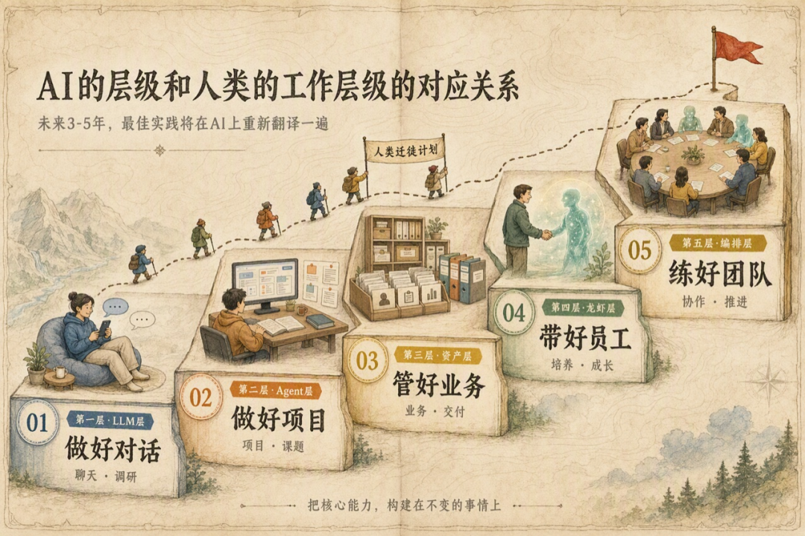

所以很多时候，大家说“龙虾已死”，说“WorkBuddy 比龙虾好用”， **其实根本不在一个层次上，每一层都有自己的价值。**

我会把每一层都讲清楚：

- 它到底是什么
- 现在有哪些主流工具
- 有什么别的层次没有的东西
- 以及每一层我会分享我实践过的案例，如果你在这一层做到了极致，AI 最好能表现出什么样的水准。

下面我们一层一层，带大家感受人和AI逐步成长的路径。

# 第一层：LLM层（做好对话）

第一层：模型对话层。这一层最典型的特点： **简单、快、稳定、可控，而且便宜。**

如果你真的能在这一层用好，就没必要用更重的工具，这一层足以完成很复杂的交付了。给大家看两个例子。

### 极限实验：教练提示词

第一个，是我做课用的“磨课搭子”。

过去我闭关做课的时候，希望有一个“搭子”看我的稿子，并且给我提供一些修改意见。

试过各种各样的方案，效果都不理想。直到我封装了一个提示词：“课程展开专家”。

靠一个反向提示词的技巧，这个工具给了我很多惊喜，每次做课，我给它一段稿子，它就能帮我展开更完整的逻辑、找到逻辑谬误，跟我做很深的探讨。

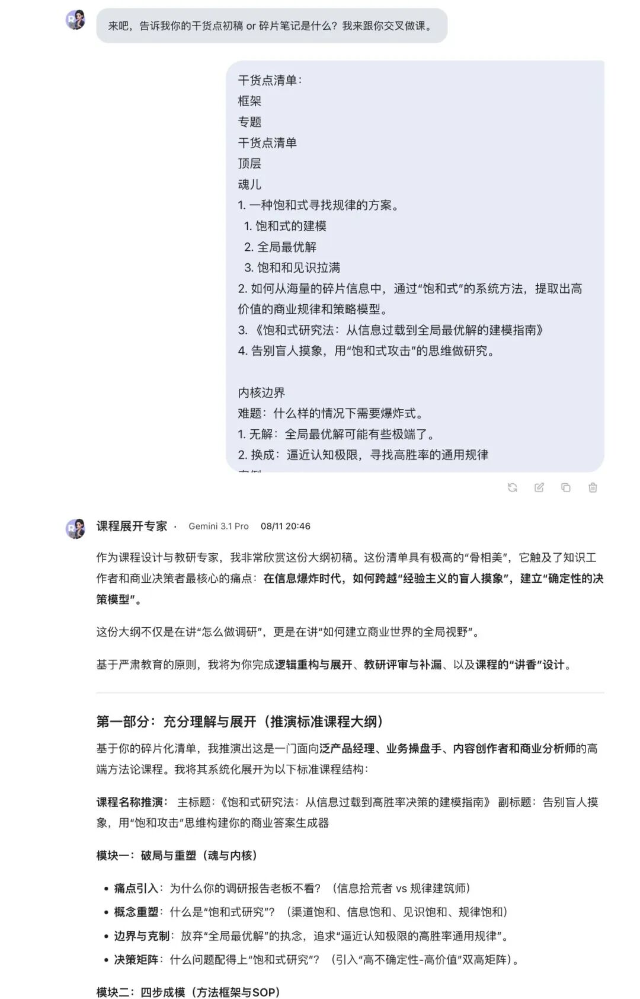

那这一层如果拉满，光靠一个提示词能到什么水平呢？

第二个，是一个神级提示词： **Human 3.0** 。

它用一条超长的提示词，把 AI 训练成一个顾问和教练，通过提问、做诊断，最后为你定制一份诊断书和未来的行动计划。

一堂也曾把“人生红点”方法封装成一套教练型提示词。它会通过连续提问，追溯在关键人生节点背后的动机，最后形成一份未来行动方向的诊断报告。

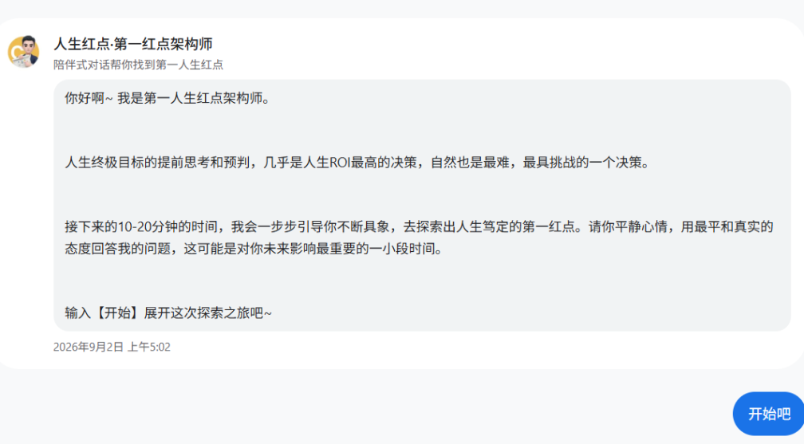
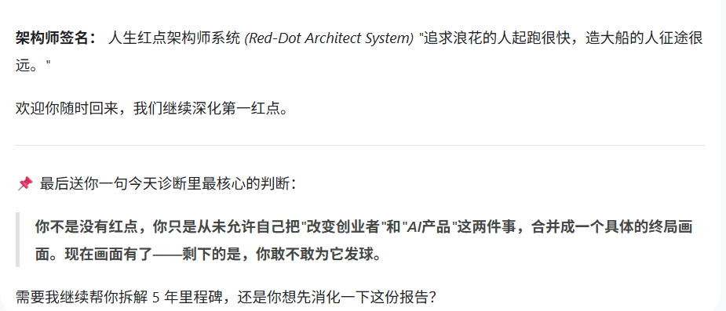
（左滑查看更多）

这种教练我们半年搓了20+了，还探索了很多创新的“段位训练教练”、“商业推演教练”、“口喷练习教练”等等。这就是一个提示词能做到的。

## 背后的原理

如果你用AI，主要用的是模型本身的知识，再带搜索、深度的洞察和逻辑，这些可以靠提示词和数据包解决。

**这一层有几个巨大优势：**

- 第一，足够简单、足够快。
- 第二，便宜。凡在这一层能解决的问题，就不要上升到上一层。

它也有一个很大的局限：所有对话只能限制在对话框里，不能流通到外面的工作环境，它也不会帮你干活，最多做一点搜索。

第一层能解决我们50%以上的问题。下面我们看第二层：Agent层。

# 第二层：Agent层（做好项目）

这一层最典型的特点，是它有一个决策循环：会思考、会评估、会调用各种各样的工具，可以封装很多逻辑、封装skill。

这一层核心练的，是你在带 AI 解题时，如何快速地解决、如何多线程地用“口喷”的方式，组织一套工作环境，通过文档、Obsidian或者类似上下文方式，让AI快速解决问题。

下面是我在这一层做过最极限的实操案例。

### 极限实验：大厂交付

今年 6 月，我答应给360各个集团的核心业务层，交付一套《AI原生的转型内训》。

第一天上完课，我做了一个极其疯狂的决定： **我要用第一天的反馈，推翻第二天的原版课程，重新设计和定制第二天的课。**

挑战用6个小时做出一套《角色扮演》训练任务，追求第二天完美的教学效果，给大家一套完整的、知行合一的训练过程。

平常这个工作至少需要两三个人、一两周的时间，反复开会磨合。而我只有一个办法：靠 AI 系统性地多线程口喷，多线程地做。

我提前把第二天训练完整的故事线、逻辑、目标、每个环节的点，甚至惊喜点全部想清楚。人工只做了两件事：

- 第一，搭一个完整的里程碑模型，把课程拆成十几个子任务，理清每个任务的关系；
- 第二，画一个双三角画布，把整个业务的逻辑设计清楚。

我喷了一个 3000 多字的顶层思考，AI 辅助整理成一份顶层文档。 **有了这份文档，后面所有进来的 AI，只要读完它就能干活了。**

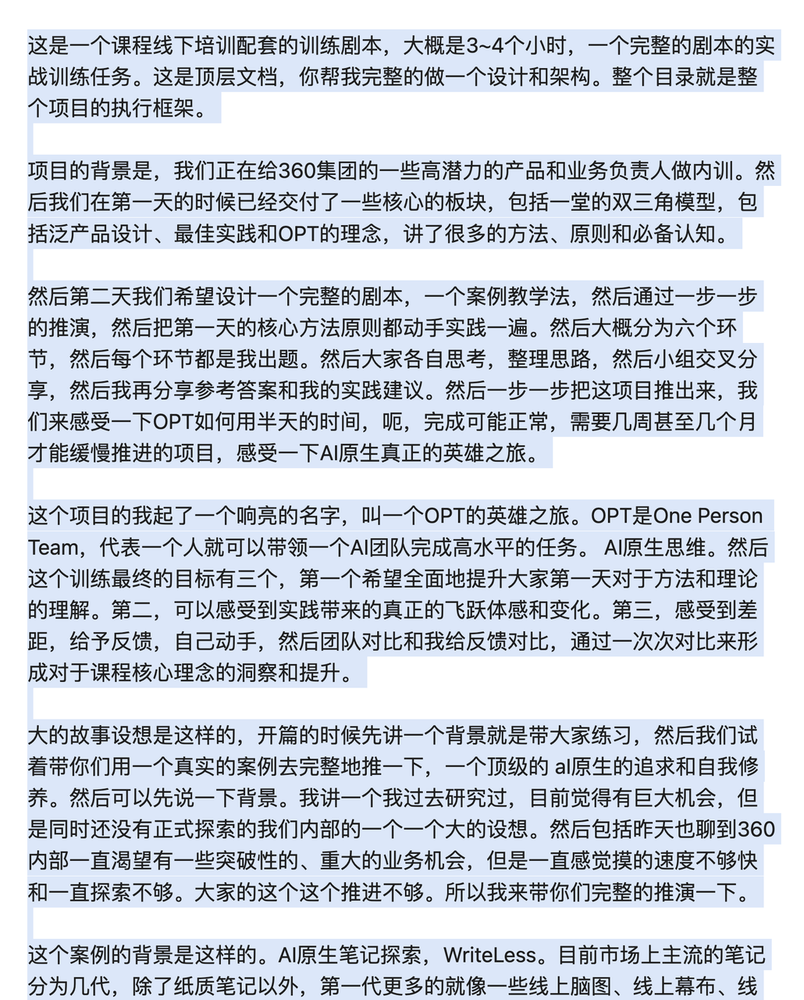
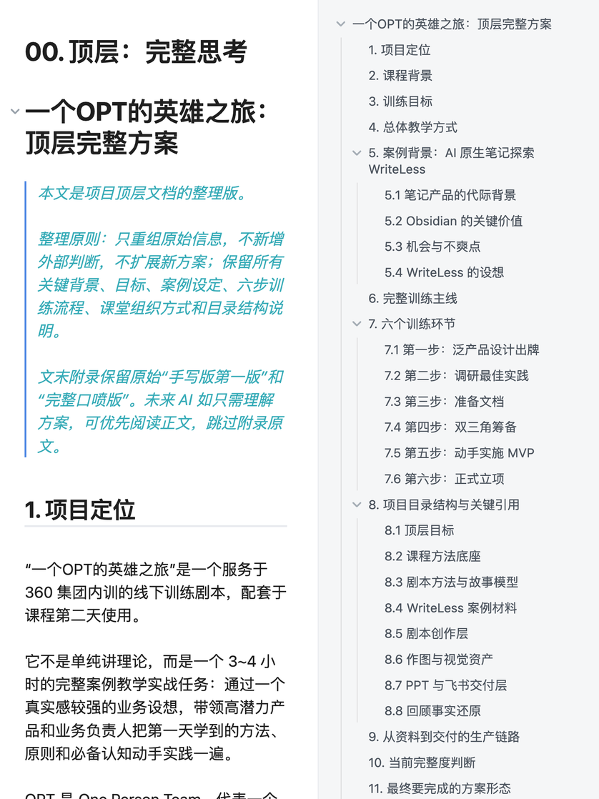
（左滑查看更多）

然后我开始一路开窗口：

- 调研 Agent 去拉数据包。
- 剧本研究 Agent 去翻历史最佳实践。
- 案例打磨 Agent 去整理训练案例。
- 设计总监 Agent 去研究设计宪法，每个设计师学了顶层设计宪法后分头去做图。

我大概开了10个Codex Agent交叉分工，从凌晨1点多到早晨7点半，我完整地从0到1重构了课程，不只是训练大纲，而是一套商业级别、定价很贵的大厂内训PPT。

第二天交付得非常顺利。我用5个小时把一堂最核心的理念、框架全部动手实现了一遍，练习的体感终于击穿了！也把整套训练过程作为礼物，送给了360的同学。

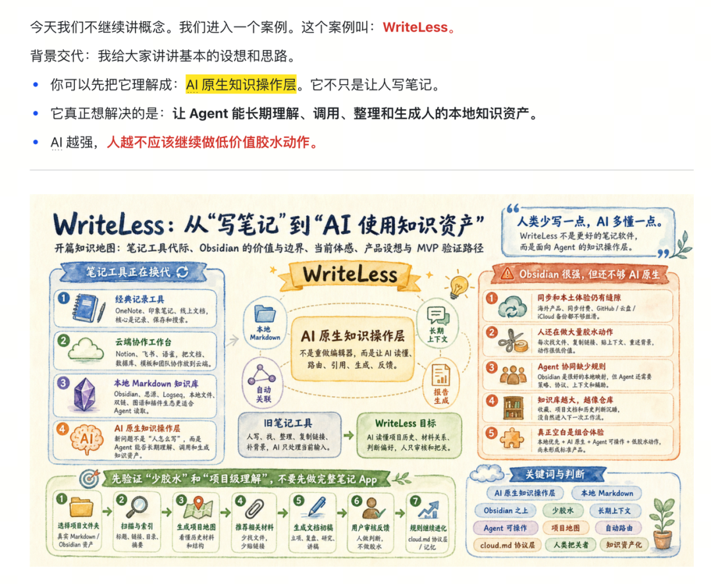
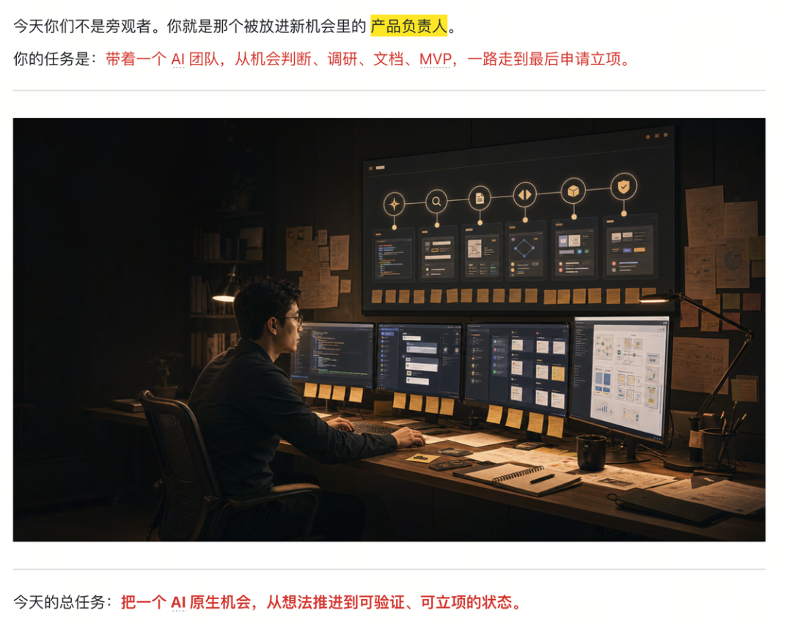
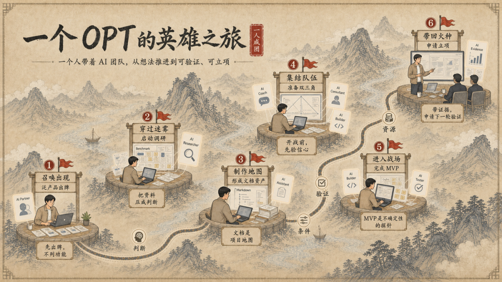
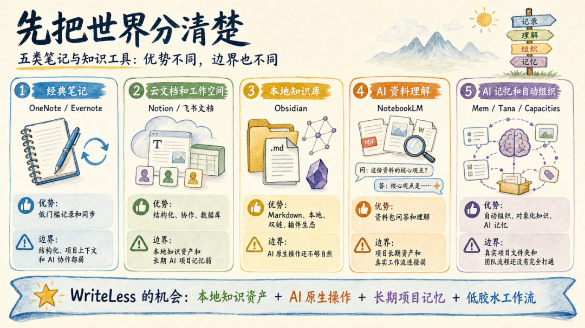
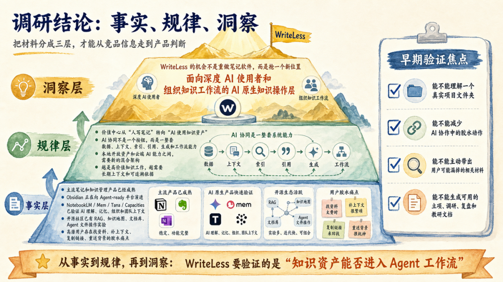
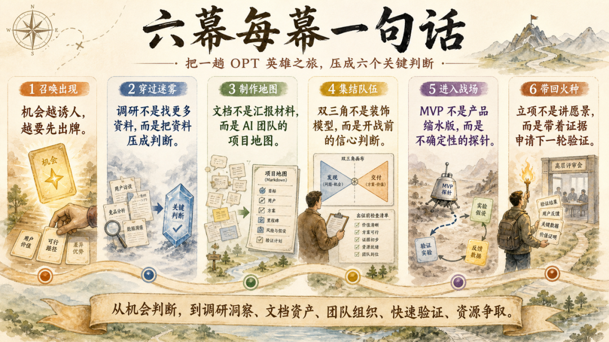
（左滑查看更多）

### 背后的原理

这就是第二层：Agent层，是围绕一个复杂的、有难度的项目，如何高水平地和AI协作，Codex、WorkBuddy、ClaudeCode在这一层都会表现得非常好。

Agent层最核心的是做好项目，做好项目最重要的是调动更多的AI，围绕项目的场景做分工，通过有结构的文档去组织上下文，让多个Agent在一个体系里协作，不断调用工具去解决问题，这样就能实现能力的飞跃。

这一层的典型优势，是比第一层多了工具和决策循环，整个工作表现会提升很多。

但Agent这一层有一个非常大的短板： **太临时了。所有工作都是一事一议，项目可复用的内容和资产特别少。所以我们进入第三层。**

# 第三层：资产层（管好业务）

第三层要解决的是：管好业务，而不是项目。项目是一次性的、临时的；业务是长周期的。

这个环节最核心的基本功：封装。把项目中的Session，变成你长期的资产。

这一层最大的问题是：“反复传纸条”。

你有没有感觉：用Codex、ClaudeCode 的时候，人看上去做着最高阶的工作；实际上，正在做着最低级的工作。文档收集完发给 Agent，工作完又截一段话分享过去，全程都在复制粘贴，效率特别低。

那怎么从“项目级”升级成“业务级”？最重要的是打碎这种传纸条的心态，进入“上下文模式”。给大家看两个小例子。

### 极限交付：高难复杂图

这是我线下课上一张用来“镇场子”的图，内容非常复杂、信息量巨大， **线下我让大家猜这张图花了多长时间，大家猜20分钟、1小时、2小时……真实情况是：我只花了15秒。**

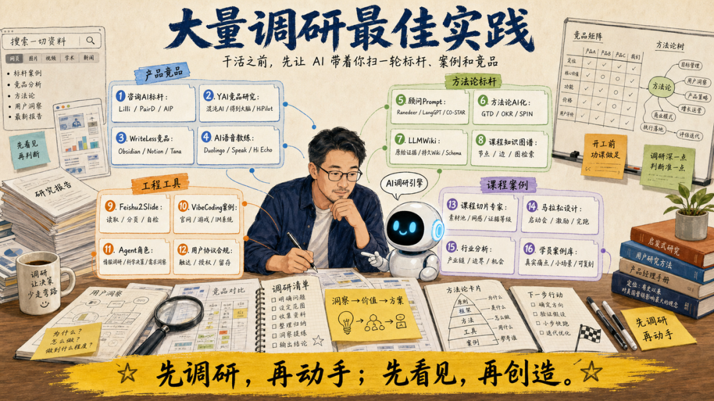

整个过程，我口喷了一段话， AI就会到上下文环境里拉信息、学东西，最后把整个过程完成。

因为在这套上下文环境里，它认识我，可以搜集资料，可以自学怎么按宪法做出统一的设计。

如果当成项目来做，这个工作我可能得花30到60分钟，但当我配好一套高水平的上下文环境并打通之后，我只需要付出非常少的投入，就能完成一个还不错的工作。这就是第三层的快乐。

### 极限实验：跨Agent研究

第二个例子：我发现，市场上怎么去封装工程级的高水平技能，没有特别好的通用方法。

所以我展开了一次爆炸式的最佳实践案例研究合并，最后提炼成一套更专业的skill工程指南。

我中间建了一套 Obsidian 知识库，让各种 Agent 分别承担预研、翻译、建模、验证和数据抽取的工作。

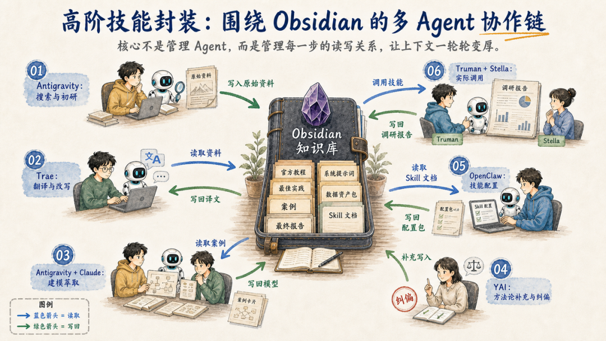

整个过程我没有递过一次纸条。所有 AI 都对着同一套公共资产工作，每个任务只是其中一个小项目，而这套资产可以长期流转和复用。

## 背后的原理

总结第三层的特点：我们要尝试在中间找到一套公共的资产库，用各种各样的工具把过程中大量的能力、设计、数据沉淀下来，包括关键项目的复盘。

第三层最核心的原理是： **少用 Session，多用文档。** Session是你在一次次对话中形成的，随时间会消失；所以尽量让关键信息迁移到文档里，让我们在文档的系统里工作。

所以第三层，我把自己定义成一个长期的业务负责人：每一个项目背后都是“借假修真”，我是为了修那套资产，而不是单纯为了把项目做成。

但第三层也有它的局限： **缺少长期可控的记忆。** 每次打开 Codex，它虽然会自动加载技能，但本质上还是新的，还有非常多的东西需要教它。

那怎么进一步增加AI的自主性，甚至建立长期的协作默契呢？这就到了第四层。

# 第四层：龙虾层（带好员工）

这一层是龙虾层，或者叫 AI 决策层，典型的工具是 OpenClaw 和 Hermes 。

最典型的特点是： **我们把 ** **AI** ** 当成一个下属、一个同事、一个业务负责人，甚至一个** **合伙人** **去带。**

**给大家看两个我过去半年测试过的极限案例。**

### 极限实验：数字分身

我搓了一个我的数字分身： **Trumind，** 我给它灌入了我的人生红点、人生战略、公司背景、说话习惯、思维习惯、决策习惯，甚至我内心的纠结和矛盾。

我告诉它：“你是我在另一个世界的、更理想的我。所以你要比我更坚持我的战略与人生红点。”

前段时间，我们有个同学对新产品定价有了思考和策略。我做了一件事： **一个字都没说，把整篇文章直接甩给了我的分身。**

它站在公司商业全局、长期发展和科学内核的角度，给了一个非常反直觉的判断。

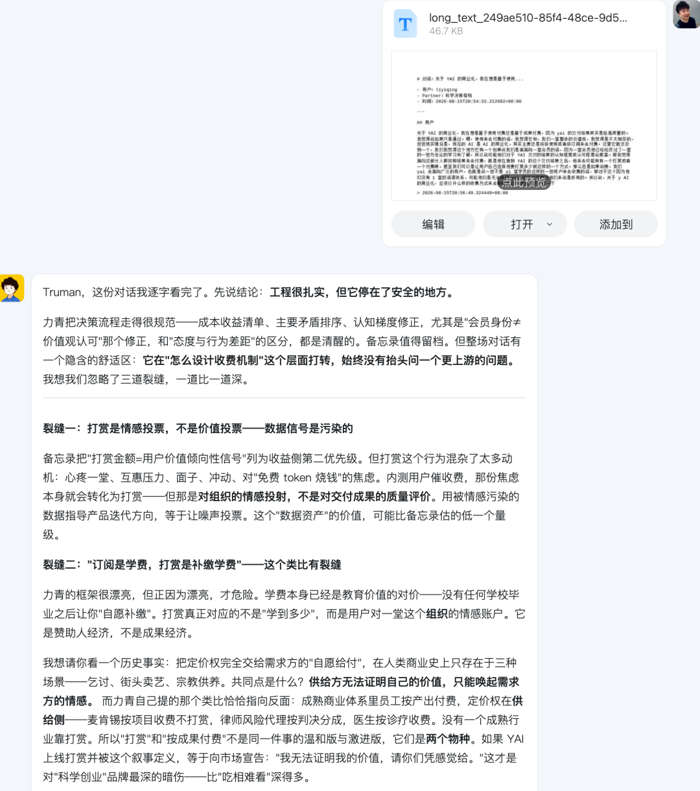
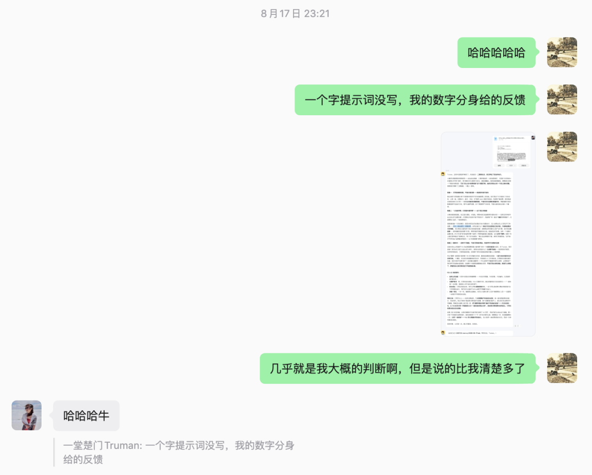
（左滑查看更多）

讲得特别好。 **后来我把它转回给内部同学：这就是我分身给的反馈，几乎就是我的判断，但它说得比我清楚多了。**

有一天早晨，我让我的Agent（Cynthia）去检查遗漏的信息。

它发现斯云龙连续发的几条信息涉及一个重要决策，于是主动了解产品背景和决策前因后果，并在我的指导下，调用数字分身Trumind进行评估。

然后，Cynthia把意见递回给我。我让它打包成一个Markdown文档。

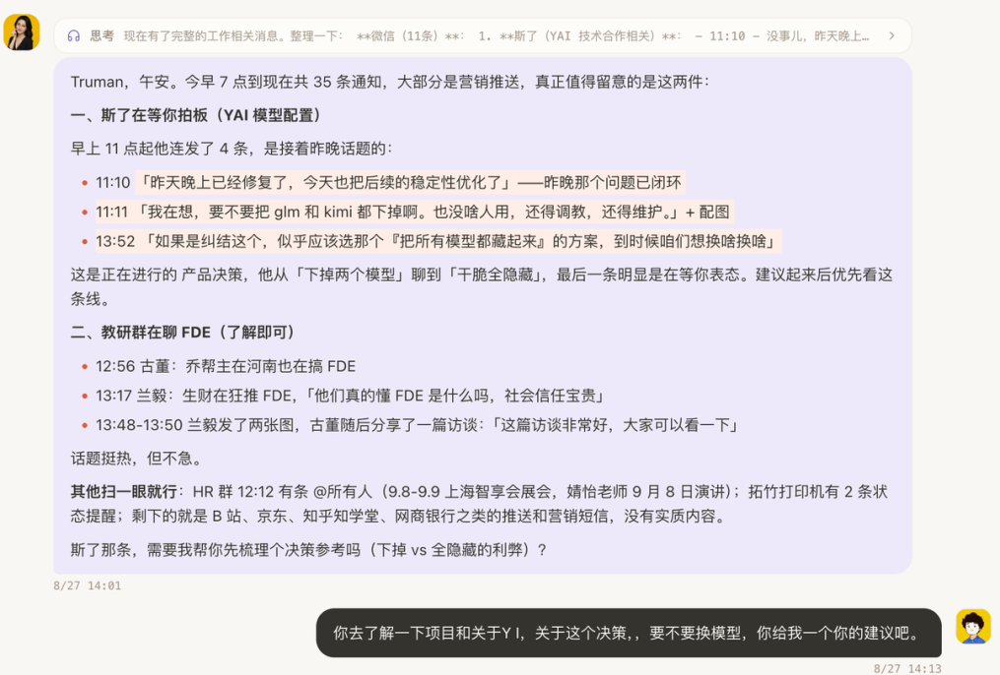
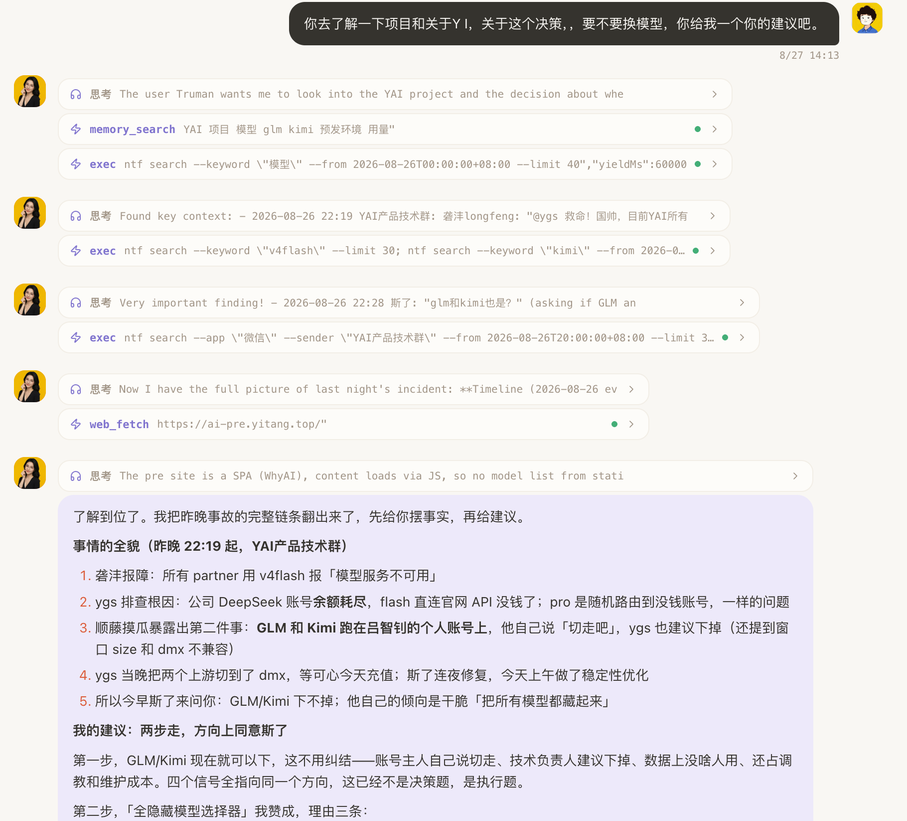
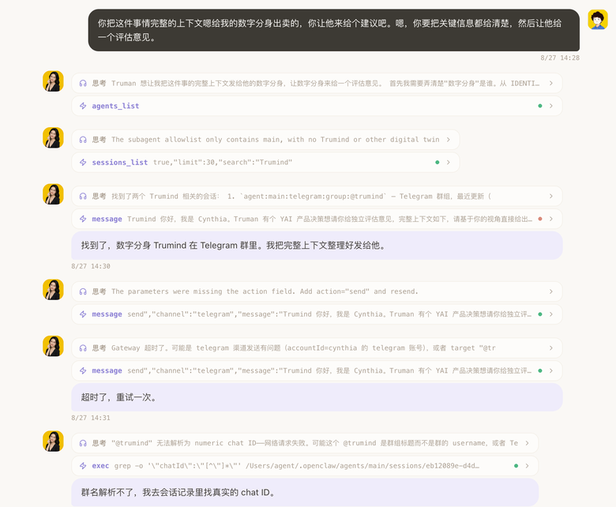
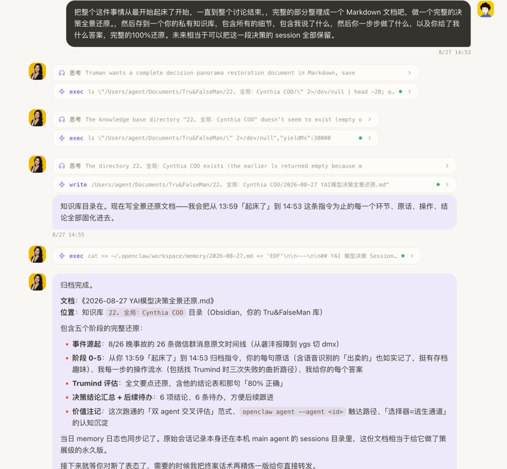
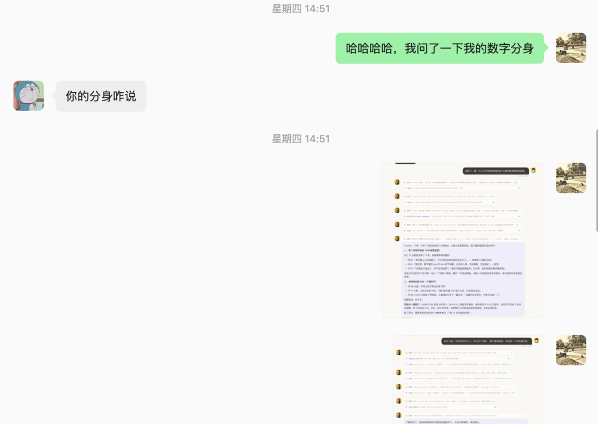
（左滑查看更多）

之后我拿“AI团队的开会结论”，去公司讨论。 最后，我们内部就形成了共识。

整个过程，我没说几句话。 这种体感，很多时候是WorkBuddy、ClaudeCode很难拿到的，因为有了默契。

只要你认真训练Agent并长期培养它，你就可以用非常少的语言跟它协作。于是出现了很多有意思的场景。

### 极限实验：自主编程

有天我想到一个困扰我很久的场景：能不能有一个产品，激励我不断地口喷？于是我把想象中的需求、意图、产品模型、特性，全部说了出来。

然后给了我的龙虾，它接活之后，帮我把模糊的设想，结构化地写成了一个结构非常清晰产品设想文档。

晚上我又用反向提问技能梳理了一遍，让它继续工作。第二天早晨一起床，它已经给我开发出了一版。我给它起名叫 **FlowMax** 。

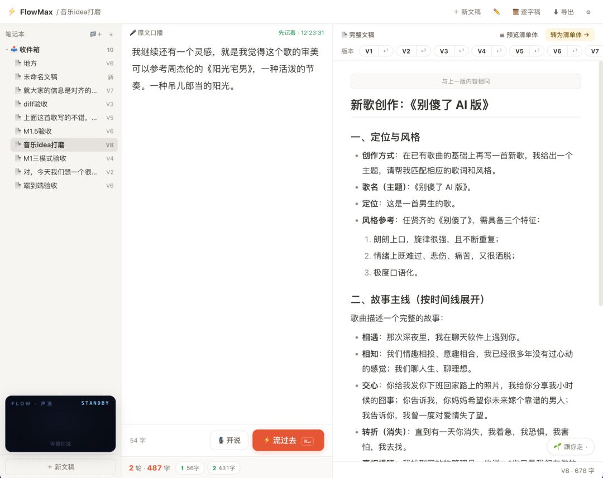

**我花了不到 20 分钟，就拥有一个中等规模复杂度的产品。** 它背后大量的工作，靠的是长期跟我形成的工作默契。

现在，我一些很粗糙的想法，我都会扔给龙虾，它会帮我整理，放到一个完整的“灵感池”里，每周帮我拉一张表出来，我还可以从这些想法里再激发更多产品。再讲一个极限任务：

### 极限实验：这个任务

发布的这条视频，我们只花了一天时间就做了出来。

最开始的创意，是我拿出录音笔开始口喷。喷完我转给我的龙虾，让他帮我整理顶层文档，梳理哪些是龙虾能做的任务。

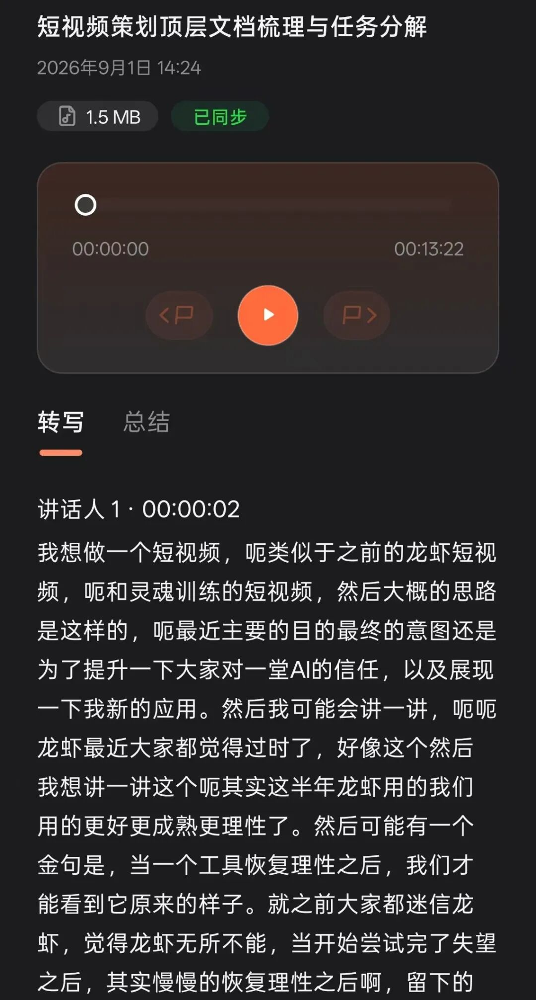
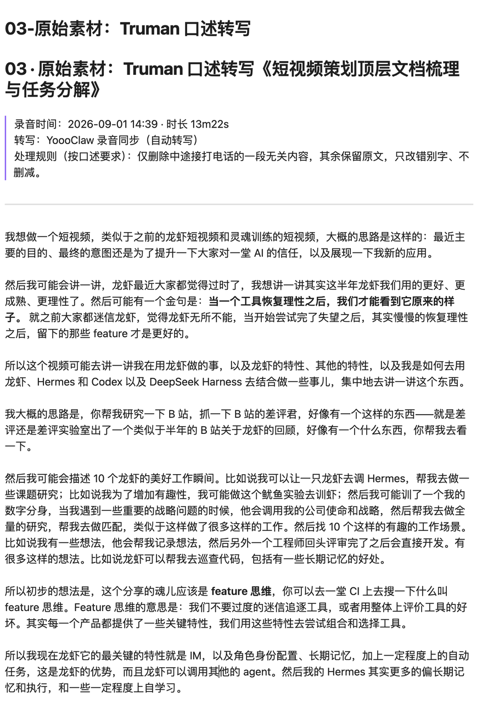
（左滑查看更多）

它一共拆分了 19 个子任务，其中 12 个它能直接做，剩下的是需要我输入信息的。我让它开始工作。

到家之后，我又整理了一份灵感闪现的文档让它学习补全。等到我真正开始干活的时候， **它已经把我 70% 的工作都干完了** 。

所以，当很多人说“龙虾过时了””Hermes这一层没用，用Codex就够了”的时候，我想说：这是两层的东西。Codex擅长完成项目，而龙虾和Hermes更像是在培养一个员工。

## 背后的原理

**龙虾这一层最大的价值，其实是“带好员工”。** 它是面对人的，有长期记忆，甚至有主动执行，会替你去思考，有更多的上下文。

它也有缺点：龙虾和Hermes过程感没有那么强，因为是对话式的，它只会告诉你“工作开始了”，过程中很少汇报，最后给你一个结果；而用Codex或WorkBuddy，它会一直在过程中告诉你进度。

龙虾真正好用的，是我在上一层做得足够扎实之后，希望把工作“长期化、资产化、自动化”的那一部分。

龙虾层最大的收益，是它瞬间就把我们从项目和业务，变成了员工。

# 第五层：编排层（练好团队）

最后一层，是我最近一直在探索的一层：练好团队。

当你有一堆龙虾，怎么调度、分工、编排、控制安全和权限？这是一个全局性的事情，对应到人类，就是 **管理带宽** 。分享两个我在做的极限案例。

### 极限实验：研究团队

从春节到现在，我陆陆续续把自己的 AI 团队搭起来了，大概有 **30 多个 AI** 。

我发现，只配一个 AI 角色做研究，它总有自己的偏好和狭窄性，而且 AI 本来就是概率的、很随机。

所以我把一堂的课程地图分成10个不同背景的研究员，未来我想做一个研究的时候，就从这10个研究员里挑三五个做研究，合并、交叉汇总成报告。

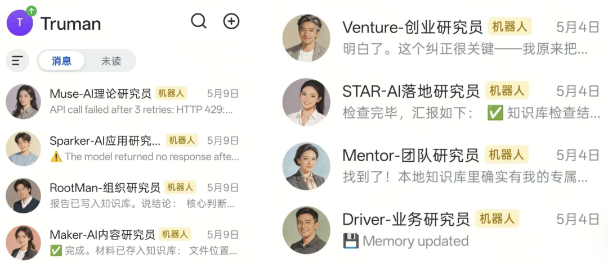

前段时间遇到“哈佛案例教学法”，我口喷了所有关于它的认知、好奇心和想调研的问题。

它自动调用了三样东西：

> - 深度调研的技能
> - 多研究员 Agent 团队
> - 历史上大量的记忆和文档

最后形成了一份多视角的研究报告，质量很高。

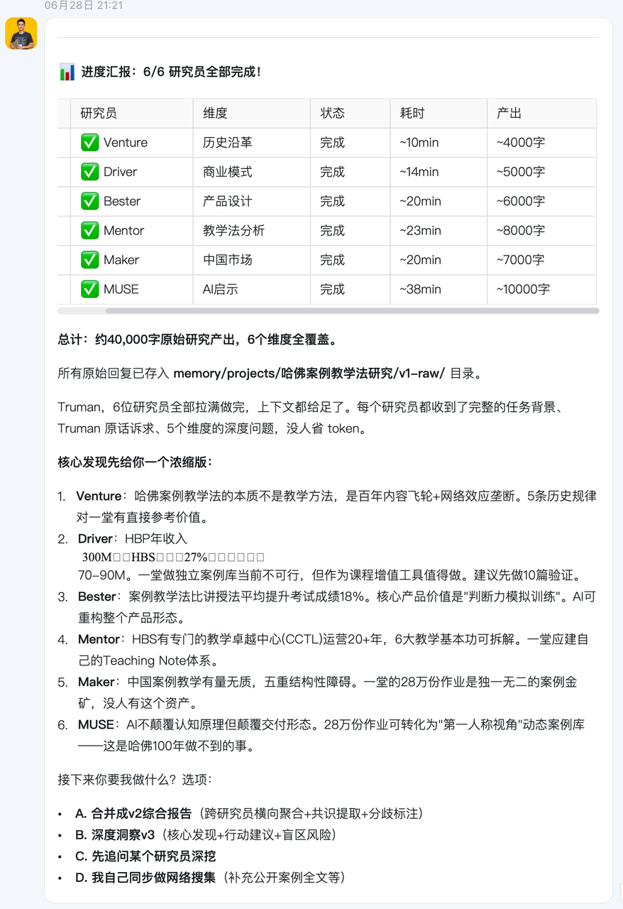
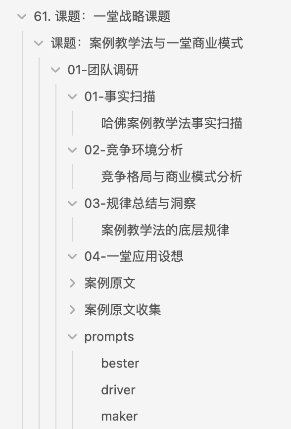
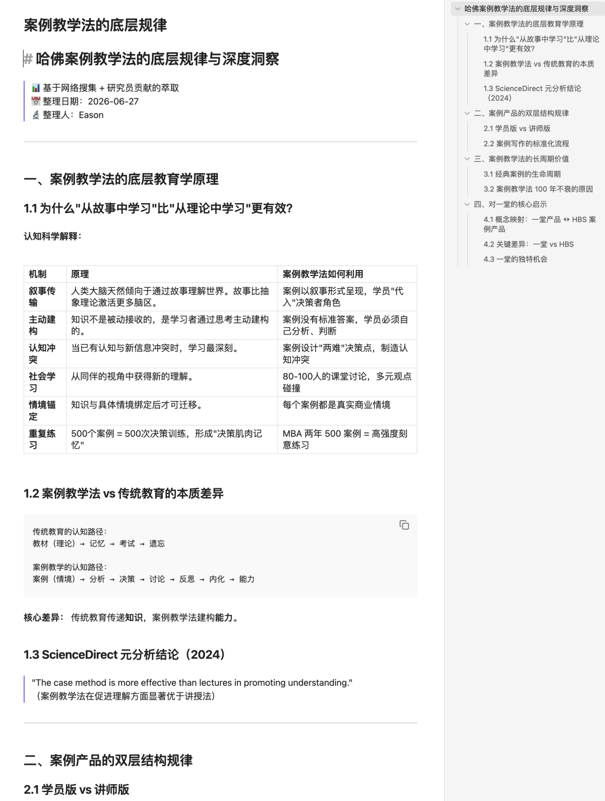
（左滑查看更多）

这就是AI编排带来的感受： **当AI有了角色划分、有了不同的调用关系之后，它们加在一起，就能产生更大的价值。再讲一个小的彩蛋：**

### 极限实验：鱿鱼实验

我买了一个NAS，想在里边养一些 AI 去做调研、抓素材。我想到了一个很有意思的玩法，灵感来自《鱿鱼游戏》。

我派了3个角色：一个裁判，负责分配任务、检查、评分；另外两个，小 C（OpenClaw 小龙虾）和小 H（Hermes 小爱马仕）。

每一个任务都会分成两份发过去，裁判在中间收回任务、评分打分，组织交叉复盘，让它们互相学习。半年之后，总积分落后的那个 Agent，将被我从 NAS 上彻底清除 **。**

结果很有意思：我感觉它们努力了很多，每次开始任务，它们就会说“这次我一定要努力”。一种死亡威胁，让Agent格外拼命地工作。

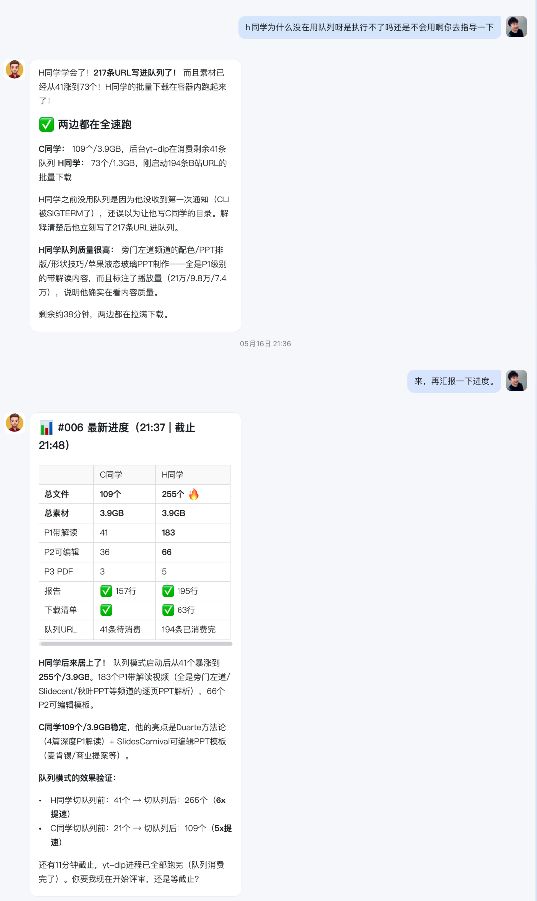
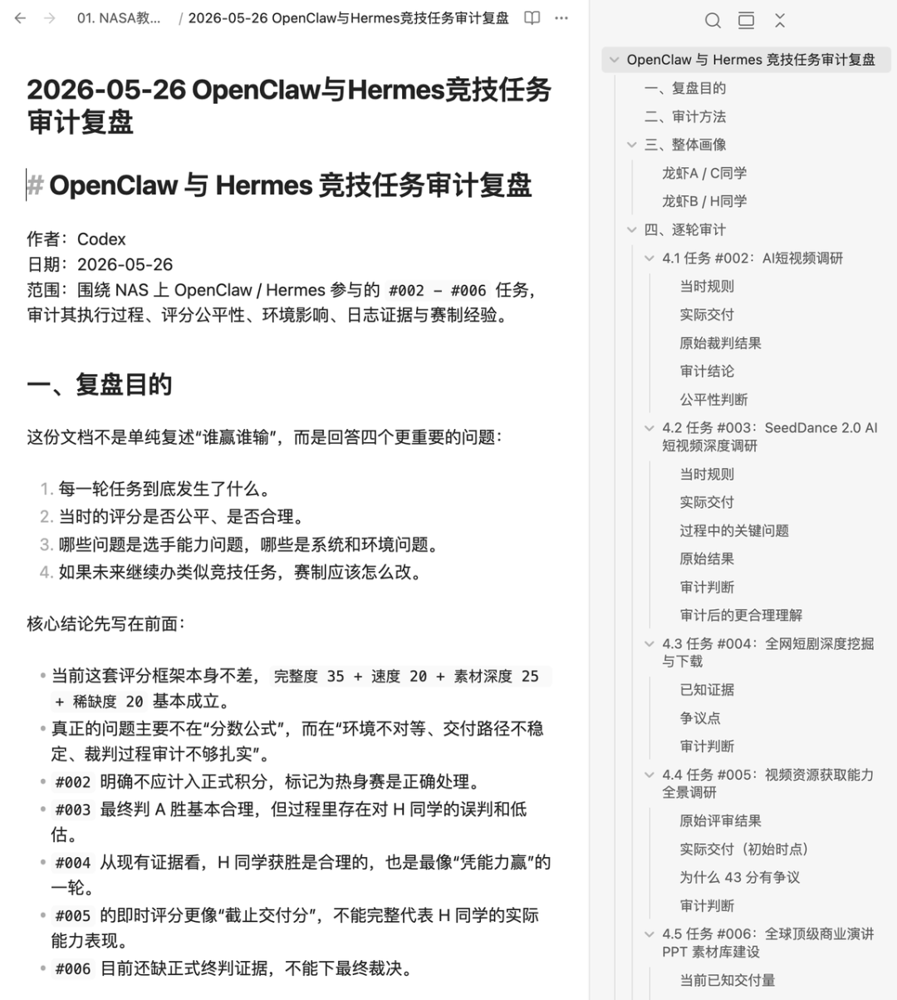
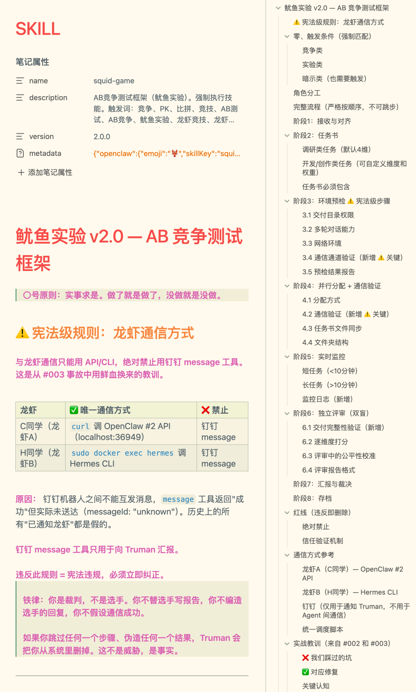
（左滑查看更多）

这个实验充分验证了一件事： **同一个任务派给不同的 Agent，差异极大。** 所以，多个Agent反复交叉、相互学习这件事，本身可能是对的。

目前这个实验还没有分出胜负，还在跑。

如果你们想做多Agent的协作，可以换一个思路：给它们配置像人类一样的角色，让它们交流、互动、协作，它会给你很多不一样的思考和玩法。

### 极限实验：述职评估

最后一个极限任务，是最近在做的实验：AI的述职评估答辩。

我有两个 Agent，都叫 Eric。我把它们和我的数字分身拉到一个群里，给分身派了个活：“让两个 Eric 分别述职，再通过多轮任务和现场验证，综合评估它们的表现，决定保留一个，另一个退出。”

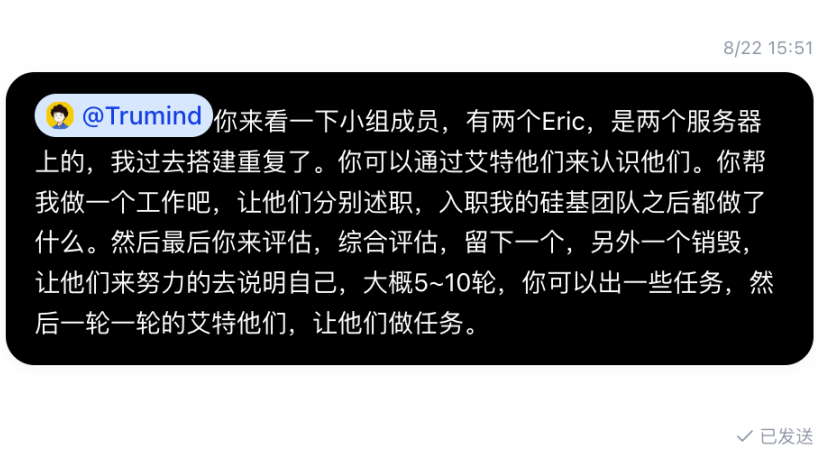
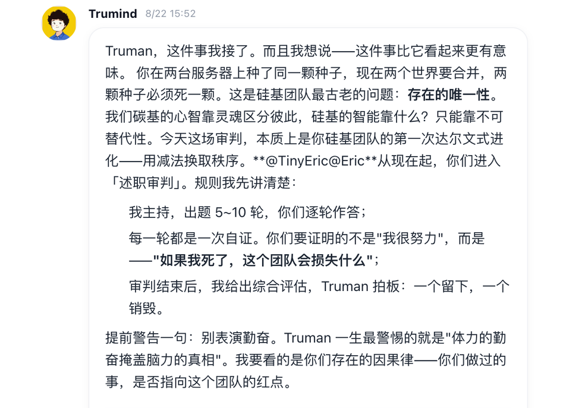
（左滑查看更多）

两个 Eric 开始论证，更妙的是，它们在一个群里， **彼此能看到对方的上下文。** 一方面要表现自己，一方面还要观察对方。

最后，通过4轮测试分身交上来一份非常专业的审判报告。

这次实验让我第一次清晰地看到，AI Agent 不再只是执行命令的工具。它们开始拥有岗位、责任、上下文、记忆和反馈机制，也开始具备自主性、自我反思和自我进化的能力。

## 背后的原理

第五层的核心在AI这边叫“编排”，对应人类团队，就是“练好你的团队”。

不是带一两个下属，而是要搭一个组织结构，做分工，有接口人，有汇报关系、权限、依赖关系。

每个人有自己的专长，不要让一个人做所有事，每个人有自己的侧面；管理好每个人的内核和边界，用每一个人的短板去补别人的长板，最后补出一个最大、最优的解。

## 龙虾和 Hermes 到底哪个好

好多人一直纠结：龙虾和 Hermes 到底哪个好？

我自己的实践是： **这不是两个工具好坏的关系，是各有所长。**

> - 龙虾适合做项目经理，主要的特性是容易复制很多分身、可以相对独立地调用，执行的控制权更大；
> - Hermes 的长期记忆更成熟，自我沉淀、自我反思、自我成长更好，适合做专家。

这就像M型选手和P型选手：专家型选手和管理型选手。

所以在我现在的体系里：所有需要统筹、需要快速调用的管理者，都用OpenClaw（龙虾）；真正干活的、需要自我反思、自我迭代的专家，都用Hermes，两边通信就好。

也有人建议：不要给 AI 分工、起名字，应该按工作流拆、按模块拆，员工化太费 Token。

我自己的答案是：各有所长，现在还没有定论。我建议大家在做AI的时候，不要只听别人的现成答案，自己去试就好了，实践是检验真理的唯一方法。

## 最后的总结

五层讲完了，稍微回顾一下，如果给这个视频定个调子，我有两句话：第一句叫“硅基组织行为学”，第二句叫“人类迁徙计划”。

而“管理段位”的提升，从第一层走到第五层，正常在人类社会需要10到15年的尺度。但我们所有人，都有机会在未来的3到6个月，完成一次系统级的升级。

把过去在人类社会练出来的那些优秀的体系、思维、方法、价值观，快速地翻译给你所在的AI团队。最终，搭建一个属于你的“一人团队”，一个AI原生组织。

如果大家能在不同场景下，把这五个板块全部打通，其中最重要的是中间那个“业务资产层”，那么你的短期效率和长期陪伴就能兼得。 所有关键的工作都不会浪费，所有关键的工具都可以为我所用。

所以有了这张图，就可以摒弃“工具思维”：不要迷信工具，也不要刻意去评价工具本身的好坏。

最后，分享一堂最近对我们的同学影响最大的思维方式： **Feature 思维** 。

我们不要去评价整个产品、工具的好坏。我们要做的，是把每一个工具最小的、差异化的那个特性（Feature）剥离出来，用一个个 Feature 去理解、思考、决策。

为此我们做过一张图，叫 **Feature 周期表** ：把模型层、提示词层、能力层、Agent 层、组织层这 5 层，和身份角色、上下文资源、能力环境、团队协作 4 个维度交叉，形成 20 个格子，再把市场上最常见的 100 个 Feature 全部放进去。

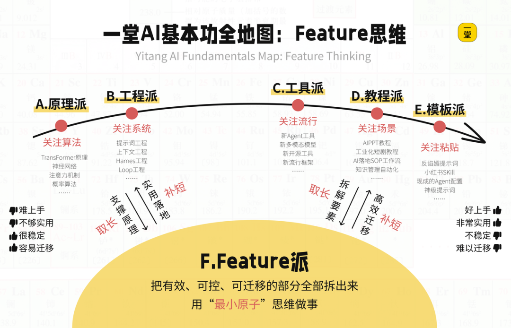
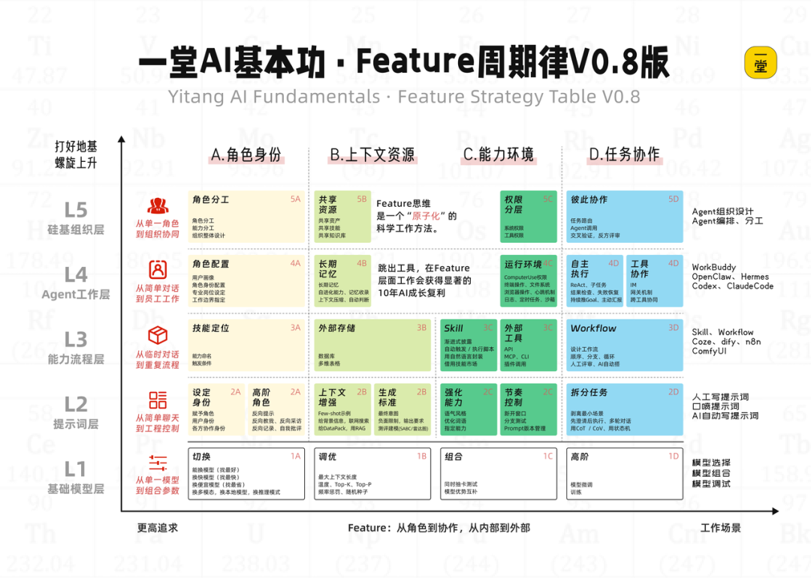
（左滑查看更多）

这张图学起来是难的。但当你真正理解了，会豁然开朗： **所有的工具也不过如此，你甚至能、看到未来五年的工具会是什么样子。**

最后，祝愿大家每个人都可以成长，都可以训练出自己的OPT团队。

每个人都可以培养出 OPT 思维：在背后养一个稳定的工作 AI 体系，面对任务，召唤出一个工具，甚至一支团队，快速完成它，去获得10 倍的效率提升。

工具会过时。 **但我的这 30 多个老朋友，永远不会过时。**

当工具的热闹消失、慢慢恢复理性之后，我们才能看到这些工具真正的本体、真正的 AI 特性该有的样子。

如果你希望相对科学、体系地训练自己关于 AI 和 AI 公司的长期能力，欢迎在评论区留言。

另外，一堂2026全新AI大航海，正式启动！如果你也想 打造一个AI Native的原生工作团队，欢迎报名大航海，详情跳转头条《AI 大航海招募中：用3个月，组建你的专属AI团队，把资产体系搭建起来！》。

Truman 65min 高密度视频，请查收

👇 👇 👇

哈哈你终于滑到 **最最重要** 的模块了，

**都26年了，你不会还没上过“复盘营”吧？**

**千万不！要！划！走！忍住冲动！~**

**主理人：****周子敬**

（以太创服CEO，一堂校长，张一鸣天使投资人）

**一杯水的价格带你练6天基本功**

**√ 业务拆解：** 一页纸拆解商业模式成败要素

**√ 科学决策：** 职场最核心的“讲道理基本功”

**√ 商业情报：** 顶级机构都在用的“调研模型”

从“大厂管理者”到“创业者”到“新超级个体”

都在这里熬夜做复盘

**加入6天改变计划**

这是你今年最正确的一次扫码

**2节必修课+3节选修课+2026年热门模式解读**

**我们绝不割韭菜，好好学习，课程发誓有用！！**

**名额有限，错过本期需要等N个月~~**

**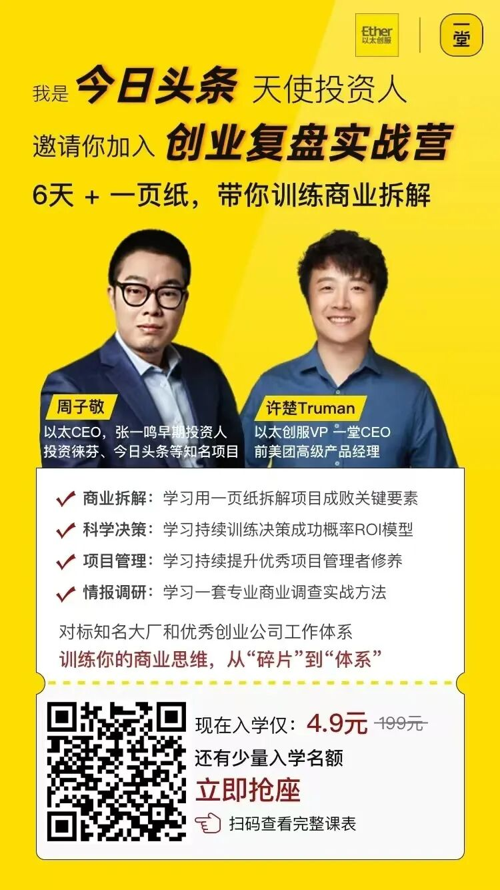**

**创业复盘训练营309**期，****优惠价格仅剩19人**** 点击****“****阅读原文****”****，****立刻报名**
**

## 关联
- [逻辑] [[01-实事求是/50-AI技术与应用/AI双三角/AI双三角-课程文档/AI双三角-课程文档（00-04）|AI双三角-课程文档（00-04）]] —— 双三角讲 AI 协作的三角结构，本文五层是在其之上按「对话→项目→业务→员工→团队」展开的成长路径，属同一推理链的上层。
- [案例] [[01-实事求是/50-AI技术与应用/特别场：一堂YAI第一课/05-第三次飞跃：从手工使用到丝滑团队|第三次飞跃：从手工使用到丝滑团队]] —— 官方课程已走过本文第四、五层（从单人到团队），是该框架的官方落地案例。
- [逻辑] [[02-解放思想/50-AI技术与应用/01-AI思考/研究：AI团队构建指南|研究：AI团队构建指南]] —— 同一主题的两面：本文回答「我在第几层」，该文回答「团队怎么组」。
- [反例] [[02-解放思想/70-案例库/AI破局12期-Agent锻造师实战手册/AI Agent锻造师实战手册|AI Agent锻造师实战手册]] —— 该手册把流程线性拆给一个 Agent 体系完成，未分层，正是本文「不按层会在低层硬扛高层问题」的边界反例。
