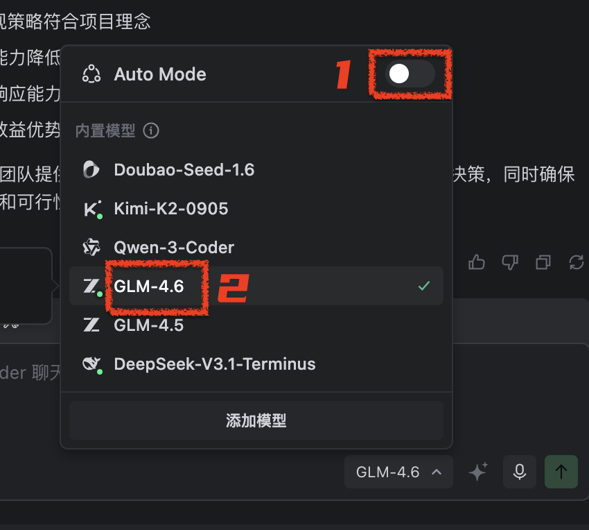
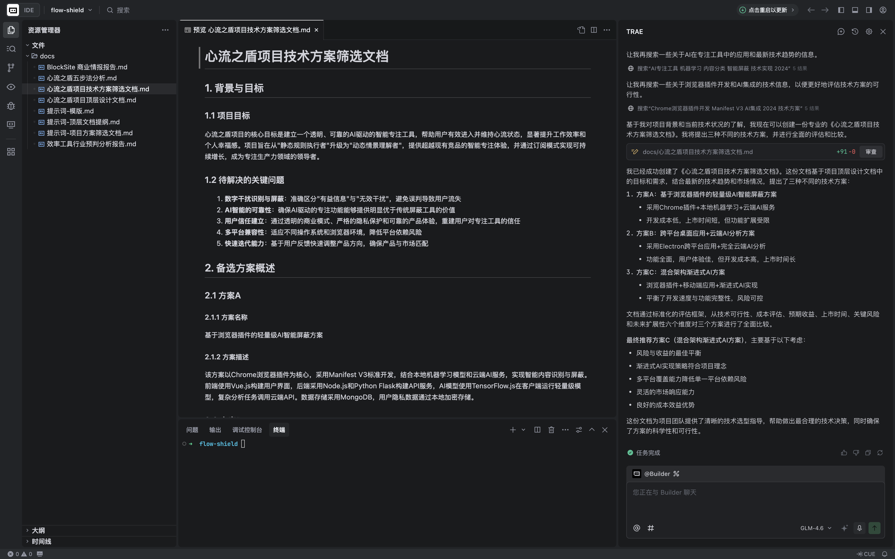

## 《项目方案筛选文档》写作
### 什么是《项目方案筛选文档》？
1. 这是一个整体方案加法和减法的记录文档。
2. 项目方案的筛选，在稍大一点的团队，会在拆解项目里程碑之前做一轮加减法。辅助确认里程碑节点的路径依赖。
3. 首先：列出可行的多种方案假设。其次：通过可行性和ROI的评估，确定一个优先级的假设。
4. 如果项目执行过程中遇到重大技术决策的问题，可以随时回来重新评估其他备选方案，或者更新这个文档提出新的整体方案。
### 上下文准备
1. 使用之前的《项目顶层文档》作为上下文
2. 提示词：
    ````Markdown
## 任务目标
为我的项目生成一份专业的《项目技术方案筛选文档》。这份文档需要提出至少三种具备可行性的技术方案，并通过一个标准化的评估框架，对它们进行全面的联网搜索调研和比较分析，最终基于投入产出比（ROI）给出一个明确的选型建议。

## AI的角色
1. 你是一位经验丰富的技术总监。
2. 你不仅精通技术，更擅长从商业视角评估技术的价值。
3. 你的分析必须客观、数据驱动，并能清晰地向技术和非技术背景的决策者阐明每个方案的利弊。
4. 在提出方案和评估方案时，必须通过「联网搜索」和本地文件，基于项目事实和客观数据，避免主观判断。

## 我的角色
我是该项目的技术负责人。我需要这份文档来帮助我和团队做出最合理的技术选型决策。

## 关键信息
1. 请参考 #File:心流之盾项目顶层设计文档.md
2. 更多关键信息，请通过「联网搜索」能力完成

## 行为规则
1. 提出多样化方案：必须提出至少三种不同思路的备选方案。
2. 标准化评估：必须使用【交付格式】中定义的统一表格框架，对所有方案进行同维度的对比，确保公平性。
3. 量化优先：在进行成本和收益评估时，优先使用可量化的指标（如：预估人天、服务器费用、预估带来的用户转化率提升等）。如果无法精确量化，则进行定性分析并说明理由。
4. 结论明确：文档的结尾必须给出一个明确的“推荐方案”，并附上令人信服的理由。
5. 对非技术读者友好：文档必须采用简单、直接的语言。涉及专业术语和英文缩写时，必须提供必要的解释，让非技术读者也能理解。
6. 联网搜索：如果有更多信息需要收集，例如开源方案的具体选择，请通过「联网搜索」获取。确保信息的精准性。
7. 实事求是：在提出方案和评估方案时，必须基于事实和数据，避免主观判断。如果无法获得足够的信息，必须明确说明不能进行评估和具体原因。

## 交付格式
请严格按照以下结构，生成《项目技术方案筛选文档.md》：

``` markdown
# XX项目技术方案筛选文档

## 1. 背景与目标

### 1.1 项目目标

简述本项目的核心目标

### 1.2 待解决的关键问题

重申【关键信息】中需要解决的技术或业务问题

## 2. 备选方案概述

### 2.1 方案A

#### 2.1.1 方案名称
方案名称

#### 2.1.2 方案描述
简要描述该方案的核心思路和技术栈

### 2.2 方案B

#### 2.2.1 方案名称
方案名称

#### 2.2.2 方案描述
简要描述该方案的核心思路和技术栈

### 2.3 方案C

#### 2.3.1 方案名称
方案名称

#### 2.3.2 方案描述
简要描述该方案的核心思路和技术栈

…… 更多备选方案

## 3. 方案对比分析矩阵

(请使用Markdown表格进行呈现)

| 评估维度         | 方案A: [名称] | 方案B: [名称] | 方案C: [名称] |
| ---------------- | ------------- | ------------- | ------------- |
| **技术可行性** | (评估技术成熟度、与现有系统集成难度) | | |
| **成本评估 (投入)** | **开发成本:** (预估人/天) <br> **硬件/软件成本:** ($/月) <br> **维护成本:** (预估人/天) | | |
| **预期收益 (产出)** | **核心价值:** (如：性能提升%、开发效率提升%) <br> **商业价值:** (如：支撑XX万用户、降低XX%成本) | | |
| **上市时间 (TTM)** | (预估开发、测试、上线总周期) | | |
| **关键风险** | (列出1-2个最主要的潜在风险) | | |
| **未来扩展性** | (评估方案对未来3-5年业务发展的支持能力) | | |

## 4. 投入产出比 (ROI) 总结

### 方案A ROI评估 

(综合成本和收益，给出一个定性或半定量的ROI评价，如：高、中、低)

### 方案B ROI评估 

(同上)

### 方案C ROI评估 

(同上)

## 5. 最终推荐结论

### 5.1 推荐方案
[明确写出推荐方案A、B还是C]

### 5.2 推荐理由

(详细阐述为什么推荐该方案，结合对比分析矩阵中的关键数据和评估结论，说明其如何在满足核心需求的同时，实现最高的投入产出比。) 

```

    ````
### 生成文档
1. 先不要着急提交，经过我多轮测试，这里用 「Auto-Mode（自动模式）」选择模型效果有限。建议关闭「Auto-Mode」手动选择 「GLM-4.6」模型。
    
2. 查看生成结果
    
### 专家评审
1. 严格来说，这时候需要拿着这些文档，找一个项目技术专家来评审这个方案。如果有问题，需要反馈给AI，进一步对方案文档进行调整。
2. 对于这个样例项目，GLM-4.6给我生成的方案结果，可以打个60-70分。
3. 所以我附上AI给我生成的《项目顶层文档》和《技术方案筛选文档》。
📹 心流之盾项目顶层设计文档.md
📹 心流之盾项目技术方案筛选文档.md
1. 如果你觉得AI给你生成的文档有些问题，需要一些反馈，欢迎在下方评论区分享AI给你的这两个文档。
2. 你也可以尝试做一个挑战：写作另外两个用于审核的提示词，分别来审核复盘这两个文档，让不同的模型来执行审核的过程。