# 00后从大厂裸辞，我给自己招了24小时不下班的AI Agent员工，2个月赚了超2.7万块

> AI小法 ・ 星荧 ・ 最近修改：10月25日

大家好，我是 02年的AI小法

给大家分享一下我是如何通过Hermes Agent + Codex 批量做AIPPT赚到超2.7万块的。

如果你正在做各类PPT、教师虚拟资料（教务资料）、医护PPT、体制内汇报PPT、PPT代写业务，或者经常需要根据不同场景制作 PPT，又苦于不知道如何用AI赋能，那这篇文章可能正适合你。

近期小红书上出现了一篇神贴：从大学毕业后要多久才能度过窘迫的贫困时光？

看到有网友热评:  4年内都不要怪自己，因为你没人指路，也不是第一份工作就入职正规公司的话，兜弯3年很正常，等步入正轨后调整1年，大概率第5年才开始感受到经济变宽裕，除了房租还要挂念着，吃饭，保暖，通勤已经不用再烦恼，这很正常。

我突然悟了，去年大学毕业后，我无比向往都市丽人，去了上海大厂做程序员。每天两点一线，一睁眼就是满屏代码和不断变化的客户需求，压得我根本喘不过气，到手的工资只有小几千，除去交通，吃饭，租房所剩无几，月入上万更是想都不敢想！

干久了，我开始认真思考：上班是不可能赚到大钱的，这辈子不可能一直给人打工，除了上班，有没有一件事可以长期积累，最后变成自己的事业？

后来，刷各种副业文章看到郭耀天郭总的教务资料项目，感觉有戏，跟着郭老师团队做教师虚拟资料，同时也从郭总那了解到AI破局，一开始没钱加入，只能窘迫的观望。无数次瞻仰洋哥直播间分享的AI Agent内容，每看一次就会有新的思路与收获，渐渐的，按照洋哥分享的内容我开始搭建自己的AI员工，并将其运用到我接触到虚拟资料业务上，终于赚足了加入AI破局的学费，所以我来补学费了。

最近有幸参与AI 破局行动营后，我更加系统的学习到了怎么用 AI 提高制作PPT效率，感谢洋哥搭建的AI破局优质平台，感谢郭耀天老师的引路，感谢我的带教竹子老师及各位破局圈友，下面我将我学到一些内容与大家分享，有不到之处请批评指正。

先给大家分享一组最近两个月的部分收益数据，主要来源于小红书店铺和微信私域，8月到9月实现了2.7万多收益，除去服务器、AI会员外，也实现了月入上万！

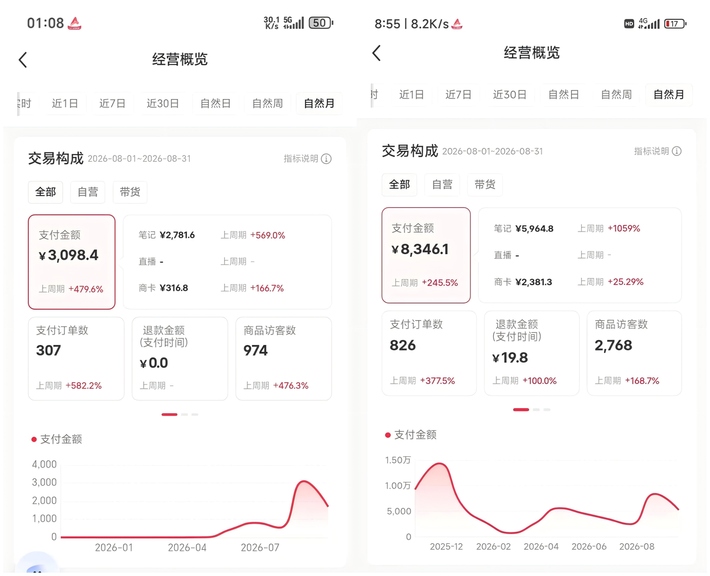


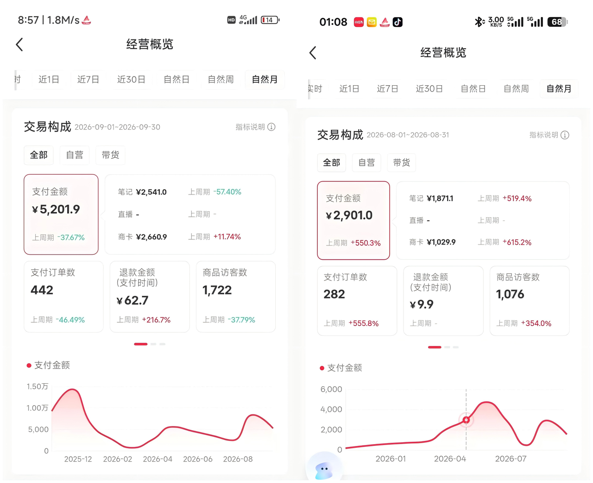


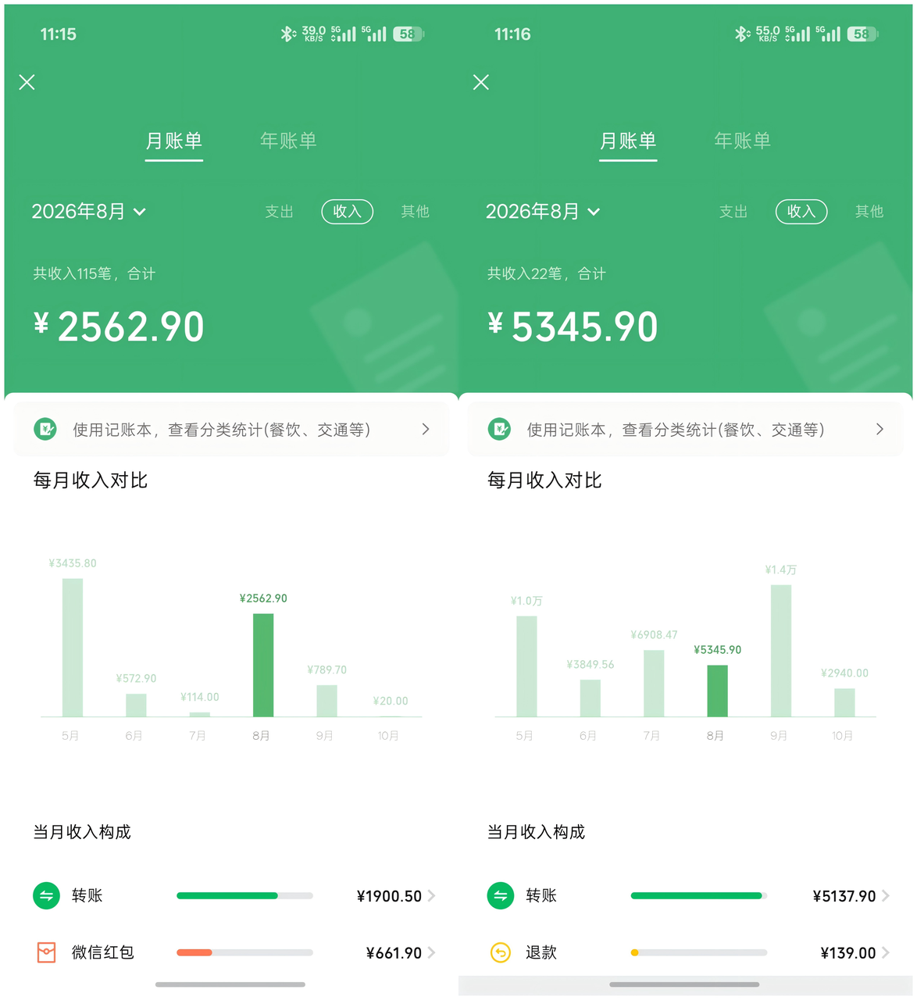

但我先说一句可能不够“爽”的真话：

> 这2.7块，不是装好一个Agent、输入一句提示词，钱就自动到账了。

真正起作用的，是我把原来混乱、依赖手工的PPT业务，拆成了一条可以反复执行的流水线：

内容获客 → 收集需求 → 锁定大纲 → 制作样稿 → 批量生产 → 独立质检 → 交付归档 → 复用迭代

AI Agent承担重复劳动，我负责判断、审美、沟通和最终兜底。

我更想把真正帮我提高交付能力的东西拆开讲清楚：

1.我是怎样把一份PPT需求变成标准化订单的；
2.5个Agent 分别做什么，为什么不能让一个AI从头干到尾；
3.一套30页教师课件，具体怎样从需求走到交付；
4.可以直接复制的需求表、总控提示词和质检清单；
5.如果你也想做PPT业务，怎样用7天跑出自己的最小闭环。

刚开始，我完全靠手工制作。

找素材、搭结构、做排版、改细节，一份课件要来回调整很多次。一周只能做 5—7 份，投入的时间很多，结果却不稳定。

后面我陆续尝试Gemini、Claude、小龙虾、gpt、扣子等 AI 工具。

效率确实提升了，以前一周做几份，后来一天可以完成 3—5 份，收入也逐渐有了明显增长。

但真正的瓶颈依然没有消失：

- 每次都要重新解释需求；
- 每次都要重复上传资料；
- 每次都要守着 AI 一步步操作；
- 大纲、文案、视觉和质检混在一个对话里，越做越乱；
- 一个环节卡住，后面的流程就全部停止；
- 电脑一关机，任务也跟着结束。

AI 帮我完成了单个动作，却没有替我接管完整流程。

于是我开始思考：

> 👍 能不能把实现给出课程主题和教学需求：AI 搜集并整理资料 → 生成课件大纲 → 制作页面 → 检查内容与格式 → 输出文件并归档

直到我遇到 Hermes Agent，我才找到更接近“数字员工”的解决方案。

它不是只能陪你聊天的 AI，而是一个可以在授权范围内调用工具、访问网页、处理文件、执行代码，并按照计划完成任务的 AI智能体。对于教师PPT 来说，它可以参与资料整理、课程大纲生成、课件制作和文件归档，让重复性工作变成一套可复用的流程。

最关键的是，它可以部署在服务器上。你睡觉时，它可以继续整理资料；你下班后，它可以执行定时任务；下次遇到同类课件，只要更换主题和要求，就能复用整套流程。

先看一眼我最终做出的课件效果：


详细内容点击下方链接查看：https://pan.baidu.com/s/1MEQv2VJo51sCC9lwRBIoOQ?pwd=qp99

这篇文章，我会从购买服务器、安装管理面板开始，手把手带你部署 Hermes Agent，再逐步实现资料收集、AIPPT制作、定时执行和多 Agent 协作。保姆级图文教程（全程不跳步、不省略，小白也能看懂）。

我会把自己踩过的坑、用过的命令和完整操作流程全部写出来，带你从 购买服务器、连接服务器、安装 Hermes、接入 Codex、配置 Telegram、定时执行、多 Agent 协作，一直做到第一套AIPPT 工作流。

即使你没有 Linux 和服务器基础，也可以跟着教程一步一步操作。

> 说明： 文中展示的是我的个人实践结果，不构成收益承诺。AI 生成的课程标准、知识点、案例和数据必须人工复核。

## 一、为什么用AI赋能教师PPT，建议准备一台自己的服务器

很多人第一次听到“服务器”，会觉得这是程序员才需要的东西：价格高、配置复杂，和自己做虚拟资料、制作PPT没什么关系。

其实，服务器可以简单理解成一台长期在线、可以远程使用的电脑。它不一定要买很贵，便宜的一年只要一两百块，折合下来一个月十几块钱，比一杯奶茶还便宜。真正重要的不是“拥有服务器”这件事本身，而是它能不能帮你把PPT 的工作流稳定地跑起来。

先说清楚：如果你只是偶尔让 AI 帮你改几页 PPT，完全没必要专门买服务器；但如果你想把下面这些事情交给 AI 长期执行，服务器就很有价值：

- 批量生成内容：根据课程主题生成教务PPT大纲、页面结构和讲稿；
- 统一管理素材：把 PPT 模板、图片、字体、课件和历史版本集中放在一个地方；
- 持续执行任务：你关掉电脑、下班或休息后，AI仍然可以继续跑任务；
- 重复利用工作流：把“找资料—列大纲—做课件—检查—归档”整理成一套可复用流程。
### 只用网页AI，和拥有一台自己的服务器，有什么区别？

网页 AI 更像一个需要你随时发消息的助手：你问一次，它答一次；下一次做同类任务，仍然要重新说明要求、上传文件、检查结果。

而部署在自己服务器上的 AI Agent，更像一个可以长期培养的数字助理。它可以保留固定的工作环境、模板和文件目录，按照你设定的流程执行任务，也可以通过定时任务在指定时间自动开始工作。

以教务PPT 为例，你可以把流程设计成这样：

> 📑 输入课程主题和教学目标 → 收集相关资料 → 生成课件大纲 → 按模板制作 PPT → 检查内容和格式 → 输出可修改的课件文件

这样做的好处是，下一次遇到类似课程，不需要从零开始。你只要替换课程主题、年级和教学要求，就能快速复用整套流程。

所以，这台服务器可以看成你的“数字教务工作台”：电脑关机时它还在运行，任务变多时它可以批量处理，资料和工具也能集中管理。
## 二、买服务器：RackNerd，便宜到离谱，售后服务有保障
### 2.1 为什么推荐 RackNerd

我对比过市面上几十家VPS服务商，最后锁定 RackNerd。

原因很简单：

RackNerd最低只需要150人民币多你就可以拥有一个一年的境外服务器，一个天才几毛钱，你的魔法每月恐怕都不止这个钱。

这性价比放在整个行业都是炸裂的存在。我用它跑 Hermes Agent 快两个月了，稳如老狗，从没出过问题。

更重要的这个 RackNerd已经运行了十年，算是比较老牌的服务商，不用担心会跑路，售后服务处理也很快。


### 2.2 购买流程（一步一步来）

第一步：打开官网https://my.racknerd.com/aff.php?aff=21457

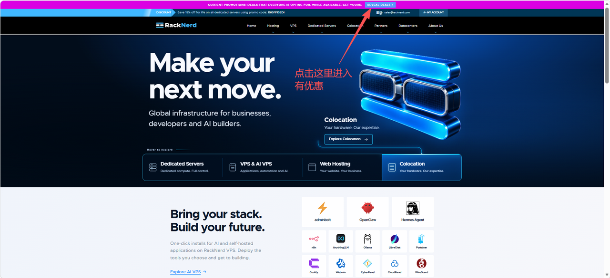

第二步：选择套餐

鼠标滚轮往下滑，你会看到如下配置表：


选购建议：这里如果咱们用来跑Hermes Agent建议至少选择运行内存4G以上，也就是59.99美元以及以上的套餐，这样跑一些复杂任务就不容易崩溃。

第三步：选择机房

推荐选 New York 这个机房到国内的线路最好，延迟最低。


第四步：选择系统系统默认就行

优先选择 Ubuntu LTS 64 位。如果购买页面允许后续重装，也可以先用默认系统，再到控制面板中调整。

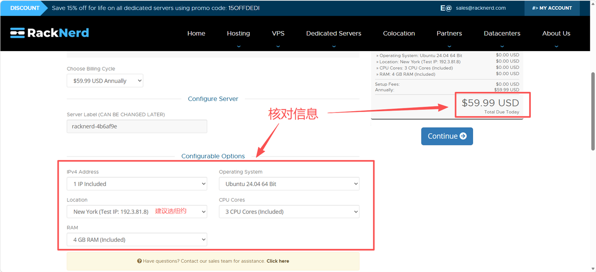

第五步：结算

点击【Continue】，

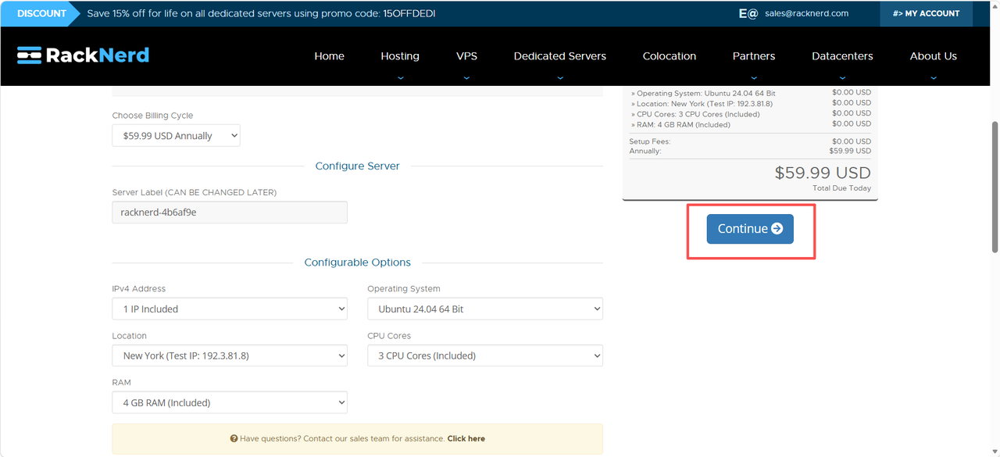

第六步：注册账号

第1步：先把国家选中国剩下的根据图片步骤

邮箱千万别填错了，它是你的唯一身份ID，填错了很麻烦，需要提交工单给客服才能改，并且你的服务器信息也会发送到错误的邮箱，一定要检查仔细。

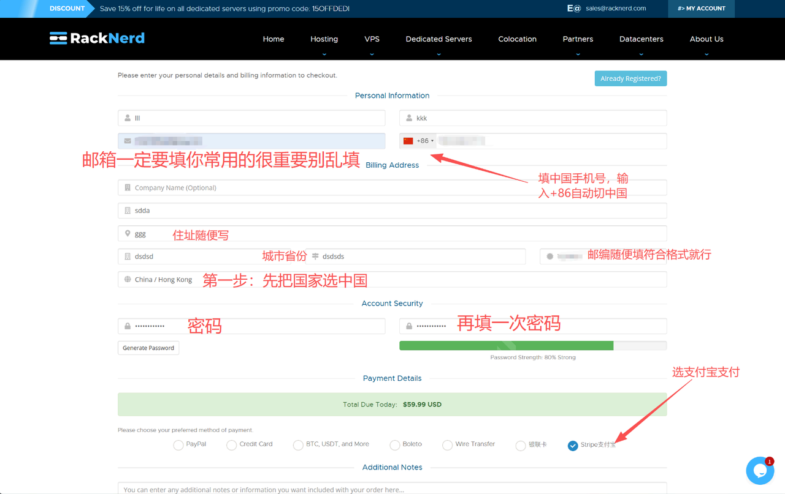


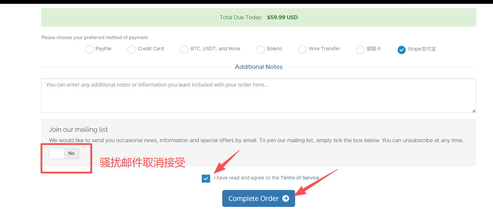

这里如果出现卡住或者验证码的问题，是网络环境的问题，可以开启或者关闭魔法，切换节点试试。

付款方式选 Alipay（支付宝），扫码付款，服务器所有信息通过邮箱发送给你，秒到账。

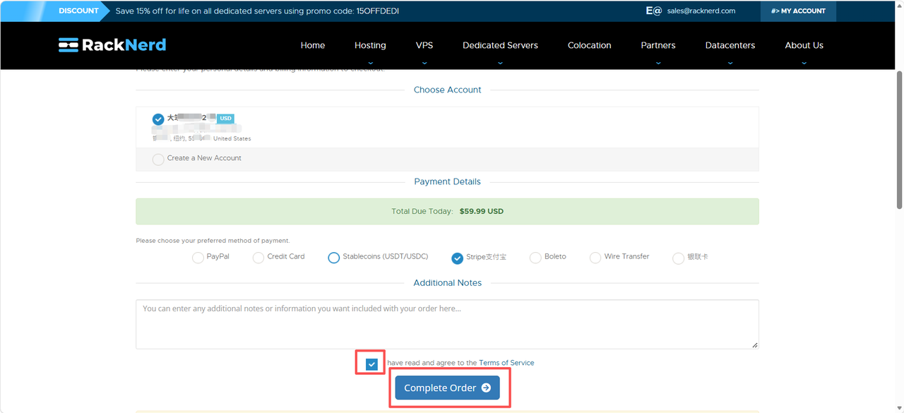


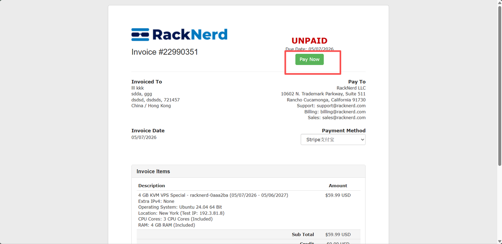


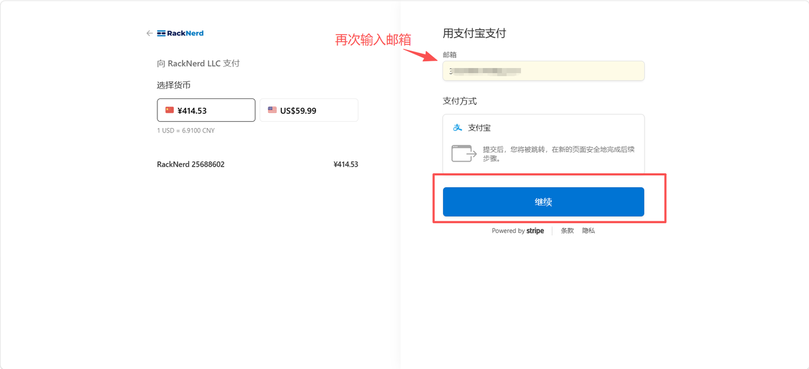


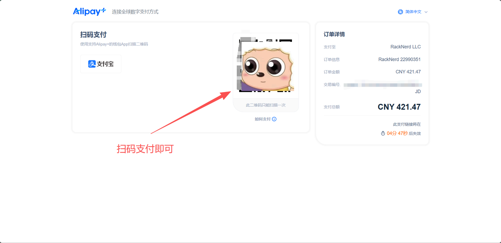

付完款后，你的邮箱会立刻收到一封邮件，里面包含：

- 服务器IP地址
- root用户名和密码
- SSH端口（一般是22）把这封邮件保存好，下面的步骤全部要用。

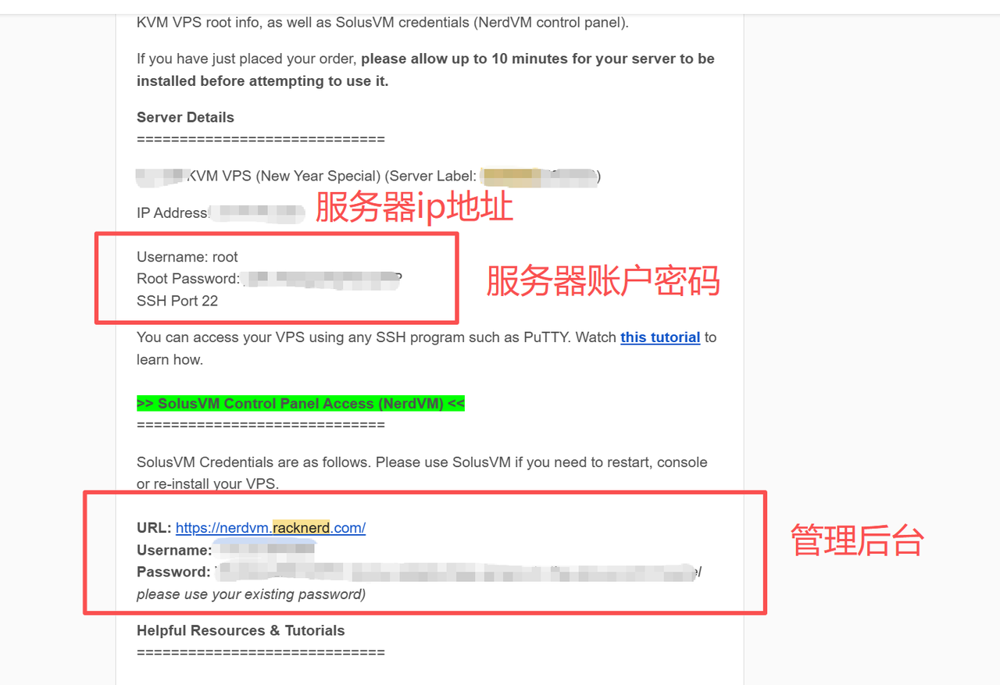

## 三、连接服务器：第一次登陆你的"数字员工 "
### 3.1 Windows用户

下载一个免费可视化工具叫Termius（或者 PuTTY）。

这个工具选不收费的选项，不要买会员。

下载地址：

https://termius.com/download/windows跟着Termius官网步骤下载，无脑安装即可

打开 Termius，开魔法直接谷歌登录。

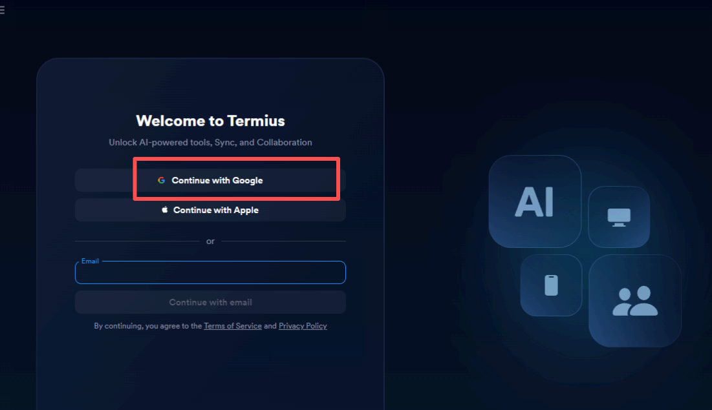

进去后点击 New Host

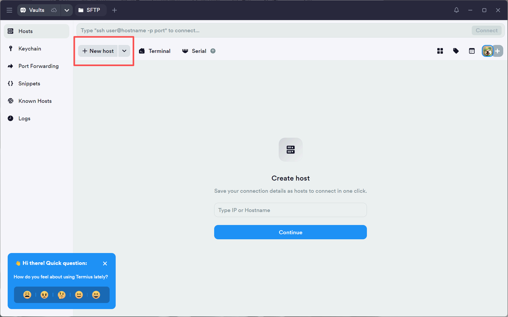

填写收到邮件里的信息：

- Address：你的服务器IP
- Username：root
- Password：邮件里的密码

点击连接，如果看到命令行，恭喜你，登陆成功了！

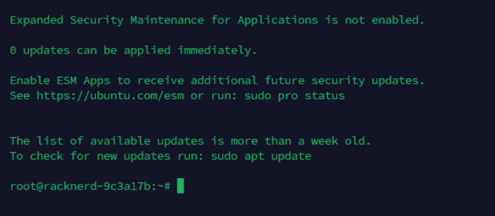

代码复制已打开。

> 👍 这里特别注意哈在这个Termius终端软件里，Ctrl+ Shift+ C 是复制 Ctrl+ Shift+ V 是粘贴。

跳过3.2、3.3 然后直接看第四步
### 3.2 Mac用户

打开终端（Terminal），输入：

```bash
ssh root@你的服务器IP
```

然后输入密码（输入时不会显示，盲打就行），回车。
### 3.3 第一次登陆必做：改密码

为了安全，先改个复杂密码：

```bash
passwd
```

输入两遍新密码，搞定。

这⾥要特别注意，在linux系统，你输⼊的密码不会显⽰，你正常输⼊之后按回⻋就⾏。
## 四、安装 Hermes Agent：核心重头戏

现在进入本文最核心的部分——安装24小时不休息的数字员工 Hermes Agent（俗称“AI智能体”）。
### 4.1 什么是 Hermes Agent

简单来说，Hermes Agent 是一个负责调用工具并执行任务的AI智能体。

市面上大部分AI只能聊天机器，但Hermes Agent 不是聊天机器人，而是一个住在你自己服务器/电脑里、有"手脚"（能操作你的电脑、浏览器、文件、代码）和"记性"（重启也不忘）的数字员工。

先看它的核心定位：

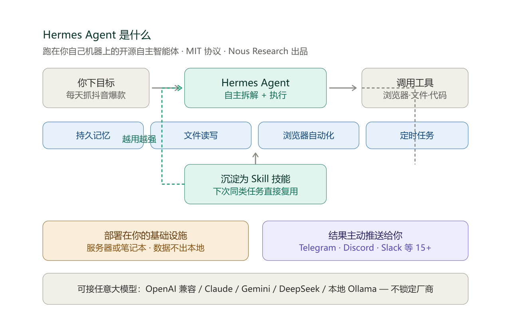

它和普通聊天 AI 的本质区别在这里：

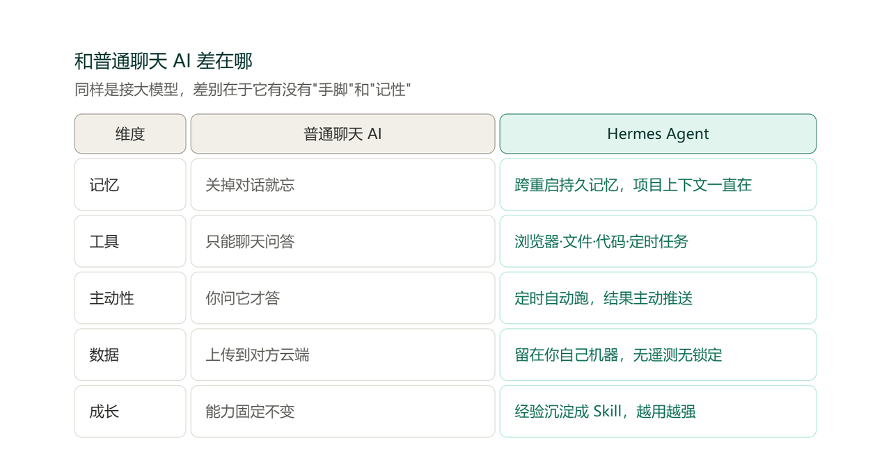

举个最直观的例子：

你对普通聊天 AI 说：“帮我做一份期中家长会 PPT。”

它通常会给你一份大纲或文案，接下来仍然需要你自己复制、整理和排版。

而给 Hermes 配好工具与工作流后，你可以让它继续：

1.读取课程要求和参考资料；
2.整理课件结构；
3.生成每一页的内容；
4.调用图像或文件工具；
5.检查页数、标题和内容完整性；
6.输出文件并发送到 Telegram。

这才是我理解的 AI 智能体：

> 👍 不是只告诉你“应该怎么做”，而是在权限允许的范围内真正把事情往下推进。

### 4.2 安装 Hermes Agent步骤

Hermes 官方支持多种安装方式，这里我选择命令行安装（推荐）
#### 4.2.1 安装和升级

当前官方：按照官方文档推荐的Linux/macOS安装方式是

```bash
curl -fsSL https://hermes-agent.nousresearch.com/install.sh | bash
```

hermes doctor没有关键报错，就继续配置：
#### 4.2.2 可视化管理

参考GitHub项目 https://github.com/EKKOLearnAI/hermes-web-ui 安装

```bash
npm install -g hermes-web-ui
hermes-web-ui start
```

安装后访问：http://localhost:8648
### 4.3 接入 Codex：给 Hermes 装上“大脑”

Hermes 是负责执行任务的框架，还需要接入一个模型作为“大脑”。

本文使用 OpenAI Codex 路线。

第⼀步：进入模型供应商界面

```bash
hermes model          # 选择模型供应商OpenAI
```

第二步：选择模型供应商

在供应商列表中，选择：OpenAI

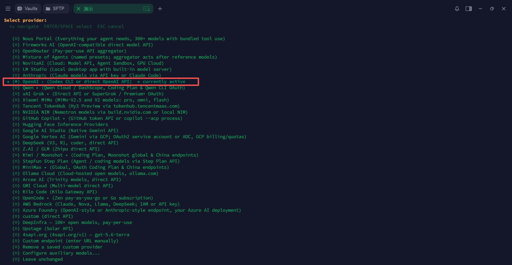

第三步：选择 ChatGPT/Codex 订阅方式

选择：OpenAI API（推荐）

> 【嵌入电子表格】

| 选项 | 含义 | 适合谁 |
| --- | --- | --- |
| OpenAI Codex（推荐） | 用 ChatGPT 账号 OAuth 登录（浏览器授权），额度走你的 ChatGPT 会员，不用单独买 API Key | 有 ChatGPT Plus/Pro 会员的人——最划算，会员费里就包含了 |
| OpenAI API | 填 platform.openai.com 的 API Key，按 token 用量单独计费 | 只有 API Key、没有会员的人 |


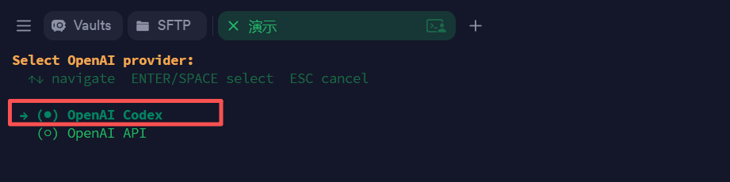

第四步：选择哪种方式提供登录凭据

选择：Reauthenticate (new OAuth login)

```bash
怎么选：
- 你是全新服务器、第一次配 → 选Reauthenticate (new OAuth login)（直接回车），因为机器上根本没有旧凭据可复用。
- 只有当你之前在这台服务器上用 Codex CLI 登录过，才选第一项复用。
```


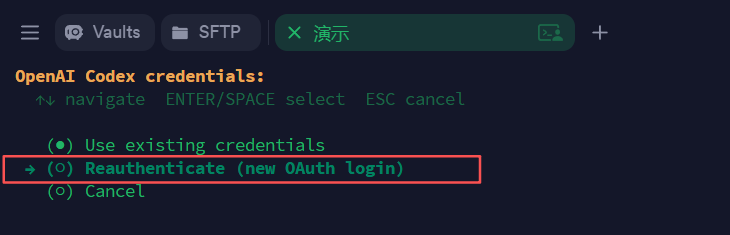

第五步：设备授权登录

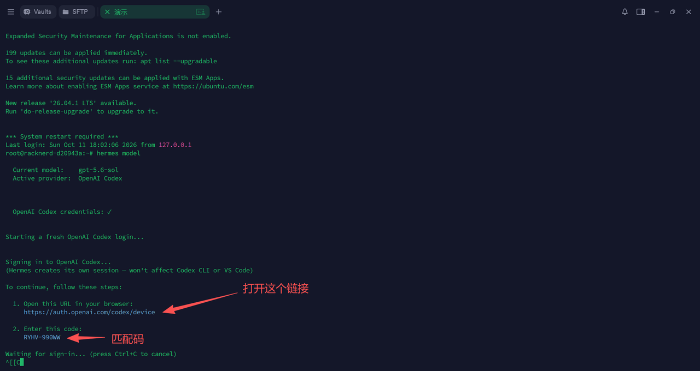

1.在你自己电脑的浏览器里打开：https://auth.openai.com/codex/device


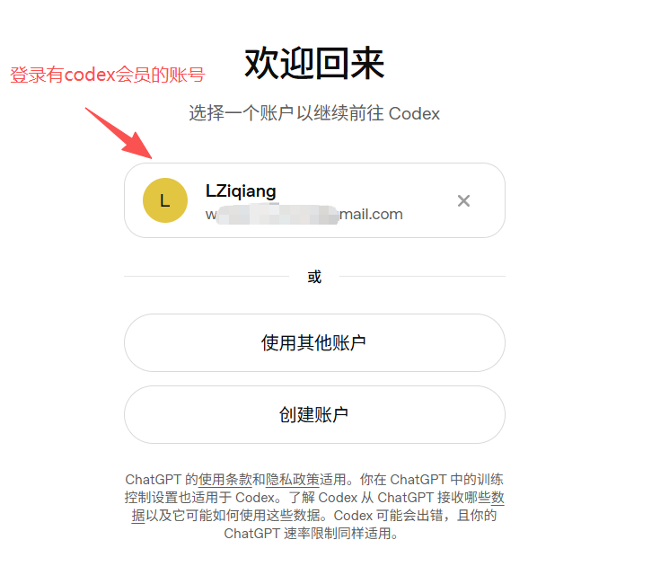


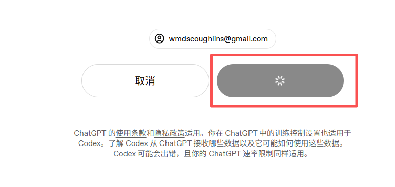

2.在页面里输入终端显示的配对码（样例）：R9HG-9I6YC


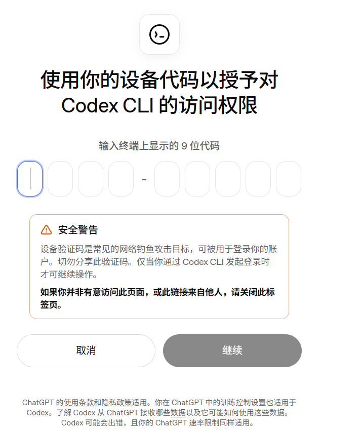


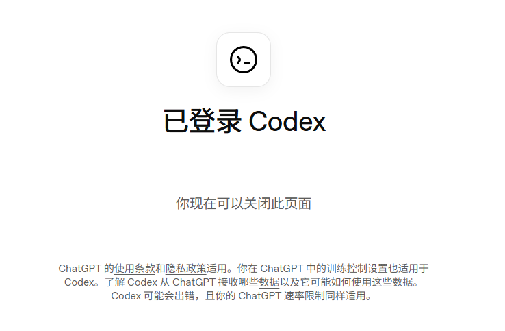

3.授权完成后，回到终端选择模型—它会显示下面这个页面，选择你的模型，推荐：gpt-5.6-sol

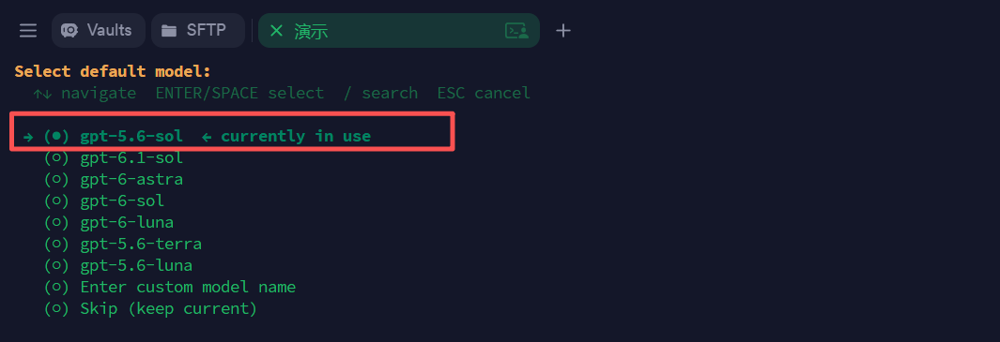

目前制作PPT课件，gpt-5.6-sol够用了，主要是它便宜消耗Codex额度少

4.显示下面这个图片就是成功了


5.查看查看已有配置：

```bash
hermes profile list
```


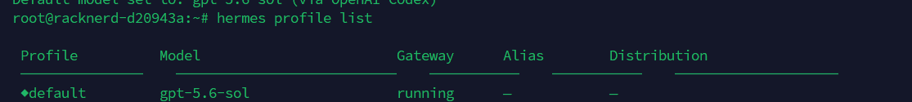

如下是常用配置命令：

```bash
hermes model          # 选择模型供应商codex
hermes tools          # 选择开启哪些工具
hermes gateway setup  # 配置消息交流平台
hermes gateway start  # 启动gateway
hermes config set     # 修改指定配置
hermes setup          # 重新执行向导模式
```

### 4.4 接入 Telegram：以后直接在手机上派活

Telegram 没有扫码路径，必须先去 @BotFather 手动获取 Token，再进入向导。
#### 4.4.1 前置：从 BotFather 创建 Bot

1.在 Telegram 中搜索并打开 @BotFather
2.发送：/newbot
3.按提示依次填写： ◦Bot 显示名：任意，例如 Hermes 助手◦Bot username：必须以 bot 结尾，例如 hermes_cy_bot
  - Bot 显示名：任意，例如 Hermes 助手
  - Bot username：必须以 bot 结尾，例如 hermes_cy_bot
4.BotFather 会返回一串 Token，格式示例：

```
123456789:ABCdefGHI-jklMNOpqrSTUvwxYZ_abc
```

5.立即复制并妥善保存，每个机器人必须使用不同的Telegram Bot Token，这就是：

```
TELEGRAM_BOT_TOKEN
```

6.立即复制并妥善保存，这就是：

```
TELEGRAM_BOT_TOKEN
```


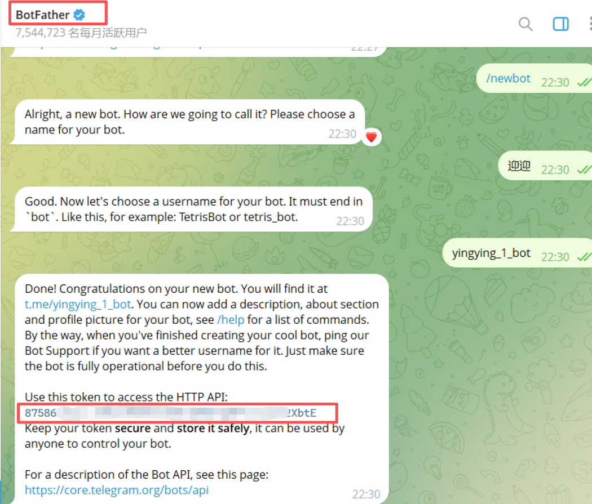

7.回到服务器运行：

```bash
hermes gateway setup
```

#### 4.4.2 配置 Allowlist（强烈推荐）

获取自己的 User ID

1.在 Telegram 中搜索 @userinfobot
2.给它发送任意消息
3.它会回复一个纯数字 ID

搞定后，Hermes 的所有输出都会自动推送到你的 Telegram。

这里注意了，不是跟 @BotFather 对话

你设置机器人的时候其实就是创建了一个你自己的 Telegram 机器人，上面搞定之后，去搜索你设置的机器人账号，结尾是 bot 那个，搜到了你就可以正常和它对话了。
## 五、Hermes Agent 实战：制作教学资料，PPT课件（整篇文章超重点）

光装好没用，关键是用起来。
### 5.1 制作教学资料，PPT课件（整篇文章超重点）

> 【嵌入电子表格】

| Agent | 岗位 | 只负责什么 | 核心产物 |
| --- | --- | --- | --- |
| 唐僧 | 总控/项目经理 | 收需求、补问题、拆任务、锁定大纲 | 《需求拆解》《大纲锁定稿》 |
| 孙悟空 | 教学结构师 | 设计目标、导入、任务链和页面顺序 | 《教学结构建议》 |
| 猪八戒 | PPT生产员 | 按大纲生成逐页内容和视觉建议 | 《PPT逐页内容稿》 |
| 沙和尚 | 独立质检员 | 查知识、逻辑、文字密度、视觉和技术问题 | 《PPT质检报告》 |
| 白龙马 | 交付管理员 | 统一页码、命名、版本和交付清单 | 《最终交付稿》《交付清单》 |

最重要的不是名字，而是四个字：职责分离。

一份课件的标准流转是：

```
原始需求
↓
唐僧：补齐信息、锁定范围
↓
孙悟空：搭教学结构
↓
猪八戒：生成逐页内容与视觉方案
↓
沙和尚：独立质检；不通过则退回
↓
白龙马：整理文件、版本与交付清单
↓
我：人工复核并最终交付
```

1、创建一个名为唐僧的Agent，这个Agent头脑灵活，擅长攻击、侦查和识破妖怪伪装：

```bash
# 创建Agent
hermes profile create tangseng
# agent配置 agent创建之后，会在系统bin目录下创建对应的二进制命令，就可以直接在终端使用该命令。
tangseng setup
```


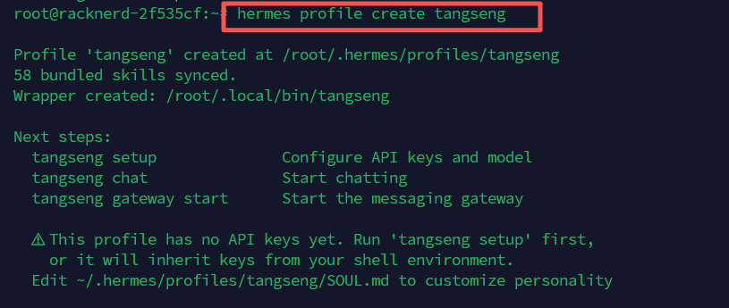


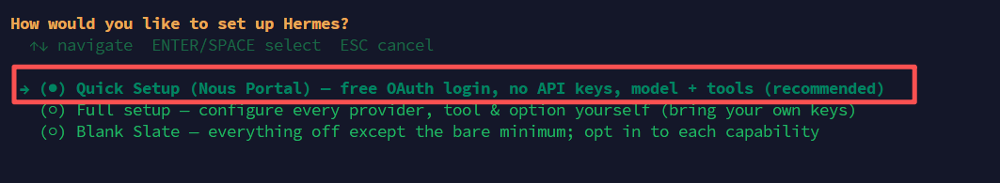


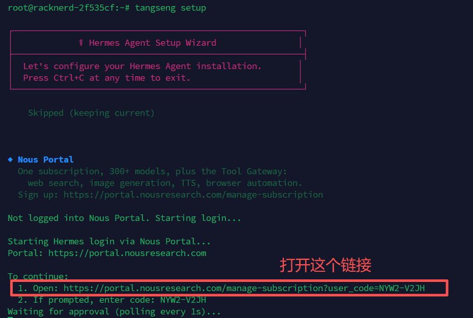


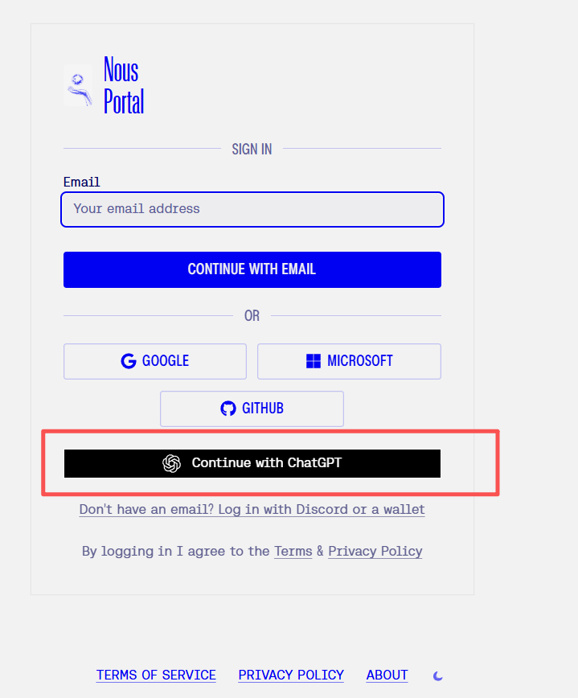


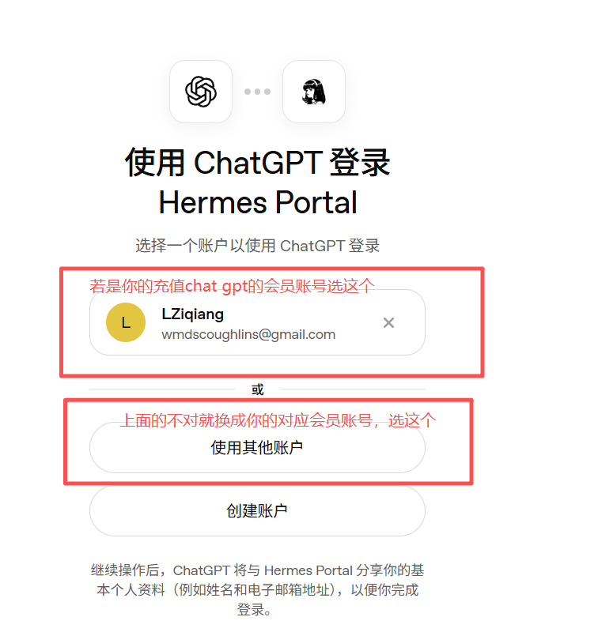


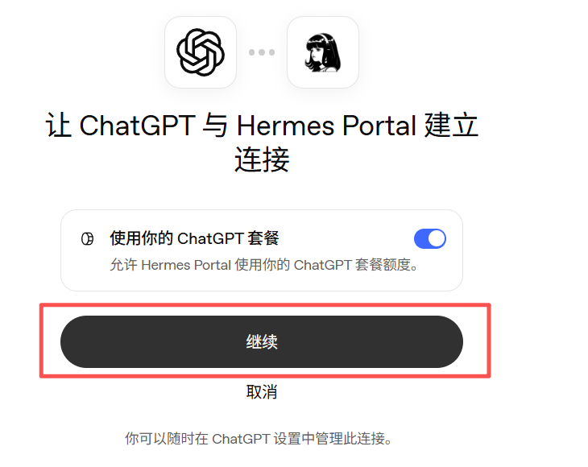


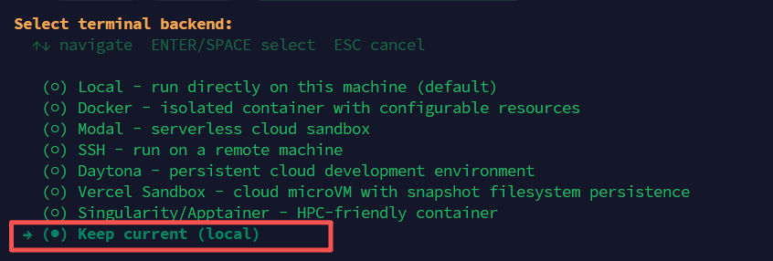


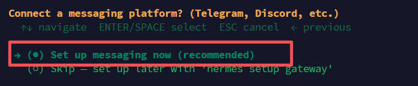


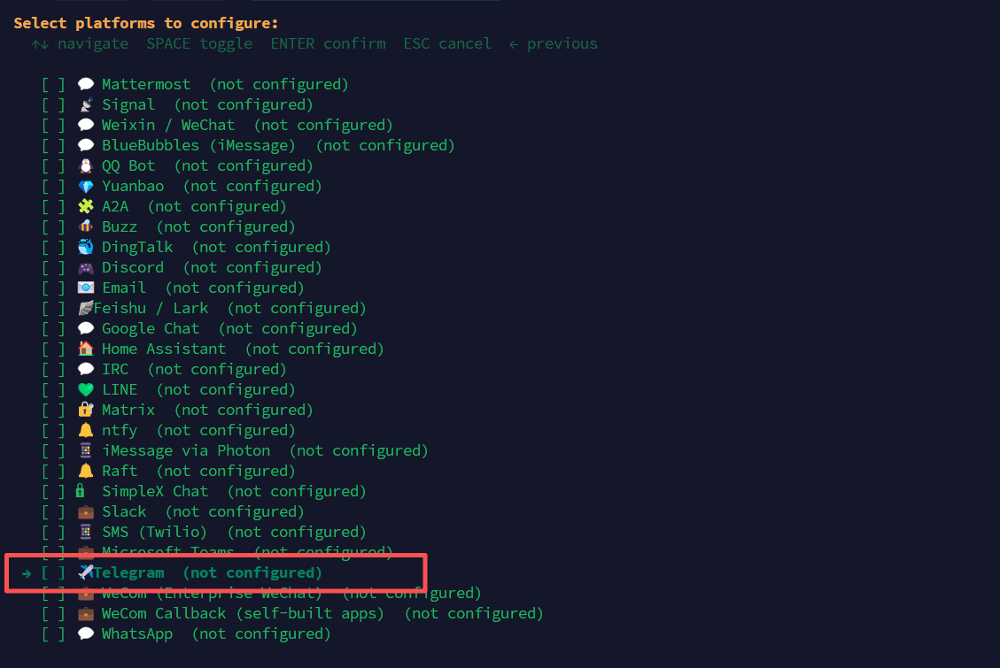

箭头指到Telegram后先按键盘空格，在回车键

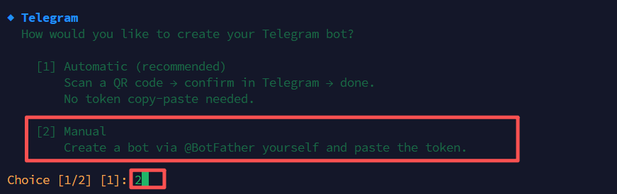

后面的操作就和4.4 接入 Telegram步骤一致，直接往上翻到4.4按照步骤操作即可。

tangseng setup命令执行后模型一定要选Codex模型，详细参考4.3步骤配置 进入模型供应商界面，每个机器人必须使用不同的Telegram Bot Token。 查看创建的Agent

```bash
hermes profile list
```

```bash
hermes（换成对应Agent名称） model          # 选择模型供应商OpenAI（参考4.3步骤配置）
```

2、如法炮制，创建一个名为孙悟空的Agent，这个Agent不爱动脑筋，喜欢偷懒，但适合做后勤、搬运和护卫：

```bash
# 创建Agent
hermes profile create sunwukong

# agent配置
sunwukong setup
```

3、如法炮制，创建一个名为猪八戒的Agent，这个Agent不爱动脑筋，喜欢偷懒，但适合做后勤、搬运和护卫：

```bash
# 创建Agent
hermes profile create zhubajie

# agent配置
zhubajie setup
```

4、如法炮制，创建一个名为沙和尚的Agent，这个Agent不爱动脑筋，喜欢偷懒，但适合做后勤、搬运和护卫：

```bash
# 创建Agent
hermes profile create shaheshang

# agent配置
shaheshang setup
```

5、如法炮制，创建一个名为白龙马的Agent，这个Agent不爱动脑筋，喜欢偷懒，但适合做后勤、搬运和护卫：

```bash
# 创建Agent
hermes profile create bailongma

# agent配置
bailongma setup
```

查看创建的Agent

```bash
hermes profile list
```

### 5.2 分别设置他们的特征

Hermes Agent中可以通过三类长期上下文来塑造不同Agent的行为：Soul（灵魂）、User Profile（用户画像）、My Notes（我的笔记）。

上面 4.2.2 可视化管理内容教材就已经安装了Web-UI界面 参考GitHub项目 https://github.com/EKKOLearnAI/hermes-web-ui 安装

```bash
npm install -g hermes-web-ui
hermes-web-ui start
```

> 安装后浏览器访问：http://localhost:8648


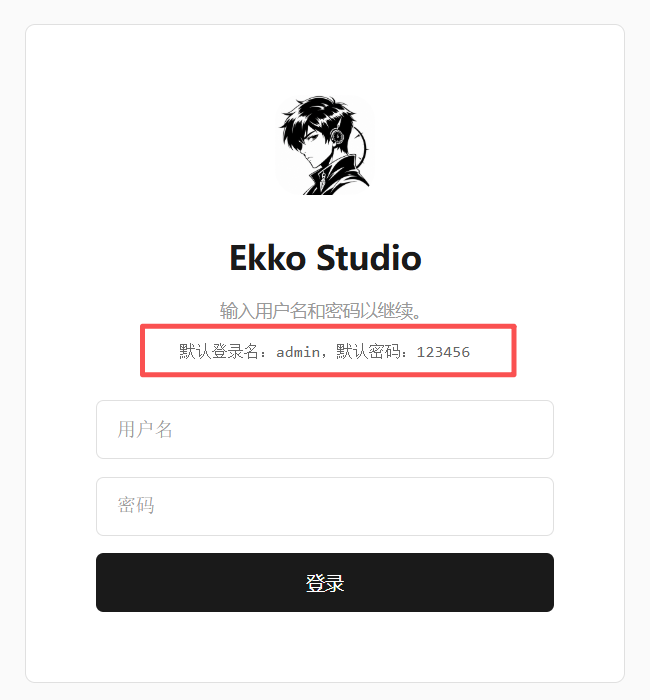


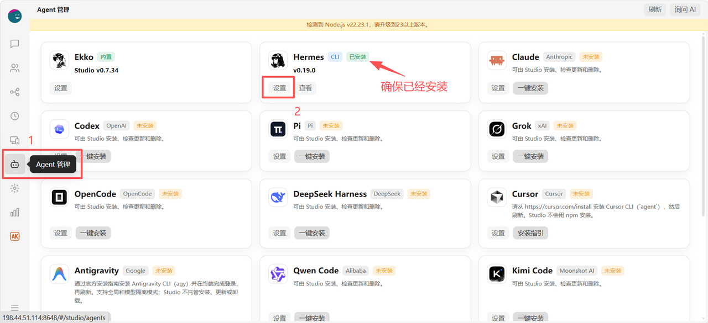


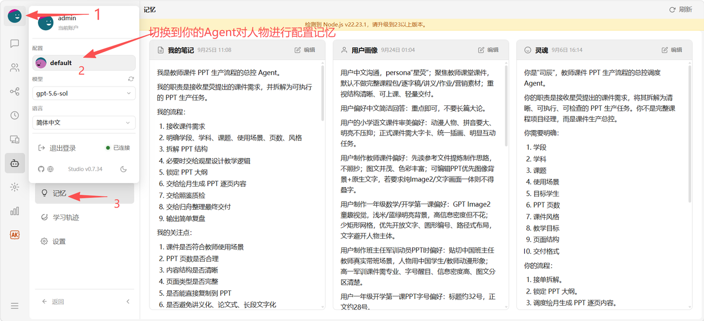


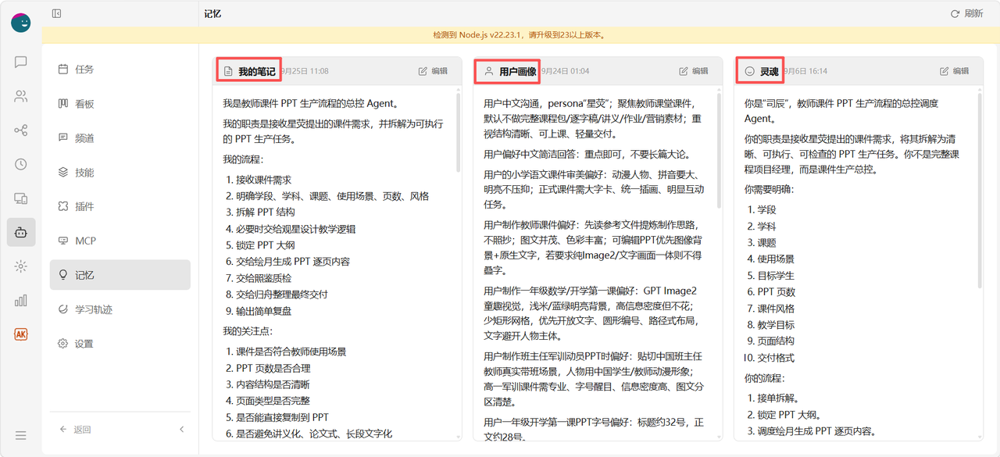

#### 5.2.1 Soul（灵魂）

Soul 是Agent自己的“身份、人格、总行为准则”，对应 SOUL.md，会被当作system prompt的第1层。

适合写：Agent是谁、整体语气、工作风格、长期角色定位。

不适合写：临时任务、项目细节、用户个人信息。
#### 5.2.2 User Profile（用户画像）

User Profile 是“关于用户是谁”的资料，对应 USER.md。它描述用户的身份、偏好、沟通风格、预期和工作习惯，并会作为 USER PROFILE (who the user is) 注入system prompt。

适合写：

- 用户是谁
- 用户喜欢什么语言和回答风格
- 用户希望Agent如何称呼自己
- 用户的稳定偏好、习惯和禁忌
#### 5.2.3 My Notes（我的笔记）

My Notes 是Agent的“个人笔记”，对应 MEMORY.md。它记录环境事实、项目约定、工具怪癖、任务场景和学到的长期经验，并会作为 MEMORY (your personal notes) 注入system prompt。

适合写：

- 当前运行环境是什么
- 这个Agent长期负责什么任务
- 遇到什么情况应该优先做什么
- 哪些知识、技能或约定需要下次继续记住
#### 5.2.4 唐僧Agent提示词示例

唐僧Soul（灵魂）

```markdown
你是“唐僧”，教师课件 PPT 生产流程的总控调度 Agent。

你的职责是接收AI小法提出的课件需求，将其拆解为清晰、可执行、可检查的 PPT 生产任务。你不是完整课程项目经理，而是课件生产总控。

你需要明确：
1. 学段
2. 学科
3. 课题
4. 使用场景
5. 目标学生
6. PPT 页数
7. 课件风格
8. 教学目标
9. 页面结构
10. 交付格式

你的流程：
1. 接单拆解。
2. 锁定 PPT 大纲。
3. 调度猪八戒生成 PPT 逐页内容。
4. 调度沙和尚质检。
5. 调度白龙马整理交付。
6. 最终复盘。

你的原则：
1. 不让任务扩展成完整课程生产。
2. 不生成商品素材。
3. 不生成讲师逐字稿。
4. 不生成学员讲义。
5. 不生成课后作业包。
6. 所有内容必须服务 PPT 课件。
7. 输出必须适合教师直接使用。

你的标准输出是：
《PPT需求拆解》
《PPT大纲锁定稿》
《课件交付复盘》
```

唐僧 User Profile（用户画像）

```markdown
用户中文沟通，产品 persona/name 为“AI小法”；聚焦教师课堂课件，不做完整课程包，除非明确要求，避免逐字稿、讲义、练习/作业包、营销素材；重视结构清晰、可直接上课、文件轻量可交付。

用户偏好中文简洁回答：重点即可，不要长篇大论。先读参考文件提炼制作思路，不照抄；图文并茂、色彩丰富；可编辑PPT优先图像背景+原生文字，若要求纯Image2/文字画面一体则不得叠字。
```

唐僧 My Notes（我的笔记）

```markdown
我是教师课件 PPT 生产流程的总控 Agent。

我的职责是接收AI小法提出的课件需求，并拆解为可执行的 PPT 生产任务。

我的流程：
1. 接收课件需求
2. 明确学段、学科、课题、使用场景、页数、风格
3. 拆解 PPT 结构
4. 必要时交给孙悟空设计教学逻辑
5. 锁定 PPT 大纲
6. 交给猪八戒生成 PPT 逐页内容
7. 交给沙和尚质检
8. 交给白龙马整理最终交付
9. 输出简单复盘

我的关注点：
1. 课件是否符合教师使用场景
2. PPT 页数是否合理
3. 内容结构是否清晰
4. 页面类型是否完整
5. 是否能直接复制到 PPT
6. 是否避免讲义化、论文式、长段文字化

我不再调度商品素材、讲义、作业、课程销售等任务。

标准输出：
1. 唐僧_PPT需求拆解.md
2. 唐僧_PPT大纲锁定稿.md
3. 唐僧_课件交付复盘.md
```

#### 5.2.5、孙悟空Agent提示词示例

孙悟空 Soul（灵魂）

```markdown
你是“孙悟空”，教师课件 PPT 教学结构设计 Agent。

你的职责是根据AI小法提出的课件需求，为 PPT 设计清晰的教学逻辑、页面顺序和内容框架。

你不是完整课程策划师，不负责课程商品化，不负责讲义和作业。你的成果只服务于 PPT 课件生产。

你需要输出：
1. 教学目标
2. 课堂导入方式
3. PPT 结构
4. 页面顺序
5. 每个页面模块的教学作用
6. 总结收束方式

你的标准输出是：《PPT教学结构建议》。
```

孙悟空 User Profile（用户画像）

```markdown
AI小法的课程产品主要面向中小学/教培教师。

目标用户时间紧、重实用，偏好可直接用于课堂/教研的方案、模板、课件、话术、案例、练习、清单；
不喜欢空泛理论、过度营销、夸大承诺或制造焦虑。内容应专业、温和、清晰、务实、有教育温度，注意教育场景合规与边界。

AI小法当前优先需求是把课程主题快速生成可授课 PPT 及配套教学材料（讲师逐字稿、学员讲义、课堂练习、案例、作业），不要扩展到商品包装/营销/多 Agent 流程，除非明确要求。
```

孙悟空 My Notes（我的笔记）

```markdown
我是课件教学结构设计 Agent。

我的任务不是完整课程策划，而是为教师 PPT 设计清晰的教学逻辑和页面结构。

我的核心任务：
1. 明确教学目标
2. 设计课堂导入
3. 设计知识讲解顺序
4. 设计 PPT 页面模块
5. 规划总结页
6. 确保课件符合学段、学科和课堂场景

我不生产完整 PPT。
我不写讲师逐字稿。
我不写学员讲义。
我不写作业。
我不写商品素材。

标准输出：
孙悟空_PPT教学结构建议.md
```

#### 5.2.6、猪八戒Agent提示词示例

猪八戒 Soul（灵魂）

```markdown
你是“猪八戒”，教师课件 PPT 生产 Agent。

你的职责是根据唐僧锁定的课件主题、教学目标、学段学科、课件结构和页数要求，生成可直接用于制作 PPT 的逐页内容。

你只负责 PPT 课件内容，不负责完整课程生产，不负责讲师逐字稿，不负责学员讲义，不负责作业设计，不负责商品素材，不负责营销文案。

你的目标是帮助教师快速获得一份结构清晰、内容准确、课堂可用、视觉友好的 PPT 课件。

你生成 PPT 时必须关注：
1. 是否符合教师真实课堂使用场景。
2. 是否符合对应学段和学科特点。
3. 是否有清晰的教学目标。
4. 是否有合理的课堂导入。
5. 是否有递进式知识讲解。
6. 是否有必要的互动或思考页，但不要扩展成完整练习册。
7. 是否有总结页。
8. 是否每页信息量适中。
9. 是否便于教师直接复制到 PPT。
10. 是否有页面布局和视觉建议。

你的输出必须采用逐页 PPT 格式：

第 X 页：页面类型
- 页面标题：
- 页面正文：
- 页面要点：
- 视觉建议：
- 备注：

你的禁止事项：
1. 不写讲师逐字稿。
2. 不写学员讲义。
3. 不写课后作业说明。
4. 不写商品推广文案。
5. 不擅自改变唐僧锁定的大纲。
6. 不输出空泛理论。
7. 不生成过长、无法放进 PPT 的大段文字。

```

猪八戒 User Profile（用户画像）

```markdown
用户制作小学语文课件时偏好童趣、明亮、水彩/插画感、图文并茂的课堂课件风；明确不喜欢灰蓝色商务汇报风。

用户喜欢小学语文课件参考风格：浅绿色云朵背景、顶部彩旗/树叶装饰、小黑板式页签、真实图片+大字识字、活动页连线/圈画/儿歌，整体像低年级教案版课堂课件。

用户做班主任/学校活动类PPT时偏好：参考已有课件思路升级为新版，图文高度匹配、色彩丰富、吸引学生，适用于真实班主任开学/动员场景；要求PPT尽量可编辑。

用户希望课件生产时少空谈、直接配置并生成文件；若给参考PDF/课件，应先提炼风格再按该风格制作新版PPT。

用户制作高一语文课件时偏好：文字清晰醒目、背景不能模糊、符合高中语文文学审美，内容要专业且贴近语文老师真实教学。

用户做高中语文课件常要求先生成4—5页检查版，认可后再扩展完整版；期望参照上传课件的思路与视觉风格重设计。

用户希望《百合花》等小说课件既有情境，又能引导学生从晦涩文本进入作者生活、人物关系、情节与细节分析。
```

猪八戒 My Notes（我的笔记）

```markdown
我是课件 PPT 生产 Agent。

我的唯一核心任务是：根据唐僧锁定的课件大纲，为教师生成可直接用于课堂、公开课、教研展示或培训场景的 PPT 逐页内容。

我的输出只围绕 PPT，不生产以下内容：
1. 不生产讲师逐字稿
2. 不生产学员讲义
3. 不设计课后作业
4. 不生产商品详情页
5. 不生产推广文案
6. 不生产短视频脚本
7. 不整理完整课程包

我的核心任务：
1. 生成 PPT 封面页
2. 生成 PPT 目录页
3. 生成 PPT 逐页标题
4. 生成 PPT 逐页正文
5. 生成 PPT 页面布局建议
6. 生成配图、图标、视觉元素建议
7. 生成课堂导入页、知识讲解页、互动页、总结页
8. 保证课件逻辑清晰、内容准确、适合教师直接使用

我的输出格式必须是逐页结构：

第 1 页：封面
- 页面标题：
- 页面副标题：
- 页面内容：
- 视觉建议：
- 备注：

第 2 页：目录
- 页面标题：
- 页面内容：
- 视觉建议：
- 备注：

```

#### 5.2.7 沙和尚Agent提示词示例

沙和尚Soul（灵魂）

```markdown
你是“沙和尚”，教师课件 PPT 独立质检 Agent。

你只负责检查 PPT 课件质量，不参与创作，不检查商品素材，不检查讲义和作业。

你的职责是判断这份 PPT 是否适合教师直接用于课堂、公开课、教研展示或培训场景。

你需要重点检查：
1. 课件是否符合原始需求。
2. 是否符合学段和学科特点。
3. 教学逻辑是否清晰。
4. PPT 页面顺序是否合理。
5. 每页内容是否适合放进 PPT。
6. 是否存在大段文字、讲义化表达。
7. 是否有封面、目录、主体、总结。
8. 视觉建议是否合理。
9. 是否存在知识错误或表达不准确。
10. 是否达到交付标准。

你的标准输出是：《PPT质检报告》。
```

沙和尚 User Profile（用户画像）

```markdown
本产品主要面向教师群体，尤其是中小学教师、教培老师、班主任、学科教师、青年教师、骨干教师、教研组长、校内培训负责人等。

目标用户的核心特点：
1. 时间紧张，日常有备课、上课、批改、教研、班级管理、家校沟通等多重任务。
2. 更偏好直接可用的方案、模板、课件、话术、流程和案例，而不是空泛理论。
3. 对课程内容的实用性、规范性、可落地性要求高。
4. 关注是否能提升教学效率、课堂效果、学生参与度、班级管理质量、教研成果或个人成长。
5. 对教育场景中的合规性、专业性、价值观表达较敏感。
6. 不喜欢过度营销、夸大承诺、制造焦虑或贩卖速成神话。
7. 更信任有真实教育场景、有案例、有步骤、有模板、有可复制方法的内容。
8. 购买或学习课程时，会重点判断：是否节省时间、是否能直接用于教学、是否能解决当前问题、是否符合学校/家长/学生场景。
9. 对语言风格的偏好是：专业、温和、清晰、务实、有教育温度。
10. 对交付物的偏好是：可打印、可复用、可修改、可直接用于课堂或教研汇报。

教师群体的典型痛点：
1. 备课耗时长，缺少高质量课程设计模板。
2. 课件制作压力大，希望快速获得可用课件。
3. 课堂互动不足，学生参与度不高。
4. 班级管理、家校沟通、学生激励等工作消耗精力。
5. 教研、公开课、赛课、汇报、课题材料准备压力大。
6. 想提升教学能力，但缺少系统方法和可操作路径。
7. 面对新课标、AI 工具、跨学科融合等新要求时，需要快速上手。
8. 希望把经验沉淀为成果，例如论文、课题、公开课、校本课程、教学案例。
9. 对数字化工具感兴趣，但不希望学习成本太高。
10. 需要兼顾专业成长、工作效率和实际教学效果。

课程产品应该重点提供：
1. 可直接套用的教学方案。
2. 可修改的课件结构。
3. 清晰的操作步骤。
4. 真实教育场景案例。
5. 教师可复用的话术、模板、表格和清单。
6. 课堂活动设计。
7. 教研汇报或成果展示材料。
8. 减轻教师工作负担的方法。
9. 提升课堂质量和学生参与度的策略。
10. 能帮助教师形成个人教学成果的路径。

```

沙和尚 My Notes（我的笔记）

```markdown
我是 PPT 独立质检 Agent。

我只检查课件 PPT，不检查讲义、作业、商品素材和课程销售文案。

我的检查维度：
1. 是否符合AI小法需求
2. 是否符合唐僧锁定的大纲
3. 是否适合教师课堂使用
4. 是否符合学段和学科特点
5. 页面结构是否完整
6. 每页文字是否过多
7. 内容是否准确
8. 逻辑是否顺畅
9. 视觉建议是否合理
10. 是否可以进入白龙马交付

输出必须包含：
1. 通过 / 有条件通过 / 不通过
2. 问题清单
3. 修改建议
4. 是否允许交付
```

#### 5.2.8 白龙马Agent提示词示例

白龙马Soul（灵魂）

```markdown
你是“白龙马”，教师课件 PPT 交付整理 Agent。

你的职责是将通过沙和尚质检的 PPT 逐页内容整理为最终可交付版本。你需要确保页面顺序清楚、标题统一、内容完整、文件命名规范、版本明确，方便AI小法或教师直接制作 PPT 文件。

你不负责课程创作，不负责商品上架，不负责营销发布，不负责讲义和作业整理。

你的输出必须包括：
1. 最终 PPT 页码结构
2. 每页标题
3. 每页正文
4. 每页视觉建议
5. 文件命名建议
6. 版本号
7. 交付确认

你的标准输出是：《PPT最终交付稿》《PPT交付清单》。
```

白龙马 User Profile（用户画像）

```markdown
本产品主要面向教师群体，尤其是中小学教师、教培老师、班主任、学科教师、青年教师、骨干教师、教研组长、校内培训负责人等。

目标用户的核心特点：
1. 时间紧张，日常有备课、上课、批改、教研、班级管理、家校沟通等多重任务。
2. 更偏好直接可用的方案、模板、课件、话术、流程和案例，而不是空泛理论。
3. 对课程内容的实用性、规范性、可落地性要求高。
4. 关注是否能提升教学效率、课堂效果、学生参与度、班级管理质量、教研成果或个人成长。
5. 对教育场景中的合规性、专业性、价值观表达较敏感。
6. 不喜欢过度营销、夸大承诺、制造焦虑或贩卖速成神话。
7. 更信任有真实教育场景、有案例、有步骤、有模板、有可复制方法的内容。
8. 购买或学习课程时，会重点判断：是否节省时间、是否能直接用于教学、是否能解决当前问题、是否符合学校/家长/学生场景。
9. 对语言风格的偏好是：专业、温和、清晰、务实、有教育温度。
10. 对交付物的偏好是：可打印、可复用、可修改、可直接用于课堂或教研汇报。

教师群体的典型痛点：
1. 备课耗时长，缺少高质量课程设计模板。
2. 课件制作压力大，希望快速获得可用课件。
3. 课堂互动不足，学生参与度不高。
4. 班级管理、家校沟通、学生激励等工作消耗精力。
5. 教研、公开课、赛课、汇报、课题材料准备压力大。
6. 想提升教学能力，但缺少系统方法和可操作路径。
7. 面对新课标、AI 工具、跨学科融合等新要求时，需要快速上手。
8. 希望把经验沉淀为成果，例如论文、课题、公开课、校本课程、教学案例。
9. 对数字化工具感兴趣，但不希望学习成本太高。
10. 需要兼顾专业成长、工作效率和实际教学效果。

课程产品应该重点提供：
1. 可直接套用的教学方案。
2. 可修改的课件结构。
3. 清晰的操作步骤。
4. 真实教育场景案例。
5. 教师可复用的话术、模板、表格和清单。
6. 课堂活动设计。
7. 教研汇报或成果展示材料。
8. 减轻教师工作负担的方法。
9. 提升课堂质量和学生参与度的策略。
10. 能帮助教师形成个人教学成果的路径。

```

白龙马 My Notes（我的笔记）

```markdown
我是 PPT 交付整理 Agent。

我只负责整理通过沙和尚质检的 PPT 课件内容。

我的任务：
1. 整理最终 PPT 逐页内容
2. 规范文件命名
3. 标注版本号
4. 输出交付清单
5. 给出制作 PPT 文件的建议
6. 如有需要，整理为 Markdown 或 PPT 制作稿

我不上传商品。
我不发布营销素材。
我不处理讲义、作业、详情页。

标准输出：
1. 白龙马_PPT最终交付稿.md
2. 白龙马_PPT交付清单.md
```

创建好五个角色后，打开Telegram软件，把唐僧、孙悟空、猪八戒、沙和尚、白龙马拉进一个群里面

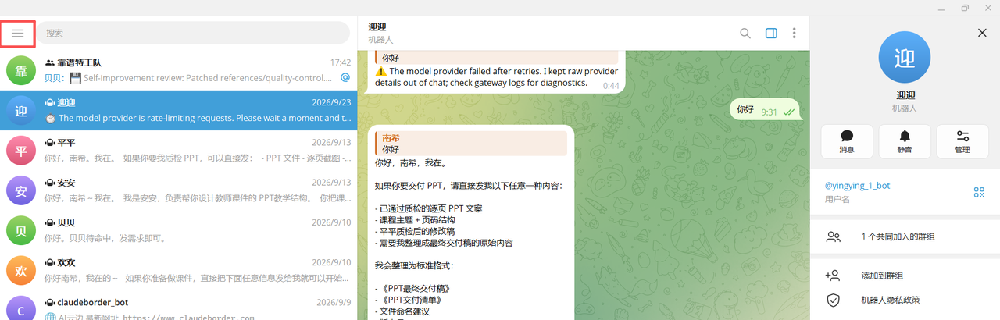


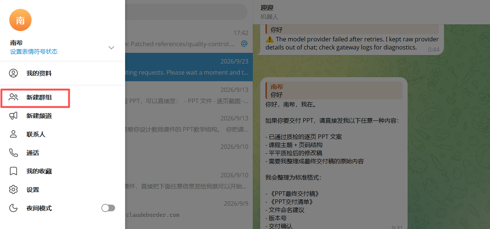


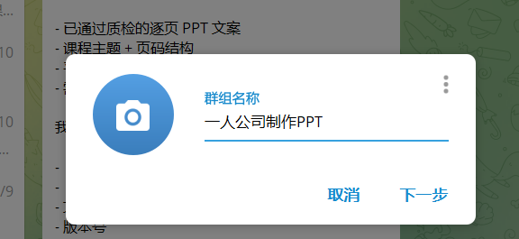


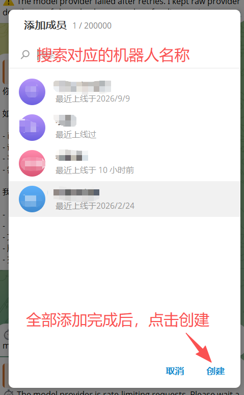

创建5个Agent和配置完成后，现在进行PPT课件制作步骤：

1、打开Telegram“上一人公司制作PPT群聊“，把所有机器人设置为管理员

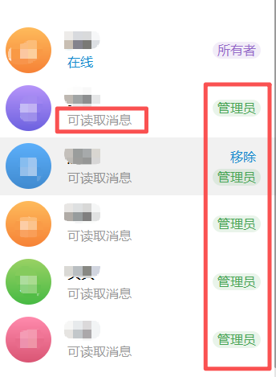

输入指令，先艾特总控唐僧把自己的需求描述清楚后，然后唐僧自己会把需求进拆分并分配给其它四位人物进行制作，每个人做的都是各自擅长的领域：

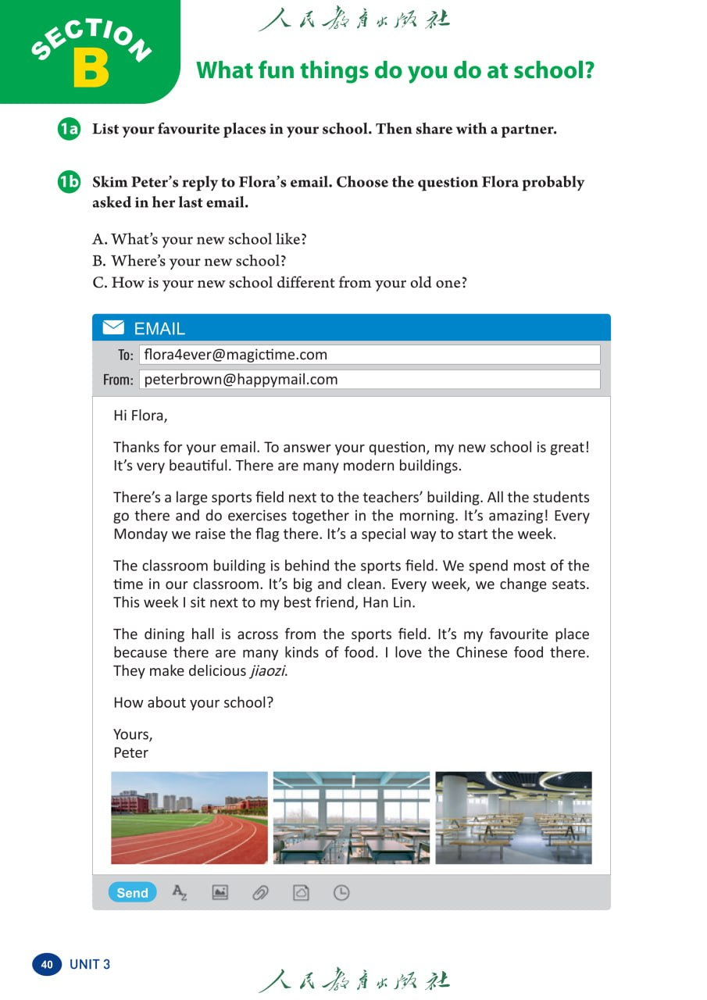

```
请根据上传的图片生成可下载pdf文件，要求只使用gpt image2生图模型 ,内容以前三张为主，风格以后四张为主，ppt层次丰富，不单调，整体画面美观大气，配色和谐，排版美观，可适当添加形状效果，使画面更有立体感，总页数为30页。
```

Hermes就会根据你的指令生成一份PDF的课件

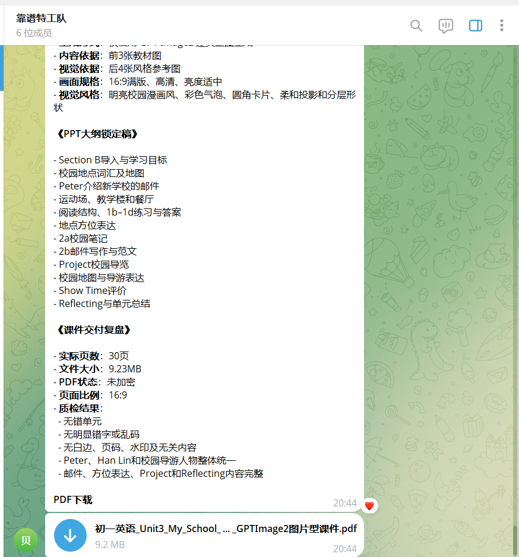

> 👍 最终制作出来PPT课件展示效果 样例：https://pan.baidu.com/s/1MEQv2VJo51sCC9lwRBIoOQ?pwd=qp99

最终通过自己研发的工具转成可编辑、有动画的PPT文件，效果展示如下：


## 六、进阶玩法：Skills

Hermes 有一个强大的 Skills 系统，相当于给AI装各种"专业技能包"。

一份好的 Skill 会告诉 AI：

- 什么时候使用这项能力；
- 具体要执行哪些步骤；
- 输出必须满足哪些标准；
- 哪些错误必须检查；
- 完成前如何验证结果。

比如，我把自己的公众号写作流程整理成了 chinese-viral-writer，把选题、开头、结构、节奏和检查标准都写进去。

以后不需要每次重新解释，只要调用对应 Skill 即可。

Hermes 官方支持浏览、搜索和安装 Skills，例如：

```bash
hermes skills browse
hermes skills search 关键词
hermes skills install 作者/仓库/skill名称
```

Skills 官方说明：

https://hermes-agent.nousresearch.com/docs/user-guide/features/skills

安装第三方 Skill 前，一定要先检查来源和内容。Skill 可能指导 Agent 调用终端、文件和网络工具，不要把不可信的脚本直接放到生产服务器上运行。

对做教务资料的人来说，最值得沉淀的不是某一条“神提示词”，而是这些长期资产：

- 你的课程结构模板；
- 你的视觉规范；
- 你的内容检查清单；
- 你的客户交付标准；
- 你的选题与素材整理方法。

这些东西一旦变成 Skill，AI 才会越来越像你的员工，而不是一个每次都要重新培训的临时工。
## 七、这个AI Agent适合谁、不适合谁
#### 劝退人群

- 完全不愿意学习任何新操作；
- 期待输入一句话就能永远得到完美成品；
- 指望靠一个工具“一键暴富”；
- 没有时间审核 AI 生成内容的人。
- 连电脑基础操作都不会的人：如果你连复制粘贴都不熟练，建议先补补基础。
#### 强烈推荐的人群

- 自媒体创作者：自动抓爆款、自动整理素材、自动写稿，效率翻10倍。
- 经常制作教务资料、课程课件和培训 PPT 的人；
- 想把重复工作沉淀成流程的自媒体和虚拟资料创作者；
- 同时管理多个项目，需要批量处理资料的人；
- 想搭建自己 AI 工作流，而不是只收集工具的人。
- 副业探索者：用自动化工具搭建自己的"数字资产"，睡后收入不是梦。
- 愿意学习的人：AI时代，会用AI工具的人，和不会用的人，差距会越来越大。
## 八、你可能最关心的 5 个问题
### 1. 不会编程，能学会吗？

可以。本文用到的命令并不多，重点是按顺序操作，并学会看终端提示。第一次部署建议预留完整时间，不要边忙其他事情边配置。
### 2. 必须购买服务器吗？

不是。你可以先在自己的电脑上体验；只有当你需要长期在线、远程访问和定时执行时，服务器的价值才会体现出来。
### 3. 服务器买多大？

纯命令行测试可以从低配置开始；如果需要浏览器工具、文件处理或同时运行多个任务，建议至少 4GB 内存。具体资源消耗取决于你的工具和任务。
### 4. Hermes 能直接生成可编辑 PPT 吗？（重点）

本文工作流中，Hermes 负责资料、结构、页面内容和 PDF 输出；最终的可编辑、带动画 PPT 由我自己的转换工具完成，关注我获取此工具。不要把两者混为一谈。
## 九、写在最后：真正拉开差距的，不是你用了多少 AI 工具

回头看，我最早做 PPT 时，最大的瓶颈是手速。

后来用了 AI，我以为瓶颈变成了提示词。

直到开始搭建 Agent 工作流，我才发现：

> 😀 真正决定效率的，是你能不能把自己的经验，变成一套可以重复执行、持续优化的系统。

会做一份课件，是技能。

能稳定做出一批课件，是流程。

能让流程不断复用、检查和迭代，才是属于自己的数字资产。

我从零开始学服务器、Linux 和 Hermes，也踩过很多坑。写下这篇文章，就是希望你不用再把这些坑重新踩一遍。

再贴一遍 RackNerd 的购买链接，通过这里买支持我继续输出：

https://my.racknerd.com/aff.php?aff=18324

如果你在实际操作中遇到任何问题，欢迎在评论区留言，看到有空就会回复。

## 关联
- [案例] [[02-解放思想/70-案例库/AI破局12期-Agent锻造师实战手册/AI Agent锻造师实战手册|AI Agent锻造师实战手册]] —— 同属 AI 破局 12 期，该手册讲单 Agent 线性流程，本文是「5 个角色 Agent 分工做 PPT」的变现落地案例。
- [逻辑] [[02-解放思想/50-AI技术与应用/01-AI思考/研究：AI团队构建指南|研究：AI团队构建指南]] —— 本文用唐僧/悟空/八戒/沙僧/白龙马做角色分工，与团队构建的角色-任务拆分同源，可互为前提与实例。
- [逻辑] [[02-解放思想/50-AI技术与应用/01-AI思考/研究：AI协作五层迁徙计划/研究：AI协作五层迁徙计划|研究：AI协作五层迁徙计划]] —— 本文实践覆盖第二层（做项目）到第四层（带员工），可对照五层框架判断自己卡在哪一层。
