# 站在普通用户视角聊 DeepSeek Harness

> 潘达 ｜ 8月18日修改

## 前言

DeepSeek 在 8 月 13 日悄悄甩出一个开源项目 Harness（命令叫 dsh），全网瞬间刷屏。

但你看完会发现：90% 的文章都在堆技术参数，普通人越看越懵。

它到底是啥、跟 WorkBuddy 有啥区别、我要不要学，没人讲人话。

所以这篇，我把自己当成「普通用户的互联网脑替」，把官方仓库、新闻稿、dsh-plugin 话题页和社区生态全扒了一遍，用最接地气的 几个问题讲清楚：

- 它到底是什么 ？
- 和 WorkBuddy 差在哪 ？
- 普通人要不要学、怎么上手最快？
- 插件社区现在最缺什么、机会藏在哪？

> 🐵
> 目录在左边呀，这几个问题不是目录。

无论你是想「立刻把事做完」的普通用户，还是想「造自己的 Agent / 嵌进产品」的开发者，这篇都能帮你少走弯路、看清这波风口。

> 👉 正文约 4000 字，建议喝着【冰阔乐】慢读。

---

## 一句话先给结论

DeepSeek Harness（dsh）是 DeepSeek 发布的开源 Agent 运行时底座（v0.1 开发者预览 / MIT 协议）。

它的本质不是「一个 Agent 产品」，而是「一个一切皆插件的 Agent 操作系统内核」。

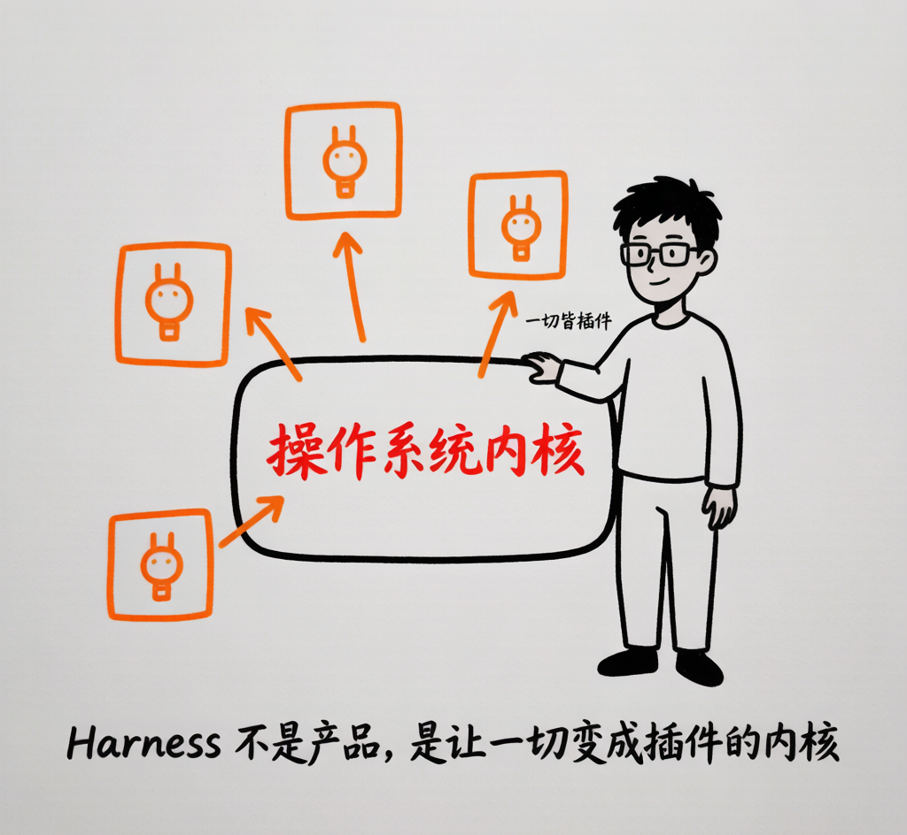

而 WorkBuddy 是面向终端用户的产品 AI 助手（你直接说需求，我来做）。


一句话区分二者：一个是造同事的工厂，一个是雇来干活的同事。

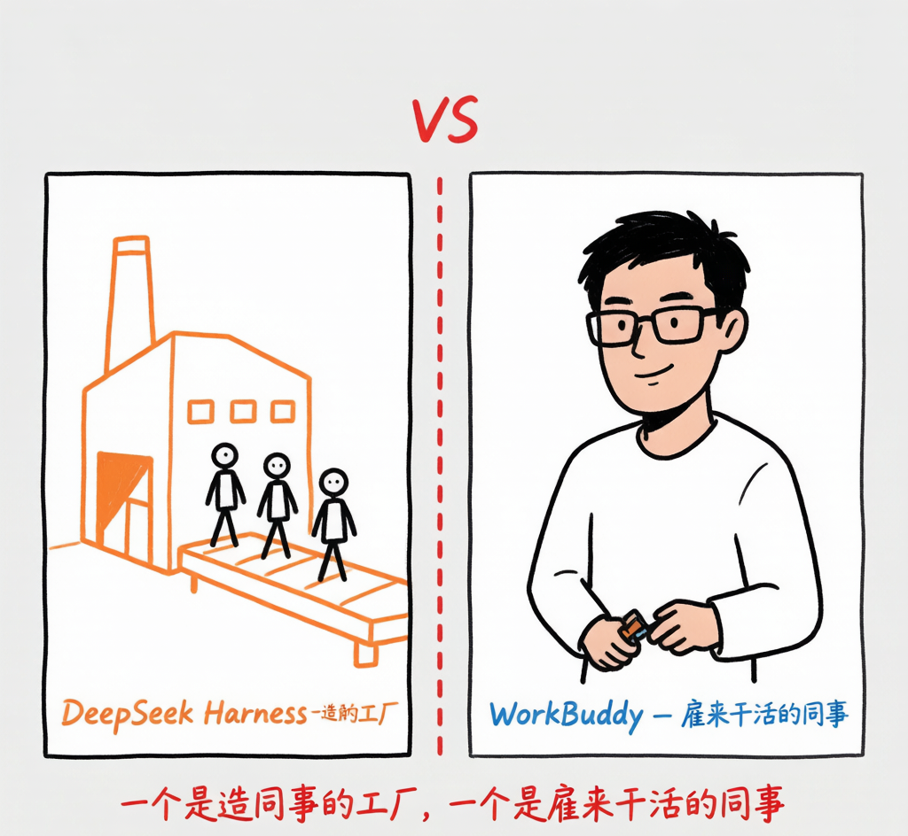

---

## 1. 它跟 WorkBuddy 到底区别在哪？

最根本的区别在定位层：

- WorkBuddy：开箱即用。
- 内置技能、专家、77+ 连接器、多模态生成，雇来就能干活。
- DeepSeek Harness：裸运行时。
- 模型、工具、UI、循环全是可替换插件，得你自己组装。

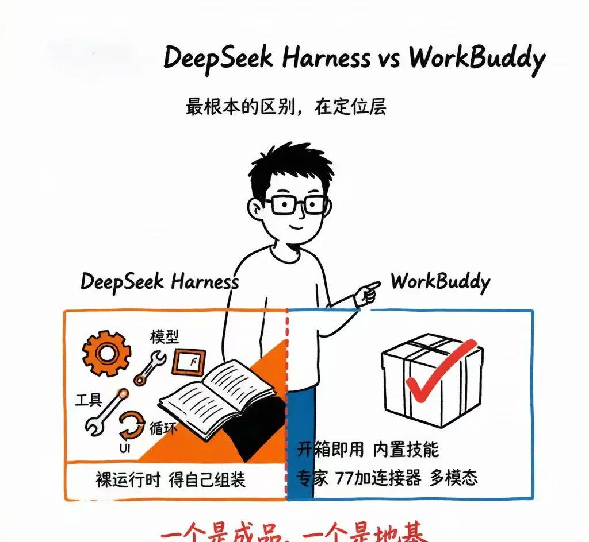

喊的口号：一切皆插件（Everything is a Plugin）VS 全场景 AI 工作台


> 🏆
> 它们的关系：产品 vs 基础设施

不是谁替代谁，而是可以组合着用。

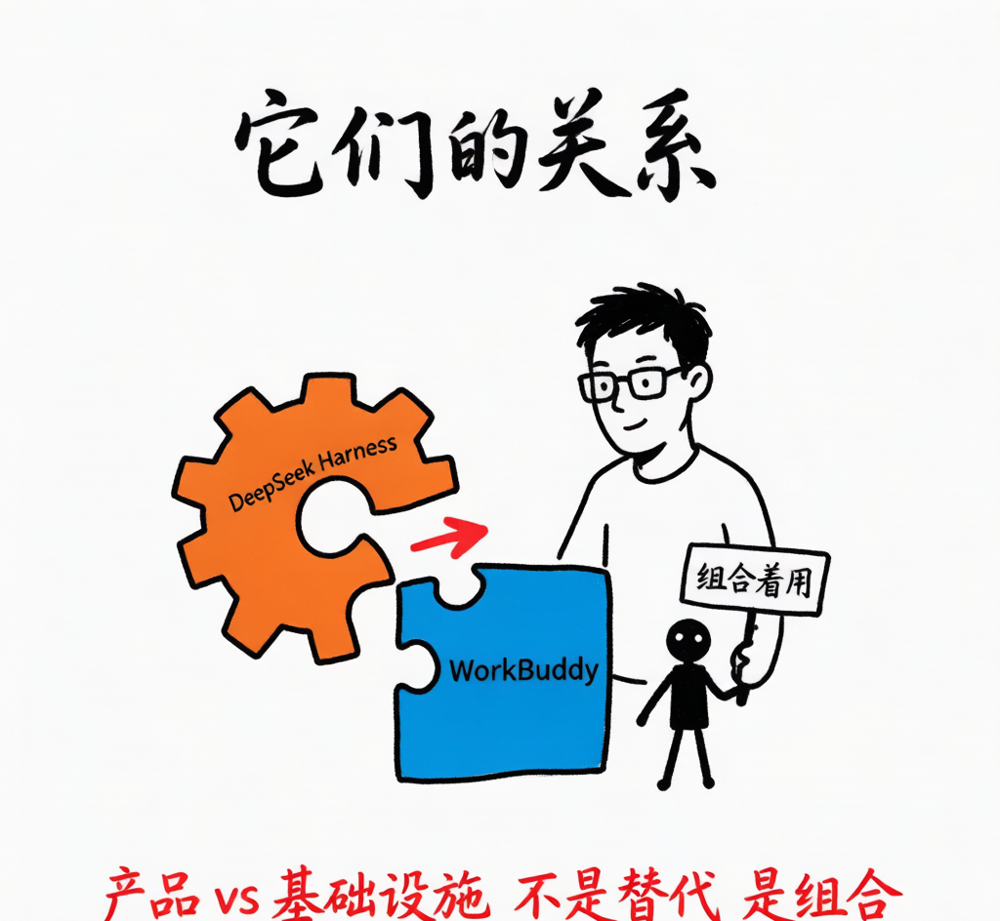

费用：有点特别，哈哈哈！！

DeepSeek Harness 开源免费，靠 DeepSeek API 模型收费。

WorkBuddy 本来是积分制/订阅，但由于现在暂时用混元3模型免费福利期，而且官方还送大量积分，普通场景间接等于不花钱。

不过 WorkBuddy 不可能一直免费。

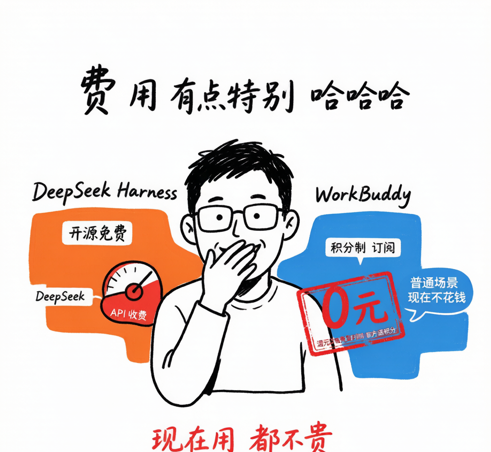

目标用户：清楚自己属于哪类人就会清晰很多

DeepSeek Harness ：

开发者、极客、Vibe Coder、技术团队、Agent 构建者、想把 Agent 嵌进自己产品的人。

WorkBuddy：

知识工作者、创作者、普通用户、职场人、企业、组织级协同。

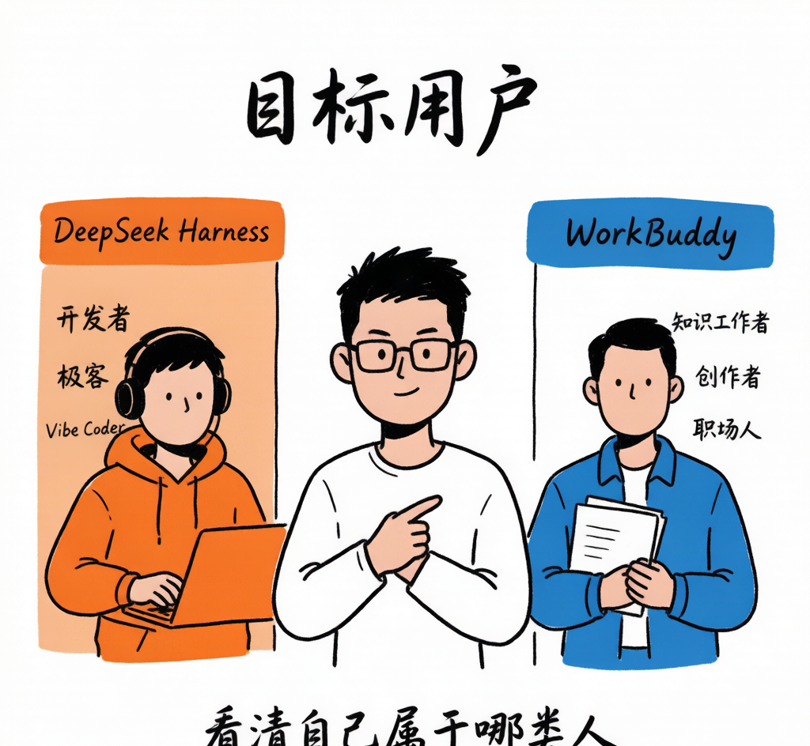

护城河：各有千秋

DeepSeek Harness ：

开放架构 + 与自家模型的联合优化 + 插件网络效应。

WorkBuddy：腾讯生态（企微/腾讯文档/会议/乐享知识库/组织通讯录）

连接器是它的魂。

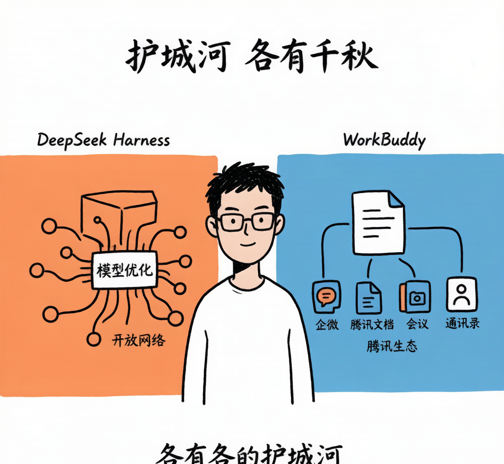

灵魂发问：DSH 壁咚 WorkBuddy 向它发问：

你到底是一个模型调用工具，还是一个真正的工作操作系统？


---

## 2. 「一切皆插件」到底怎么理解？

一个词：乐高底板。

我不讲DSH 的核心设计去分四层解读：字面层、架构层、使用层、动态层。

因为用户压根不关心，所以往简单讲。


基于一个叫 Cordis 的元框架。

Cordis 只负责插件的「加载/卸载/依赖管理」，而 Agent 的所有具体组件都是不同的 Cordis 插件：

> 【同步来源：内容为嵌入的同步文档卡片，请查看原文】

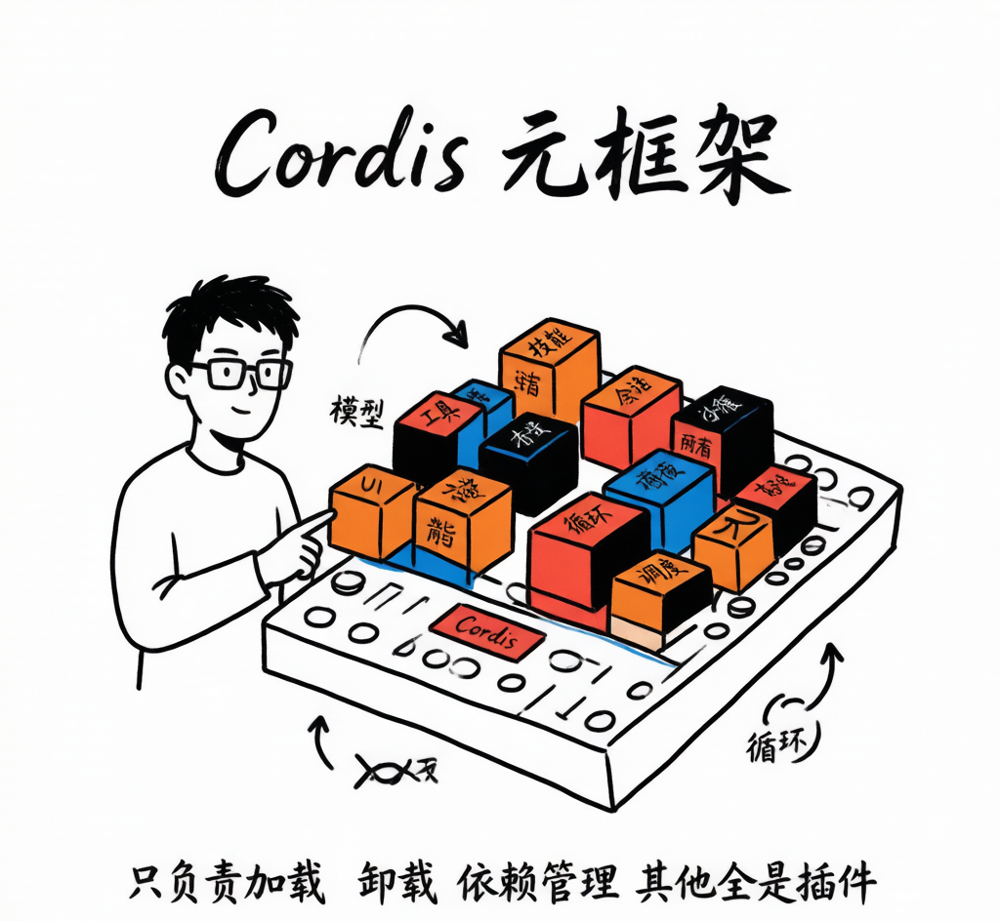

关键只有三件事：

① 没有「特权内核」

框架内部没有一个需要打补丁的核心。所有能力（连 Agent 循环本身都是插件）都能在「配置层」被替换或重组，你永远不用改 dsh 源码。


② 插件通过「服务 + 事件」协作

每个插件向共享 Context 贡献：服务（Service）、类型化事件（Typed Event）、可逆副作用（Reversible Effect）。

插件卸载时，它的所有注册会被自动回滚，不留孤儿状态。

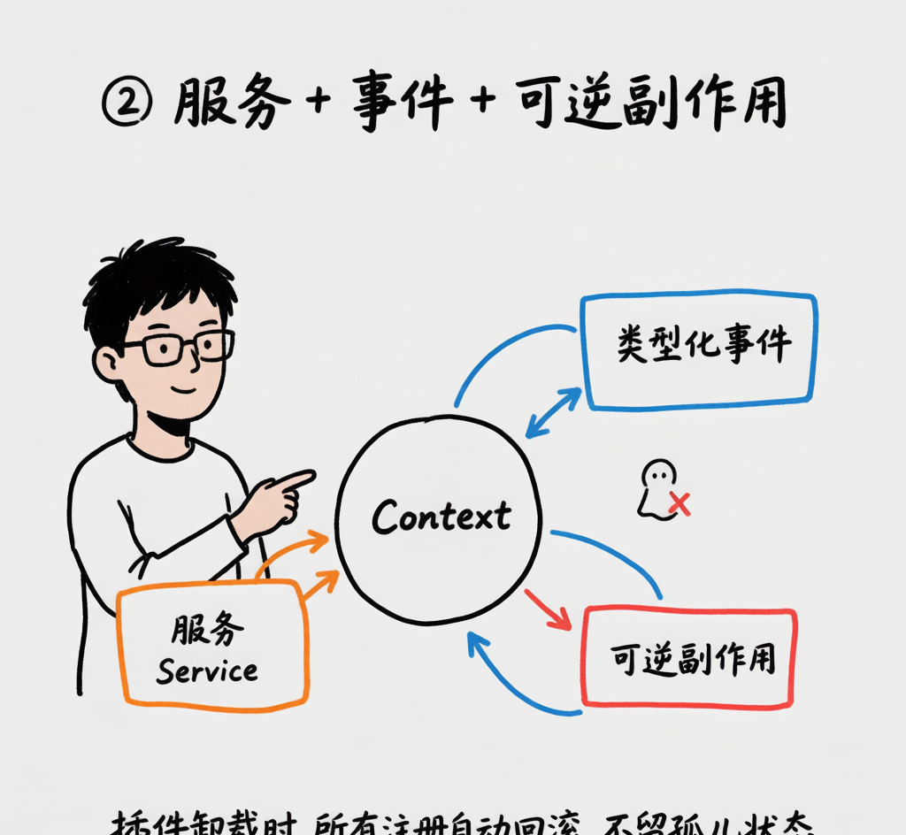

③ Cordis 的「时空可组合性」（这是它最硬核的部分）

时间可组合性：卸载一个组件时，副作用能完整回滚（每个 context 变换都带一个「逆」，由运行时追踪）。

空间可组合性：依赖可声明，context 一变就反向通知组件。官方甚至给出一套演算，证明该性质能从单个组件传导到整个系统。

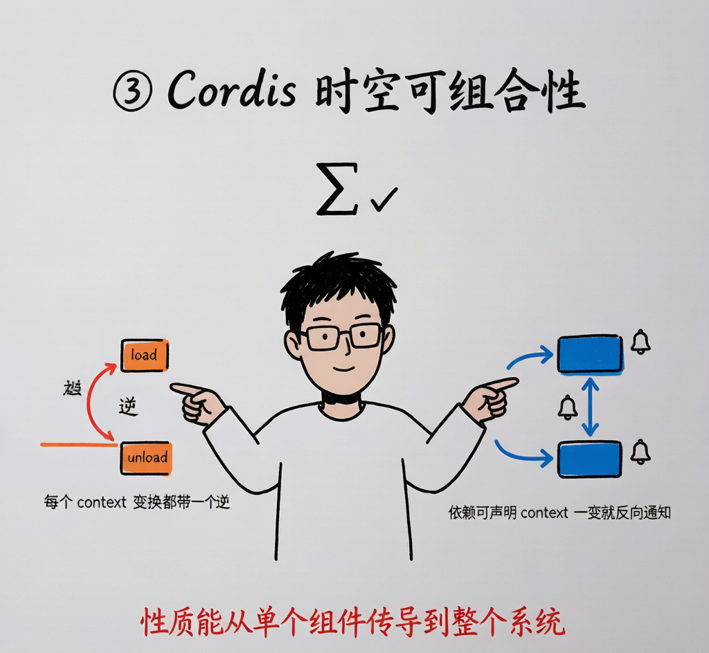

> 🎁
> 这里加一个人话解释版：
> 你装过一个"装好就定型"的软件吧？它把每一块，都做成能随时换掉的零件。
> 这套东西的底层，是一个只管插件的微内核，职责就一件事：谁该加载、谁该卸载、彼此怎么协作。
> 往上分三层组装：第一层是必装的基础包，第二层是一组组打包好的组合包，第三层是补丁，按名字定位到具体插件去覆盖。
> 最上面是四种运行模式，换模式就是换一套插件组合，一行代码都不用改。
> 最绝的是，模型、工具、文件、沙箱，连驱动整个Agent运转的主循环本身，全都是插件。
> 运行时想换哪块换哪块。
> 你写代码最怕什么？怕改一个地方，全塌。
> 它用三条机制兜底：
> 第一，每个插件从排队、启动、运行到卸载，全程有记录，状态一目了然；
> 第二，谁先启动不由写的先后顺序定，由依赖关系定——你声明需要某个能力，那个能力没就位，你就安静排队，不崩；
> 第三，插件卸了，它开过的定时器、挂过的监听器、注册的子插件，全部自动清干净。
> 它跟别的Agent框架最大的不同，不是"支持插件"，是"整个产品就是插件的组合"。
> 想扩展，不是在源码上打补丁，是在旁边挂一个，拆了还能原样回滚。
> 好的系统不追求"我多完整"，它追求"哪块都能换"。

综上所述：

所有能力靠「服务 + 类型化事件 + 可逆副作用」来协作。

最关键是 Cordis 的时空可组合性：卸载一个插件可以完整回滚，插件之间的依赖可以声明反向通知。

结果就是你永远不必改 dsh 的源码，只在配置层换插件、拼插件就行。

所以「一切皆插件」不是营销话术，而是一种工程承诺：任何能力都不是写死的，你都能用配置把它换掉或拼出新组合。

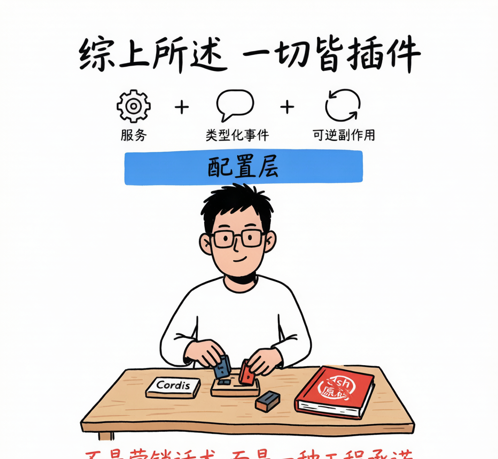

---

## 3. 怎么用别人的插件？怎么自己做？

用别人的插件：

- 跑 npx @deepseek-ai/dsh web 起一个 Web UI
- 装好 npm 包后，在 cordis.patch.yml 或 --patch 里挂载
- 用 --dump-config 看实际加载了哪些东西

```
# 1. 启动 DSH Web（默认 http://127.0.0.1:3080）
npx @deepseek-ai/dsh web

# 2. 安装插件（dsh plugin 会把命令转发给 pnpm，三种来源都支持）

dsh plugin --profile web add <npm包>              # 已发布的 npm 包
dsh plugin --profile web add"github:作者/仓库名"   # 直接从 GitHub 装
dsh plugin --profile web add./本地插件目录         # 本地路径

# 3. 重启 dsh 服务，刷新页面，设置页里管理插件
```

装好后，声明了 dsh.bundle 的插件会自动进入 profile 的层栈并生效。

纯 Cordis 插件通过 profile 的 cordis.patch.yml insert 行挂载（配置 HMR 实时生效，不用重启）。

比如：

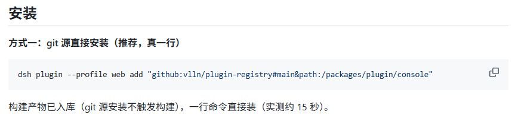

写到这程度，你不会，我就 i~（咬着牙）

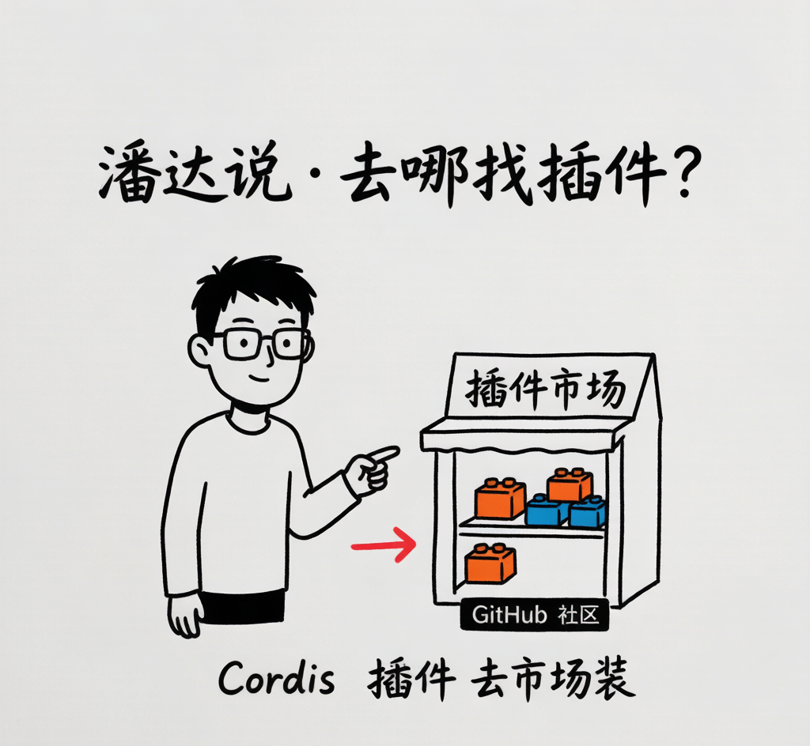

去哪找插件？

https://github.com/0xsline/awesome-deepseek-harness

自己做插件：

- 先学 Cordis 插件系统（这是地基）；
- 在 Creation 模式里实验；
- 在 package.json 里用 dsh 字段声明你的 bundle；
- 打包挂到 profile，打上 dsh-plugin 标签发布出去。

官方插件开发教程 + 发布教程：

https://github.com/deepseek-ai/deepseek-harness/blob/master/docs/user/develop/basic/index.zh.md

https://github.com/deepseek-ai/deepseek-harness/blob/master/docs/user/develop/basic/publish.zh.md

说个der呀，往简单的整）

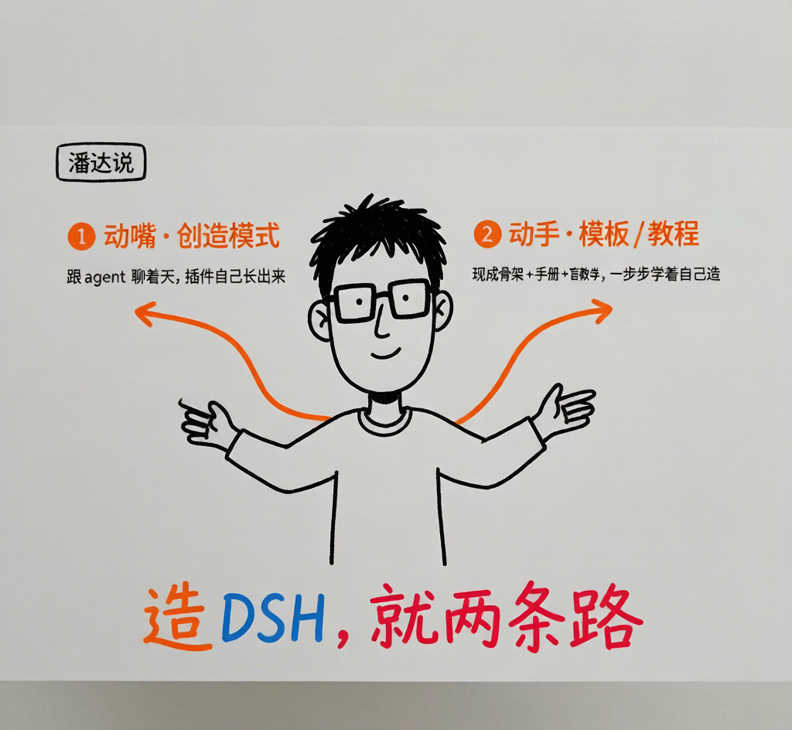

1）直接用创造模式让 agent 对话式生成动态插件；

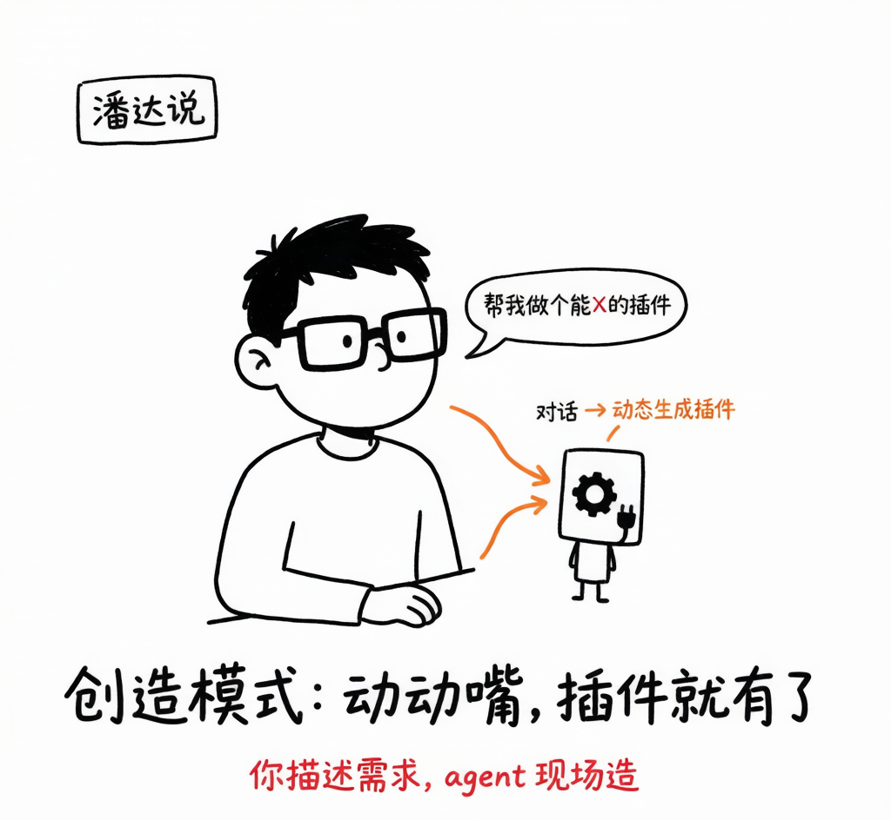

2）现成脚手架/教程
npm 上已有 create-dsh-plugin（秒建插件骨架）

https://www.npmjs.com/package/create-dsh-plugin

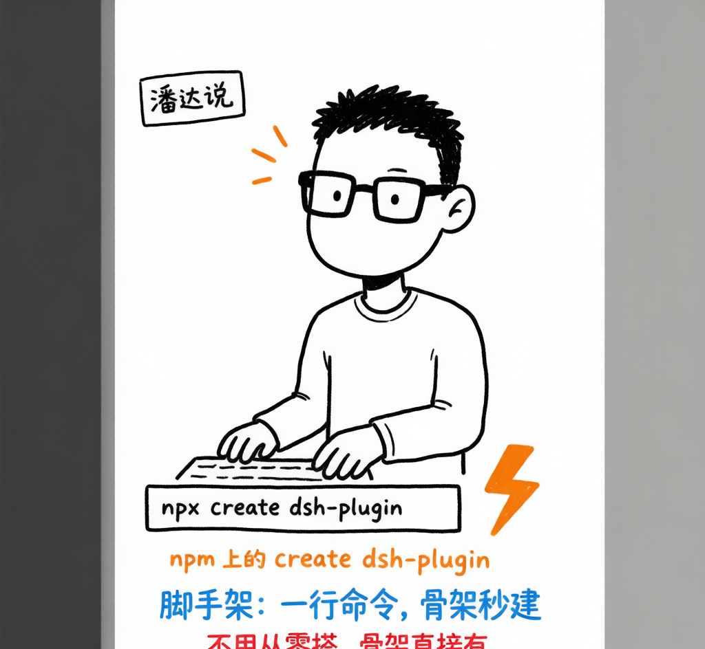

当然还有大家喜欢的skill

https://github.com/vlln/plugin-registry 提供 make-dsh-plugin skill 引导

https://github.com/Electricitysheep/dsh-handbook 是0到1深度手册（安装/插件开发/性能调优）


官方仓库还内置了教agent 写插件的 Skill（cordis-plugin-development、editing-cordis-compositions）


有人看到这里，脑子出现问号？？）

这样都迷糊了，你不去问AI，你瞅我干啥？


---

## 4. 什么时候用 WorkBuddy，什么时候用 DSH？

> 📍
> 一句话讲清楚：
> 要「立刻把事做完」 → 用 WorkBuddy
> 要「造自己的 Agent / 嵌进产品 / 要可观测可审计」 → 用 DSH

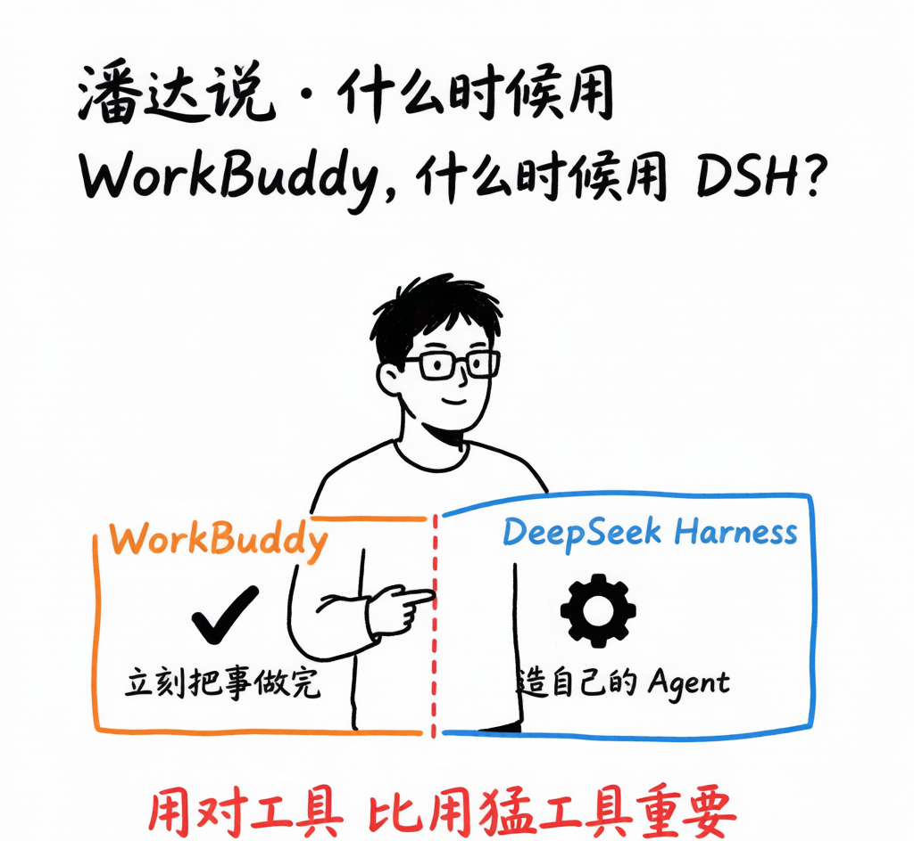

用 WorkBuddy 当…

你想立刻把事做完：写稿、研究、数据分析、做图/视频、自动化任务；

你要的是开箱即用的能力（技能、专家、飞书/GitHub/腾讯文档等连接器）；

你不想碰基础设施、不想配环境；

你是终端用户 / 知识工作者 / 商业创作者。


用 DeepSeek Harness 当…

你想造一个自己的 Agent，或把 Agent 嵌进你的产品；

你需要完全可控的运行时：换模型、换工具、换 UI、改循环逻辑；

你需要可观测/可审计/可回放（长任务、失败恢复、合规）；

你是开发者 / 工程师 / AI创业者。

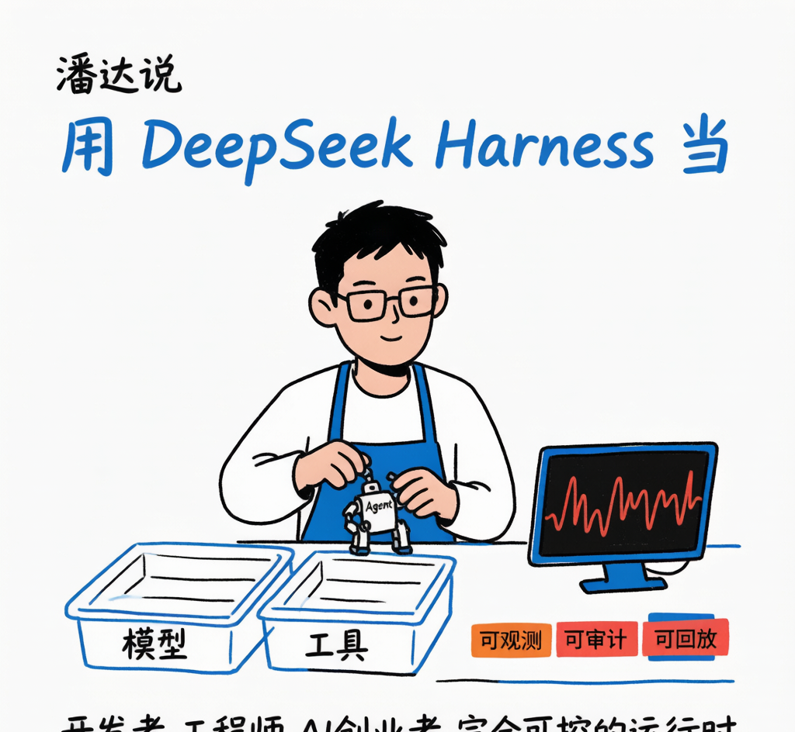

---

## 5. 想 DSH 用更好，学点啥？（我劝你别没事找事）

> 🥇
> 正常来说，应该学以下：
> Cordis 插件系统：地基中的地基
> TypeScript：DSH 生态的主语言
> dsh 架构分层：session / system-prompt / tools / agent / agent-loop / llm
> Seam 思想：能力与副作用的边界
> 四种运行模式：尤其 PTC 和 Creation
> append-only 日志与 Trajectory 轨迹回放：这是真杀器
> 插件工程化：读社区、做贡献、发自己的

能看这文章的有正常人吗？）

你们会说：我问的是计划，你给我讲道理？）

那请干下面这些：

从会用 → 会造 → 会教，初步掌握就行了


第 0 层 · 概念（1-2 天）

搞懂 Model+Harness=Agent；Agent Loop（步骤/轮次/工具调用流水线）；

https://github.com/deepseek-ai/deepseek-harness/blob/master/docs/architecture.zh.md

第 2 层 · 使用（1-2 周）

1）学习/命令（压缩、目标、计划）、Skills 的编写与挂载、子代理、工作流（workflow）、MCP 客户端配置；

2）成本优化：理解 KV cache 与缓存命中率、prompt 精简、上下文压缩策略；

3）把 Claude Code/Codex 的 Skills 迁移过来。

4）熟悉插件 dsh-skillport

https://github.com/Jesse-njx/dsh-skillport

第 3 层 · 插件（2-4 周）（这是拉开差距的关键）

1）官方插件开发教程 + 发布教程；

https://github.com/deepseek-ai/deepseek-harness/blob/master/docs/user/develop/basic/index.zh.md

https://github.com/deepseek-ai/deepseek-harness/blob/master/docs/user/develop/basic/publish.zh.md

2）用创造模式对话式造插件；学 make-dsh-plugin skill；

https://github.com/vlln/plugin-registry

3）每天刷 dsh-plugin topic 和 awesome 列表，拆解高分插件源码。

https://github.com/topics/dsh-plugin

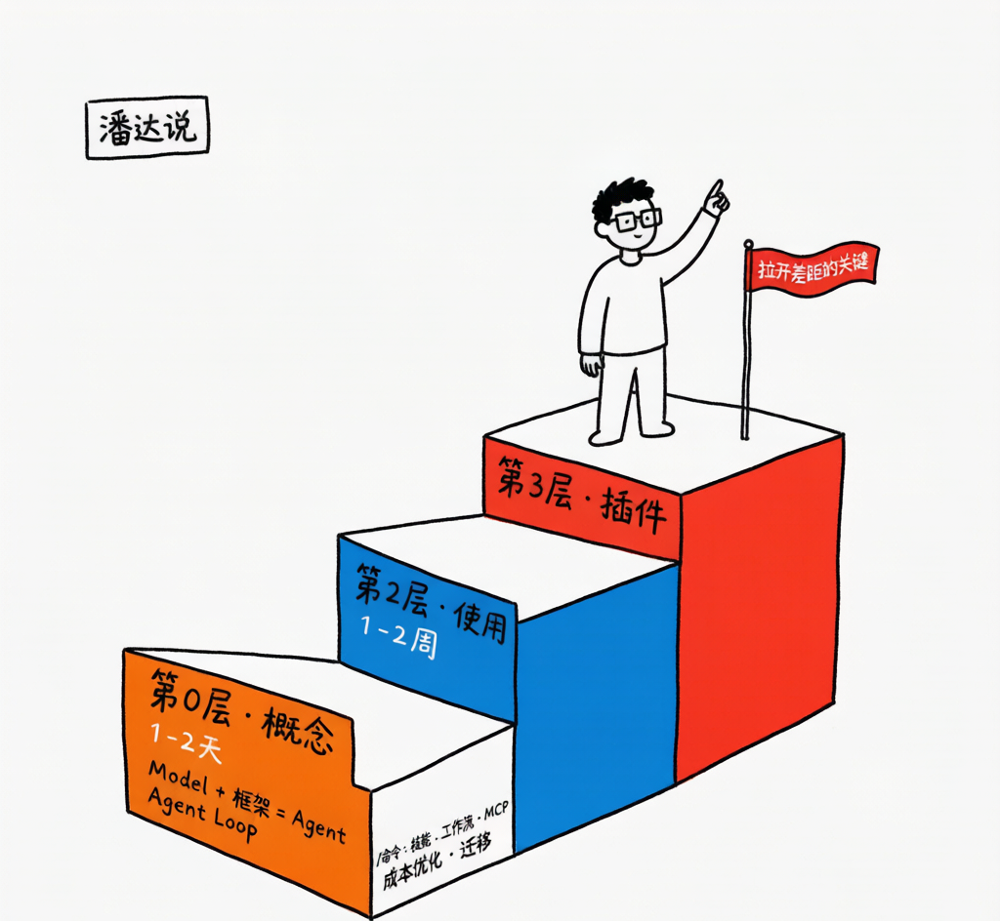

第 4 层 · 框架（1-2 月）（别学了，认清自己）

学透 Cordis：插件生命周期、ctx 服务、inject 依赖、事件四模式（emit/waterfall/parallel/serial）、ctx.effect 可逆副作用

官方 cordis-primer）
https://github.com/deepseek-ai/deepseek-harness/blob/master/docs/cordis-primer.md

TypeScript + Node + pnpm；
阅读 node_modules/@deepseek-ai/ 下150+ 包的 README 和 patch 文件。

第 5 层 · 工程与生态（痴心妄想）

订阅 DeepSeek Harness Discord 和 GitHub Discussions；

https://discord.gg/Ycq5dCaS4

关注 dsh-handbook、learn-workbuddy（通用 harness 架构参考）；

https://github.com/Electricitysheep/dsh-handbook

https://github.com/adongwanai/learn-workbuddy

反向学习 AdamPlatin123 兼容性雷达的检查方法论（DSH 几乎每天发版，插件漂移是常态，能诊断兼容性问题本身就是稀缺技能）。

https://github.com/AdamPlatin123/awesome-dsh-plugins

---

## 6. 大部分博主都写了，你还可以写什么？

已经有的：首发实测、安装教程

接下来必然出现的：插件 Top10 推荐、与 Claude Code/CodeX详细横评、薅羊毛/省钱攻略（8/17 涨价 + 免费额度路由）


你要差异化，就该做这几件他们不做的事：

1)真上手：从 0 写一个插件show 代码、打包、挂载、跑通,这是硬通货。

2)讲透 Cordis 的「时空可组合性 + 无特权内核」别人讲不清，你讲清，只是吸引同行。

3)可观测性专题append-only 日志 + Trajectory 回放/分叉，这是 DSH 相对竞品的真杀器，几乎没人深挖。

4)「DSH vs Claude Code vs Codex vs WorkBuddy，什么时候用谁」给具体场景，不做情绪判断。

5)「缺口就是机会」自己造一个缺失插件并开源，既是内容又是作品。

---

## 7. WorkBuddy 和 DSH 怎么组合？

别二选一，组合着用才猛：

- DSH 当生产车间：跑长任务、造定制 Agent；
- WorkBuddy 当交付前台：写插件代码、出图、接飞书 / 腾讯文档做分发。
- 还能用 WorkBuddy 自动化盯 dsh-plugin 的新插件，第一时间追上社区。

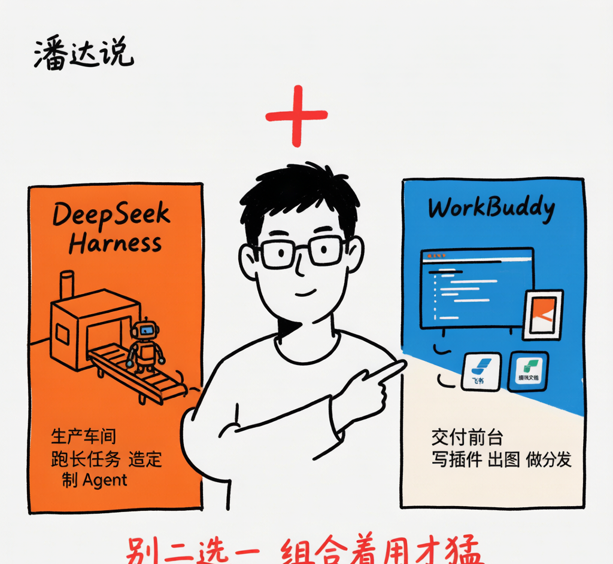

🛠 造插件：用 WorkBuddy 写/调试 TypeScript 插件代码（它本身就是强编码 Agent），再到 DSH 里 npx dsh web 实测调通。

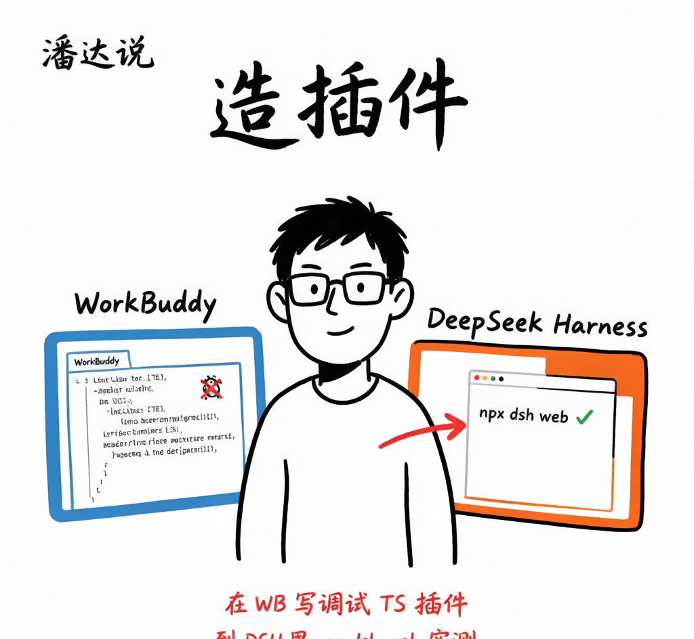

🎨 做素材：用 WorkBuddy 的多模态生成（图像/视频）给你的 DSH 插件做 UI 皮肤、演示物料。

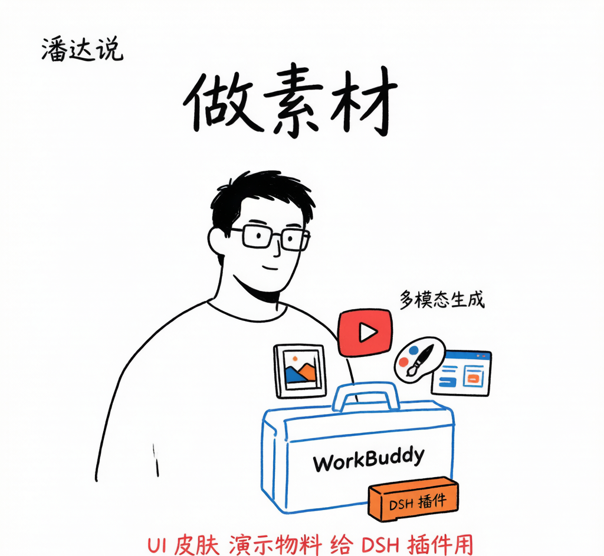

📚 喂资料：用 WorkBuddy 的研究/检索能力整理领域资料，沉淀成 DSH 插件的 Skill / 知识库。


🔁 流水线：DSH Agent 跑长任务（自主编程/多 Agent 协作）→ 输出到工作区 → WorkBuddy 接手润色、评审、发布，经飞书/腾讯文档分发。

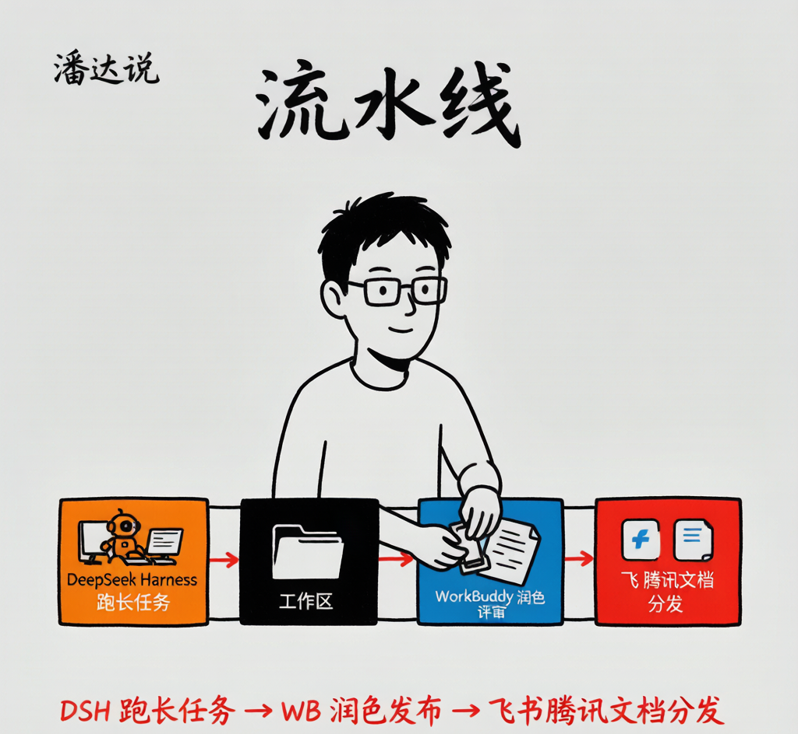

👁 监控生态：用 WorkBuddy 自动化定时盯 dsh-plugin 话题 / GitHub，有新插件自动汇总推给你。

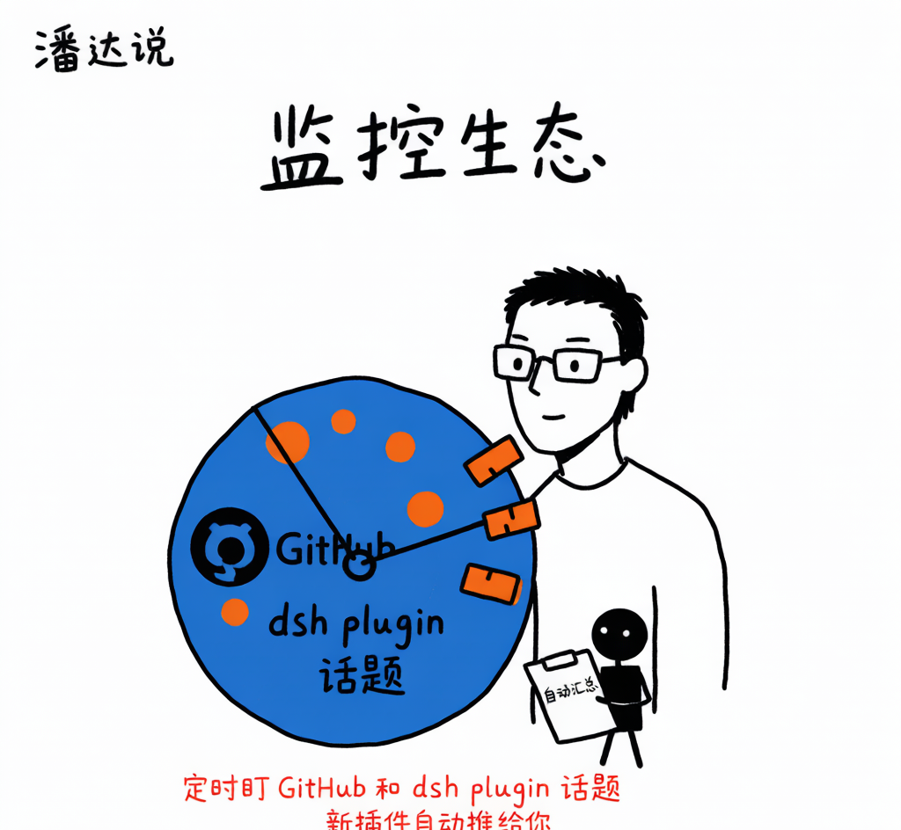

🧠 当顾问：架构 DSH 插件时，让 WorkBuddy 的专家系统做架构评审与方案顾问。

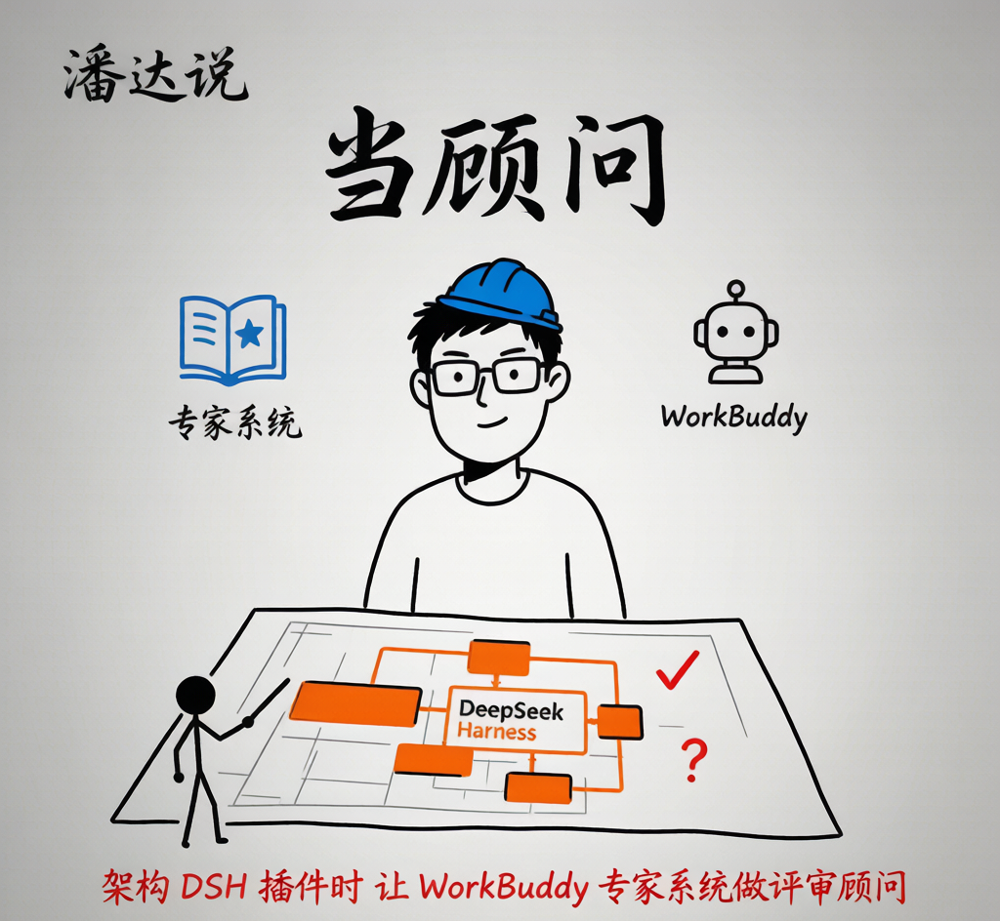

## 8. 插件社区现在长啥样？缺什么？

GitHub 的 dsh-plugin 话题已经收录了 社区插件，我按功能分了10 类。

> 🌰
> 🎨 UI/皮肤/桌面增强（最大热点）：官方 UI 极简，社区疯狂补位
> 💻 TUI 终端（官方空白补位）：官方只有 Web 无 TUI
> 👁️ 视觉能力（V4 是纯文本模型的刚需）：全生态星数最高的插件方向
> 🤖 Agent 能力/工作流 ：记忆/自动化/多Agent 是热门方向
> 🛠️ 工具/文档/数据
> 🔗 浏览器/电脑控制 ：都在早期，不成熟
> 🔔 通知/集成 ：IM 集成刚起步
> 🎮 娱乐/整活（中国特色生态）：社区氛围独特
> 📦 发行版/基建 ：打包分发是补位热点
> 📚 学习/科研 ：学习类意外地热

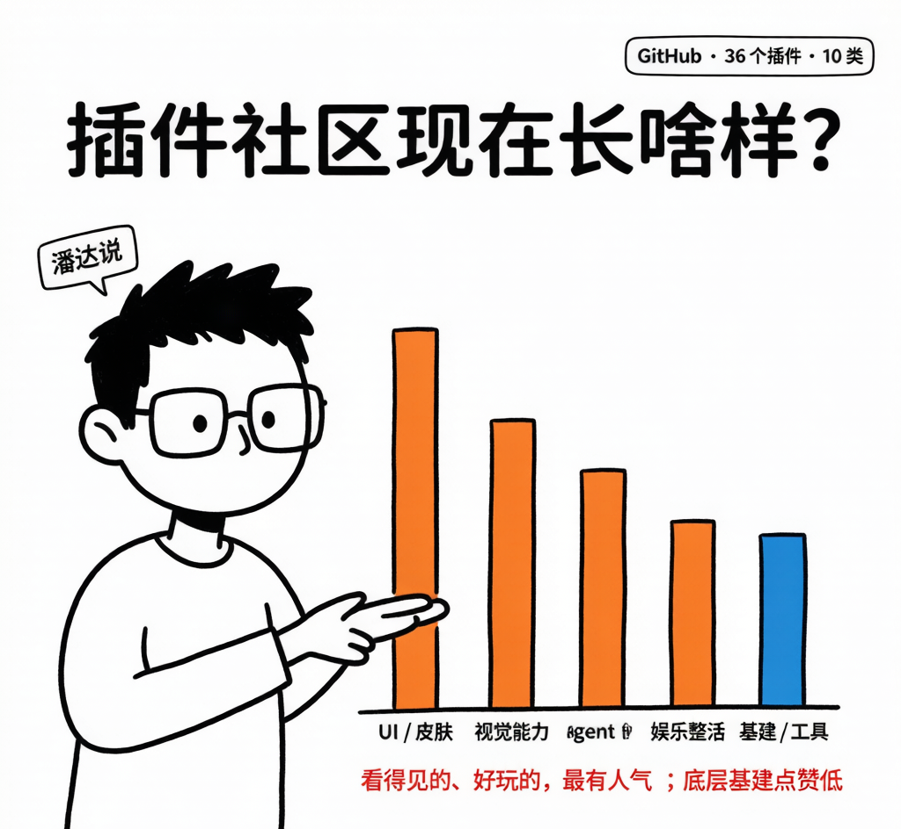

规律很清晰：社区最买账「看得见、好玩」的消费级插件。

视觉、陪伴、内容、UI 类点赞高；底层 Infra 类点赞普遍偏低。

最受欢迎的几个：

- colleague-skill「数字生命」meme，情感向，非技术主流，参考需打折
- OpenBiliClaw （内容发现）
- deeptide （macOS 编码 Agent）
- mobius（自进化 Agent OS）
- modlens （视觉）
- MuseAI（角色互动）
- agent-vision-toolkit（视觉）
- dsh-web-ui（UI 合集）

最大的缺口，也就是机会：

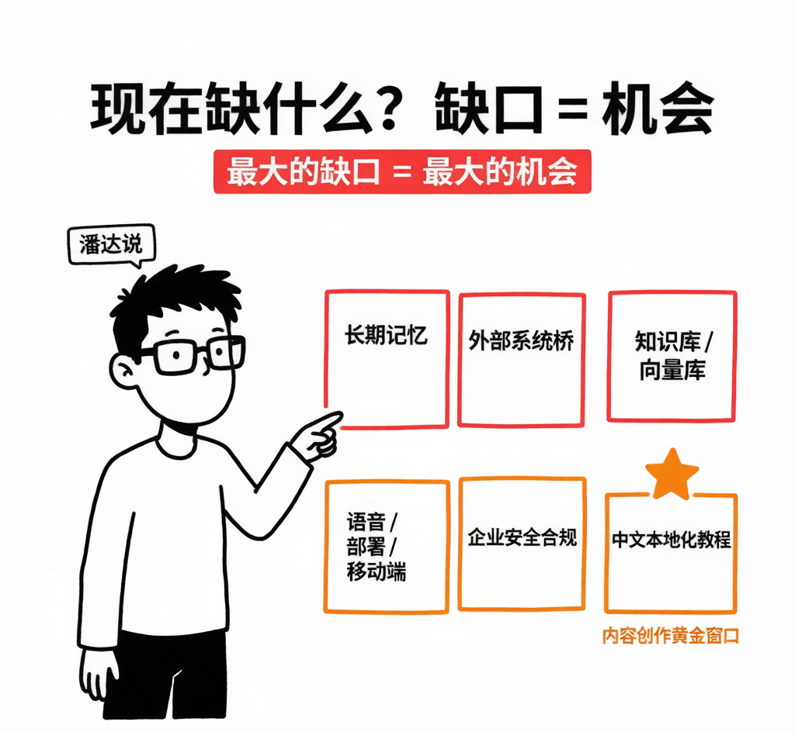

官方记忆插件 dsh-memory 已被删：长期记忆是刚需，现在缺

MCP 连接器生态薄弱：接外部系统的桥太少

RAG / 向量库稀少：知识库能力几乎是空白

语音 / 部署 / 移动端早期：都还在起步

企业安全合规空白：没人做

中文本地化教程稀缺：这是内容创作的黄金窗口

---

## 最后的话

DSH 把「造 Agent」的门槛，从写框架降到了拼插件。接下来真正值钱的，是你能不能看准这些缺口，做出被社区需要的插件。

而 WorkBuddy，负责让你把脑子里的想法快速度变成乐高积木。

最后组成你自己的银河战舰。

---

关于潘达

连续创业者，始终坚信阅读、写作、科技和商业实践的意义。

潘达的slogan：以AI为杠杆、人性为底层，追逐商业的力量。

## 关联
- [逻辑] [[01-实事求是/50-AI技术与应用/AI技能/官方任务包01｜封装第一个“非常好用”的 Skill（技能 for Agent）/官方任务包01｜封装第一个“非常好用”的 Skill（技能 for Agent）|官方任务包01：封装 Skill]] —— Harness「一切皆插件」正是 Skill 的运行时载体，封装方法在前、承载底座在后，构成同一推理链。
- [案例] [[03-知行合一/50-AI技术与应用/AI工具/主题：榨干 codex|主题：榨干 codex]] —— 同为 AI 工具使用心得，那篇是使用层技巧，这篇补上 harness 层的选型判断。
- [逻辑] [[02-解放思想/50-AI技术与应用/01-AI思考/研究：AI协作五层迁徙计划/研究：AI协作五层迁徙计划|研究：AI协作五层迁徙计划]] —— Harness 属第二层（Agent 层：做好项目）的底座工具，本文回答「该不该上」，五层框架回答「该在哪一层用它」。
- [反例] [[02-解放思想/50-AI技术与应用/AI落地Live88·YAI新人上手技巧分享/02-基础协作|AI落地Live88：基础协作]] —— 面向纯新手的路径是先用轻工具完成协作，说明「普通用户上来就搭 DSH」在什么条件下不成立。
