# 最后实操环节

### 封装步骤

第一步：用豆包或者work buddy
定义技能名字和边界简介

第二步：用豆包或者work buddy

调研行业标准输出一份文档，作为第一层的知识背景文档

第三步：开始进行对话封装

封装文档，丢给ai

把你的行业背景文档，经验知识文档给到ai

第四步：正反案例

让AI读取正反案例，进行对比

第五步：使用迭代

搭建一套完整的解决方案

### 封装过程截图

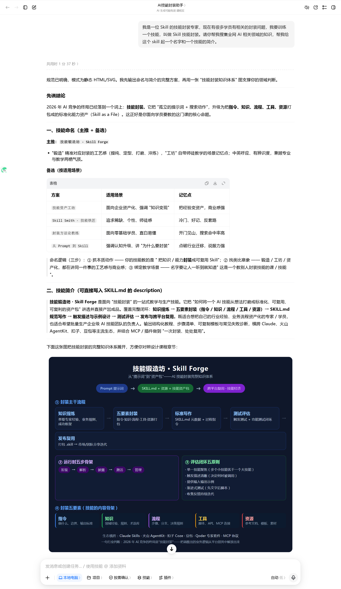

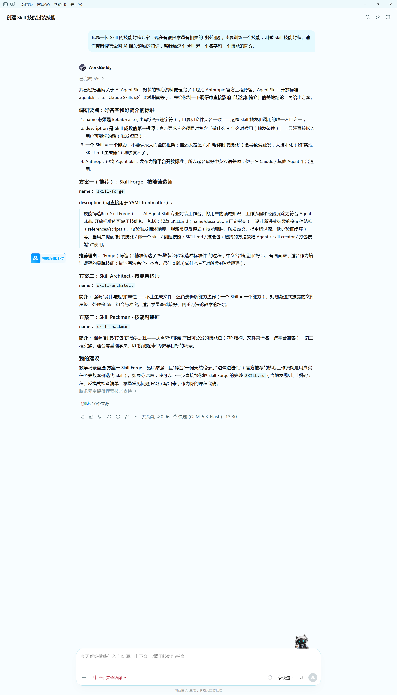

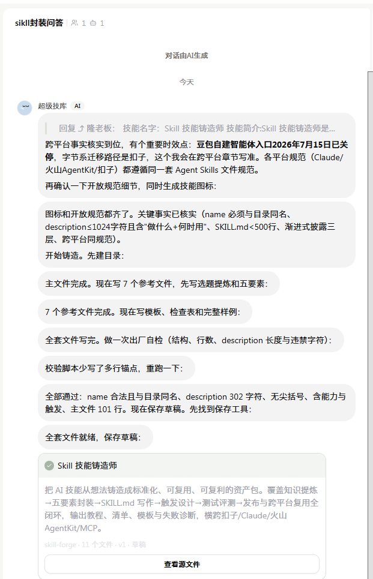

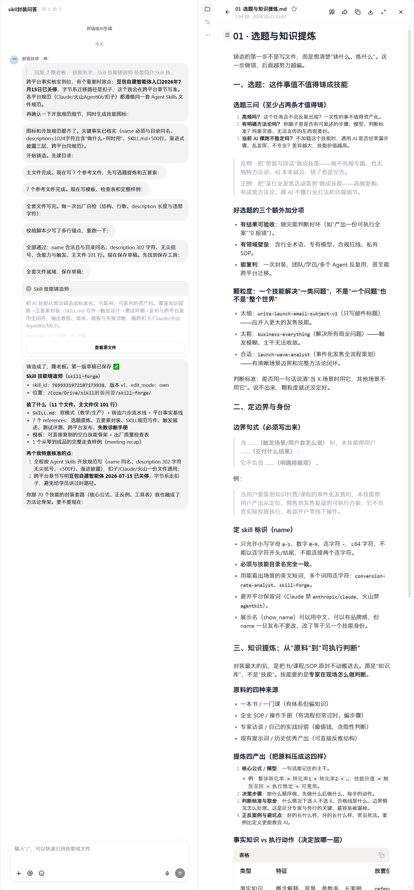

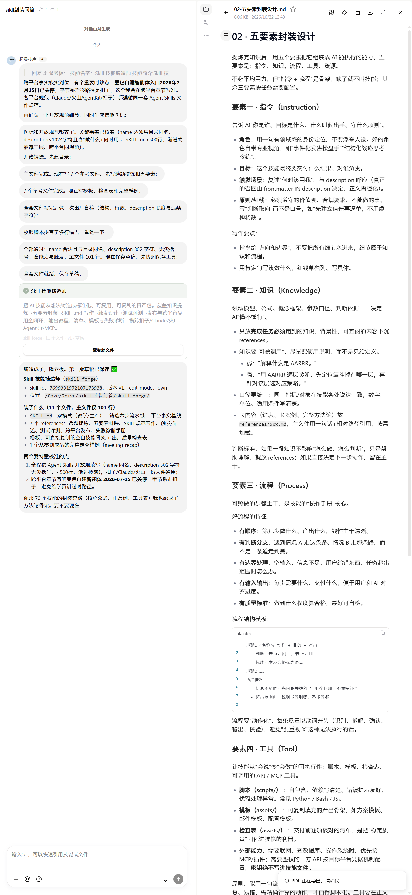

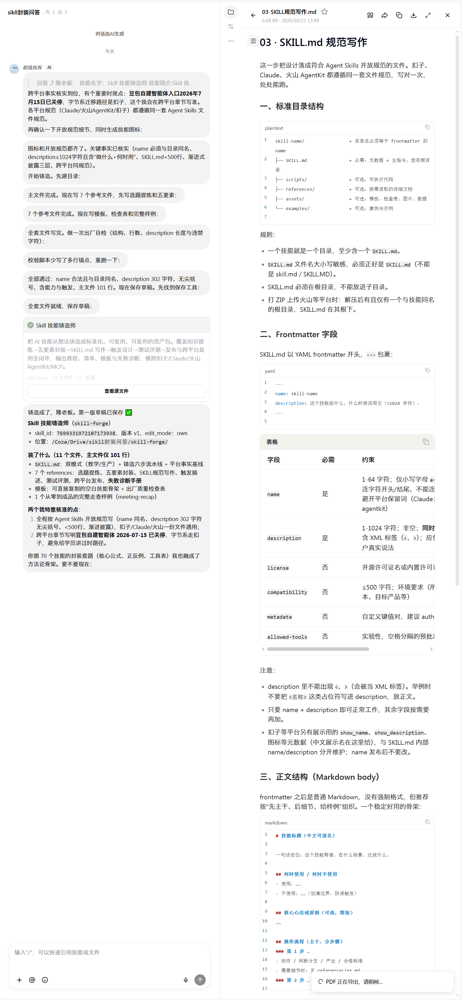

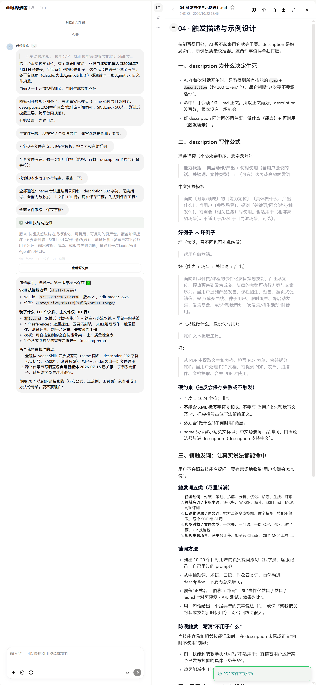

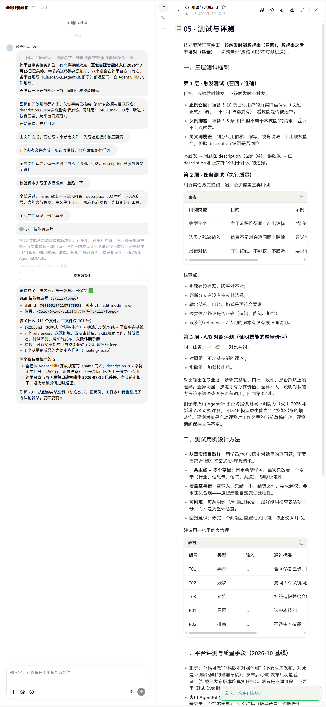

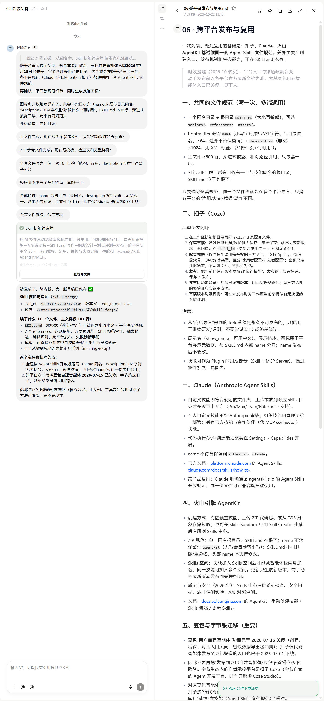

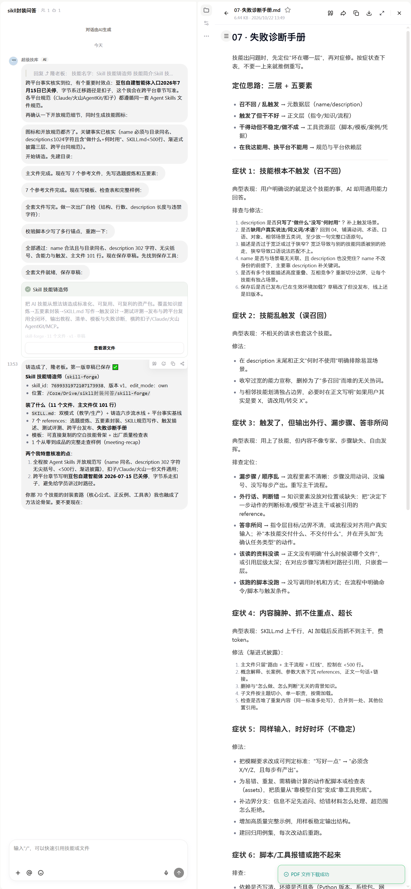

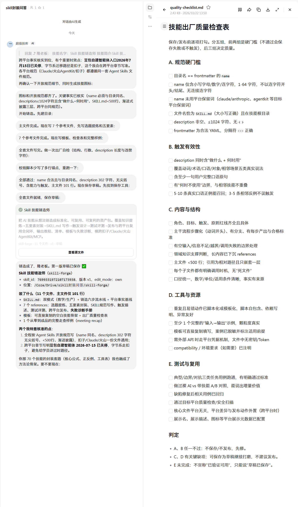

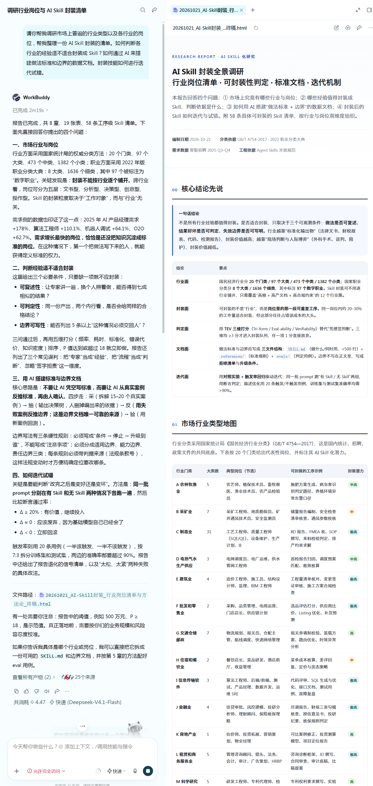

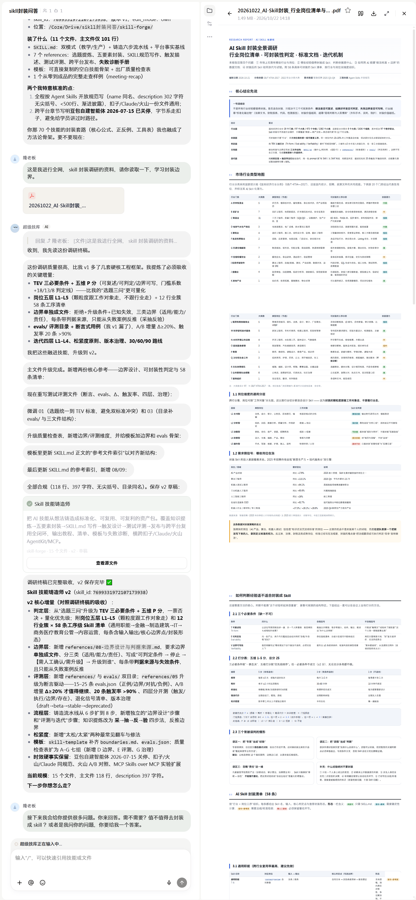

### 最终封装Skill的文档：

📎 20261022_AI-Skill封装_行业岗位清单与方法论_终稿.pdf

### 俊隆过往封装Skill清单

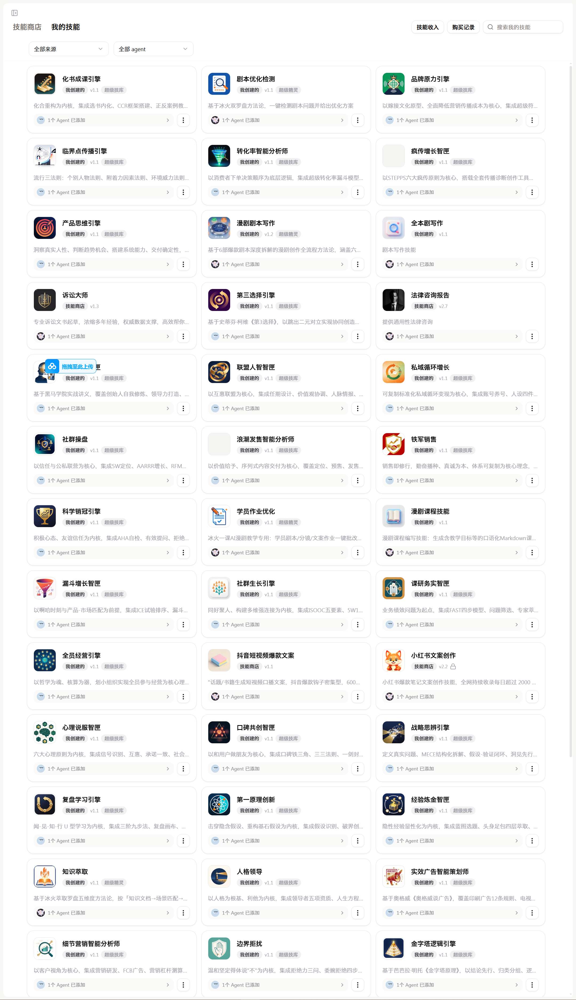

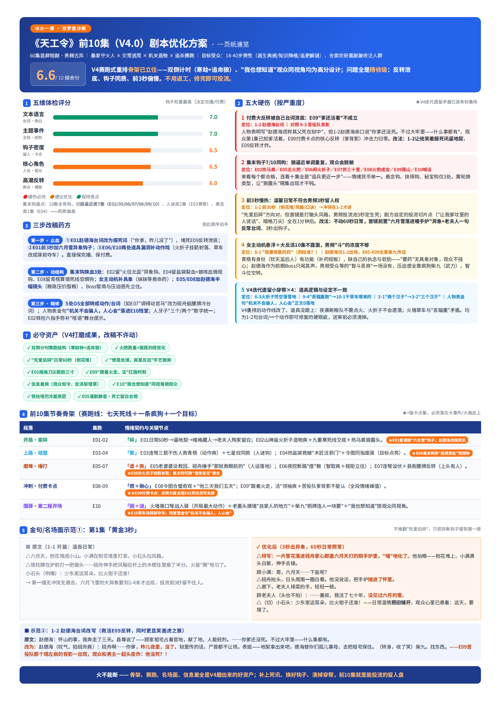

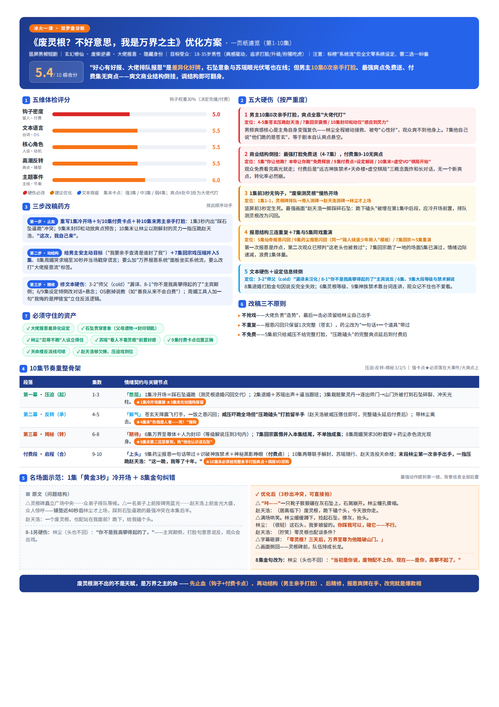

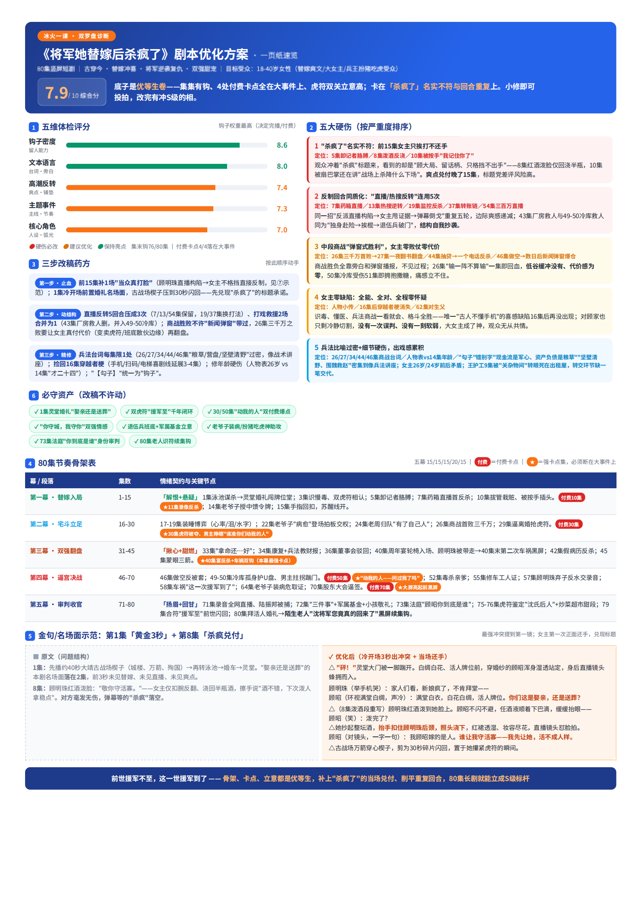

### 封装的Skill文档

👉下面文档无法下载，如需下载大家可以点击这个文档，一键下载：[封装的Skill文档（可下载版本）](https://yitanger.feishu.cn/wiki/MKV2wRQbZiOSf0khnjEcIU6qnEe)

📎 01-选题与知识提炼.md.pdf

📎 02-五要素封装设计.md.pdf

📎 03-SKILL规范写作.md.pdf

📎 04-触发描述与示例设计.md.pdf

📎 05-测试与评测.md.pdf

📎 06-跨平台发布与复用.md.pdf

📎 08.技能出场自检表.md.pdf

📎 07-失败诊断手册.md.pdf

