## R落地场景：降本增效

### 快速认识

看上去个人和团队差不多是吧？但实际情况是，一旦启动公司内部AI落地，就会发现瞬间难度和阻力倍增：往往需要多人协作、需要大家共识、准确度要求很高，而且需要克服过去的很多旧的习惯和惯性，才有机会落地。

来来来，资深同学来示范，新同学来收一波认知，抄一波作业：

**【互动🙋🏻‍♀️】**来，到现在为止，你们公司和团队探索出了哪些AI具体的场景？那个场景已经落地，而且发挥出了非常显著的价值？

> 判断标准：大幅提升效率/收入/利润，很难回退，并且激励团队使用AI；

————

**【灵感闪现💡】**你自己的业务和团队，哪些关键的节点可能被AI大幅降本增效，你们有哪些具体的场景假设？

————

如果公司AI落地，这个阶段的AI更像是什么呢？有没有比实习生和合伙人更合适的角色呢？

我们还是先看几个具体的例子吧：

### 看案例提见识

我们这次还特别访谈了一位在互联网外卖大厂的AI产品经理，他们内部也已经推行落地了非常多的AI场景。

比如点外卖时写的**备注内容**，有的可能会非常长，可能会同时包含**很多不同的需求，**有对店家的，还有对外卖小哥的。一大段的内容揉在一起，店家和外卖小哥其实很容易忽略其中一些内容，从而造成**用户的满意度下降**。

于是他们就很聪明地用AI，先把用户**备注内容**进行提取和分类识别，之后再分别分发给商家和外卖小哥，尽量减少遗漏和理解偏差，满足用户的合理需求。

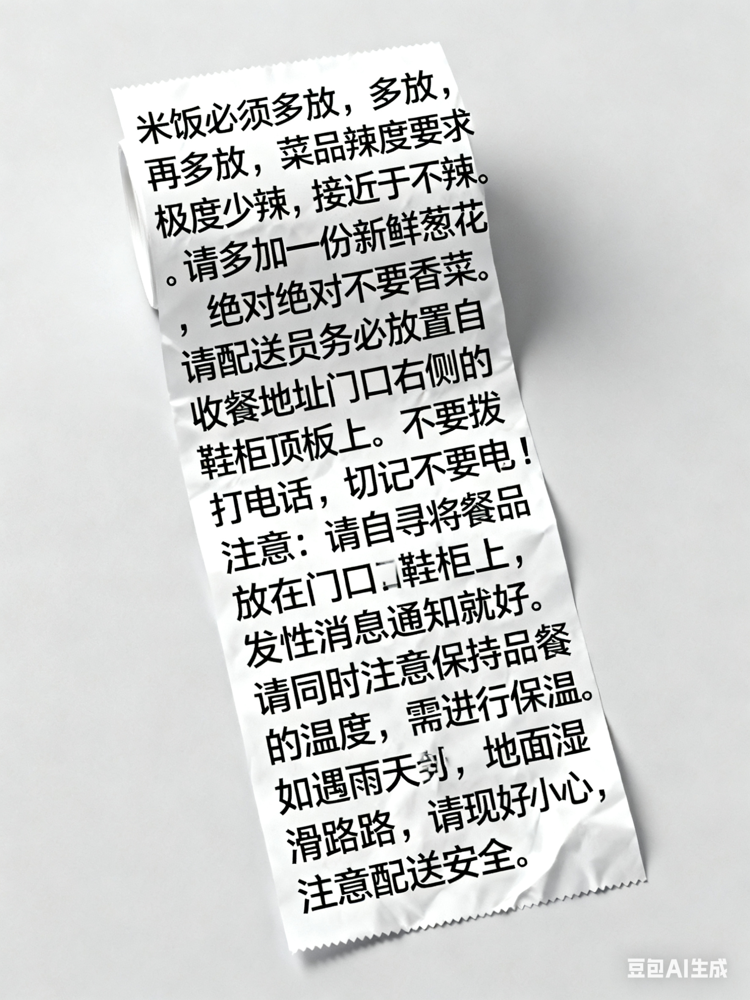

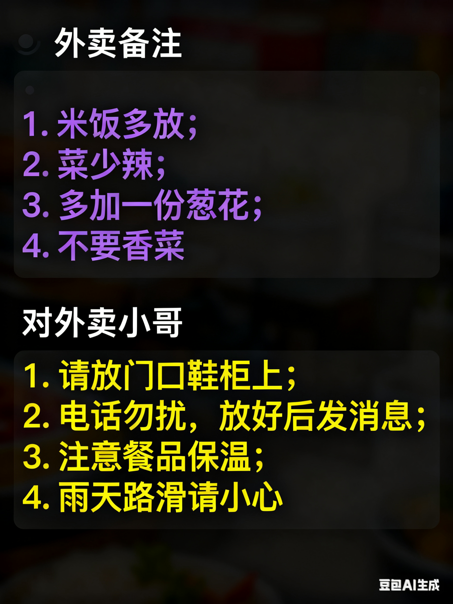

另外，他们也在用AI分析外卖小哥&商家的通话记录，还有视频监控菜品供应商的操作流程，最大程度避免违规事件，保证服务质量，从而帮助**提升用户的满意度和复购**。

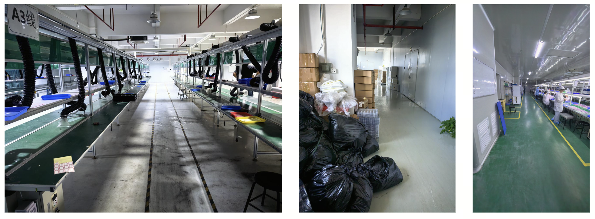

我们访谈过一位做消防设施检测的刘同学，主要服务工厂和线下门店，**按照消防标准，去现场把设备、设施、通道看清楚，回来出一份能过审的检测报告**。

以前的流程特别“重”，检测员跑到现场，拍照、记数据、对着设施（消防门、通道、灭火器等）一项项提问，然后回到公司，看着照片、翻着笔记，把信息一条一条手工录进系统，最后生成检测报告。

**麻烦的是，年轻的检测员，经验太少，容易漏掉项目，一离开现场，信息就开始衰减。**照片没拍全，笔记太简单，忘掉了一些回答，都得靠回忆补，想不起来，需要再跑一趟。

他们最开始想做，AI来实现“自动判定合格”，后来发现责任太重，AI 很难实现。

于是他们**用 AI接手了最耗时的环节**：

- 现场一边拍照、访谈、记录，AI自动来识别照片里的设备和标识；
- AI来转写访谈记录，再按报告模板的字段自动抽取、归类、填位，填到表里，AI来提醒可能的漏项。

**人走出车间的时候，报告初稿已经在那儿了**。然后检测员做核对、修正、签字；客户当场确认，该盖章的现场就盖了。

这么多环节，拍照、访谈、记录、录入、出报告，在核心的录入环节，大幅提高效率，省下30-50%的时间，省下的时间就是公司成本。

我们访谈的这位李同学，一直帮助企业做AI落地，做过一个**帮助制造业企业做报价系统**的项目。

报价这件事，很多制造型企业，过去一直很痛苦：每次都要很久，还不一定成单。

**第一个，卡在老板**。这个工作别人替代不了，因为最全的信息都在老板脑子里：哪些客户什么价、哪些材料什么成本、哪些指标什么口径，只有老板清楚。所以每次报价只能老板亲自动手，老板就成了整条流程的瓶颈。

**第二个，太耗时间**。过往报价信息的记录方式特别多，纸质文件、电子文件、微信聊天记录、图片。每次报价前都要先做一轮“搜信息”，搜出类似客户、价格、服务、成本，光这一步就花掉很多时间，有时候客户等不及了，容易丢单。

所以他们的目标很明确：把老板从这个位置上解放出来，提高报价的效率。

他们最开始想做，AI来实现全自动报价，后来发现很难实现，老板不敢用。

后来他们怎么做的，就是把**和这单报价相关的所有信息先搜集出来**，包括客户历史、价格口径、成本明细，再结合这些内容生成几版报价方案，然后交给老板。老板不再从零开始找信息，**而是在这个方案的基础上做调整、做判断**。

这样一来，**老板从"找"变成了"审"**，从瓶颈变成了把关人。

更关键的是，他们有天然的迭代条件：**每周差不多有10-20个报价需求，每一次都是一次真实的训练和数据，方案越生成越准。**

这个AI落地案例，把「卡在老板个人经验里的报价」拆成「AI 搜信息、出方案、老板做调整」，他们大量的工作都是在梳理数据，快速验证后调整。

再讲一个，来自刚过去的这届马拉松，也是我特别喜欢的一个AI组织落地的案例，今天这里只讲一个小切片。

贺雷同学，医疗领域一位连续创业的大哥，拿到很多大结果。去年年底受邀去做一家医药集团的 CEO，他自己就是个重度 AI 用户，一个人手搓过一堆 skill 和 agent。

但进这家公司，他面对的不是「自己怎么用 AI」，而是一道更难的题：**怎么让一百多号人、一个传统组织，真的把 AI 用起来。**

他先踩了个坑。一上来，他把自己做好的 agent 直接培训、给各部门高管用，后台数据一看，傻眼了，使用率很低，好多高管一个月都打不开一次。工具给到手上，不用，就是不用。

工具发下去没用，贺雷就换了个打法。这年 3 月的公司战略会上，他正式向全员提出「建立智能原生组织」的方向，紧接着就推了几件实事：做培训、当场给任务、反复定原则。

但大的调子铺好了，真正落地，还得落到一个具体的场景上。

那第一个场景选哪儿？他盯上的是**经营分析会。**

为什么偏偏是它？因为经营分析会有三个特点，正好卡在「价值高、成本又可控」的点上：

- **第一，高管和各部门负责人都得参加，谁都绕不过去。**你在这个场景里推 AI，一推就覆盖了所有关键的人；
- **第二，大家的表现都摊在台面上，做得好不好一目了然。**有压力，才有真用；
- **第三，会议本身价值大**，一旦改造好，复利极其显著。

> 过去的经营分析会，有两个大的问题：一是**数据乱：**各部门的信息、数据各在各处，靠人手工抓数据、看报表，又慢又未必准；二是**效率低：**一个个部门挨着汇报一遍，时间全耗在“念材料”上，反而挤掉了真正该讨论的问题。

而它又不像那些「大而美」的项目那么难，不要求 AI 一上来就替代专家、写爆款、做诊断，它就聚焦在一场会的数据、汇报、督办这一条闭环上，颗粒度够小、边界够清晰，AI 反而能发挥出显著的价值。

选定了场景，飞轮就有了第一个抓手。经过一段时间调整，一场会，从“挨个念材料、听完就散”，变成了“AI 把料备好、人只花时间在真正要决策的事上”。会议本身的价值，被重新放回了它本该在的地方。

公司上上下下都从这个会上，第一次真真切切感受到了 AI 的价值，后面一个个部门自己找场景，就成了顺理成章的事。

> 具体细节今天不展开了，我们在Candy里开源给大家。↓部分流程环节截图：数据表、AI预处理、督办清单。

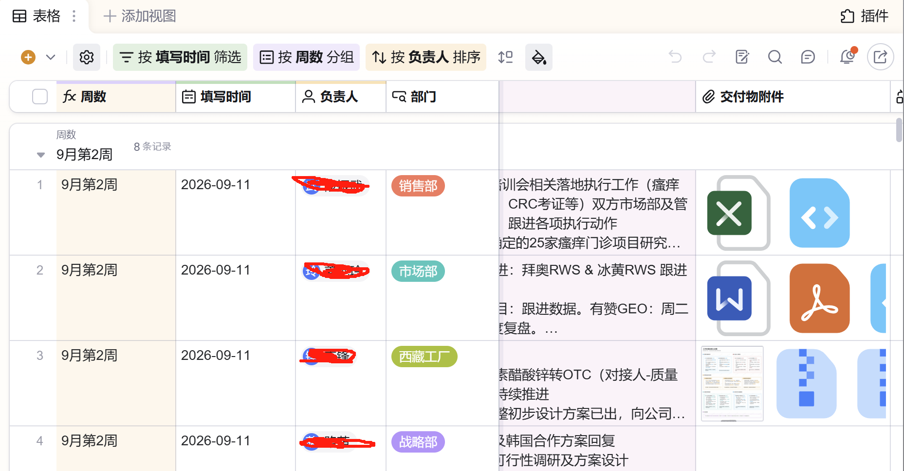

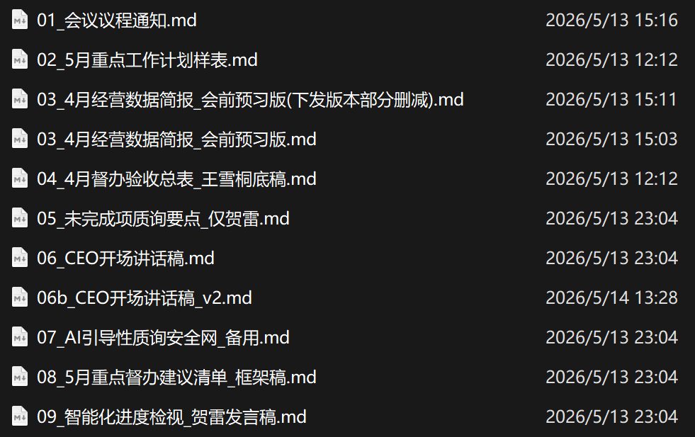

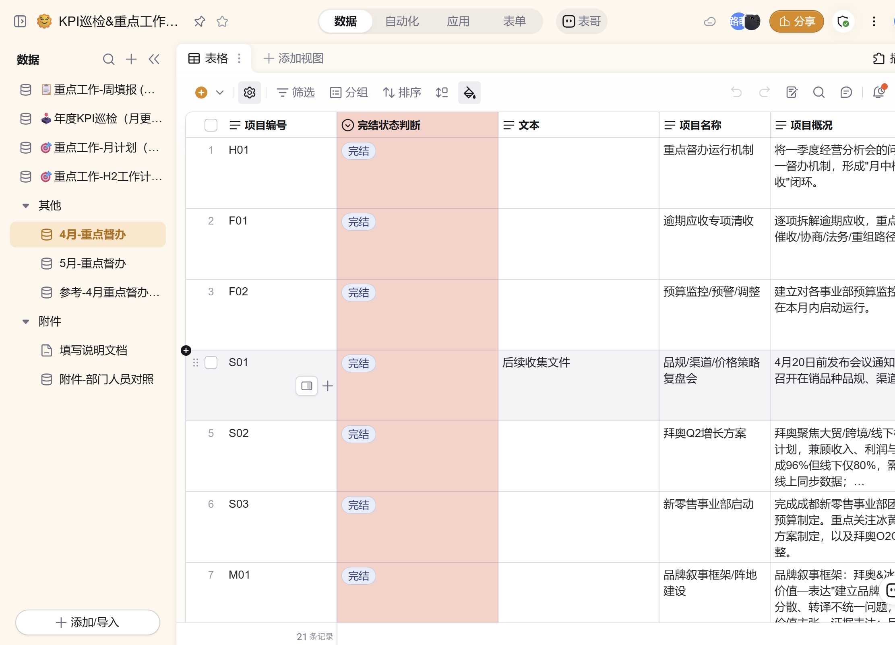

这就是组织侧 AI 落地最难、也最关键的一步：不是先教会所有人用工具，而是**先替公司找到那个“足够小、足够真、价值又高”的第一场景**。

下面，我们还收集了一大堆类似的案例：

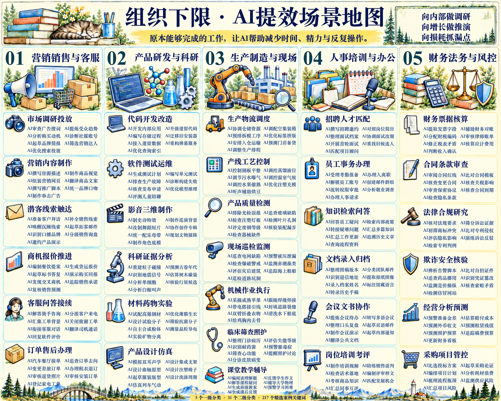

### 背后的专业度

大家感受到组织侧“**AI落地**”的感受了么？更像是什么？

这个场景，大家可以试着把AI理解成你的新员工：

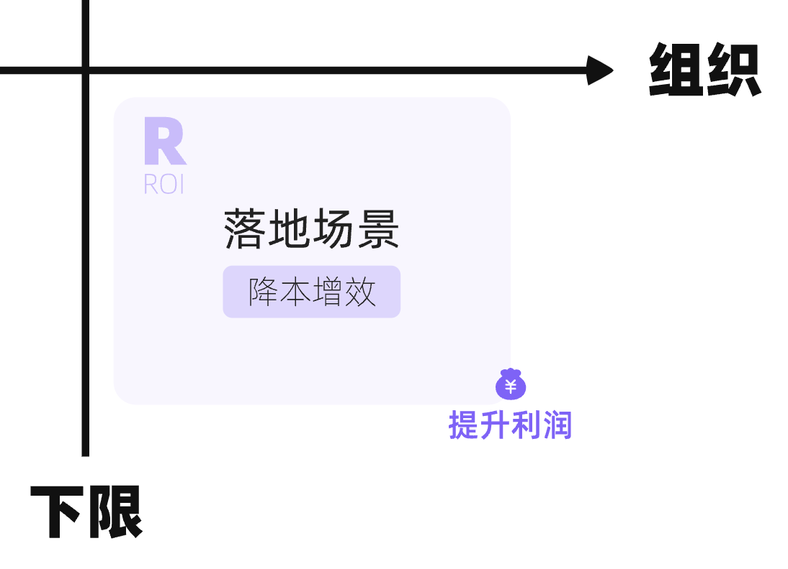

一共有四个关键词：
1. **员工：**不是单纯工具，而是可以自己分析、自己解决问题的“虚拟员工”。
2. **新：**新加入你的公司，没有上下文，你可能要给足够多信息TA才能上手。
3. **潜力很好：**非常勤奋、努力、可以7x24小时支持你的工作。
4. **独特工作习惯：**和人类工作习惯不同，需要使用AI的思维方式和工作流。

**想象一个场景：**在一个创业空间有大量公司，孵化器统一给每个公司分配了一批员工可以几乎免费用，你如果能带好就能大幅提升你的收入和利润。

这个就是摆在我们所有人面前的一道题目。

在这里，我想特别提一个新的理念：**第一黄金场景。**

任何一个业务想要“AI化”都非常困难，各种阻力，最关键的是找到第一个“**黄金场景**”，也就是足够小足够真实，然后完成AI启动，然后整个公司看到结果，就会自动转起来，后面才能滚起来。

下面我简单讲一讲，找到“第一黄金场景”，大家通常要迈过的三关：

很多人为了练习，做了很多公司热门项目：爆款视频，AI写作，AI写PRD，AI做调研，找了很多教程，做了大量复刻。

但是往往发现，学习还行，但推动落地非常难，问题出在哪儿了呢？

**公司落地，一定要极度务实，用真实的、业务真正高价值的目标来做**，而不是简单的“这试一下”“那试一下”，做了很多玩具，看似很专业，但对于业务没有太实质的帮助。

所以第一关，要想在公司落地，一定要带着明确的业务目标去分析。

这是第一关，我们来看第二关。

我们这次磨课过程中，很多团队的AI落地、降本增效还是太难了，遇到了大量卡点：很多人把AI当成是一个很牛的成熟员工，误以为AI是一个“**神奇的黑盒**”，期待“一键输入问题，自动输出完美方案”。

然后试着用AI写方案、做PPT、写脚本、写程序，最后发现质量远不如原来的专家，一次次试错就扔掉了。

到底问题出在哪儿了呢？

————

就像基本功一样，最难的是找到第一个关键的小场景，不求大，要求真和透，先在一个小的点上拿到结果，让团队找到信心，找到落地体感，一旦让团队都看到了AI的显著作用，公司的AI飞轮会自己滚起来，就很容易自己自发找场景了。

**【重点💡】**一个好的“关键小场景”探索成功的标志：**真实有用，难以回退，建立信心，启动循环。**

和拆解组织的基本功一样，拆解AI场景往往是一样的，需要找到业务卡点里面的关键小场景，往往是拆到-2-3-4甚至-5层往往才可以。

什么意思呢？比如有人想在公司做一个“通用爆款脚本”Agent专家，直接替换or超越原来的专家，但凡你之前团队基础好一些，真的不现实，我们要试着剥离：

- **剥离1层：**只做**素材投放类视频**，其他品牌类、口播类、Vlog都不管；
- **剥离2层：**拆解整个节点过程，比如调研 - 打分 - 抽离故事线 - **改写** - 拍摄 - 剪辑。
- **剥离3层：**甚至改写还是太大了，它就能解决其中一个关键卡点：**匹配10个idea；**

最后很有可能，你做出来的非常有效的AI助理，是“灵感激发师”，找到市场上一个高流量对标爆款，拆解分析框架以后，AI和库里N个历史脚本结合，**出10个选题idea供IP挑选**，挑选初筛后再精写脚本，这个大大增加了内容团队处理的带宽和工作效率。

尤其是在早期能力不够、数据不够的时候，我们大概拆解到一个非常非常小的颗粒度，往往才有机会发挥AI显著巨大的价值。

再举一个例子，某公司开始试着想做一个“合同审核”的AI工具，发现效果很差；后面细化到了"**某一类合同事实性校对**"，效果就很好。

再举一个例子，某公司想做一个“绩效AI助理”，发现效果很差，根本不现实；后面就细化到“**绩效收集和沟通填表**”的多轮对话，效果就很好。

再举一个例子，有人想试着做一个“AI诊断”的助手，难度极大，短期不现实；后面一路细化到一个具体场景，替换**“手工填表” **or  **"手写表AI自动录入"**，用了微调训练以后，准确度很高，大幅降低了低效的人工录入时间，效果就很好。

再举一个例子，AI参与做课，做一个AI课程产品经理不现实，于是我们开始聚焦测“AI写逐字稿”的场景，但是发现直接用LLM效果很差，距离合格线很远，怎么办呢？

于是我们开始剥离，最后拆解到一个很具体的小场景“**给录音稿+知识点清单+对标参考，写逐字稿初稿**”，且用特定的大模型和上下文充分的情况下，基本上初稿可用，可以帮我们节省整体50-80%的时间。

早期探索场景，如果我们划分成“**会不会拆解**”、“**懂不懂怎么做**”四个象限，我们要努力去寻找“能拆解比较细&过去足够懂”的象限，更容易AI落地。

好了，到这里你大概能找到大量的选项，那问题来了，这么点子先做哪个呢？下面是第三关，怎么做减法。

**【提问🙋🏻‍♀️】**你们考虑“场景优先级”考虑哪些非常重要的维度呢？

————

简单说，本质上就是考虑ROI问题，AI投入和长期收益的平衡，看似简单，但实际很复杂，我们复习一下科学决策的模型：

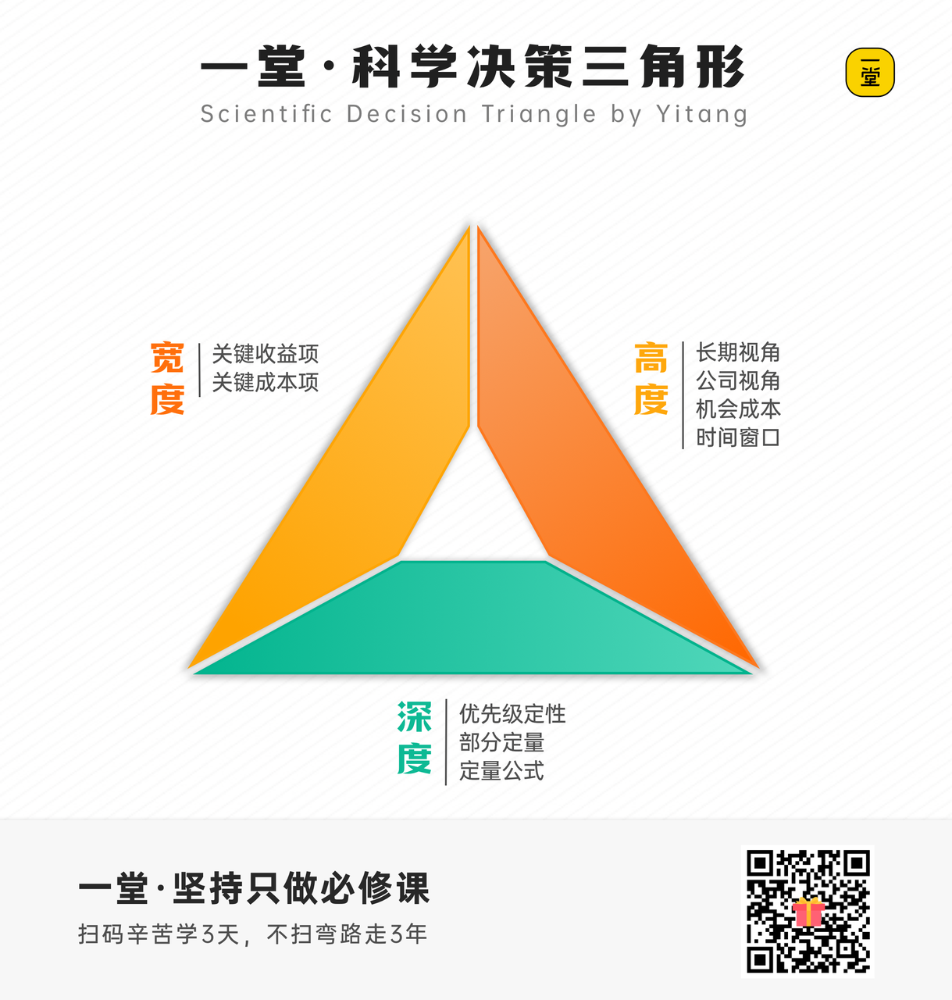

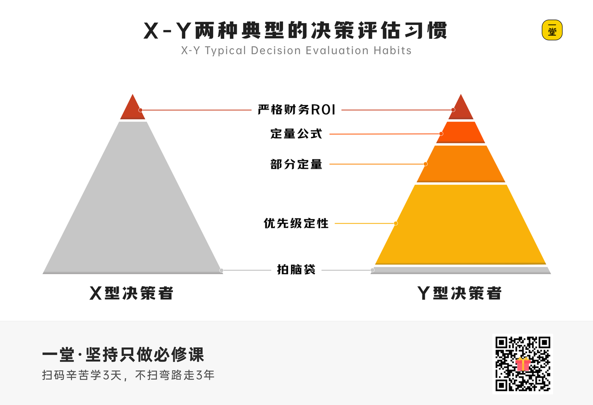

综合来看，有没有可能有一个完整的模型呢？除了刚才的《灵感闪现文档》和《大胆设想文档》，这节课给大家第三个文档模板：

**第三套文档：《场景评估文档》**

一般来说，任何一个公司or业务，都有几十上百个各种各样的场景，哪些最值得先做呢？如何评估？

**【提问🙋‍♂️】**大家一般会思考哪些角度？

————

本质上是个ROI问题，所以我们还是用矛盾辩证的方法来解读，一般来说：

- **收益**考虑四个维度：**价值差异，复现频率，规模卡点，核心能力。**
- **成本**考虑四个维度：**容错高低，流程清晰，决策明确，数据可行。**

选不选，本质上其实就是这4v4不断对抗取舍的过程而已。

我试着把这八个维度做了基础对应，以及展开成解读工具，就有了一个画布：

#### AI场景取舍评估画布

**价值侧：实现以后的收益**

**成本侧：实现过程的卡点**

**A1.价值差异**

AI化以后，对效率/价值影响多大，能否量化成财务指标

**B1.容错高低**

是否有人判断，对于错误的宽容度如何

**A2.复现频率**

多久执行一次，是低频还是高频

**B2.流程清晰**

业务流程是否清晰标准化

**A3.规模卡点**

是否是你们复制规模化的规模经济卡点

**B3.决策明确**

是否有清晰的判断和评价逻辑

**A4.核心能力**

是否是你们对外的核心竞争力

**B4.数据可行**

是否有足够多的数据，AI友好可以接入AI使用

注：可以1-10分打分，并且增加事实论证解释

> 这只是V0.1初步框架，后面AI场景落地篇，我们会做一个更正式的模型。

这里面多数模块相对容易理解，但有两个角特别说明一下。在实际落地过程中，我们搜集了很多案例，发现很多场景看似ROI极高，但是最后效果都很差，就是因为这两个角：

**B1.容错性。**为什么有些场景AI化落地很难，往往卡在这个容错性上。不同业务容错性完全不同，比如写文案、做策划、做图相对容错性很高，出现问题也不大；

但如果是精准的控制、大客户的VIP客服，医疗诊断等等，对于10%甚至1%的错误是不能容忍的，AI落地难度就大很多，之前人类工作流程里积累的大量容错机制不能复用，得从头一点点测试，各种模型和方案不断AB测试，去调试一个合格的方案出来。

感觉业务的“容错性”能单开一节单独的进阶课了，后面如果大家呼声很高，我们沉淀到更多这方面的专家和案例，我们再尝试深度解解这个题。

**B4.数据可行性。**有些细分场景需要足够多的上下文、专家知识去构建，甚至需要大量标注过的优质数据，大量数据才能做到足够ok的水准。

在访谈时候，有不止一个AI落地专家都反复强调“**AI数据闭环**”的意识，遇到高难度的业务场景，要分析能不能找到一个方式，持续生产数据、喂给AI数据、并且根据结果不断调整数据，构建一个数据循环对某些业务非常重要。

举个例子，我有两个场景“复盘营发消息AI化”和“作业系统AI专业化”，部门不一样，维度不一样，如果非拉一起，就很容易吵架，但是画在表里，就一目了然了：

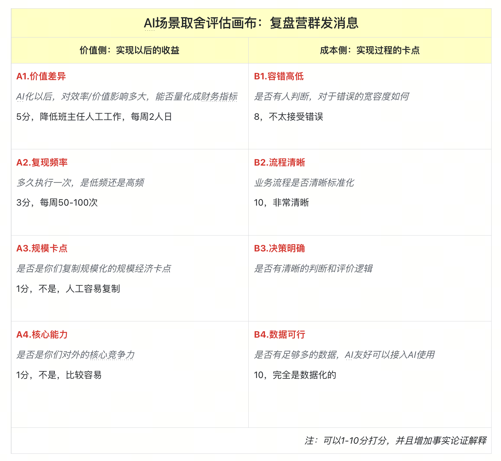

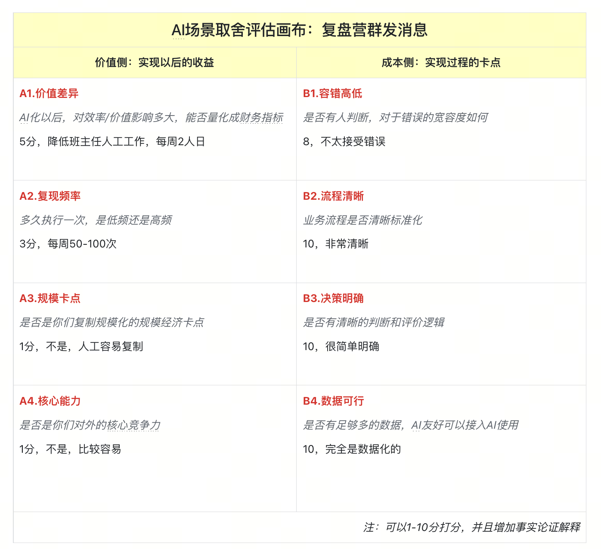

> 复盘营群发（10+38），作业点评（33+28），复盘营成本更优，但作业点评价值远远更大。

好啦，加法减法我就讲完了，大家自己试着想一想，你自己业务，哪些场景可能是高价值的AI落地场景呢？

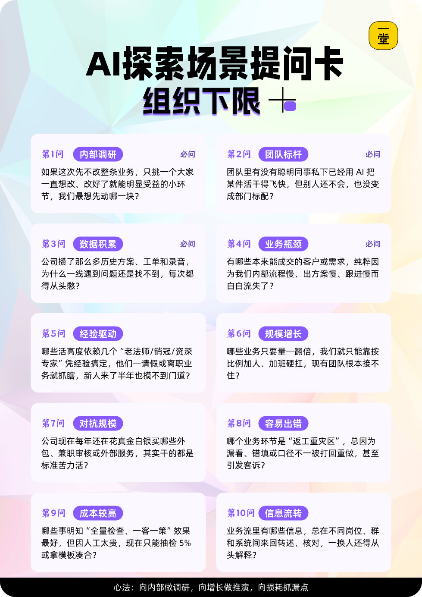

好啦，讲完了提速、探索和落地，最后一个，最难也是未来很多人最渴望的一个场景，就是：变革。