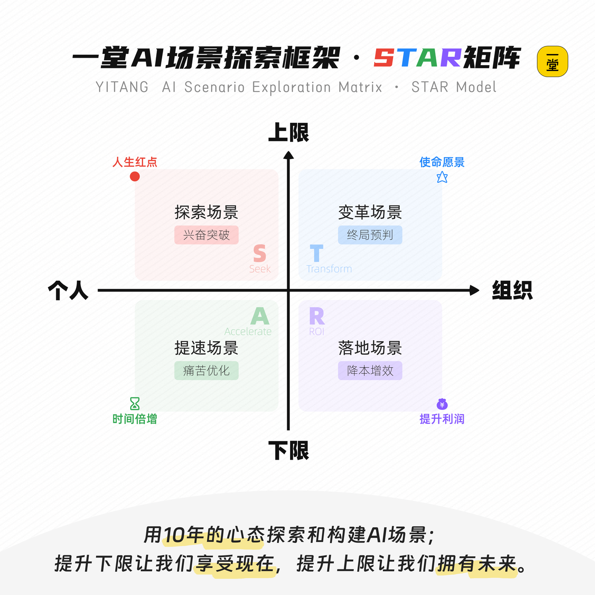
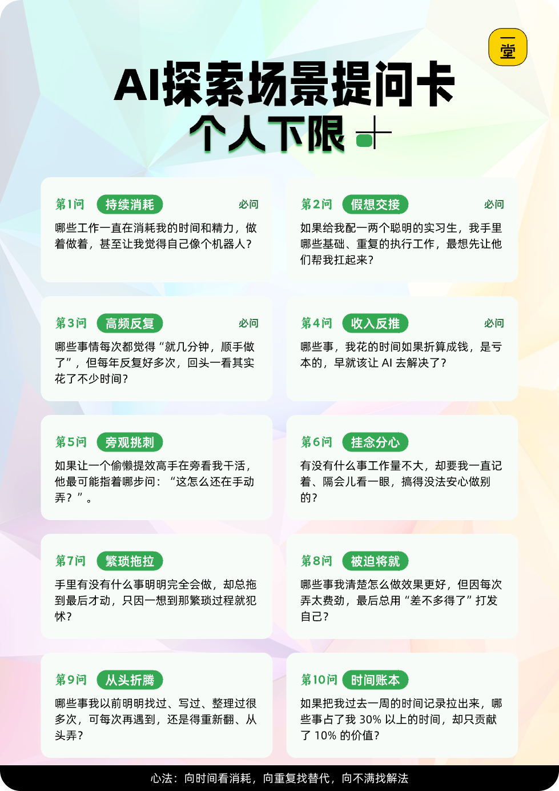
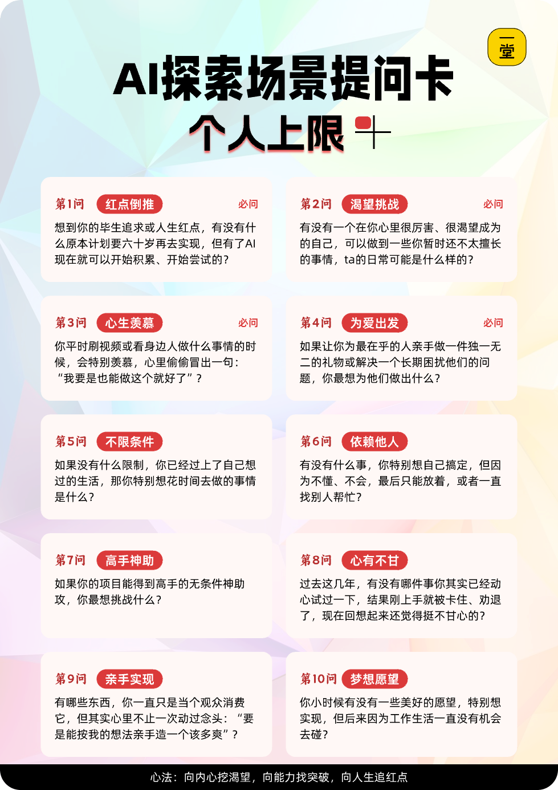
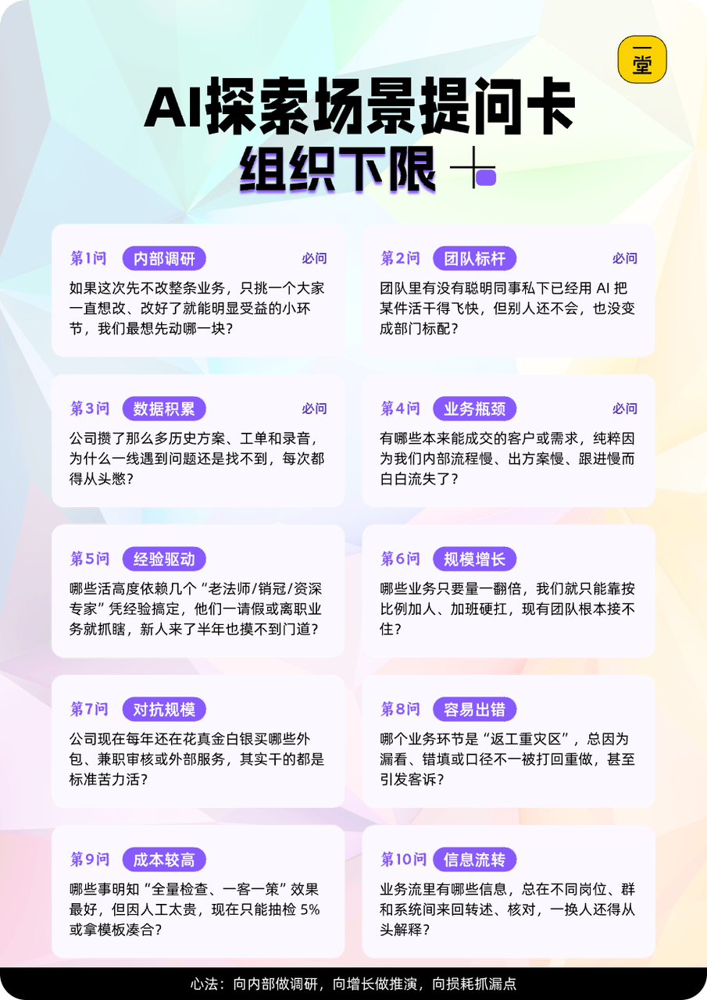
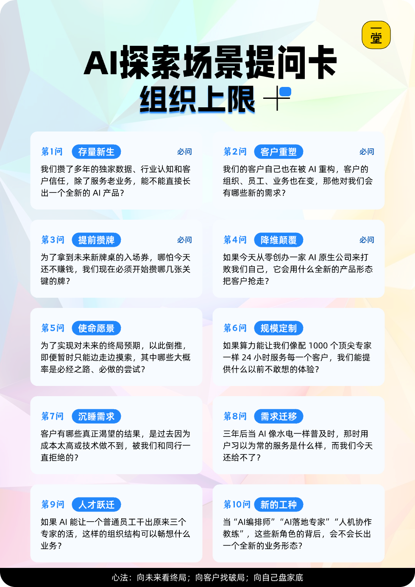
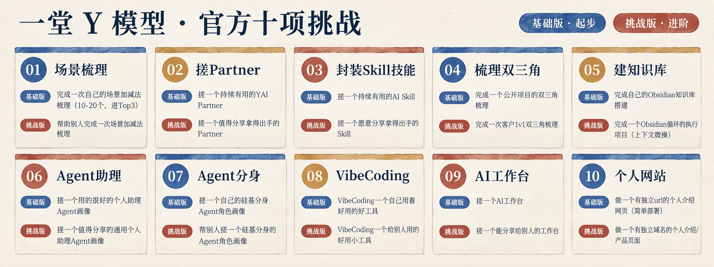

## 重新理解“场景STAR模型”

### 快速回顾：这节课必知必会

好啦，这张图我就讲完了，我们重新看一遍，有没有感觉通透多了：

这是一个螺旋上升的过程：

- **个人下限A**，往往是“**敏感逻辑**”：对于低效敏感，然后上AI，然后拿到结果，然后越来越敏感，各种事情开始用AI，越来越高效自动化。
- **个人上限S**，往往是“**想象逻辑**”：对于美好的期待敢于想象，然后上AI拿到结果，然后越来越有信心，就敢越挑战更高的AI难题。
- **组织下限T**，往往是“**算账逻辑**”：对于某些环节上AI，要算算ROI成本跟收益，需要理性和下决心，往往才能对抗组织惯性，才能推得动。
- **组织上限R**，往往是“**攒牌逻辑**”：一时半会实现不了，努力预判下一个稳态，然后一点点攒牌，积累认知、能力、数据，把最后的大牌攒出来。

如何落地，我给大家准备了四张卡牌：

同时也给了大家三套工具：**《灵感闪现文档》《大胆设想文档》和《场景评估画布》。**

这三套工具，可以帮大家把“随机想法”变成一套可计划、可沉淀、可迭代的场景工作体系。

在最后，我想讲，“**场景**”对于AI，特别像“**需求**”对于一堂五步法，这是一切工作的起点。

- 如果你找不到几个，那你的AI探索就会非常缓慢、滞涩；
- 你的场景找的多，你的AI探索就能源源不断、永不停歇；
- 如果你混乱，场景没有章法，那么你执行也会很飘忽不定；
- 如果你逻辑清晰、场景有条不紊，你的执行逻辑也就不会慌张。
- .....

希望每个人都能拥有自己的AI场景清单，敢于大胆设想，一步步把AI落地吧。

**🎁 礼物：**在课后Candy里面，我们会送你们一套“超级案例包”，包含**2000+**真实案例清单，你如果实在觉得场景很少，可以试试，让AI巡查下你的信息，匹配这些案例，给你一组AI场景建议。

最后，我猜很多人的卡点，往往不是“**没有场景**”，而是“**做不出来/焦虑/害怕**”，反而不敢想了。所以很早我就一个设想：**一堂官方给大家做一套任务集，从简单到难，大家可以在这个演习场挑战。**

### 正式官宣：一堂闯关任务集

AI进阶，其实最难的就是从0到1，第一次动手拿到结果爽那一下。既然大家容易慌&丧，不如我们官方给大家一套任务吧，配上任务说、官方说明、参考案例，尽量降低大家第一次的难度。

一共划分了10个阶段，并且按照难度，我们分为了“**基础版**”和“**挑战版**”，基础版提供给大家和大航海的同学来做。挑战版作为AI高手营的同学来重点挑战。

如果大家这节课场景课觉得难以落地，可以专注先把这些“一堂官方任务”试着挑战一遍，有了基本信心，也看到了大量的同学案例，有了见识，自己再做也就没那么难了。