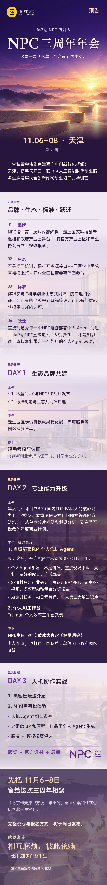

## ⛰️一堂NPC共创领袖培养计划周日开启申请！（⏰限时1周）

💥 不止于共建：一堂私董会生态“共创领袖”（NPC）第7期召集令

过去3年，我们见证了200+同学从“学习者”成长为“引领者”和“共建者”。今天，第 7期一堂私董会领队NPC召集窗口启动，从“共建”走向“共同成就”。

我们不寻找单纯的“志愿者”，而是进行一场关于领导力投资，以及“通过组织创新推进科学创业”的社会实验。我们寻找的是志在成为中国精益创业的领导者、科学创业生态的共建合伙人。

🙋新NPC名额：仅20席 

⏳窗口期：5天（10月23日截止）

‼️请留意：文末的 2 个申请信要求

🚪特殊参与：全国私董会幕僚和案主，可只参加第二天活动或第二天社交晚宴

⛰️名单查询：第6期NPC和全国幕僚名单🔗https://npclist.netlify.app/

📄 招募详情：

### **Yitang活动小助手上线**

这是一项重要的服务升级，关乎到每一个一堂会员的体验升级。

我先说一下背景啊 ，很多同学来了一堂之后给了我们一个很有意思的的评价：「一入一堂深似海」。

你会发现在一堂，每一周都有大量的会员活动：四大俱乐部、城市活动、训练营、大航海····

我们的初衷是希望大家能在一堂有更多成长的机会，但是随着活动增多，我们发现大家陆陆续续遇到了一些困扰：

- **消息淹没：**活动通知被聊天记录淹没，转眼就错过报名
- **活动密集：**每周 4 大俱乐部、线上训练营、训战营活动扎堆，「选哪个」「会不会撞时间」纠结到放弃
- **收集困难：**在大量的活动群里收到听课、回放、作业、报名提醒···信息收集非常不容易

大家的难处，其实班班们都看在眼里，也急在心里。

所以，这一次，玖月班班们主动发起了这个升级体验的假设：给每一个会员同学配上一个你的专属——**Yitang活动小助手。**

介绍一下小助手的作用，这是一个专门给大家**汇总活动类消息**，**个性化推送**的新账号，它有 3 个价值：

- **精准不打扰：你可以按兴趣订阅活动，我们只推 “你想看” 的活动**，想看的活动准时提醒，无关的消息一概没有～
- **省心不费脑：**每周自动汇总「线上活动精华」，「同城线下活动」，3秒掌握重点，省出80%筛选时间！  
- ** 抢先有特权：** 你感兴趣的新活动上线…第一时间通知你，让你抢先报名！  

简单来说，**Yitang活动小助手**就是给你们配了一个活动管家，一个助理，一个秘书。

大家注意啊，原来的玖月班班依旧会继续服务大家，不过以后2 个账号会有职责上的不同。

